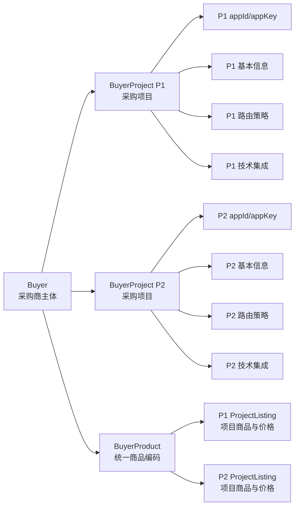

# 供应链中台采购商项目化设计方案

> 文档状态：方案已确认  
> 编制日期：2026-08-21  
> 适用范围：供应链中台采购商主体、采购项目及项目级采购能力

## 1. 背景

现有供应链中台将采购商主体、接入身份、商品授权、结算价格、账户、路由和订单隔离统一放在 采购商 维度，只能表达“一个采购商对应一个接入项目”。

业务需要支持同一个采购商主体下接入多个项目，并允许各项目独立配置：

- 接入凭证和集成方式；
- 可采购商品范围；
- 项目结算价格和展示名称；
- 结算账户；
- 标准商品供应商路由；
- 订单、用户、事件和查询权限。

因此需要将“采购商主体”与“实际采购接入单元”拆开，形成 `采购商 + 采购项目` 两级模型。

## 2. 已确认的业务边界

本方案基于以下已确认规则：

1. 一个采购商主体维护一个项目集，一个项目只能属于一个采购商主体。
2. 每个项目拥有独立 `appId/appKey`，供应链中台通过项目凭证识别业务归属。
3. RPC 和 HTTP 都可接入，但使用同一套项目认证和业务幂等规则。
4. 采购商主体统一维护商品编码，项目不能为同一平台 SKU 创建不同商品编码。
5. 项目可以独立配置可采购范围、展示名称和采购商品结算价。
6. 支持采购商主体默认目录和项目独立目录；主体变化必须经过项目审批后才能生效。

## 3. 设计目标

### 3.1 核心目标

- 明确区分稳定采购商主体与独立采购项目。
- 防止商品、价格、账户、订单和用户在不同项目间串用。
- 使项目配置可审批、可发布、可追溯，并保证在途订单不受后续配置变化影响。
- 统一 RPC、HTTP 的身份认证、请求签名和幂等语义。
- 支持项目共享主体资源，同时允许有隔离要求的项目使用独立配置。
- 保持标准商品、O2O、到店购共用订单和资金主干，但不混合各场景的商业规则。

## 4. 总体方案

采用“采购商主体统一治理，采购项目独立运行”的两级模型。



各模型只回答一个核心问题：

| 模型 | 核心职责 |
|---|---|
| `Buyer` | 哪个稳定组织主体在中台采购？ |
| `BuyerProject` | 本次业务属于该主体下哪个独立接入项目？ |
| `ProjectApplicationIdentity` | 中台如何认证并定位采购项目？ |
| `BuyerProduct` | 采购商主体如何统一标识平台商品？ |
| `ProjectListing` | 项目可以采购哪些商品，使用什么展示名称和结算价？ |
| `ProjectCatalogRelease` | 一组项目商品变更何时经过审批并原子生效？ |
| `ProjectAccountAssignment` | 项目新订单使用哪个真实资金账户？ |
| `ProjectRoutingPolicy` | 项目采购标准商品时可以选择哪些供应商及其顺序？ |
| `BuyerIntegrationProfile` | 中台如何调用该项目的收银台和事件接收端？ |

## 5. 采购商主体与采购项目

### 5.1 采购商主体

`Buyer` 表示稳定采购组织，负责：

- 维护采购商基本身份和合作状态；
- 维护项目集合；
- 维护主体统一商品编码；
- 维护主体目录模板；
- 维护主体共享资金账户；
- 提供跨项目统一管理视图。

Buyer 不再作为采购商侧请求的认证身份。Buyer 暂停时，其下所有项目停止新业务，但历史查询、在途订单恢复、资金收敛和事件投递继续执行。

### 5.2 采购项目

`BuyerProject` 是实际接入和采购边界，具有永久唯一的 `projectCode`。项目创建后不能转移到其他 Buyer；归属错误时应关闭旧项目并重新创建。

项目生命周期：

```text
DRAFT → ACTIVE ↔ SUSPENDED → ARCHIVED
   └────────────────────────→ ARCHIVED
```

- `DRAFT`：配置中，不能接收业务请求。
- `ACTIVE`：允许已开通能力的新业务。
- `SUSPENDED`：停止新业务，继续历史查询、目录下架同步、在途恢复和事件投递。
- `ARCHIVED`：永久停止新业务，项目编码不得复用。

项目可分别开通标准商品、O2O、到店购能力。暂停项目只影响本项目，不影响同一 Buyer 下其他项目。

## 6. 项目应用认证

### 6.1 身份解析

供应链中台不再使用 `sourceSystem + externalTenantId` 判断采购商侧业务归属，而是使用：

```text
appId + keyVersion + request signature
→ ProjectApplicationIdentity
→ BuyerProject
→ Buyer
```

- 一个项目对应一个稳定 `appId`；
- `appId` 全局唯一，密钥轮换时不改变；
- `appKey` 是可轮换秘密，只在创建时显示一次；
- `appKey` 不明文落库、不再次返回、不写日志。

### 6.2 RPC 与 HTTP 统一签名

RPC 元数据和 HTTP 请求头统一携带：

```text
appId, keyVersion, contractVersion, operationCode,
timestamp, nonce, requestSha256, signature
```

两种传输必须对同一业务请求生成相同的规范请求摘要和 HMAC-SHA256 签名。业务 DTO 不传 `buyerId/projectId`，防止调用方伪造项目归属。

同一项目可以发布 RPC、HTTP 或两者，但中台不能在一种传输失败后自动切换另一种传输。跨传输重试必须复用原业务幂等键和相同业务请求。

### 6.3 密钥轮换与防重放

- 密钥版本状态为 `CURRENT/GRACE/REVOKED/EXPIRED`。
- 一个应用最多一个 CURRENT 和一个短期 GRACE 密钥。
- 时间戳默认允许正负五分钟偏差。
- Nonce 按 `appId + nonce` 唯一，防重放存储不可用时读写请求全部失败关闭。
- 未知 appId、错误签名、错误密钥版本和重放统一返回认证失败，避免枚举项目。

## 7. 商品、目录与价格

### 7.1 主体统一商品身份

新增 `BuyerProduct`，用于保存采购商主体统一的 `buyerSkuCode` 与平台 SKU 映射。

主体内必须满足：

```text
(buyerId, platformSkuId) 唯一
(buyerId, buyerSkuCode) 唯一
```

`BuyerProduct` 不保存项目可采购状态、项目结算价、展示名称或供应商路由。

### 7.2 项目采购商品

`ProjectListing` 表示项目对一个 BuyerProduct 的采购授权。不同项目可以对同一 BuyerProduct 配置不同的：

- 可采购状态；
- 展示名称；
- 采购商结算单价；
- 生效时间；
- 继承、覆盖或排除来源。

项目结算价表示“该项目向中台结算的单位价格”，不表示 C 端零售价，也不表示供应商成本。

### 7.3 采购商-项目配置模式

| 模式 | 行为 |
|---|---|
| `MANAGED` | 主体模板变化后生成项目待审批变更，项目批准后才生效。 |
| `INDEPENDENT` | 项目自行选择主体已有 BuyerProduct 并维护商业配置，不接收主体模板变化。 |

主体模板只提供推荐配置，不直接改变项目线上目录。运行时只读取项目已经发布的完整结果，不动态执行“主体默认 + 项目覆盖”。


发布时在同一事务中完成商品版本、当前版本指针、项目目录版本、变更游标和目录事件。任一商品冲突时整批回滚，不能出现部分商品已生效、部分未生效。

主体再次修改模板时，不允许静默覆盖项目已有草稿；旧基线批次必须重新生成或显式解决冲突。

## 8. 订单、用户与幂等

### 8.1 订单归属

所有新订单必须保存 Buyer 与 Project 双重归属及快照：

```text
buyerId, buyerCode/name snapshot,
projectId, projectCode/name snapshot,
buyerUserId, orderType,
buyerSettlementAmount, currency
```

标准商品订单还要保存 BuyerProduct、ProjectListing、项目商品版本、项目价格和项目路由快照。

### 8.2 用户隔离

`buyerUserId` 只在项目内唯一：

```text
(projectId, buyerUserId)
```

相同 buyerUserId 在不同项目中可以代表不同用户。订单、履约资产、O2O 用户绑定、到店购授权凭证和会员转发都必须校验项目，禁止跨项目查询或消费。

### 8.3 项目级幂等

标准商品永久幂等键调整为：

```text
(projectId, buyerOrderNo)
```

- 不同项目可以使用相同 buyerOrderNo；
- 同项目同键同请求返回原订单；
- 同项目同键不同请求返回幂等冲突；
- RPC 与 HTTP 重试命中同一订单事实。

认证失败、主体暂停、项目暂停或场景能力未开通时不创建订单。项目身份已解析后，商品未授权、版本过期、账户未配置或路由无候选时，标准商品创建 FAILED 订单，但不创建履约请求、供应商订单和资金事实。

## 9. O2O 与到店购边界

项目化分为“统一身份归属”和“项目商业配置”两层：

| 能力 | 标准商品 | O2O / 到店购 |
|---|---:|---:|
| 项目 appId/appKey 认证 | 是 | 是 |
| 订单、用户、事件按项目归属 | 是 | 是 |
| 项目账户指派 | 是 | 是 |
| 项目集成档案和收银台 | 是 | 是 |
| 项目商品和结算价 | 是 | 否 |
| 项目供应商路由 | 是 | 否 |

O2O、到店购继续以渠道金额作为采购商结算金额，不建立项目商品或项目报价。外部渠道调用中台时继续使用各自渠道协议身份，但该身份也必须唯一恢复项目。

项目暂停时，新的标准商品、O2O 和到店购业务全部停止；在途订单、退款、资金恢复和事件投递继续收敛。

## 10. 管理端流程

项目创建与激活流程：

```text
创建 DRAFT 项目
→ 生成 appId 与首个 appKey
→ 配置项目基础信息
→ 发布账户信息
→ 发布项目技术集成
→ 配置项目商品信息与路由规则
→ 执行激活
→ ACTIVE
```


## 11. 总结

本方案将采购商模型从“一个 采购商 对应一个接入租户”升级为“一个 采购商 维护多个独立 采购项目”：

- Buyer 负责稳定主体、统一商品编码和共享资源；
- BuyerProject 负责应用身份、商品发布、价格、账户、路由、集成和业务隔离；
- RPC、HTTP、标准商品、O2O 和到店购统一归属项目；
- 标准商品具备项目级商业配置，场景订单暂时保留渠道金额和固定 Supplier 规则。
