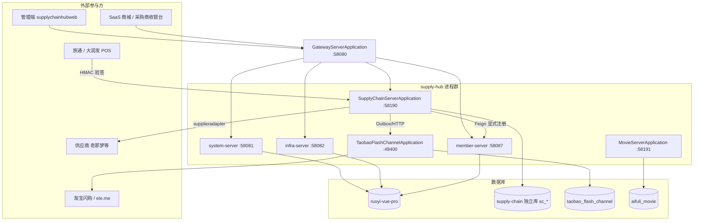
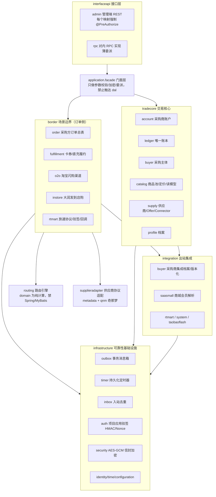

# 供应链中台系统架构总览

> 版本：2026-09-23
> 范围：supply-hub 仓库全部可部署进程，重点是供应链中台（`aifuli-module-supply-chain`）的核心模块划分与数据流。
> 上游依据：`AGENTS.md`（仓库形态约束）、`docs/superpowers/specs/2026-09-07-supply-hub-repo-split-design.md`（拆仓）、`docs/superpowers/specs/2026-08-04-supply-chain-core-design.md`（一期核心设计）、`CONTEXT.md`（统一语言）。

---

## 1. 系统定位

本仓库是**供应链中台后端**，由 `aifuli-mall-pro` 拆分而来（孤儿快照迁入，`mall`/`pay`/`erp` 已删除）。核心职责：

- 维护平台标准商品池（SPU/SKU）、供应商供给（SupplierOffer）与三级结算价（L1/L2/L3）；
- 面向采购商项目（BuyerProject）提供统一采购订单（Supply Chain Order）与履约协同；
- 支撑三类履约场景：**标准商品（卡券/直充）**、**O2O 渠道（淘宝闪购/盒马）**、**到店购（大润发/旅通）**；
- 提供采购商账户唯一账本、资金冻结、对账与调账能力；
- 为管理端（`supplychainhubweb`，前端仓库位于 `/Users/mac/Documents/codeSpace/supplychainhubweb`）提供运营 REST。

商城（SaaS mall）只能通过中台接口/事件获取数据，**禁止直连中台库**。

## 2. 部署架构

仓库内共 **8 个可独立启动进程**，基于 Java 21 + Spring Boot 3.5.9，经 Nacos 注册发现，统一由网关暴露。

| 进程 | 模块 | 默认端口 | 数据存储 |
|---|---|---|---|
| `GatewayServerApplication` | `aifuli-gateway` | 58080 | 无 |
| `SystemServerApplication` | `aifuli-module-system` | 58081 | `ruoyi-vue-pro` |
| `InfraServerApplication` | `aifuli-module-infra` | 58082 | `ruoyi-vue-pro` |
| `MemberServerApplication` | `aifuli-module-member` | 58087 | `ruoyi-vue-pro` |
| `AifuliServerApplication` | `aifuli-server`（仅聚合 system + infra，member 依赖已注释） | 48080 | `ruoyi-vue-pro` |
| `SupplyChainServerApplication` | `aifuli-module-supply-chain/aifuli-module-supply-chain-server` | 58190 | **独立库**（环境变量 `AIFULI_SUPPLY_CHAIN_DATASOURCE_*` 注入，表前缀 `sc_*`） |
| `TaobaoFlashChannelApplication` | `aifuli-module-supply-chain/aifuli-channel-taobao-flash-server` | 48400（context-path `/taobaoh5`） | 独立库 `taobao_flash_channel` |
| `MovieServerApplication` | `aifuli-module-movie-server` | 58191 | 独立库 `aifuli_movie` |

数据所有权铁律：

- 供应链进程使用**独立数据源 `supplyChainDataSource`、独立事务管理器 `supplyChainTransactionManager`**，Liquibase 管库（`db/changelog/db.changelog-master.yaml`）；表名统一 `sc_*` 前缀，表间无物理外键。
- 供应链代码**不得访问** `system_*`、`member_*` 等其它模块的表；管理端菜单与数据字典由 `script/deploy` 部署 SQL 写入 system 库。
- 淘宝闪购渠道服务只存协议 inbox、调用日志、单号映射、原始账单，**不持有业务订单真相**；电影服务同理独立，均不得并入供应链容器。

网关路由（`grayLb://` 服务发现）：`/admin-api/system/**`→system、`/admin-api/infra/**`→infra、`/admin-api/member/**`→member、`/admin-api/supply-chain/**` 与 `/app-api/supply-chain/**`→supply-chain（后者可被 `AIFULI_GATEWAY_SUPPLY_CHAIN_URI` 覆盖）。



## 3. 供应链服务内部分层

`aifuli-module-supply-chain-server`（包根 `com.aifuli.module.supplychain`）是单进程、多逻辑模块的结构；逻辑模块之间只能经 Interface 协作，禁止跨包访问 DAO/Mapper，由 `SupplyChainModuleArchitectureTest`（ArchUnit，27 条规则）强制。



各分层职责与硬约束：

| 分层 | 职责 | 关键约束（ArchUnit 强制） |
|---|---|---|
| `interfaceapi.admin` | 管理端 REST（运营档案、定价、路由规则、订单只读/售后等） | 每个 HTTP 映射必须有 `@PreAuthorize`；不得依赖 `supplieradapter`；禁用 `@DataPermission` |
| `interfaceapi.rpc` | 对内 RPC 实现 | Instore RPC 实现为薄委派，不得依赖 dal/integration/border/tradecore |
| `application.facade` | 对外门面：参数校验、敏感字段加解密、委派 | 不得依赖任何 `..dal..` |
| `border.*` | 订单与三场景（fulfillment/o2o/instore/rtmart）编排，各自 `application/domain/dal` 三层 | 不得访问账户与账本 DAL；`buyerUserId` 永不为 `Long` |
| `tradecore.*` | 账户、唯一账本、采购主体、商品池与定价、供应商供给 | `catalog` 不得写账本/账户 DAL；catalog.application 不得写 Offer 评分 |
| `routing` | 标准商品供给路由 + 场景路由，决策物化为路由轮次/记录 | `routing.domain` 纯计算：禁 Spring/MyBatis/persistence；不感知履约评分字段 |
| `supplieradapter` | 供应商协议适配（当前：奇那梦 qnm），`CompositeOperationExecutor` 统一执行 | 不得访问 `..border..dal..`（适配器不写订单） |
| `integration.buyer` | 采购商集成档案/能力/传输（RPC 或 HTTP Adapter）的版本化路由与快照 | 不得访问场景 DAL（o2o/instore） |
| `infrastructure.*` | Outbox/Timer/Inbox、项目应用验签、信封加密、ULID 单号、数据库时钟、独立数据源 | `auth` 包完全隔离；`ProjectAuthContext(Holder)` 仅 auth 包可触达 |

出站 RPC 一律走**显式注册**的 Feign（`framework/rpc/config/RpcConfiguration`）：

```java
@EnableFeignClients(clients = {MemberProfileResolveApi.class, MemberSsoTokenApi.class, DictDataCommonApi.class})
```

新增外部服务依赖必须显式注册，不得依赖包扫描隐式引入（有 `RpcConfigurationTest` 契约守护）。

## 4. 核心数据模型（sc_* 表分组）

供应链独立库约 100+ 张 `sc_*` 表，按域分组（Liquibase releases/1.0.0 001~043）：

| 分组 | 代表表 | 说明 |
|---|---|---|
| 主数据与身份 | `sc_buyer`、`sc_buyer_project`、`sc_supplier`、`sc_supplier_connector(+_version)`、`sc_brand`、`sc_product_category` | 采购商/项目/供应商/连接器主体 |
| 商品池与报价 | `sc_platform_spu/sku`、`sc_supplier_offer(+_version)`、`sc_inventory_source/snapshot`、`sc_buyer_listing_availability` | 平台商品、供给、库存源与供给可用性 |
| 三级定价 | `sc_platform_sku_pricing`、`sc_buyer_sku_pricing`、`sc_project_sku_pricing`（各含 `+_version`）、`sc_standard_pricing_quote` | L1 平台价 / L2 分销商基础价 / L3 项目专属价，运行时 L3>L2>L1 并冻结进发布版本 |
| 采购商商品与目录 | `sc_buyer_product(+_settlement_price)`、`sc_project_listing(+_version)`、`sc_buyer_catalog_change` | 采购商商品身份、项目采购商品、目录发布批次 |
| 账户与账本 | `sc_buyer_account`、`sc_account_ledger`、`sc_fund_reservation` | 唯一账本；冻结金额 = 已确认 + 已释放 + 剩余冻结 |
| 路由 | `sc_supplier_routing_policy(+_version)`、`sc_standard_product_routing_rule/_candidate`、`sc_scenario_routing_rule/_candidate`、`sc_supplier_routing_round/_record` | 四级特异性规则（分销商+品类 > 分销商 > 品类 > 全局），决策追加式审计 |
| 订单与履约 | `sc_supply_chain_order`、`sc_order_status_log`、`sc_fulfillment_request`、`sc_b_order`、`sc_fulfillment_operation/_asset/_exception_case`、`sc_raw_status_observation` | BuyerOrder 总表 + FulfillmentRequest + BOrder（供应商履约尝试，串行换路） |
| O2O 场景 | `sc_o2o_channel_detail`、`sc_o2o_refund_case`、`sc_o2o_operation`、`sc_o2o_channel_user_binding` | 淘宝闪购整单交易与退款协同 |
| INSTORE 场景 | `sc_instore_channel_order`、`sc_instore_payment_flow`、`sc_instore_refund_case`、`sc_instore_entry_credential` | 到店购交易、支付流水、退款协同、入口授权凭证（仅存 SHA-256 摘要） |
| 渠道绑定 | `sc_supplier_channel_binding` | 渠道外部商户标识 → Supplier 的版本化映射（O2O 用渠道商户号，到店购用 `company_code`） |
| 采购商集成 | `sc_buyer_integration_profile(+_version)`、`sc_buyer_integration_capability`、`sc_buyer_credential_set/_version`、`sc_project_application`、`sc_project_app_credential_version`、`sc_project_auth_nonce` | 集成档案版本化、项目应用身份（appId/appKey 轮换）、验签 Nonce |
| 可靠投递 | `sc_outbox_event`、`sc_timer_task/_execution`、`sc_inbox_event` | 自研异步三件套（无 MQ/Quartz） |
| 对账结算 | `sc_reconciliation_batch/_line/_difference`、`sc_settlement_adjustment_request` | 对账差异 + 人工审批调账，调整只能由账本追加流水 |
| 供应商结算与开票 | `sc_supplier_settlement_account/_ledger`、`sc_supplier_invoice`、`sc_buyer_invoice` | 供应商预存账面账户、开票信息 |
| 观测与审计 | `sc_fulfillment_call_log`、`sc_supplier_error_code_map`、`sc_status_mapping_definition`、`sc_sensitive_access_audit` | 脱敏调用日志、错误码/状态映射、敏感访问审计 |

订单模型的核心不变量（详见 `2026-08-04-supply-chain-core-design.md`）：

- `sc_supply_chain_order`（BuyerOrder）是唯一采购方订单总表，`orderType ∈ {CARD, O2O, INSTORE}`；`FulfillmentRequest` / `O2OChannelDetail` / `InstoreChannelOrder` 为互斥一对一场景详情，**不是另一张订单**。
- 供应商履约尝试（BOrder）按履约请求串行发生，同一时刻最多一张活动尝试；权威失败后才可创建下一轮（**无并行拆单**）。
- 总表公共状态只能由 BuyerOrder 模块按 orderType 注册的 `OrderSummaryPolicy` 汇总类型化事实得出，场景不得直写总表 Mapper。

## 5. 核心数据流

### 5.1 标准商品（卡券/直充）履约

详细时序见 `docs/superpowers/specs/2026-08-10-supply-chain-call-sequences.md#卡券、卡密与直充履约`，要点：

1. 商城调用 `acceptFulfillment(buyerOrderNo, buyerUserId, quantity)`；中台短事务创建/锁定 PROCESSING 回执（受理幂等：同键同摘要返回原结果，同键不同摘要永久冲突）。
2. 事务外校验命令、采集资格事实 → `routing` 计算确定性候选快照（四级特异性规则，策略版本冻结）。
3. 最终短事务原子创建 BuyerOrder + FundReservation（资金冻结） + FulfillmentRequest + 首张 BOrder + Operation；任一步失败则只落 FAILED BuyerOrder（含 failureStage/failureCode），不产生冻结与履约实体。
4. 经 **Outbox** 提交异步履约任务 → `supplieradapter` 以稳定 `supplierRequestNo` 调用供应商。
5. 结果四分叉：权威成功 → 提交采购资金一次；权威失败且有冻结候选 → 原子终结当前 BOrder、串行换路；全部失败 → 释放资金一次、订单 FAILED；**结果未知 → 保持冻结、禁止换供应商/换单号，由 Timer 驱动原键查单**。
6. 订单状态经 Outbox 事件通知商城；卡密/券码资产查询走鉴权 + 敏感访问审计。

### 5.2 O2O（淘宝闪购）渠道交易

1. 入口：商城 `getH5Entry` → 中台创建/读取 `O2OChannelUserBinding`（随机不可枚举 `channelUserId`）→ 渠道服务调 ele.me SSO 换一次性 H5 链接。此阶段**不建单、不冻结**。
2. 下单：用户在渠道 H5 整单 → 渠道通知（Inbox 去重）→ 中台按 `SupplierChannelBinding`（渠道商户号）解析固定商户 Supplier → 创建 BuyerOrder(O2O) + 渠道详情 + 资金冻结 → 调采购商收银台端口支付。
3. 生命周期由 `O2OChannelLifecycle` + Timer 驱动（支付/退款收敛、操作恢复）；退款以 `sc_o2o_refund_case` 协同采购商实际退款、中台账户返还与渠道结果通知。
4. 中台 → 淘宝闪购渠道服务的投递走 Outbox `CHANNEL_NOTIFY`（local 为 HTTP `127.0.0.1:48400/taobaoh5`）。

### 5.3 INSTORE（大润发/旅通）到店购

1. 入口：已登录采购商用户获取扫码购首页/详情页地址；中台签发**到店购授权凭证**（不透明、一次性、默认 10 分钟、库中仅存 SHA-256 摘要）。
2. 旅通持凭证 + 渠道项目应用标识（`Instore Project App Key`）调中台商户接口，HMAC 验签（`infrastructure.auth`）后唯一恢复采购项目；会员资料经 `(projectId, buyerUserId)` 向项目集成端转发，中台不落库会员资料。
3. 交易：旅通创建到店购交易（与旅通订单号一一对应）→ 中台创建 BuyerOrder(INSTORE) + 渠道详情，按整笔交易冻结一次 → 采购商收银台支付，**支付成功即履约完成**；渠道支付流水号（Channel Trade Id）是详情上的支付幂等键，不是子订单。
4. 退款：`sc_instore_refund_case` 支持同交易多笔部分退款（累计 ≤ 实付），已支付取消仅在无退款协同时作为全额退款；旅通主动查退款结果，中台不推送。

### 5.4 主数据与目录同步

运营在管理端发布商品/采购商/供应商/路由规则 → 中台写发布版本 → Outbox 通知商城 `CATALOG_CHANGED`（只负责唤醒）→ 商城按游标 `getCatalogChanges(cursor, limit)` 增量拉取已发布快照（含 tombstone）。商城商品表是消费投影，不得反向修改中台主数据。

### 5.5 定价与结算链

- 运行时取价 **L3 项目专属价 > L2 分销商基础价 > L1 平台默定价**，结果必须冻结进已发布项目商品版本，下单不回源当前价格行。
- 采购商侧：下单冻结 `buyerSettlementUnitPrice × 数量`；O2O/到店购无另行约定时等于渠道支付金额。
- 供应商侧：`SupplierOfferVersion` 冻结履约结算单价 → 预计应结金额（路由/毛利预估用）；供应商报告金额与中台报价不一致时形成**对账差异**，调账只能由唯一账本追加独立流水，禁止直接改账。

## 6. 可靠性设计（无 MQ 的异步三件套）

供应链模块不使用 RocketMQ/Quartz/@Scheduled，而是数据库持久化自研组件（`infrastructure/`）：

| 组件 | 表 | 机制 | 典型用途 |
|---|---|---|---|
| Outbox | `sc_outbox_event` | 扫描-租约-抢占投递（scan 800ms / batch 32 / lease 30s / 8 worker / 退避 5s~10m），`OutboxDispatchHandlerRegistry` 按类型分发 | 履约 Operation 执行、采购商事件 RPC、订单事件、渠道通知 |
| PersistentTimer | `sc_timer_task`、`sc_timer_execution` | 租约 + fencing token + 崩溃恢复，`PersistentTimerHandlerRegistry` 按任务类型分发 | 支付/退款收敛（InstorePaymentConvergenceService 等）、操作恢复、O2O 生命周期、验收生命周期、未知结果查单 |
| Inbox | `sc_inbox_event` | 入站事件按业务键去重 | 渠道回调、支付/退款通知 |

## 7. 安全设计

- **项目应用身份**：采购商 OpenAPI 以 `appId` + 可轮换 `appKey` 认证（`sc_project_application`、`sc_project_app_credential_version`）；`appKey` 仅创建时返回一次，禁明文落库/写日志；验签在 `infrastructure.auth`（HMAC + Nonce 防重放），`ProjectAuthContext` 仅 auth 包可见。
- **到店购渠道身份**：旅通侧独立的 `Instore Project App Key`，禁止跨项目共享，与采购商侧 appId 是两套身份。
- **敏感数据**：AES-GCM 信封加密（凭证、卡密）；到店购授权凭证只存 SHA-256 摘要；`buyerUserId` 为不透明字符串，禁止转 `Long`（ArchUnit 强制）；敏感资产访问写 `sc_sensitive_access_audit`。
- **管理端权限**：yudao 权限标识 `supply-chain:{resource}:{action}`，角色-菜单授予；运营数据范围（供应商/分销商/项目 code）为本轮全量、目标收口，不用部门数据权限。
- **出站调用**：第三方调用记录请求/响应摘要与耗时，敏感字段脱敏；高频路径按错误码聚合或采样防日志风暴。

## 8. 架构约束速查（违反即测试红灯）

1. 供应链独立库独立事务，禁跨库访问其它模块表（字典走 `DictDataCommonApi` RPC）。
2. 出站 Feign 全部显式注册于 `RpcConfiguration`。
3. `routing.domain` 纯计算，禁 Spring/MyBatis。
4. Facade 不得触达 dal；场景 border 不得触达账户/账本 dal；supplieradapter 不得写订单。
5. 管理端每个 HTTP 映射必须有 `@PreAuthorize`，禁 `@DataPermission`。
6. 资金只能经唯一账本追加流水变动；对账差异不得直接改账。
7. 结果未知不是失败：禁止换业务单号、禁止切换供应商、禁止释放资金。
8. 同一履约请求同一时刻最多一张活动 BOrder；无并行拆单。

## 9. 关联文档

- 统一语言：`CONTEXT.md`
- 仓库形态与拆仓：`AGENTS.md`、`docs/superpowers/specs/2026-09-07-supply-hub-repo-split-design.md`
- 一期核心设计：`docs/superpowers/specs/2026-08-04-supply-chain-core-design.md`
- 跨系统时序：`docs/superpowers/specs/2026-08-10-supply-chain-call-sequences.md`
- 采购商项目化：`docs/superpowers/specs/2026-08-21-supply-chain-buyer-project-design.md`
- PRD 范围基线：`docs/superpowers/specs/2026-09-12-supply-chain-prd-scope-alignment-design.md`
- 管理端 API / RBAC：`docs/superpowers/specs/2026-09-02-supply-chain-admin-frontend-api-design.md`、`2026-09-03-supply-chain-admin-rbac-design.md`
- 联调与人工验收：`docs/集成测试.md`
