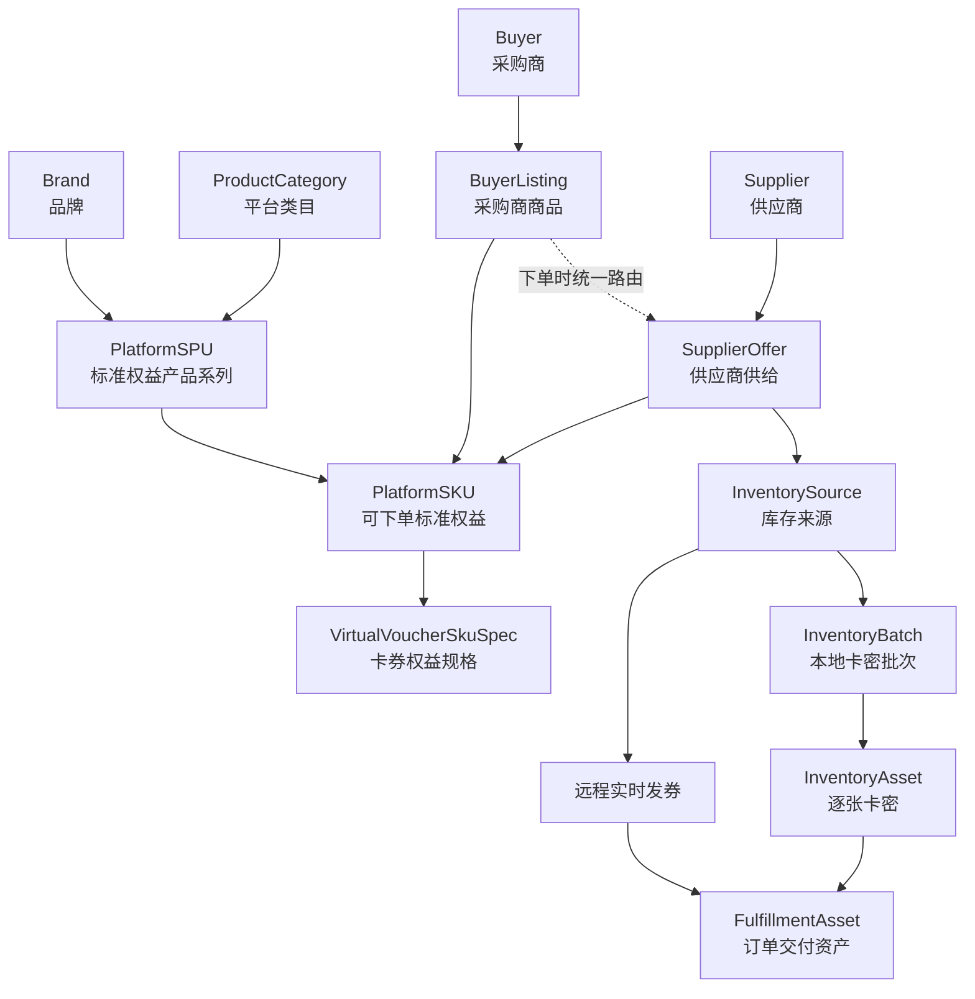
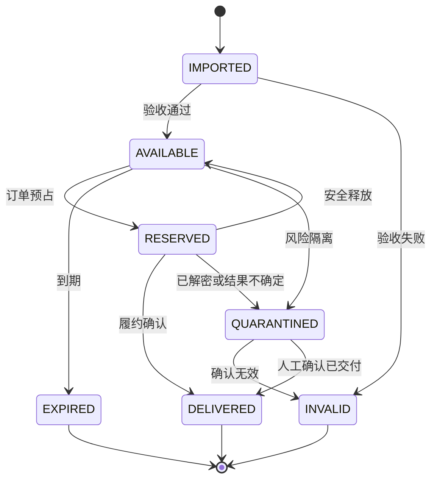
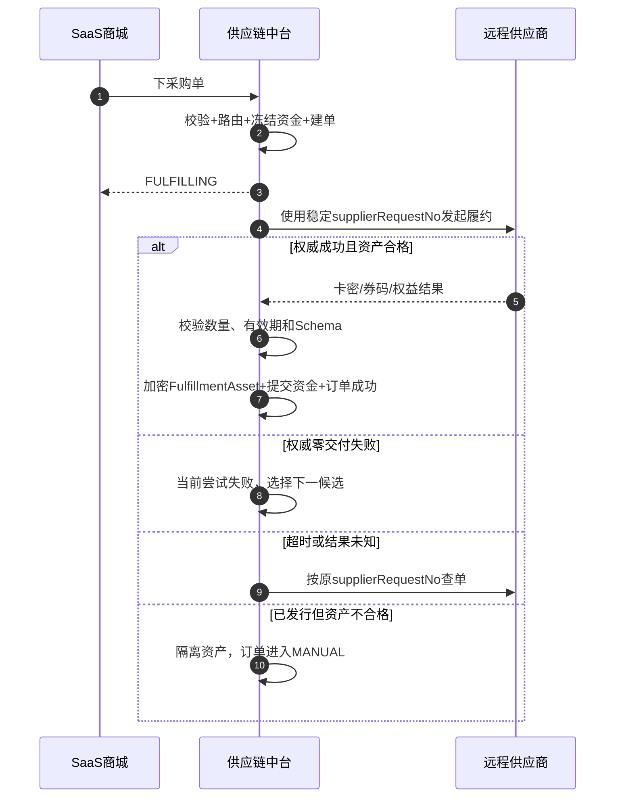
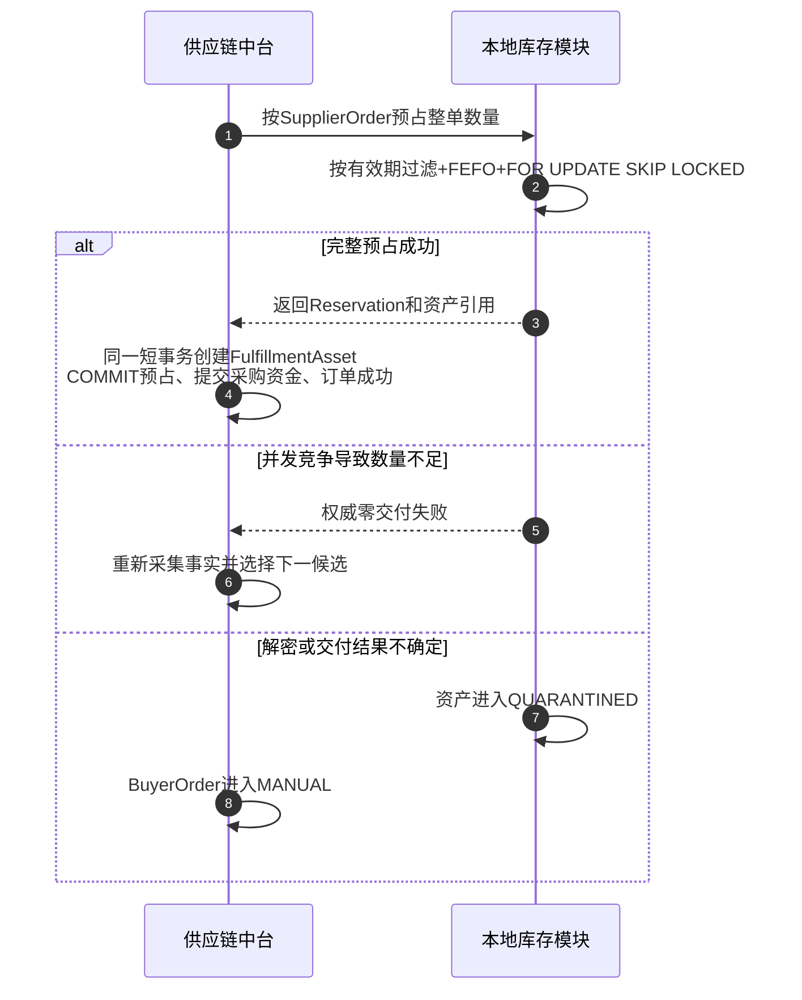

# 供应链中台虚拟卡券商品设计说明

> 文档状态：设计方案  
> 编制日期：2026-08-21  
> 适用范围：供应链中台标准商品池中的虚拟卡券、兑换券、会员权益和相关直充商品

---

## 1. 文档目的

本文给出供应链中台虚拟卡券类商品的领域与数据设计，重点回答以下问题：

1. 虚拟卡券的 SPU 和 SKU 分别表达什么，什么情况下应拆分。
2. 如何同时支持供应商实时发券和中台本地卡密池。
3. 如何让同一平台 SKU 在多个远程供应商和本地库存之间统一路由。
4. 如何表达固定面值卡、商品兑换券和会员权益等不同权益形态。
---

## 2. 业务范围

### 2.1 纳入范围

本设计覆盖以下标准商品：

- 固定面值储值卡，例如 50 元、100 元电子卡。
- 固定商品或服务兑换券，例如咖啡兑换券、电影通兑券。
- 会员权益，例如视频会员月卡、季卡和年卡。
- 折扣券、代金券等具有明确权益规则的虚拟券。
- 券码、卡号卡密、券链接、账户绑定权益和直充等交付方式。
- 供应商下单后实时返回卡密或权益结果。
- 中台预先采购、导入并持有的本地卡密库存。
- 同一个平台 SKU 在本地卡密池和多个供应商之间按规则选择供应商。

### 2.2 不纳入范围

- 淘宝闪购、盒马 H5、大润发到店购 等不进入中台标准商品池的 O2O 渠道商品。
- 商城 C 端定价规则。

### 2.3 业务决策

| 决策项 | 结论 |
| --- | --- |
| 供给模式 | 同时支持供应商实时发券和中台本地卡密池。 |
| 商品范围 | 同时支持固定面值卡和非金额型权益。 |
| 有效期 | 平台 SKU 声明统一最低有效期承诺，不按供应商实际到期日拆 SKU。 |
| 多数量订单 | 一次履约必须由一个候选完整满足，不跨库存源或供应商拆量。 |
| 商品扩展方式 | 采用“通用 PlatformSKU + 一对一 VirtualVoucherSkuSpec”。 |

---

## 3. 设计原则

### 3.1 商品只描述“卖的是什么”

PlatformSPU 和 PlatformSKU 只描述用户与采购商能够理解的标准权益，不包含：

- Supplier、供应商外部商品号和供应商账号。
- SupplierOffer、供应商结算价和协议私有参数。
- 本地或远程库存数量。
- 卡密批次和单张卡密。
- Buyer、采购商采购价和商城零售价。

### 3.2 SKU 必须可以无感替换供给

判断两个供给能否映射到同一个平台 SKU，采用以下测试：

> 隐藏供应商、外部商品号、库存来源和批次后，两份履约结果能否在不改变用户订单承诺的情况下相互替换？

能够替换，表示它们是同一个平台 SKU 的不同 SupplierOffer 或 InventorySource；不能替换，必须拆成不同 SKU。

### 3.3 本地库存和远程供给共用订单与路由主干

本地卡密池不是另一套商品体系，也不是另一套采购订单。二者共同使用：

- PlatformSPU、PlatformSKU 和虚拟卡券规格。
- BuyerListing 和采购商商品目录。
- SupplierOffer 和供给路由。
- BuyerOrder、FulfillmentRequest 和 SupplierOrder。
- FulfillmentAsset 交付结果。

差异仅存在于供给执行方式：远程供给调用 Supplier Connector，本地供给调用库存分配器。

### 3.4 商品承诺与实际资产分离

- SKU 保存对采购商和消费者的标准权益承诺。
- SupplierOfferVersion 保存供应商能够提供的保证和执行方式。
- InventoryBatch 保存一个本地采购批次的取得事实。
- InventoryAsset 保存单张卡密的实际有效期和状态。
- FulfillmentAsset 保存订单最终交付的权益资产。

### 3.5 已激活 SKU 的身份语义不可修改

SKU 激活后，凡是会改变用户所得权益的字段均不可修改。权益内容、履约方式、有效期承诺或使用范围发生变化时，应创建新 SKU；旧 SKU 停用或归档，但历史订单继续引用旧快照。

---

## 4. 统一领域术语

| 术语 | 定义 |
| --- | --- |
| 平台 SPU | 采购商和消费者认知中的标准权益产品系列。 |
| 平台 SKU | 可精确下单、定价、路由和履约的最小标准权益。 |
| 虚拟卡券规格 | 平台 SKU 的卡券专属权益定义，包括权益类型、权益内容、交付数量、有效期承诺和使用范围。 |
| 采购商商品 BuyerListing | 某个采购商获准采购和销售一个平台 SKU 的商业关系。 |
| 供应商供给 SupplierOffer | 某个供应商为一个平台 SKU 提供履约的供给关系。 |
| 库存来源 InventorySource | SupplierOffer 实际使用的远程按需、远程观察、本地数量或本地逐张资产来源。 |
| 本地卡密批次 InventoryBatch | 一批预先取得、统一验收并具有共同来源及成本口径的本地卡券资产。 |
| 库存资产 InventoryAsset | 履约前已经由中台控制的一张卡号、卡密、券码或链接。 |
| 供给预占 SupplyReservation | 为一次 SupplierOrder 临时锁定本地数量或逐张资产的事实。 |
| 履约资产 FulfillmentAsset | SupplierOrder 成功或部分成功后，实际交付给采购商的权益资产。 |
| 有效期承诺 | 平台 SKU 对资产可使用期限作出的最小保证。 |
| 实际有效期 | 远程供应商返回或本地资产记录的真实可使用期限。 |

应避免使用“渠道商品”表示 SupplierOffer。卡券业务中的供给方统一称为 Supplier；“渠道”只用于 O2O、INSTORE 等外部交易渠道。

---

## 5. 总体领域模型



核心基数如下：

- 一个 SPU 至少包含一个 SKU。
- 一个虚拟卡券 SKU 有且只有一份 VirtualVoucherSkuSpec。
- 一个 SKU 可以被多个 Buyer 上架。
- 一个 SKU 可以由多个 SupplierOffer 提供。
- 一个 SupplierOfferVersion 固化一个执行模式和一个 InventorySource。
- 一个本地 InventorySource 可以包含多个批次和多张资产。
- 一张 InventoryAsset 最多只能形成一份有效 FulfillmentAsset。

---

## 6. PlatformSPU 设计

### 6.1 SPU 的业务含义

PlatformSPU 回答“这是什么权益产品系列”，其身份由以下因素确定：

```text
SPU Identity = 品牌或发行方 + 权益系列 + 使用生态 + 产品形态
```

例如：

```text
品牌：星巴克
├── SPU：星巴克电子储值卡
├── SPU：星巴克饮品兑换券
└── SPU：星享会员权益

品牌：爱奇艺
└── SPU：爱奇艺黄金 VIP 会员
```

### 6.2 SPU 拆分规则

出现以下差异时应拆成不同 SPU：

- 品牌或权益发行方不同。
- 储值卡、商品兑换券、折扣券和会员权益等核心权益类别不同。
- 使用生态完全不同，例如京东 E 卡与京东到家专用权益。
- 消费者不会将两者理解为同一个可选规格系列。

以下差异通常不拆 SPU，而在 SKU 中表达：

- 固定面值不同。
- 会员周期不同。
- 交付方式不同。
- 最低有效期承诺不同。
- 使用区域或适用端不同。

### 6.3 SPU 建议字段

在现有 `sc_platform_spu` 基础上增加 `product_type`：

| 字段 | 类型建议 | 说明 |
| --- | --- | --- |
| `product_type` | VARCHAR(32) | 封闭枚举；本设计使用 `VIRTUAL_VOUCHER`。 |
| `spu_code` | VARCHAR(32) | 平台永久业务编码。 |
| `brand_id` | BIGINT | 标准品牌。 |
| `primary_category_id` | BIGINT | 平台主类目。 |
| `spu_name` | VARCHAR(256) | 标准产品系列名称。 |
| `subtitle` | VARCHAR(512) | 标准副标题。 |
| `cover_url` | VARCHAR(512) | 商品主图。 |
| `use_instruction` | TEXT | 系列级使用说明；不能覆盖 SKU 的确定权益规则。 |
| `status/version` | SMALLINT/BIGINT | 生命周期与乐观锁。 |

不能只依赖类目判断商品行为。类目是运营目录，`product_type` 才是系统选择卡券规格校验和履约规则的稳定类型。

---

## 7. PlatformSKU 与虚拟卡券规格设计

### 7.1 SKU 的业务含义

PlatformSKU 回答“用户购买一个销售单位后，最终得到什么确定权益”。建议使用以下身份公式：

```text
SKU Identity =
    SPU
  + 权益类型
  + 权益内容或面值
  + 履约类型
  + 每销售单位权益数量
  + 有效期承诺
  + 使用范围
  + 履约目标 Schema
  + 履约结果 Schema
```

### 7.2 SKU 拆分矩阵

| 差异 | 是否拆 SKU | 正确归属 |
| --- | --- | --- |
| 供应商不同 | 否 | SupplierOffer |
| 供应商外部商品号不同 | 否 | SupplierOfferVersion |
| 供应商结算价不同 | 否 | SupplierOfferVersion |
| 远程实时发券或本地卡密池 | 否 | InventorySource 与执行模式 |
| 本地卡密批次不同 | 否 | InventoryBatch |
| 单张卡券实际到期日不同 | 否 | InventoryAsset/FulfillmentAsset |
| 实际期限不同但均满足最低承诺 | 否 | Offer、批次和资产校验 |
| 采购商采购价和展示名不同 | 否 | BuyerListingVersion |
| 商城零售价不同 | 否 | 商城商品模型 |
| 权益内容不同 | 是 | 新 SKU，必要时新 SPU |
| 固定面值不同 | 是 | 新 SKU |
| 会员周期不同 | 是 | 新 SKU |
| 履约方式不同 | 是 | 新 SKU |
| 每单位交付资产数量不同 | 是 | 新 SKU |
| 最低有效期承诺不同 | 是 | 新 SKU |
| 使用范围或适用端不同 | 是 | 新 SKU |
| 目标或结果 Schema 不同 | 是 | 新 SKU |

### 7.3 PlatformSKU 通用字段

`sc_platform_sku` 保留通用下单和履约字段：

| 字段 | 说明 |
| --- | --- |
| `sku_code/spu_id` | 永久 SKU 编码及所属 SPU。 |
| `sku_name` | 标准 SKU 名称。 |
| `fulfillment_type` | 标准履约类型。 |
| `target_schema_code/version` | 履约目标结构。券码通常不需要目标；直充、账户绑定权益需要手机号或账号目标。 |
| `result_schema_code/version` | 标准履约结果结构。 |
| `status/version` | 生命周期和乐观锁。 |

当前表中的 `face_value BIGINT NOT NULL` 不再适合作为所有 SKU 的通用必填字段。非金额型权益不能用 `0` 表示面值，否则会形成业务魔法值。实施时应将面值语义迁移到虚拟卡券规格，并在兼容期将原字段调整为可空或只读投影。

### 7.4 履约类型

沿用现有封闭枚举：

| 枚举 | 含义 |
| --- | --- |
| `DIRECT_RECHARGE` | 向手机号、账号或指定目标直接充值，不产生独立卡券资产。 |
| `VOUCHER_CODE` | 返回一个或多个兑换码。 |
| `CARD_CODE_SECRET` | 返回卡号和卡密组合。 |
| `VOUCHER_URL` | 返回权益领取或使用链接。 |
| `ACCOUNT_BOUND_BENEFIT` | 将可独立查询或撤销的权益绑定到用户账号。 |

相同权益采用不同履约类型时必须拆 SKU，因为它们的目标、结果、敏感数据、查询恢复和售后处理不同。

### 7.5 VirtualVoucherSkuSpec

新增一对一扩展表 `sc_virtual_voucher_sku_spec`：

| 字段 | 类型建议 | 说明 |
| --- | --- | --- |
| `id` | BIGINT | 内部主键。 |
| `platform_sku_id` | BIGINT | 逻辑引用 SKU，唯一。 |
| `spu_id` | BIGINT | 冗余所属 SPU，用于同一 SPU 下规格去重；发布时必须与 SKU 一致。 |
| `voucher_kind` | VARCHAR(32) | `STORED_VALUE/FIXED_ITEM/DISCOUNT/MEMBERSHIP`。 |
| `value_type` | VARCHAR(32) | `MONETARY/NON_MONETARY`。 |
| `face_value` | BIGINT NULL | 金额型权益面值，单位分。 |
| `currency` | CHAR(3) NULL | 金额型权益币种；一期为 CNY。 |
| `entitlement_code` | VARCHAR(64) | 平台标准权益编码。 |
| `entitlement_version` | INT | 权益定义版本。 |
| `entitlement_quantity` | BIGINT | 一个销售单位包含的权益数量。 |
| `entitlement_unit` | VARCHAR(16) | `FEN/DAY/TIME/ITEM` 等封闭单位。 |
| `asset_count_per_unit` | BIGINT | 一个销售单位预期交付的资产份数。 |
| `validity_policy_type` | VARCHAR(32) | 有效期承诺类型。 |
| `valid_from/valid_to` | DATETIME NULL | 固定窗口型承诺。 |
| `validity_value` | BIGINT NULL | 相对期限数值。 |
| `validity_unit` | VARCHAR(16) NULL | `DAY/MONTH/YEAR` 等封闭单位。 |
| `min_activation_window` | BIGINT NULL | 交付后至少保留的激活窗口。 |
| `usage_scope_code` | VARCHAR(64) | 使用范围编码。 |
| `usage_scope_version` | INT | 使用范围版本。 |
| `transferability` | VARCHAR(16) | 是否允许转赠；封闭枚举。 |
| `stackability` | VARCHAR(16) | 是否允许叠加；封闭枚举。 |
| `spec_digest` | BINARY(32) | 身份字段规范化后的 SHA-256。 |
| `created_at` | DATETIME(3) | 创建时间。 |

建议约束：

- `platform_sku_id` 唯一。
- `(spu_id, spec_digest)` 唯一，防止同一 SPU 下重复创建语义相同的 SKU。
- `MONETARY` 必须有 `face_value/currency`，`NON_MONETARY` 必须为空。
- 券码、卡号卡密和券链接要求 `asset_count_per_unit > 0`；直充等无独立资产的履约要求其为 0。
- SKU 首次激活后规格不可修改。
- 核心身份字段必须结构化，不放入任意 JSON。

订单预期资产数量按以下公式计算，并检查乘法溢出：

```text
expectedAssetCount = orderQuantity × assetCountPerUnit
```

### 7.6 权益定义与使用范围

`entitlement_code/version` 用于表达平台标准化权益，例如：

```text
STARBUCKS_STORED_VALUE
STARBUCKS_LATTE_TALL
IQIYI_GOLD_VIP
MOVIE_GENERAL_TICKET
```

`usage_scope_code/version` 表达可机器校验的使用范围，例如全国门店、指定地区、指定 App 或指定门店集合。复杂范围可以由独立的不可变规则表维护，但不得在 SKU 中保存可执行脚本、SpEL 或动态 SQL。

权益定义本身建议使用 `sc_entitlement_definition` 与不可变的 `sc_entitlement_definition_version` 管理。储值金额、固定兑换物、折扣门槛与折扣金额、会员等级等高频业务字段采用按权益类型校验的结构化字段；低频描述只能进入经过封闭 Schema 校验的配置，不能使用无约束 JSON。

权益定义或使用范围发布新版本不会自动重解释已激活 SKU。需要改变订单承诺时，必须创建新 SKU。

---

## 8. 有效期承诺设计

### 8.1 有效期的三层事实

| 层级 | 保存内容 |
| --- | --- |
| SKU | 对采购商和消费者作出的最低有效期承诺。 |
| SupplierOfferVersion | 供应商对该外部商品能够保证的期限。 |
| InventoryBatch/InventoryAsset/FulfillmentAsset | 批次或单张资产的真实起止时间。 |

供应商实际到期日和本地批次到期日不是 SKU 身份。只要满足 SKU 的统一承诺，即可作为同一 SKU 的供给候选。

### 8.2 有效期承诺类型

建议采用封闭类型：

| 类型 | 含义 | 示例 |
| --- | --- | --- |
| `FIXED_WINDOW` | 在固定时间窗口内有效。 | 2026-01-01 至 2026-12-31。 |
| `MIN_REMAINING_AFTER_DELIVERY` | 交付时至少剩余指定期限。 | 用户收到时至少还有 365 天。 |
| `DURATION_AFTER_ACTIVATION` | 激活后享有指定权益期限，同时规定最小激活窗口。 | 交付后 30 天内可激活，激活后有效 31 天。 |

`MONTH/YEAR` 涉及自然月语义时不得简单换算成固定秒数；平台应使用明确的日期计算规则并固化规则版本。

### 8.3 供给准入校验

SupplierOfferVersion 发布时必须声明其有效期保证，并满足：

```text
Offer 保证期限 >= SKU 最低承诺
Offer 权益定义 = SKU 权益定义
Offer 使用范围覆盖 SKU 使用范围
Offer 交付资产数量 = SKU 约定数量
Offer 履约目标和结果 Schema 与 SKU 兼容
```

远程供应商未提供可验证的有效期保证时，不得映射到带最低有效期承诺的 SKU，除非每次履约结果都返回可校验的实际到期日并且协议允许安全处理不合格资产。

### 8.4 本地资产分配校验

本地卡密池的“可用数量”必须按当前订单动态计算，而不是简单统计 `AVAILABLE`：

```text
eligible =
    asset.status = AVAILABLE
    AND asset.validity 满足 SKU 承诺
    AND asset.usage_scope 覆盖 SKU 范围
    AND asset 未被其他预占占用
    AND asset 未进入隔离、过期或无效状态
```

资产选择采用 FEFO，即在满足最低承诺的前提下优先分配最早到期资产。已经不满足承诺但尚未自然过期的资产不得继续销售为该 SKU，应转移到适配的新 SKU、退供或隔离处理，不能降低现有 SKU 承诺。

### 8.5 履约后校验失败

- 本地资产在预占前必须完成期限校验，原则上不得在交付后才发现不合格。
- 远程供应商返回的资产必须在进入有效 FulfillmentAsset 前再次校验实际期限。
- 如果远程资产期限不足且已经产生不可逆发行事实，BuyerOrder 和 FulfillmentRequest 进入 `MANUAL`，资产进入隔离，禁止自动切换供应商造成重复交付。
- 只有供应商已权威确认原资产作废或未产生任何有效交付，才能将本次尝试按零交付失败处理并切换下一候选。

---

## 9. BuyerListing：采购商商品设计

BuyerListing 继续表示“某采购商获准采购并销售一个平台 SKU”，不关心最终由哪家供应商或哪个库存源履约。

```text
sc_buyer_listing
- buyer_id
- platform_sku_id
- buyer_sku_code
- current_version_id
- status/version

sc_buyer_listing_version
- buyer_settlement_unit_price
- display_name
- min_quantity/max_quantity
- valid_from/valid_to
```

规则如下：

- 同一 Buyer 对同一 PlatformSKU 一期只有一个 Listing。
- 采购商结算价是 Buyer 向中台支付的 B 端单价，不是商城零售价。
- 调价、展示名或购买限制变化发布新的不可变 ListingVersion。
- 商城目录只看到品牌、SPU/SKU 展示信息、履约类型、权益摘要、有效期承诺、采购商结算价和当前是否可买。
- 商城看不到 Supplier、外部 SKU、供应成本、卡密批次和供应商库存数量。

商城 C 端如需把多个供应链 SKU 组合为套餐，应在商城商品或组合商品层完成，不能把组合营销强行塞入供应链 SKU。

---

## 10. SupplierOffer：供应商供给设计

### 10.1 供给身份

SupplierOffer 表示某个 Supplier 能够提供一个 PlatformSKU。一个供应商可以对同一 SKU 建立多个 Offer，用于区分：

- 不同外部商品或采购合同。
- 远程实时发券与本地预采库存。
- 不同执行账号或库存来源。
- 不同结算和有效期保证。

SupplierOffer 不能绑定 Buyer；Buyer 和供给只在下单路由时连接。

### 10.2 OfferVersion 建议扩展

在现有不可变 OfferVersion 上增加或明确以下结构化字段：

| 字段 | 说明 |
| --- | --- |
| `execution_mode` | `REMOTE_CONNECTOR/LOCAL_ASSET_POOL`。 |
| `settlement_trigger` | `ORDER_FULFILLMENT/INVENTORY_RECEIPT/INVENTORY_DELIVERY`。 |
| `validity_guarantee_type` | 与 SKU 有效期类型相兼容的供应保证类型。 |
| `guaranteed_validity_value/unit` | 供应商保证期限。 |
| `guaranteed_activation_window` | 账户激活型权益的最小激活窗口。 |
| `inventory_source_id` | 实际库存来源。 |
| `connector_version_id` | 远程执行时必填，本地库存执行时为空。 |

建议使用数据库和发布服务实施条件约束：

```text
execution_mode = REMOTE_CONNECTOR
  => connector_version_id IS NOT NULL

execution_mode = LOCAL_ASSET_POOL
  => connector_version_id IS NULL
     AND inventory_source.source_type = LOCAL_ASSET_POOL
```

不建议为本地卡密池伪造 Supplier Connector。Connector 表示外部技术接入身份，本地库存分配器属于库存领域，两者职责不同。

### 10.3 结算与成本口径

远程实时供给和本地预采库存的成本发生时点不同：

- 远程按单履约：SupplierOfferVersion 单价形成订单预计供应商应结金额。
- 本地预采买断：供应商应付款在库存入库或批次结算时形成；订单履约只结转库存成本，不能再次形成同额供应商应付款。
- 本地寄售：可以在资产实际交付时形成供应商应结金额。

因此路由成本快照需区分：

```text
cost_type = PER_FULFILLMENT_SETTLEMENT | INVENTORY_COST_BASIS
```

本地买断库存按实际分配资产所在批次结转成本。SupplierOrder 可以记录 `allocated_inventory_cost_amount`，但不能把它误写成新的 `confirmed_supplier_settlement_amount`，避免重复结算。

---

## 11. InventorySource：双供给模式

### 11.1 远程实时发券

使用现有类型：

- `REMOTE_ON_DEMAND`：下单后供应商实时发码或直充，通常没有可锁定数量。
- `REMOTE_OBSERVED`：中台可以查询供应商库存，但只保存有时效的观察快照。

远程库存快照只在 `valid_until` 前作为候选资格事实。过期表示 `UNKNOWN`，不是零库存，也不表示中台已经锁定库存。

### 11.2 本地逐张卡密池

使用 `LOCAL_ASSET_POOL`。一个本地 InventorySource 建议固定以下边界：

```text
Supplier + PlatformSKU + 所有权类型 + 结算模式
```

不同供应商取得的卡密原则上不混入同一个 InventorySource，避免来源、成本、退供和对账责任不清。它们可以属于同一个 PlatformSKU，并作为不同路由候选。

### 11.3 本地库存表模型

#### 11.3.1 InventoryBatch

`sc_inventory_batch` 保存批次级取得与验收事实：

| 字段 | 说明 |
| --- | --- |
| `batch_no` | 批次永久业务编号。 |
| `inventory_source_id` | 所属本地库存来源。 |
| `platform_sku_id/supplier_id` | 冗余校验和审计快照。 |
| `source_order_no` | 采购、导入或供应商批次号。 |
| `acquisition_mode` | `PURCHASED/CONSIGNMENT/MANUAL_ADJUSTMENT`。 |
| `unit_acquisition_cost/currency` | 批次单位取得成本。 |
| `received/accepted/rejected_quantity` | 收到、验收通过和拒绝数量。 |
| `valid_from/valid_to` | 批次共同有效期；单张不一致时以资产为准。 |
| `import_digest` | 导入文件或载荷摘要，不保存原始明文卡密文件。 |
| `status/version` | `IMPORTING/ACCEPTED/PARTIALLY_ACCEPTED/REJECTED/CLOSED`。 |

#### 11.3.2 InventoryAsset

`sc_inventory_asset` 保存单张敏感资产：

| 字段 | 说明 |
| --- | --- |
| `asset_no` | 中台内部资产编号。 |
| `batch_id/inventory_source_id` | 批次和库存来源。 |
| `asset_type` | `VOUCHER_CODE/CARD_CODE_SECRET/VOUCHER_URL`。 |
| `encrypted_payload` | 信封加密后的资产内容。 |
| `kms_key_version` | 加密密钥版本。 |
| `asset_fingerprint` | HMAC 指纹，用于去重；不能使用可离线撞库的裸 SHA。 |
| `asset_namespace` | 发行方、权益和资产类型组成的稳定命名空间。 |
| `masked_hint` | 后台可展示的脱敏摘要。 |
| `valid_from/valid_to` | 单张资产实际有效期。 |
| `status/version` | 资产状态和乐观锁。 |
| `delivered_fulfillment_asset_id` | 成功交付后的引用。 |

建议唯一约束：

- `(asset_namespace, asset_fingerprint)` 全局唯一，防止同一资产被导入不同库存来源后重复销售。
- `delivered_fulfillment_asset_id` 非空时唯一。
- 单张资产不能跨 SKU、库存来源或批次移动；纠错使用隔离和审计命令。

#### 11.3.3 SupplyReservation

`sc_supply_reservation` 表示一次 SupplierOrder 对本地库存的预占：

| 字段 | 说明 |
| --- | --- |
| `reservation_no` | 稳定预占编号。 |
| `supplier_order_id` | 供应商履约尝试，唯一。 |
| `inventory_source_id` | 被预占的库存来源。 |
| `requested/reserved/committed/released_quantity` | 数量守恒字段。 |
| `status` | `RESERVED/COMMITTED/RELEASED/PARTIALLY_COMMITTED/MANUAL`。 |
| `expires_at` | 尚未产生不可逆交付时的预占过期时间。 |
| `version` | 乐观锁。 |

`sc_supply_reservation_asset` 记录预占与逐张资产关系，`(reservation_id, inventory_asset_id)` 和有效 `inventory_asset_id` 均唯一。

数量不变量：

```text
reservedQuantity = committedQuantity + releasedQuantity + remainingQuantity
```

#### 11.3.4 InventoryTransaction

`sc_inventory_transaction` 采用追加式流水记录：

```text
RECEIPT / RESERVE / COMMIT / RELEASE / ADJUST /
QUARANTINE / EXPIRE / INVALIDATE / RETURN_TO_SUPPLIER
```

库存余额是流水的可重建投影，不能通过后台直接修改数量。人工调整必须经过受审计命令并追加独立流水。

### 11.4 资产状态机



只有在资产未解密、未发送、未暴露且没有外部结果未知风险时，预占失败才允许从 `RESERVED` 回到 `AVAILABLE`。已经解密、发送或可能被用户获得的资产必须进入 `QUARANTINED` 或 `DELIVERED`，不能重新销售。

---

## 12. 统一供给路由

### 12.1 路由输入

标准卡券路由键保持：

```text
Buyer + PlatformSKU + FulfillmentType + Quantity + BusinessTime
```

路由候选是有效 SupplierOfferVersion 及其 InventorySource，不是 Supplier 本身，也不是本地资产批次。

### 12.2 候选资格

候选进入排序前必须满足：

1. BuyerListing、Buyer、Brand、SPU 和 SKU 有效。
2. Supplier、SupplierOfferVersion 和 InventorySource 有效。
3. Offer 的权益、履约 Schema、有效期保证和使用范围满足 SKU 承诺。
4. 数量在 Offer 的最小值、最大值和步长范围内。
5. 远程 Connector 能力和健康事实满足发布策略。
6. 本地卡池中满足有效期承诺的可预占资产数量不少于整单数量。
7. 采购商规则允许该候选。

### 12.3 确定性排序

候选顺序由已发布路由规则决定，可配置本地库存优先或指定供应商优先。相同配置和事实快照必须得出相同结果。禁止按随机权重、当前成本浮动或数据库返回顺序隐式改变结果。

推荐默认策略：

```text
满足有效期承诺的本地库存
  → 采购商指定远程供应商顺序
  → 其他有效远程 SupplierOffer 按稳定编码兜底
```

若业务更关注库存保质期，也可显式配置远程优先，但必须发布新路由策略版本，不能静默改变默认行为。

### 12.4 整单不拆量

一次 FulfillmentRequest 只能选择一个候选完整履约全部数量。例如购买 10 张而本地池只有 6 张时：

- 本地候选因“整单可用数量不足”被淘汰。
- 路由选择能完整提供 10 张的下一个候选。
- 不允许本地交付 6 张、远程供应商交付 4 张。

整单不拆量避免多供应商部分成功、资金分摊、售后归属和重复交付显著复杂化。

### 12.5 切换候选条件

只有当前候选得到“权威失败且有效交付数量为零”时，才能切换下一候选：

- 本地短事务竞争失败且没有资产被暴露，可以重新路由。
- 远程供应商明确拒绝且确认未履约，可以重新路由。
- 超时、断连、回调歧义属于结果未知，只能使用原 `supplierRequestNo` 查单，不能切换。
- 已交付一部分、已产生不可逆卡密或资产有效性存疑时进入人工处理，不能自动切换。

---

## 13. 履约流程

### 13.1 统一受理

商城支付成功后，使用永久商城单号向中台下采购单。中台在本地事务中：

1. 校验 BuyerListing、SKU 规格、购买数量和采购商资金。
2. 固化 SKU、VoucherSpec 和 ListingVersion 快照。
3. 使用当前供给事实完成路由并固化候选快照。
4. 冻结采购商资金。
5. 创建 BuyerOrder、FulfillmentRequest 和首个 SupplierOrder。
6. 提交 Outbox 或持久化操作任务。

所有外部供应商调用和本地资产分配均在事务提交后执行。

### 13.2 远程实时发券



### 13.3 本地卡密履约



本地逐张资产抢占必须使用数据库短事务和行锁，不得采用“先查可用资产、再逐条更新”的方式，也不能只依赖 Redis 分布式锁。

### 13.4 FulfillmentAsset

- 远程供应商返回卡密：直接创建加密 FulfillmentAsset，不伪造 InventoryAsset。
- 本地卡密履约：FulfillmentAsset 引用 InventoryAsset，不复制敏感密文。
- 事件通知只发送 `assetAvailable/assetReference`，不发送明文卡密。
- 商城通过授权资产查询接口按需领取；所有查询和解密写不可变审计。

---

## 14. 商品可用性与商城同步

BuyerListing 的人工发布状态与实时供给可用性分离。卡券商品可用性按以下条件计算：

```text
BuyerListing 已发布
AND Buyer、Brand、SPU、SKU 有效
AND 至少一个 SupplierOfferVersion 有效
AND 至少一个候选完整满足 SKU、数量和有效期承诺
AND Connector 或本地库存源可用
AND 路由策略允许
```

可用性仍使用：

```text
AVAILABLE / UNAVAILABLE / UNKNOWN
```

建议新增稳定原因码：

```text
VOUCHER_SPEC_INVALID
VALIDITY_GUARANTEE_UNSATISFIED
LOCAL_ELIGIBLE_ASSET_INSUFFICIENT
LOCAL_ASSET_POOL_UNAVAILABLE
REMOTE_INVENTORY_UNKNOWN
NO_COMPATIBLE_OFFER
```

商城投影增加以下非敏感字段：

- `productType`。
- `voucherKind`。
- 标准权益摘要。
- 面值或非金额权益说明。
- 有效期承诺。
- 使用范围摘要。
- 每销售单位权益数量。

商城页面状态仍不能作为下单依据；中台受理订单时必须重新校验。

---

## 15. 生命周期与不可变性

### 15.1 SPU/SKU 生命周期

沿用：

```text
DRAFT → ACTIVE → INACTIVE → ACTIVE
DRAFT/ACTIVE/INACTIVE → ARCHIVED
```

- 草稿阶段允许修正身份字段。
- SKU 首次激活后，所属 SPU、履约类型、权益规格、有效期承诺、使用范围和 Schema 不可修改。
- 展示文案和媒体变更可以发布目录变更，但不能改变历史订单语义。
- 已归档不可恢复；新语义创建新编码。

### 15.2 SupplierOffer 生命周期

沿用不可变发布版本：

```text
DRAFT → PUBLISHED → SUSPENDED → PUBLISHED
DRAFT/PUBLISHED/SUSPENDED → RETIRED
```

供应商调价、外部商品号、执行模式、Connector、InventorySource、有效期保证和结算触发点发生变化时，发布新 OfferVersion。

### 15.3 历史订单快照

订单必须固化：

- SPU/SKU 编码和名称摘要。
- VirtualVoucherSkuSpec 主键和 `spec_digest` 规范摘要。
- ListingVersion 和采购商结算价。
- 路由策略、候选与事实快照。
- OfferVersion、InventorySource 和执行模式。
- 预期交付数量、有效期承诺和结果 Schema。

任何后续主数据调价、停用或规则变化不得重算已受理订单。

---

## 16. 核心数据不变量

| 编号 | 不变量 |
| --- | --- |
| INV-01 | PlatformSPU/SKU 不保存 Supplier、外部 SKU、供应价格或库存数量。 |
| INV-02 | BuyerListing 不绑定 Supplier，SupplierOffer 不绑定 Buyer。 |
| INV-03 | 一个虚拟卡券 SKU 有且只有一份 VirtualVoucherSkuSpec。 |
| INV-04 | 激活后的 SKU 身份字段不可修改。 |
| INV-05 | 一个 SupplierOfferVersion 只使用一个执行模式和一个 InventorySource。 |
| INV-06 | 同一 FulfillmentRequest 任一时刻最多一个活动 SupplierOrder。 |
| INV-07 | 同一 FulfillmentRequest 最多一个有效成功 SupplierOrder。 |
| INV-08 | 一次履约不得跨候选拆量。 |
| INV-09 | 本地资产可用数量只统计满足当前 SKU 有效期承诺的资产。 |
| INV-10 | 一张 InventoryAsset 最多交付一次。 |
| INV-11 | 已解密、已发送或结果未知的本地资产不得重新变为 AVAILABLE。 |
| INV-12 | 远程库存快照过期表示 UNKNOWN，不表示零库存。 |
| INV-13 | 本地买断库存的订单成本结转不得重复形成供应商应付款。 |
| INV-14 | 卡密和券码不得进入普通日志、事件、列表 DTO 或 Excel 导出。 |
| INV-15 | SKU 承诺、Offer 保证和实际资产必须逐层兼容。 |

---

## 17. 异常与错误处理

### 17.1 商品与供给错误

建议使用稳定错误码：

| 错误码 | 含义 |
| --- | --- |
| `VOUCHER_SPEC_NOT_FOUND` | 虚拟卡券 SKU 缺少规格。 |
| `VOUCHER_SPEC_CONFLICT` | SKU 与卡券规格字段冲突。 |
| `VOUCHER_VALIDITY_NOT_SATISFIED` | Offer 或资产不满足最低有效期。 |
| `VOUCHER_ASSET_COUNT_MISMATCH` | 实际资产数量与 SKU 承诺不一致。 |
| `LOCAL_ASSET_INSUFFICIENT` | 满足条件的本地资产不足整单数量。 |
| `LOCAL_ASSET_RESERVATION_CONFLICT` | 并发竞争导致预占失败。 |
| `VOUCHER_ASSET_DUPLICATED` | 导入卡密指纹重复。 |
| `VOUCHER_ASSET_DECRYPT_FAILED` | 资产解密失败，必须失败关闭并转人工。 |
| `VOUCHER_ASSET_QUARANTINED` | 资产因暴露风险、有效性或协议异常被隔离。 |

### 17.2 重路由边界

| 场景 | 是否可自动切换候选 |
| --- | --- |
| 本地资产预占前发现数量不足 | 可以。 |
| 本地并发抢占失败且无资产暴露 | 可以。 |
| 远程供应商明确拒绝且零交付 | 可以。 |
| 远程调用超时或结果未知 | 不可以，只能查单。 |
| 远程返回部分卡密 | 不可以，进入部分成功或人工处理。 |
| 卡密已解密或可能已展示 | 不可以。 |
| 资产有效期不足但无法权威作废 | 不可以，隔离并人工处理。 |

### 17.3 日志要求

- 商品发布、Offer 发布、批次导入、库存预占和状态变化记录业务编号、数量、状态、耗时和稳定原因码。
- 第三方调用记录脱敏请求摘要、响应摘要、错误码和耗时。
- 高频库存竞争和定时恢复日志按原因码聚合或采样，避免日志风暴。
- 严禁记录卡号、卡密、完整券码、Token、密钥、完整手机号或原始供应商响应。

---

## 18. 安全与合规

### 18.1 敏感资产存储

- 卡号、卡密、券码和敏感链接使用包含 KMS key version 的信封加密。
- 数据库保存密文、KMS key version、HMAC 指纹和脱敏提示。
- HMAC 指纹密钥与数据密文密钥分离管理。
- 禁止保存可被撞库验证的裸 SHA-256 卡密摘要。

### 18.2 最小化解密

仅允许以下场景解密：

- 本地库存履约的最终交付点。
- 授权商城查询已归属当前用户的有效履约资产。
- 经审批的人工异常处理。

所有解密、查看、导出、补录和作废操作写不可变安全审计。后台默认只显示 `masked_hint`。

### 18.3 导入安全

- 上传文件只用于流式解析和验收，不长期保存明文原文件。
- 导入完成后保存摘要、统计和错误原因；明文临时文件按安全策略立即销毁。
- 卡密去重使用 HMAC 指纹。
- 单批次出现重复、格式错误或有效期不足时按验收规则拒绝或部分接收，并完整记录数量守恒。

---

## 19. 测试设计

### 19.1 纯逻辑单元测试 `*Test`

- SPU/SKU 拆分与规格摘要计算。
- 金额型和非金额型权益字段不变量。
- 有效期三种承诺类型的日期计算。
- SKU 承诺与 Offer 保证的兼容性判断。
- 本地资产有效性过滤与 FEFO 排序。
- 路由候选确定性排序。
- 整单不拆量规则。
- 资产状态机和预占数量守恒。
- 买断库存成本与订单供应商应付款分离。

### 19.2 集成测试 `*IntegrationTest`

使用真实 MySQL、Liquibase、事务和锁验证：

- 同一 SKU 远程 Offer 和本地 Offer 并存。
- 多线程竞争同一批卡密时每张资产最多预占一次。
- `FOR UPDATE SKIP LOCKED` 下整单预占成功或完整失败。
- 预占提交、释放、隔离和过期恢复。
- 同一资产最多生成一个有效 FulfillmentAsset。
- 卡密批次导入 HMAC 去重。
- ListingAvailability 随本地合格资产数量和远程供给状态变化。
- 订单受理固化 SKU、Listing、Offer 和有效期快照。

### 19.3 契约测试 `*ContractTest`

- 各供应商履约结果是否满足对应 Result Schema。
- 供应商返回资产数量和有效期字段映射。
- 超时后使用原 `supplierRequestNo` 查单。
- 卡密、目标和供应成本不进入商城事件。
- 商城按授权查询敏感资产。

### 19.4 架构测试 `*ArchitectureTest`

- 商品目录模块不得依赖供应商 Adapter 实现。
- BuyerListing 不得直接引用 SupplierOffer。
- 路由模块只计算候选，不直接调用供应商、修改订单或操作库存。
- 本地库存仅由库存应用服务写入。
- FulfillmentAsset 是交付结果，InventoryAsset 是履约前库存，两者不得合表。

### 19.5 必测业务场景

1. 本地库存充足，完整发放并按 FEFO 选择。
2. 本地总库存充足但满足最低有效期的库存不足，整体切换远程供应商。
3. 本地页面可用但并发抢占失败，重新采集事实后切换候选。
4. 远程首选供应商明确失败，切换第二供应商。
5. 远程首选供应商超时，只查单不切换。
6. 远程资产有效期不足且无法作废，隔离并转人工。
7. 批量购买 10 张、本地仅 6 张，不发生 6+4 拆分。
8. 同一 SKU 包含金额卡、非金额券和会员权益的不同规格时正确拆分。
9. SupplierOffer 调价或 SKU 下架不改变历史订单快照。
10. 卡密不出现在日志、事件、列表接口和导出文件中。

---

## 20. 示例

### 20.1 星巴克电子权益

```text
Brand：星巴克

SPU：星巴克电子储值卡
├── SKU：50元｜券码｜交付时至少剩余365天
└── SKU：100元｜券码｜交付时至少剩余365天

SPU：星巴克饮品兑换券
├── SKU：中杯拿铁1杯｜券码｜交付时至少剩余30天
└── SKU：中杯美式1杯｜券码｜交付时至少剩余30天
```

“供应商甲实时发码”“供应商乙实时发码”“平台本地预采卡池”均映射到对应的同一 SKU，通过不同 SupplierOffer 和 InventorySource 区分。

### 20.2 爱奇艺会员

```text
SPU：爱奇艺黄金 VIP 会员
├── SKU：月卡｜券码｜交付后30天内激活｜激活后31天权益
├── SKU：月卡｜手机号直充｜到账后31天权益
├── SKU：季卡｜券码｜激活后93天权益
└── SKU：年卡｜账户绑定权益｜到账后365天权益
```

虽然月卡券码和月卡直充的权益时长相同，但履约目标、结果和售后语义不同，因此必须拆 SKU。

### 20.3 一次购买 10 张 100 元电子卡

```text
请求数量：10
本地合格资产：6
远程供应商甲可供：10
远程供应商乙可供：10
```

路由结果：本地候选因整单数量不足被淘汰，按策略选择供应商甲；不会将 6 张本地资产和 4 张远程资产组合交付。

---

## 21. 实施演进建议

### 阶段一：商品规格标准化

- 为 PlatformSPU 增加 `product_type`。
- 新增 VirtualVoucherSkuSpec。
- 将 `face_value` 从通用 SKU 必填语义迁移到卡券规格。
- 建立 SKU 规格不可变发布校验和 `spec_digest` 去重。
- 扩展商城目录投影。

### 阶段二：供给兼容性

- 为 OfferVersion 增加执行模式、有效期保证和结算触发点。
- 发布时校验 SKU、Offer、Connector 和 InventorySource 兼容性。
- 路由加入有效期承诺和整单数量资格判断。

### 阶段三：本地卡密池

- 建立 InventoryBatch、InventoryAsset、SupplyReservation 和 InventoryTransaction。
- 完成卡密安全导入、验收、HMAC 去重和 FEFO 分配。
- 实现本地库存短事务抢占、提交、释放与隔离。
- 将本地履约接入现有 SupplierOrder/FulfillmentAsset 主干。

### 阶段四：运营与治理

- 商品、Offer、批次和资产管理页面。
- 供给可用性重算与商城变更推送。
- 资产安全审计、异常工单、退供和过期治理。
- 对账、批次成本结转和寄售结算。

每个阶段都应同步维护仓库正式详细设计、Liquibase DDL、自动化测试和 `docs/集成测试.md`，不得只改代码。

---

## 22. 设计结论

虚拟卡券商品应采用“平台标准权益 + 独立商业关系 + 独立供给与库存”的分层模型：

```text
PlatformSPU
  → PlatformSKU
    → VirtualVoucherSkuSpec

Buyer → BuyerListing → PlatformSKU
Supplier → SupplierOffer → PlatformSKU
SupplierOfferVersion → InventorySource
InventorySource → 远程实时供给 或 本地卡密批次/资产
```

SPU 表达消费者认知中的权益产品系列；SKU 表达可以被订单承诺和供给无感替换的最小标准权益。供应商、外部商品、成本、库存模式、批次和实际到期日都不参与 SKU 身份。这样既能防止商品重复建设，也能让同一 SKU 在本地卡密池和多家远程供应商之间安全路由，同时保持采购商目录、订单、资金、敏感资产和供应商结算边界清晰。
