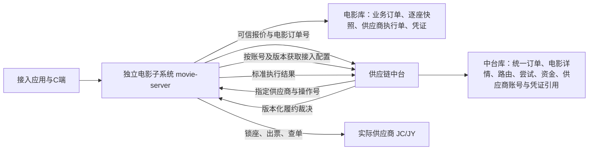
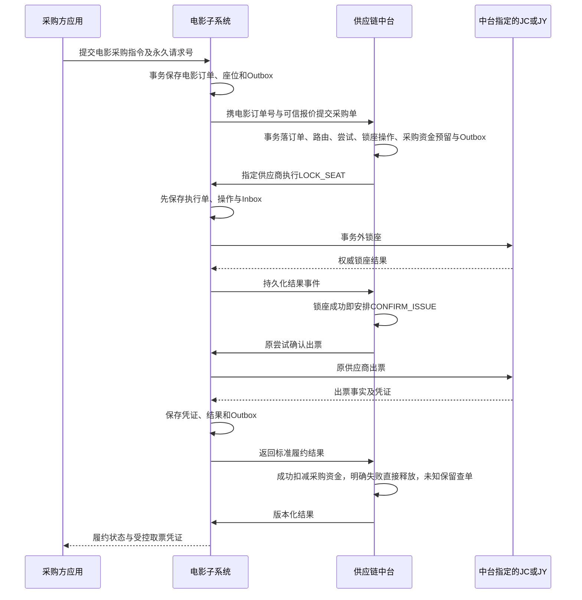

# 电影子系统与中台电影履约详细开发设计规范

> **版本**：v1.3.3（供应商账号与凭证由中台统一管理）
> **创建日期**：2026-09-03  
> **修订日期**：2026-09-29
> **面向对象**：后端、前端、测试

> **2026-09-29 配置归属修订（目标设计，尚未实施）**：电影供应商账号、应用 ID、密钥、接口地址及配置版本统一由供应链中台管理，电影服务通过受控内部接口获取指定账号配置并执行供应商协议。以第 2.3 节为准，替代旧“电影自行管理凭证”的设计。当前代码仍读取 Nacos `movie.supply.accounts` 和电影进程环境变量，本次仅修改文档，不代表配置接口、数据库迁移或代码切换已完成。

> **2026-09-16 供给底座实现补充**：见 [电影供给与排期底座详细设计](superpowers/specs/2026-09-16-movie-supply-schedule-design.md)。
> 该补充明确 qihaofu 的 JC/JY 字段兼容规则、同名城市唯一匹配、账号隔离排期主键、供给同步与故障恢复。
> 第 2.2 节示例中的 `{channel}_{supplierShowId}` 单账号主键，由补充设计的 `{channel}:{accountRef}:{supplierShowId}` 替代；其余平台表及 TTL 语义不变。
> **2026-09-17 审查修订**：补充设计第 7 节及第 7.5 节优先于历史示例。排期 v2 键包含原始影院，采用分量编码；单影院刷新使用版本条件和 MongoDB 事务，部署要求副本集/事务拓扑。JC filmId 专资语义、影院 standardId、JY 分区价格式以用户提供的 API 文档校正；城市同名、账号间 Mapping 和影片状态仍待业务确认。


---

> **2026-09-17 订单结构修订**：以 [电影订单双端落库与独立表结构设计](superpowers/specs/2026-09-17-movie-order-storage-design.md) 为订单存储、系统职责及建表的现行依据。电影订单独立保存于电影库 `movie_order`，中台保存 `sc_supply_chain_order` 与 `sc_movie_order_detail`，不使用任何 `trade_order*` 商城表。用户支付、积分扣减及用户退款不在整个 supply-hub 系统内实施；电影流程不等待支付通知。本次已移除旧支付状态、字段、接口和示例，采购账户沿用中台允许透支、缺账户拒绝的既有规则。
## 1. 业务背景与架构定位

### 1.0 术语约定

- **供应链中台**：统一管理全部场景订单、采购商资金、实际 Supplier、供应商接入账号与凭证、路由轮次、供应商尝试和公共履约终态；
- **供应链中台子系统**：承接中台通用模型不适合直接实现的垂直业务能力，电影、后续点餐等均属于此类专业子系统；
- **电影子系统**：供应链中台子系统体系下的电影专业子系统，对应独立 `movie-server`；它是中台的执行协作者，不是 Supplier；
- **电影供应商**：实际提供电影供给并被中台路由、结算和审计的 JC、JY 等 Supplier。

### 1.1 核心业务背景
电影票务不同于传统实物或静态卡券，具有以下强时效、高并发特征：
1. **多源多渠道供货**：对接今晨（JC）、佳意（JY）等多家供应商，不同供应商的影院 ID、影片 ID、场次 ID 各自独立；
2. **海量高频时效排期**：全国上万家影院每日产生数十万场次排期，售卖周期通常仅 3~5 天；
3. **秒级价格与座位浮动**：座位销售状态与成本底价秒级变化，提单前必须实时并发验座与比价；
4. **锁座后履约**：中台受理采购指令并冻结采购资金后安排锁座，权威锁座成功后立即安排确认出票；每单只路由一次，保存锁座和出票操作，明确失败直接终结且不补偿，未知结果仅查原单；
5. **中台统一路由与订单**：JC、JY 是供应链中台统一管理的实际供应商，电影子系统负责执行中台不适合直接承载的电影专业协议；
6. **独立业务订单**：电影子系统对外金额统一使用人民币元，业务主订单、座位和取票凭证由电影库保存；用户支付、积分扣减和用户退款在系统外处理，本仓不建设相关表、状态或接口。

### 1.2 系统边界与分工



- **接入应用**：展示电影供给、提交用户选座及永久请求号；不能指定中标供应商、篡改采购成本或直接决定换渠道。电影订单不要求接入方创建商城交易单。
- **电影子系统**：独立进程与数据库，管理标准主数据、排期、物理验座、报价；先创建本地业务订单及逐座快照，再向中台提交；按中台指定的 JC/JY 执行协议，保存供应商执行单、幂等操作、恢复上下文及凭证，消费中台结果供用户查询。
- **供应链中台**：维护实际 Supplier、供应商接入账号及凭证、冻结路由、采购商资金和唯一履约裁决；向电影服务提供受控的版本化接入配置，外呼前原子创建统一订单、电影详情、首张供应商尝试、操作和 Outbox。中台采购结算金额与供应商成本分开保存。
- **单次路由**：每单最多一张供应商尝试，明确失败直接终结，不补偿、不重发、不换渠道，未知结果只查原供应商；供应商执行位置在电影子系统，中台不集成 JC/JY 私有 SDK。
- **资金边界**：中台仅冻结、扣减、释放采购商资金；电影子系统不写采购账本，整个系统不处理用户支付或积分扣减。明确失败后直接释放采购资金预留，不代表用户退款，也不触发供应商补偿。

订单关系、字段和恢复边界详见 [订单结构设计第 2～7 节](superpowers/specs/2026-09-17-movie-order-storage-design.md)。

---

## 2. 数据库表结构设计 (DDL)

### 2.0 数据所有权、建表与身份隔离约束

- 电影主数据、渠道映射及 MongoDB 排期属于独立 movie-server，为平台级供给数据；原六张主数据表保持不变。
- 电影业务订单、座位明细、供应商执行单、协议操作及取票凭证保存于电影库，使用独立订单模型；不创建或访问 `trade_order`、`trade_order_item`、`trade_order_movie` 及商城售后表。
- 电影交易查询显式验证可信 `project_id + buyer_user_id` 归属，提交幂等作用域为 `project_id + source_order_no`。平台主数据无租户列不意味着订单可以跨采购商查询；不能依赖已经关闭的商城租户拦截器保障交易隔离。
- 中台统一订单、电影详情、路由、尝试和账本保存在中台独立库；两个进程不共享事务、表或本地 Bean。
- 本文及补充文档为目标结构；正式实施使用两库各自的前向 Liquibase 变更。本次未添加可执行订单迁移、未修改既有 changeset，也不在应用启动时自动改表。

### 2.1 MySQL 标准主数据与渠道映射表

#### (1) 平台标准城市表：`movie_city`
```sql
CREATE TABLE `movie_city` (
  `id` bigint NOT NULL AUTO_INCREMENT COMMENT '城市主键ID',
  `city_code` varchar(32) NOT NULL COMMENT '行政区划统一代码 (如 110100)',
  `city_name` varchar(64) NOT NULL COMMENT '城市标准名称 (如 北京市)',
  `pin_yin` varchar(64) DEFAULT NULL COMMENT '拼音全拼 (beijing)',
  `first_letter` char(1) DEFAULT NULL COMMENT '首字母索引 (B)',
  `is_hot` tinyint(1) DEFAULT '0' COMMENT '是否热门城市 0-否 1-是',
  `status` tinyint DEFAULT '1' COMMENT '状态 1-启用 0-禁用',
  `create_time` datetime DEFAULT CURRENT_TIMESTAMP COMMENT '创建时间',
  `update_time` datetime DEFAULT CURRENT_TIMESTAMP ON UPDATE CURRENT_TIMESTAMP COMMENT '更新时间',
  PRIMARY KEY (`id`),
  UNIQUE KEY `uk_city_code` (`city_code`),
  KEY `idx_letter_hot` (`first_letter`, `is_hot`)
) ENGINE=InnoDB DEFAULT CHARSET=utf8mb4 COMMENT='电影平台标准城市表';
```

#### (2) 渠道城市映射表：`movie_city_mapping`
```sql
CREATE TABLE `movie_city_mapping` (
  `id` bigint NOT NULL AUTO_INCREMENT COMMENT '主键ID',
  `channel` varchar(32) NOT NULL COMMENT '供应商渠道编码 (jy, jc)',
  `supplier_city_id` varchar(64) NOT NULL COMMENT '供应商原始城市ID',
  `supplier_city_name` varchar(64) DEFAULT NULL COMMENT '供应商原始城市名',
  `standard_city_id` bigint NOT NULL COMMENT '绑定的标准城市ID (关联 movie_city.id)',
  `create_time` datetime DEFAULT CURRENT_TIMESTAMP COMMENT '创建时间',
  PRIMARY KEY (`id`),
  UNIQUE KEY `uk_channel_supplier_city` (`channel`, `supplier_city_id`),
  KEY `idx_standard_city` (`standard_city_id`)
) ENGINE=InnoDB DEFAULT CHARSET=utf8mb4 COMMENT='供应商城市映射表';
```

#### (3) 平台标准影片库：`movie_film`
```sql
CREATE TABLE `movie_film` (
  `id` bigint NOT NULL AUTO_INCREMENT COMMENT '影片主键ID',
  `film_code` varchar(32) NOT NULL COMMENT '国家专资影片编码 (12位唯一业务键)',
  `film_name` varchar(128) NOT NULL COMMENT '影片标准中文名',
  `poster_url` varchar(512) DEFAULT NULL COMMENT '海报封面图URL',
  `duration` int DEFAULT NULL COMMENT '影片时长 (分钟)',
  `publish_date` date DEFAULT NULL COMMENT '公映日期',
  `director` varchar(128) DEFAULT NULL COMMENT '导演姓名',
  `cast_actors` varchar(512) DEFAULT NULL COMMENT '主要演职员表',
  `intro` text COMMENT '影片剧情简介',
  `film_type` varchar(64) DEFAULT NULL COMMENT '类型标签 (科幻/动作/剧情)',
  `score` decimal(3,1) DEFAULT '0.0' COMMENT '大众评分 (如 9.3)',
  `is_presell` tinyint(1) DEFAULT '0' COMMENT '是否预售 0-热映中 1-预售待映',
  `status` tinyint DEFAULT '1' COMMENT '状态 1-上架 0-下架',
  `create_time` datetime DEFAULT CURRENT_TIMESTAMP COMMENT '创建时间',
  `update_time` datetime DEFAULT CURRENT_TIMESTAMP ON UPDATE CURRENT_TIMESTAMP COMMENT '更新时间',
  PRIMARY KEY (`id`),
  UNIQUE KEY `uk_film_code` (`film_code`),
  KEY `idx_publish_presell` (`publish_date`, `is_presell`, `status`)
) ENGINE=InnoDB DEFAULT CHARSET=utf8mb4 COMMENT='电影平台标准影片库';
```

#### (4) 渠道影片映射表：`movie_film_mapping`
```sql
CREATE TABLE `movie_film_mapping` (
  `id` bigint NOT NULL AUTO_INCREMENT COMMENT '主键ID',
  `channel` varchar(32) NOT NULL COMMENT '供应商渠道 (jy, jc)',
  `supplier_film_id` varchar(64) NOT NULL COMMENT '供应商原始影片ID',
  `standard_film_id` bigint NOT NULL COMMENT '关联的标准影片ID',
  `film_code` varchar(32) NOT NULL COMMENT '专资编码快照',
  `create_time` datetime DEFAULT CURRENT_TIMESTAMP COMMENT '创建时间',
  PRIMARY KEY (`id`),
  UNIQUE KEY `uk_channel_supplier_film` (`channel`, `supplier_film_id`),
  KEY `idx_standard_film` (`standard_film_id`)
) ENGINE=InnoDB DEFAULT CHARSET=utf8mb4 COMMENT='供应商影片映射表';
```

#### (5) 平台标准影院库：`movie_cinema`
```sql
CREATE TABLE `movie_cinema` (
  `id` bigint NOT NULL AUTO_INCREMENT COMMENT '影院主键ID',
  `cinema_code` varchar(32) NOT NULL COMMENT '国家专资办影院编码 (8位唯一业务键)',
  `cinema_name` varchar(128) NOT NULL COMMENT '影院标准名称',
  `standard_city_id` bigint NOT NULL COMMENT '所属标准城市ID',
  `city_name` varchar(64) DEFAULT NULL COMMENT '城市名称冗余',
  `region_name` varchar(64) DEFAULT NULL COMMENT '行政区名称 (如 朝阳区)',
  `address` varchar(256) NOT NULL COMMENT '影院详细物理地址',
  `longitude` decimal(10,6) DEFAULT NULL COMMENT '百度/高德经度',
  `latitude` decimal(10,6) DEFAULT NULL COMMENT '百度/高德纬度',
  `phone` varchar(64) DEFAULT NULL COMMENT '影院联系电话',
  `status` tinyint DEFAULT '1' COMMENT '状态 1-正常营业 0-停业下架',
  `create_time` datetime DEFAULT CURRENT_TIMESTAMP COMMENT '创建时间',
  `update_time` datetime DEFAULT CURRENT_TIMESTAMP ON UPDATE CURRENT_TIMESTAMP COMMENT '更新时间',
  PRIMARY KEY (`id`),
  UNIQUE KEY `uk_cinema_code` (`cinema_code`),
  KEY `idx_city_status` (`standard_city_id`, `status`),
  KEY `idx_location` (`latitude`, `longitude`)
) ENGINE=InnoDB DEFAULT CHARSET=utf8mb4 COMMENT='电影平台标准影院库';
```

#### (6) 渠道影院映射表：`movie_cinema_mapping`
```sql
CREATE TABLE `movie_cinema_mapping` (
  `id` bigint NOT NULL AUTO_INCREMENT COMMENT '主键ID',
  `channel` varchar(32) NOT NULL COMMENT '供应商渠道编码 (jy, jc)',
  `supplier_cinema_id` varchar(64) NOT NULL COMMENT '供应商原始影院ID',
  `supplier_cinema_name` varchar(128) DEFAULT NULL COMMENT '供应商原始影院名',
  `standard_cinema_id` bigint NOT NULL COMMENT '标准影院ID (关联 movie_cinema.id)',
  `cinema_code` varchar(32) NOT NULL COMMENT '专资编码快照',
  `status` tinyint DEFAULT '1' COMMENT '该渠道该影院状态 1-可售 0-不可售',
  `create_time` datetime DEFAULT CURRENT_TIMESTAMP COMMENT '创建时间',
  PRIMARY KEY (`id`),
  UNIQUE KEY `uk_channel_supplier_cinema` (`channel`, `supplier_cinema_id`),
  KEY `idx_standard_cinema` (`standard_cinema_id`)
) ENGINE=InnoDB DEFAULT CHARSET=utf8mb4 COMMENT='供应商影院映射表';
```

#### (7) 电影业务订单独立表组（替代商城扩展表）

旧 `trade_order_movie` 方案废弃，完整字段、类型、可空性、索引及状态见 [订单结构设计第 4 节](superpowers/specs/2026-09-17-movie-order-storage-design.md#4-电影库订单表)。

| 电影库表 | 职责 |
| --- | --- |
| `movie_order` | 独立业务主单、用户归属、场次与价格快照、中台关联和状态投影 |
| `movie_order_seat` | 每个物理座位的不可变快照 |
| `movie_supplier_order` | 中台指定供应商尝试的本地执行单及冻结账号/场次/座位上下文 |
| `movie_supplier_operation` | 锁座、出票的持久化幂等操作与未知结果查询 |
| `movie_order_ticket` | 加密取票凭证，支持一单一码或一座一码 |
| `movie_order_ticket_seat` | 凭证与座位的对应关系 |

配套 `movie_quote_batch/movie_quote_candidate` 和 `movie_inbox_event/movie_outbox_event` 支持可信报价与可靠通知，见补充设计第 5 节。中台存储模型见第 2.4 节。

---

### 2.2 MongoDB 动态排期数据集合设计

- **Database**：`aifuli_movie`（独立于商城库与供应链中台库）
- **Collection**：`cinema_schedule`

#### (1) 文档结构定义（Mongo Shell 风格 BSON 示例）
```javascript
{
  "_id": "jc_88998822",                     // 主键格式: {channel}_{supplierShowId}
  "showGroupId": "c4ca4238a0b923820dcc509a6f75849b", // 跨渠道物理场次逻辑聚合键
  "channel": "jc",                          // 供货渠道 (jy / jc)
  "supplierShowId": "88998822",             // 供应商原始排期ID
  "cityCode": "110100",                     // ★ 平台标准城市编码 (关联 movie_city.city_code，C端城市排期过滤)
  "cityName": "北京市",                     // 冗余城市名 (免跨库JOIN)
  "standardCinemaId": 1001,                 // 平台标准影院ID
  "cinemaCode": "11010101",                 // 影院专资编码
  "cinemaName": "万达影城(CBD万达广场店)",   // 冗余影院名 (C端免JOIN)
  "standardFilmId": 501,                    // 平台标准影片ID
  "filmCode": "001100012023",               // 影片专资编码
  "filmName": "流浪地球3",                  // 冗余片名 (C端免JOIN)
  "posterUrl": "https://img.xxx.com/p.jpg", // 冗余封面 (C端免JOIN)
  "hallName": "8号激光巨幕厅",              // 影厅名称
  "versionType": "国语 2D",                 // 语言制式
  "showDate": "2026-09-20",                 // 放映日期
  "showTime": ISODate("2026-09-20T14:30:00Z"), // 开场时间
  "closeTime": ISODate("2026-09-20T16:55:00Z"),// 散场时间
  "stopSellTime": ISODate("2026-09-20T14:00:00Z"), // ★ 停售时间 (TTL 自动销毁字段)
  "netPrice": NumberDecimal("38.00"),       // 电影标准人民币基准价 (元)
  "minSettlementPrice": NumberDecimal("31.00"), // 本渠道该场次起步结算成本 (元)
  "areas": [                                // 原生内嵌分区价
    { "areaId": "1", "areaName": "普通区", "settlePrice": NumberDecimal("31.00") },
    { "areaId": "2", "areaName": "黄金座", "settlePrice": NumberDecimal("35.00") }
  ],
  "priceOption": {                          // 今晨快票价格选项
    "settle_8": NumberDecimal("30.00"),
    "settle_15": NumberDecimal("28.00")
  },
  "createTime": ISODate("2026-09-18T08:00:00Z"),
  "updateTime": ISODate("2026-09-18T08:00:00Z")
}
```

所有电影子系统金额字段在 Java 中使用 `BigDecimal` 并固定人民币元两位小数，在 MongoDB 中显式映射为 BSON `Decimal128`；禁止将 `38.00` 之类字面量按 BSON `Double` 落库。该要求只约束电影子系统自身的人民币金额精度，不代表电影子系统改用商城积分或中台整数分模型。

#### (2) 必须建立的索引
```javascript
// 1. 核心业务复合索引：C端按影院+日期毫秒级拉取排期列表
db.cinema_schedule.createIndex({ "cinemaCode": 1, "showDate": 1, "stopSellTime": 1 });

// 2. 逻辑场次聚合索引：提单前根据聚合键拉取多商排期底价
db.cinema_schedule.createIndex({ "showGroupId": 1, "channel": 1 });

// 3. ★ TTL 异步物理过期索引：过期清理由 MongoDB 后台任务完成，不保证到点立即删除
db.cinema_schedule.createIndex({ "stopSellTime": 1 }, { expireAfterSeconds: 0 });

// 4. ★ 城市在映影片快速检索复合索引：按城市+未停售快速 distinct filmCode，末期无排期影片自动过滤
db.cinema_schedule.createIndex({ "cityCode": 1, "stopSellTime": 1, "filmCode": 1 });
```

TTL 仅负责容量回收，不能作为停售判断的唯一依据；所有在售查询仍必须显式包含 `stopSellTime > now`，避免 TTL 后台清理延迟期间返回已停售场次。

### 2.3 供应商接入配置与现有 qihaofu 兼容边界

#### 2.3.1 管理与执行职责

- 中台统一管理今晨 `JC`、佳意 `JY`、影乐星 `LX` 的接入账号、应用 ID、密钥、接口地址、启停、超时、限流、协议版本及项目/采购商绑定。同一供应商可以有多个账号；应用 ID 和密钥必须归属同一账号、同一配置版本。
- 电影服务通过受控内部接口获取配置，继续负责协议签名、城市/影院/影片/排期采集及后续验座、锁座、出票、查单。中台不引入电影供应商私有 SDK，电影服务不另建供应商凭证管理表。
- `jyMovie/jcMovie` 仅是历史配置分类，不作为业务渠道编码。保留稳定的 `connectorAccountRef`，不能将账号等同于供应商、项目或定时任务。
- XXL-JOB 执行器启动就注册全部五类 Handler，任务启停和执行时间只由调度中心管理。账号启停决定是否承接新采集/新报价，不控制 Handler 注册。

#### 2.3.2 复用中台配置表

复用 [供应链详细设计第 5.8 节](superpowers/specs/2026-08-07-supply-chain-phase1-detailed-design.md#58-supplier-connector-与配置发布) 的模型：

| 表 | 电影账号用途 | 约束 |
| --- | --- | --- |
| `sc_supplier_connector` | 稳定接入账号身份、供应商归属、适配类型、启停及当前版本 | 同一供应商可配置多个账号 |
| `sc_supplier_connector_version` | 应用 ID 等非秘密标识、接口地址、超时、限流、协议参数及凭证槽关联 | 发布后不可变；密钥不得写入 `adapter_config_json` |
| `sc_credential_slot` | 密钥托管引用、秘密版本及脱敏提示 | 不保存明文 appSecret；采用密钥系统引用或受控加密存储 |

应用 ID 的接口语义明确为 `appId`：LX 对应 `app_id`，JC 对应 `partnerCode`，JY 对应 `x-ca-key`。应用标识与签名密钥不能混用；协议认定为敏感的标识也应受凭证保护。

现有 DDL 没有独立 `app_id` 列，`merchant_account` 的含义是“非秘密供应商商户账号”，不能未经适配器映射就视为电影应用 ID。TODO（本节）：实施前补齐应用 ID 结构化字段、三渠道协议元数据、项目/采购商绑定及版本映射的详细契约；必要扩列采用前向 Liquibase 迁移，不修改已发布 DDL，不将高频身份字段或密钥放入无约束 JSON。

当前中台凭证实现仅支持 `ENV` 与 `env:NAME`，尚未实现完整密钥托管。过渡期可由中台解析器读取中台进程环境变量，电影进程不再直接读取供应商凭证；后续 KMS 或信封加密也由中台管理。信封加密主密钥不得与密文同库。单个可覆盖的环境变量不能保证历史秘密版本可恢复，实施时须补齐版本解析能力。

#### 2.3.3 内部配置接口与安全边界

中台 API 模块提供内部契约，电影服务显式注册 Feign 客户端；不能直接查询 `sc_*` 表、跨库 JOIN 或依赖中台 server/DAL。中台配置服务也不得访问电影库。Facade 委托应用服务，遵守既有分层和 routing.domain 纯逻辑边界。

接口至少覆盖两个职责，具体 DTO、路径及错误码待实施时补齐：

1. 返回调用方授权范围内、可用于电影新采集的已发布账号列表，包含渠道、稳定 `connectorAccountRef`、不可变 `configVersion` 和必要非秘密配置。项目报价按已确认的项目/采购商绑定选择账号，平台采集不得伪造项目身份。
2. 按指定账号及配置版本解析执行配置和凭证；验证服务身份、账号归属、调用用途和版本状态。仅授权电影服务的受控执行接口取得必要秘密材料，管理端列表、采购商接口和 C 端接口不得返回密钥。

服务间鉴权与受保护传输为前提。凭证仅在电影进程签名所需的内存范围使用，不进入电影库、Mongo 排期、报价、订单、Outbox、日志或追踪报文；外呼日志仅记录账号引用、版本、结果码和耗时，按既有规则脱敏及采样。

每轮采集固定账号和配置版本，不在处理中途自动切换账号或最新版本。配置获取失败、无权限或版本不可解析必须明确失败，不解释为空供应商响应、不清空已有排期、不回退 Nacos。只有中台明确成功返回无启用账号时才按无账号处理。

#### 2.3.4 报价、订单与版本一致性

排期、报价和履约上下文继续冻结 `connectorAccountRef/configVersion`，由中台配置接口提供；迁移时明确与 Connector/ConnectorVersion 的映射，不能直接用新编号覆盖旧 account-ref，也不能将旧 `v1` 字符串当作数据库主键。

配置版本必须能确定原应用 ID 和秘密材料版本，不能只取凭证槽最新的 `active_secret_version`。中台负责保留允许恢复的历史配置；账号停用、密钥轮换及紧急撤销须明确对新采集、新报价和原订单查单的影响。历史恢复不能绕过中台授权；原版本无法安全执行时明确失败，不擅自换账号、换凭证或重新路由。

中台履约命令仍将原 `supplierQuoteToken` 原样交回电影服务。订单只记录版本引用和业务上下文，不复制供应商秘密；应用 ID 或密钥变更形成新版本，不原地修改已有报价和订单。

#### 2.3.5 实施状态与迁移

本节为 2026-09-29 确认的目标设计。当前代码仍读取 Nacos `movie.supply.accounts` 和电影进程环境变量，内部配置接口及电影消费逻辑尚未实现。本次只改文档，不能立即删除现有配置或凭证来源。

1. 补齐中台应用 ID、协议元数据、绑定和历史秘密版本契约及必要前向迁移，复用既有连接器配置管理。
2. 实现受控内部接口及电影消费逻辑，保留原供应商客户端和五类 Handler。三渠道账号由中台后台配置并发布。
3. 暂停调度中心周期任务，迁移并核对稳定账号引用、版本和已有排期/报价映射，切换到中台单一配置源；不双写、不静默回退。
4. 确认历史业务可按原版本解析、联调通过后，删除电影 Nacos 中的 `movie.supply.accounts` 及电影进程供应商凭证环境变量，再恢复调度。中台采用 ENV 时保留中台侧的环境凭证来源。
5. Nacos 继续维护基础设施、服务发现、执行器连接和平台停售策略。验收见 `docs/集成测试.md` 的“电影供应商账号与凭证中台统一管理验收（2026-09-29，待实现）”。

### 2.4 中台电影订单、路由与供应商尝试模型

中台继续以 `sc_supply_chain_order` 为唯一全场景总订单表，新增 MOVIE 类型及 `sc_movie_order_detail`。电影单号写入中台 buyer_order_no；采购商原接入单号只在电影库隔离保存。

- 新增通用 `sc_supplier_attempt/sc_supplier_attempt_operation`，电影每单最多一张尝试；现有 CARD 的 `sc_b_order/sc_fulfillment_operation` 及历史数据保持原语义。
- 新增电影报价回执、候选与订单受理回执，永久幂等保存成功和拒绝事实；供应商尝试在外呼前落库。
- 复用既有路由、账户、资金预留、账本、Inbox/Outbox、定时任务和订单状态日志；电影场景不伪造静态 SKU。
- 按现有 CARD/O2O/INSTORE 结构扩展总表 CHECK，禁止基于旧 CARD/O2O 初始 DDL 覆盖已发布约束。
- 详情保存中台履约阶段、CAS 版本、项目与账户指派快照、资金和路由关联、锁座有效期及明确失败原因，不保存用户支付/积分事实。

逐字段设计、唯一性约束和迁移影响见 [订单结构设计第 6～7 节](superpowers/specs/2026-09-17-movie-order-storage-design.md#6-中台订单表及现有模型调整)。

---

## 3. 核心业务流程与算法规范

### 3.1 跨渠道逻辑场次归一算法 (`showGroupId`)
为了将今晨、佳意等多家渠道的相同场次聚合为同一条货架记录，系统在排期入库时统一计算 MD5 散列值：
```
showGroupId = MD5(cinemaCode + "_" + filmCode + "_" + normalizeHall(hallName) + "_" + format(showTime))
```
- **影厅名归一化清洗规则（`normalizeHall`）**：
  1. 剔除所有特殊标点符号（如 `%`、`-`、`_`、空格、括号）；
  2. 统一全角半角；
  3. 例如 `3号厅%` 与 `3号厅` 经清洗后均归一为 `3号厅`。

### 3.2 动态验座、报价批次与可信提交

电影子系统按已验证的物理坐标并发验座和询价，保存不可变报价批次与各供应商候选，然后提交中台登记。中台按已发布规则排序，电影子系统不能预先决定最终供应商，客户端不能提交成本和候选顺序作为可信输入。

用户确认提交后，电影库先持久化 `movie_order + movie_order_seat + Outbox`；中台受理同一电影单号，核验报价归属、摘要和有效期，在本地事务创建统一订单、详情、路由、首个尝试、锁座操作、资金预留与 Outbox。两库通过永久单号及状态查询收敛。

报价过期只限制首次或新的锁座受理，不能阻断已受理操作的出票结果查询和幂等状态重放。已受理提单的重复请求先查原回执，不能因当前报价过期变成拒绝。详见 [订单结构设计](superpowers/specs/2026-09-17-movie-order-storage-design.md)。

### 3.3 金额语义与单位

- 电影标准售价：电影库 `standard_sale_amount_yuan`，人民币元 DECIMAL/BigDecimal。
- 供应商成本：报价及尝试的预计、报告、确认成本，分别保存；未知确认成本为 NULL。
- 采购商结算金额：中台按已发布规则计算并冻结，人民币分 BIGINT；不能假定等于供应商成本或用户售价。
- 用户实际支付、积分扣减及用户退款：整个系统不处理，不新增相应字段、流水或待支付状态；前三类金额均不是用户支付事实。

元转分使用精确转换，禁止浮点运算及静默舍入；规则版本和快照随订单冻结。

### 3.4 中台主控与电影执行的事务边界

依据 [供应链中台多场景概要设计第 3 节](供应链中台多场景概要设计.md#3-调用关系与时序)、[一期详细设计第 3.5、6 章](superpowers/specs/2026-08-07-supply-chain-phase1-detailed-design.md) 和 [一期透支规则](superpowers/specs/2026-08-17-supply-chain-phase1-buyer-account-overdraft.md)，本系统只处理采购履约及采购资金，不处理用户收款。



锁座成功后无需用户支付通知即可推进出票。缺采购账户或账户不可用时拒绝；采购账户可用余额不足不拒单，允许透支冻结和扣减。资金发生额仍非负。所有外部调用在本地事务之外，电影与中台分别以 Inbox/Outbox、永久编号及状态查询恢复。

### 3.5 每单只路由一次

中台只计算并冻结一次路由决策，只有被选中的一家供应商执行。完整候选可留作审计，但不能在失败、超时或查单过程中重新排序、选择第二家或创建第二张尝试。不设计二期换路开关或可变最大尝试数。

同一电影订单最多一张本地供应商执行单和一张中台供应商尝试；movie_supplier_order 对 movie_order_id 建唯一键，中台 MOVIE 尝试序号固定 1。重复提单返回原路由和原结果，明确失败后不重新开始。

### 3.6 明确失败直接终结

状态为 `LOCKING → ISSUING → ISSUED`；锁座或出票明确失败直接进入 FAILED，中台同步 RELEASE 尚未提交的采购资金，并通知电影子系统落失败。失败后不主动解锁、不补发、不重试履约、不重新路由。

结果未知不等同于明确失败。网络超时后保留原操作号、供应商与采购资金，只查原单；不得重新发起锁座或出票。部分出票、矛盾终态或无法核实转人工记录，不能自动产生补偿操作。

失败时原锁若仍存在，由供应商自身有效期机制处理，本系统不发解锁请求，也不把本地失败当作锁已释放的证据。首次出票派发前已确认原锁失效且未发起过出票时，可直接失败；出票已派发后不能仅以锁到期判定失败。

结果通知的可靠重投及幂等查询用于双端状态同步，已失败操作只返回原结果。中台以 stage_version CAS/行锁使状态、资金释放和通知同事务提交，资金仅释放一次。

## 4. 接口契约规范（接入查询参考 + 系统间 RPC）

### 4.1 电影供给查询与提单接口

接入应用通过已认证项目身份查询电影数据并提交采购履约指令。本系统只输出电影人民币金额，不计算福利积分、不拉起用户收银台、不接收用户支付确认。

| 能力 | 查询或提交内容 | 返回内容 |
| --- | --- | --- |
| 城市 | 已开通城市 | cityCode、cityName |
| 影片 | 城市、热映/预售条件及分页 | 标准影片编码、名称、海报及上映信息 |
| 影院排期 | 城市、影片、影院及日期 | 逻辑场次、影厅、开场/停售时间、人民币展示价 |
| 座位底图 | 逻辑场次 | 物理行列、显示名称、可选状态 |
| 验座报价 | 场次及选定物理座位 | quoteBatchNo、verifyToken、standardSaleAmountYuan、expiresAt |
| 电影提单 | 项目内永久 sourceOrderNo、quoteBatchNo、取票信息 | movieOrderNo、middleOrderNo、受理及履约状态 |
| 订单/凭证查询 | 原电影订单号及项目用户身份 | 场次座位快照、履约状态及授权取票凭证 |

最终 REST/RPC 路径与鉴权落实在独立 movie-server，不依赖已删除商城模块。采购项目、用户和报价归属须核验；供应商成本、候选账号和密钥不输出到普通用户查询。

### 4.2 电影子系统领域 RPC 契约（接入应用 / Supply Chain → Movie）

> **归属模块**：根目录 `movie-api` 声明 RPC 接口、DTO、错误码和枚举；根目录 `movie-server` 作为独立应用实现并注册服务。商城和供应链中台只依赖 `movie-api`，禁止依赖 `movie-server` 或注入其本地 Bean。  
> **计价边界**：电影 RPC 的现金金额全部为人民币元 `BigDecimal`，不出现积分、商城租户定价或中台账本分值。

#### (1) 影院排期查询（MovieScheduleApi）

- **Method**：`CommonResult<List<MovieScheduleRespDTO>> getScheduleList(String cinemaCode, LocalDate showDate)`

```java
public class MovieScheduleRespDTO {
    private String showGroupId;                  // 跨供应商逻辑场次聚合键
    private Long filmId;                         // 电影子系统标准影片ID
    private String filmCode;                     // 专资影片编码
    private String filmName;                     // 影片标准中文名
    private String hallName;                     // 标准化影厅名称
    private String versionType;                  // 语言与制式
    private LocalDateTime showTime;              // 放映时间
    private LocalDateTime closeTime;             // 散场时间
    private BigDecimal standardSalePriceYuan;    // 电影标准人民币基准价，固定两位小数
    private Integer stopSellSeconds;             // 距离停售剩余秒数
}
```

#### (2) 实时选座底图（MovieSeatApi）

- **Method**：`CommonResult<MovieSeatLayoutRespDTO> getSeatLayout(String showGroupId)`
- **Response DTO**：包含标准物理坐标 `(row, column)`、座位名称和售卖状态；供应商私有座位 ID 仅保存在 `movie-server`。

#### (3) 物理验座与多供应商报价（MovieSeatApi）

- **Method**：`CommonResult<MovieSeatQuoteRespDTO> verifyAndQuote(MovieSeatQuoteReqDTO reqDTO)`

```java
public class MovieSeatQuoteReqDTO {
    private String buyerProjectCode;                 // 服务端可信项目身份，禁止直接采用C端传值
    private String quoteRequestNo;                   // 采购项目范围内稳定的验座报价幂等键
    private String showGroupId;                      // 跨供应商逻辑场次键
    private List<MovieSeatCoordDTO> seats;           // 标准物理座位坐标
}

public class MovieSeatQuoteRespDTO {
    private String quoteBatchNo;                         // 不可变报价批次号
    private String verifyToken;                          // 绑定场次、座位、金额和有效期的防篡改令牌
    private Integer ticketCount;                         // 选座票数
    private BigDecimal standardSaleAmountYuan;           // 电影标准人民币总基准价
    private LocalDateTime expiresAt;                     // 报价失效时间
    private List<MovieSupplierQuoteDTO> supplierQuotes;  // 内部候选报价；C端暂兼容展示，禁止作为路由输入
}

public class MovieSupplierQuoteDTO {
    private String supplierCode;                 // 中台实际供应商编码：JC/JY
    private BigDecimal supplierCostAmountYuan;   // 本次选座供应商总成本，人民币元
    private String supplierQuoteToken;           // 电影子系统私有、不透明且防篡改的报价引用
    private LocalDateTime expiresAt;             // 本候选报价失效时间
}
```

### 4.3 电影报价提交与中台采购订单契约

- `submitMovieQuoteBatch`：movie-server → supply-chain-server，幂等提交可信报价批次；同号异摘要冲突，不产生资金或锁座副作用。
- `acceptMovieOrder`：movie-server → supply-chain-server，正式受理采购履约；使用 movieOrderNo 关联电影库订单，不再采用暗示等待用户付款的预订单契约。携带可信 projectId/buyerId/buyerUserId 上下文、quoteBatchNo、请求摘要及受控取票引用。
- 按 `projectId + movieOrderNo` 查询永久受理回执与当前快照；请求超时沿用原号查询或重试，已经受理则不能因报价后来过期而拒绝重放。
- 受理事务同时保存总单、电影详情、冻结路由、首张尝试、操作、采购资金预留和 Outbox；采购商余额不足按一期规则透支，不创建“待充值/待支付”电影单。
- 本电影流程不提供用户支付确认、查支付、积分扣减、用户退款及迟到支付补偿接口。

字段与幂等边界见 [订单结构设计第 6、8 节](superpowers/specs/2026-09-17-movie-order-storage-design.md)。

### 4.4 中台指定供应商的电影履约执行契约

`supply-chain-server → movie-server`：`executeMovieOperation(command)` 受理指定操作，`getMovieOperationResult(operationNo)` 查询原结果。

命令包含 movieOrderNo、middleOrderNo、supplierAttemptNo、attemptSequence、operationNo、operationType、supplierCode、supplierRequestNo、supplierQuoteToken 及 requestDigest。操作类型仅 LOCK_SEAT、CONFIRM_ISSUE；结果未知只查询原操作，不新建尝试。CONFIRM_ISSUE 依据原锁座和中台采购裁决，不携带用户 paymentNo、paidAt 或积分字段。

- 首次 LOCK_SEAT 核验报价归属、金额、座位、账号、配置版本及有效期；已受理的操作恢复不能仅因报价过期被拒绝。
- CONFIRM_ISSUE 要求同一尝试锁座权威成功、首次派发时锁仍有效，且订单/原操作尚未失败；中台锁座结果事务直接安排该操作。
- 明确失败直接保存 FAILED 并返回。没有主动解锁或失败重试接口；未知只查原单，不把超时当失败。
- 返回 operationNo、operationStatus、resultVersion、outcomeCode、rerouteSafety、externalSupplierOrderNo、reportedSupplierCostAmountYuan、lockExpiresAt、凭证清单受控引用及脱敏失败码。

### 4.5 中台履约编排事务边界

1. 本地短事务：恢复可信项目身份及账户指派，按永久请求号受理、固化报价/路由、冻结采购资金、创建总单/详情/尝试/操作与 Outbox。
2. 事务外：投递命令；电影子系统先落执行单和操作，再事务外调用 JC/JY。
3. 本地短事务：消费结果 Inbox，按版本更新详情和尝试；锁座成功创建出票操作；出票成功 COMMIT；权威明确失败直接 FAILED 并 RELEASE，不等待解锁、不补偿；UNKNOWN 保留采购资金并只查原单。
4. 事务外：通知电影子系统投影结果，回调丢失靠原单号查询收敛。

资金通过 tradecore 账户应用服务参与中台事务；border 不访问账本 DAL，Facade 不访问 DAL，routing.domain 只做纯计算。项目级身份和账户指派沿用中台已有设计，不另造用户钱包或项目虚拟余额。

## 5. 项目工程结构组织规范

本仓库已从 mall-pro 拆分，不存在 mall/trade/promotion/pay 实现模块及 MallServerApplication。电影与供应链中台各自独立启动。

- `aifuli-module-movie-api`：电影 RPC 契约、DTO、错误码和枚举，不含 DAL 或私有凭证。
- `aifuli-module-movie-server`：供给同步、报价、业务订单、协议执行、凭证及独立电影存储。
- `aifuli-module-supply-chain-server`：统一订单、电影详情、路由、通用供应商尝试、操作编排和资金。

进程之间只依赖 API 并显式注册 Feign，不扫描对方实现包、不共享数据库事务。Facade、routing.domain、border 与账户的依赖方向继续受 `SupplyChainModuleArchitectureTest` 约束。

### 5.1 工程初始化落地约定（2026-09-07）

本文 `movie-api/movie-server` 为架构简称，实际 Maven 模块名分别为根目录的
`aifuli-module-movie-api`、`aifuli-module-movie-server`，直接继承根 POM 并加入根聚合模块清单。

本次初始化范围为模块骨架、独立基础设施配置及第 2.1 节已明确的建表脚本：

1. API 模块预留 RPC 接口、DTO、枚举包，定义服务名 `movie-server` 与 RPC 前缀 `/rpc-api/movie`；本次不发布尚未实现的业务接口。
2. Server 使用 `com.aifuli.module.movie.MovieServerApplication` 独立启动，只扫描电影包；默认端口 `58191`，可由 `MOVIE_SERVER_PORT` 覆盖。不引入已删除商城模块或中台 server 实现依赖。
3. 基础设施使用 Spring Boot Web、Security、JDBC、MongoDB、Redis、MyBatis Plus 及现有 RPC starter；复用仓库 BOM，不引入商城租户 starter，显式设置 `aifuli.tenant.enable=false`。MySQL 默认库及 MongoDB 库均为 `aifuli_movie`，连接地址与凭证通过环境变量或专属 Nacos 配置注入。
4. 默认 `local` 环境启用 Nacos 配置与注册，读取 `movie-server-local.yaml`；`test`、`dev` 分别读取 `movie-server-test.yaml`、`movie-server-dev.yaml`。业务配置归属和部署位置见 `docs/superpowers/specs/2026-09-16-movie-supply-schedule-design.md#配置归属调整2026-09-28`。后续新增外部服务消费者时必须通过 `@EnableFeignClients(clients = {...})` 显式注册。
5. 骨架阶段仅开放不含连接详情的 `/actuator/health`，其它 HTTP 请求拒绝访问；TODO（本设计第 4.2、4.4 节）：在业务接口开发时补齐系统间鉴权、授权与脱敏日志后再开放对应 RPC。此临时策略不是业务 RPC 的最终认证协议。
6. `sql/mysql/movie/` 为 MySQL 脚本唯一维护目录，6 张电影平台表分别使用独立 Liquibase 前向变更；Maven 资源配置将电影变更入口和 `releases/` 原样打包至 `db/movie/`。Liquibase 默认关闭，应用启动不自动改表；发布流程使用独立迁移账号显式执行变更。
7. `sql/mysql/movie/mall/` 仅保留废弃方案的历史脚本，不作为本次电影部署入口，不执行建表、不修改历史 checksum。电影订单按 2026-09-17 补充设计另行生成前向变更。
8. MongoDB 的 `cinema_schedule` 索引脚本放在 `sql/mysql/movie/mongodb/` 作为配套初始化文件，由部署流程显式执行；应用关闭自动建索引，脚本不插入示例排期，查询端仍须显式过滤停售时间。
9. TODO（本设计第 2.3、3.2、3.4、4.4 节）：供应商账号与配置版本复用中台连接器和凭证槽，补齐电影应用 ID、绑定及历史秘密版本契约；电影库不另建供应商凭证管理表。报价、Inbox/操作幂等及恢复检查点按订单设计补齐前向变更，不将 6 张主数据表描述为完整出票存储模型。

初始化、迁移、独立启动与人工验收步骤统一维护于 `docs/集成测试.md#电影子系统工程初始化验收2026-09-07`。

## 6. 实施与联调顺序

| 阶段 | 工作 | 门禁 |
| --- | --- | --- |
| 供给底座 | 保持六张主数据表、Mongo 排期、物理验座和可信候选报价 | 独立进程、精确人民币金额、账号配置及排期事务 |
| 双端订单 | 按项目身份创建电影主单/逐座快照；中台原子创建采购订单、详情、路由、尝试、操作和资金预留 | 永久幂等、项目隔离、缺账户拒绝及低余额透支 |
| 履约执行 | LOCK_SEAT 成功直接安排 CONFIRM_ISSUE；明确失败直接终结，未知只查原单 | 不依赖用户支付；外呼前落库；同一尝试可恢复 |
| 凭证与资金 | 全部出票且凭证齐备后提交采购资金并同步结果 | 一单一码/一座一码、重复回调不重复扣款、部分出票转人工 |
| 验收 | 自动化门禁、真实 MySQL 故障注入及线下取票验证 | 按 docs/集成测试.md 记录结果；未执行不得标通过 |

每单只路由一次，失败不补偿、不重发、不换供应商；没有二期换路方案。用户收款、积分和用户退款均不进入本仓开发排期。

## 7. 质量门禁与防踩坑 Checklist

- [ ] 电影子系统和中台各有自己的订单存储，不访问 `trade_order*`，不共享数据库事务或对方实现 Bean。
- [ ] 采购商主体、项目、用户归属和账户指派遵循中台项目化设计，永久幂等与资产查询按项目校验。
- [ ] 不存在用户支付单、积分流水、支付截止、待支付状态或用户退款依赖；采购资金账本与用户收款明确分开。
- [ ] 缺账户拒绝，可用余额不足允许透支；采购发生额非负，资金预留与账本在订单事务内提交。
- [ ] 中台指定 JC/JY，电影只执行指定协议；单次路由不换渠道，未知只查原单。
- [ ] 中台订单/尝试/操作和电影执行单/操作均在供应商外呼前提交；结果与 Outbox 同事务保存。
- [ ] 锁座权威成功后直接安排出票；明确失败直接终结，不发解锁或任何失败补偿命令；未知只查原单。
- [ ] 报价过期只限制新的锁座，锁座超时本身不证明无交付；供应商结果未知时不释放采购资金。
- [ ] 全部座位交付及凭证齐备才能成功；支持一单一码和一座一码，部分出票转人工。
- [ ] 金额使用 BigDecimal/Decimal128 与精确元分转换；标准价、采购结算额及供应商成本分别保存。
- [ ] 供应商配置冻结账号和版本，手机号/票码加密，日志脱敏并对高频外呼采样/限频。
- [ ] 主数据和排期验收沿用供给补充设计，TTL 不得破坏历史订单快照或恢复上下文。
- [ ] 供应链 Test、IntegrationTest、ContractTest、ArchitectureTest 按变更实施；人工联调不替代自动化门禁。
