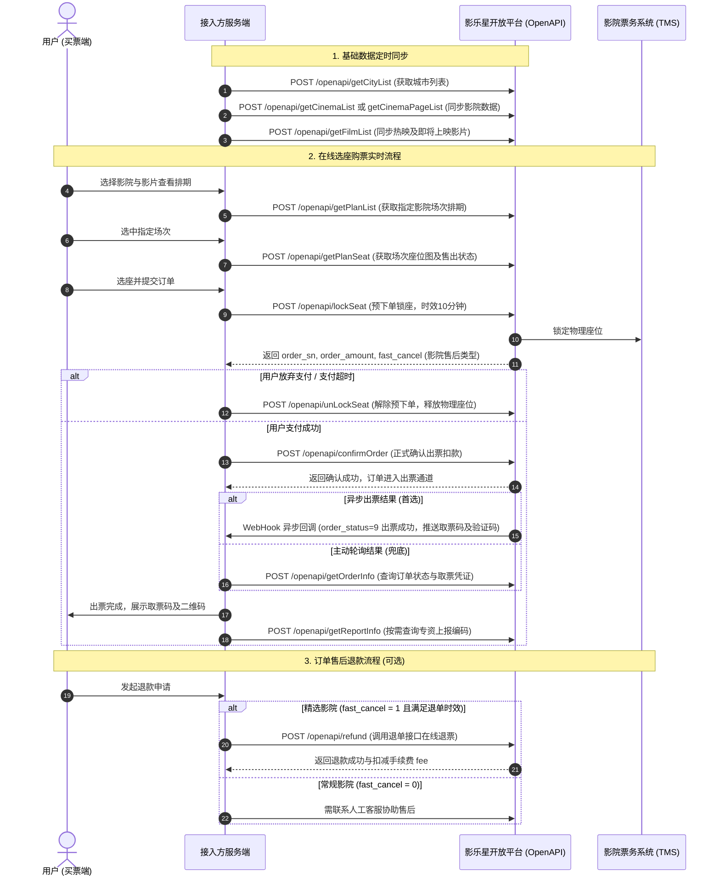

# 影乐星开放平台接口文档 (精选影院)

> **官方来源**：[https://www.yinglexing.com/web/open/index.html](https://www.yinglexing.com/web/open/index.html)\
> **服务商**：广州商展科技有限公司 / 影乐星开放平台\
> **适用业务**：电影票分销、在线选座下单、自动出票、影院场次排期同步、退票售后等。\
> **版本基准**：严格剔除官方页面源码中被 HTML 注释掉的废弃死代码，100% 对应线上实际生效的真实 API 规范。

---

## 目录

- [一、全局开发规范](#一全局开发规范)
  - [1.1 接口基础信息](#11-接口基础信息)
  - [1.2 认证与签名规则 (Sign)](#12-认证与签名规则-sign)
  - [1.3 启用 GZIP 传输提速 (关键规范)](#13-启用-gzip-传输提速-关键规范)
  - [1.4 公共返回结构与全局状态码](#14-公共返回结构与全局状态码)
- [二、业务流转时序图](#二业务流转时序图)
- [三、基础数据接口](#三基础数据接口)
  - [3.1 获取电影（影片） (getFilmList)](#31-获取电影影片-getfilmlist)
  - [3.2 获取城市列表 (getCityList)](#32-获取城市列表-getcitylist)
  - [3.3 获取电影院列表（全量影院） (getCinemaList)](#33-获取电影院列表全量影院-getcinemalist)
  - [3.4 获取电影院列表（分页查询） (getCinemaPageList)](#34-获取电影院列表分页查询-getcinemapagelist)
  - [3.5 获取场次（指定影院） (getPlanList)](#35-获取场次指定影院-getplanlist)
  - [3.6 获取场次（指定场次详情） (getPlanInfo)](#36-获取场次指定场次详情-getplaninfo)
  - [3.7 获取场次座位图 (getPlanSeat)](#37-获取场次座位图-getplanseat)
- [四、交易与订单接口](#四交易与订单接口)
  - [4.1 订单预下单（锁座） (lockSeat)](#41-订单预下单锁座-lockseat)
  - [4.2 解除预下单（解座） (unLockSeat)](#42-解除预下单解座-unlockseat)
  - [4.3 订单正式确认 (confirmOrder)](#43-订单正式确认-confirmorder)
  - [4.4 订单信息查询 (getOrderInfo)](#44-订单信息查询-getorderinfo)
  - [4.5 专资信息查询 (getReportInfo)](#45-专资信息查询-getreportinfo)
  - [4.6 订单售后（退单） (refund)](#46-订单售后退单-refund)
- [五、商户资产接口](#五商户资产接口)
  - [5.1 查询账户余额 (getUserBalance)](#51-查询账户余额-getuserbalance)
- [六、订单异步回调通知 (WebHook)](#六订单异步回调通知-webhook)
  - [6.1 通知方式与协议](#61-通知方式与协议)
  - [6.2 回调请求参数](#62-回调请求参数)
  - [6.3 取票码与二维码展示规范](#63-取票码与二维码展示规范)
- [七、业务关键避坑指南](#七业务关键避坑指南)
- [八、更新日志明细 (Change Log)](#八更新日志明细-change-log)

---

## 一、全局开发规范

### 1.1 接口基础信息
- **正式环境域名**：`https://api.yinglexing.com`
- **默认请求方式**：`POST`
- **请求内容类型 (Content-Type)**：`application/x-www-form-urlencoded`
- **字符编码**：`UTF-8`
- **对接凭证**：请联系商务人员获取对接密钥 `app_id` 和 `app_secret`。
- **强制签名**：所有业务 API 接口均必须提供签名参数 `sign`。

---

### 1.2 认证与签名规则 (Sign)

#### 公共 Body 请求参数
所有接口请求均需在 Body 中携带以下公共参数：

| 参数名 | 示例值 | 类型 | 是否必须 | 描述说明 |
| :--- | :--- | :--- | :--- | :--- |
| `app_id` | 16624661113 | String | 是 | 应用标识，联系商务人员分配获取 |
| `time` | 1789884168 | Integer | 是 | 当前 10 位 Unix 时间戳（秒级） |
| `sign` | D50F19FD31276B0414667C061AF625C3 | String | 是 | 请求参数生成的 32 位大写 MD5 签名值 |

#### 签名算法规则
1. **参数排序**：筛选所有参与本次请求的参数（含公共参数与业务参数，**排除 `sign` 字段本身**），按照键名（ASCII 码字典升序）进行排序。
2. **拼接键值对**：遍历排序后的参数字典，将各参数的 key 与 value 使用 `=` 连接（即 `key=value`），再将所有键值对以 `&` 符号拼接成待签名字符串。
   - *拼接示例*：`app_id=13000000000&medium_id=abc123456&medium_name=测试&time=1693811486`
3. **追加密钥**：在拼接后的字符串末尾连接 `&app_secret=` 及平台分配的 `app_secret`。
   - *拼接示例*：`app_id=13000000000&medium_id=abc123456&medium_name=测试&time=1693811486&app_secret=789`
4. **MD5 加密并转大写**：对最终字符串计算 MD5 摘要，并将字母转换为全部**大写**，得到签名结果。

#### 多语言签名代码参考

##### PHP 实现
```php
function getSign(array $params = [], string $appSecret): string
{
    ksort($params);
    $string = [];
    foreach ($params as $key => $value) {
        $string[] = $key . '=' . $value;
    }
    $str = implode('&', $string) . '&app_secret=' . $appSecret;
    return strtoupper(md5($str));
}
```

##### Python 3 实现
```python
import hashlib

def get_sign(params: dict, app_secret: str) -> str:
    sorted_items = sorted(
        [(k, str(v)) for k, v in params.items() if k != 'sign' and v is not None],
        key=lambda x: x[0]
    )
    query_str = '&'.join([f"{k}={v}" for k, v in sorted_items])
    query_str += f"&app_secret={app_secret}"
    return hashlib.md5(query_str.encode('utf-8')).hexdigest().upper()
```

##### Node.js 实现
```javascript
const crypto = require('crypto');

function getSign(params, appSecret) {
  const keys = Object.keys(params).filter(k => k !== 'sign' && params[k] !== undefined && params[k] !== null).sort();
  const pairs = keys.map(k => `${k}=${params[k]}`);
  const rawStr = pairs.join('&') + `&app_secret=${appSecret}`;
  return crypto.createHash('md5').update(rawStr, 'utf8').digest('hex').toUpperCase();
}
```

##### Java 实现
```java
import java.nio.charset.StandardCharsets;
import java.security.MessageDigest;
import java.util.*;

public class SignUtil {
    public static String getSign(Map<String, Object> params, String appSecret) {
        Map<String, Object> sortedMap = new TreeMap<>(params);
        sortedMap.remove("sign");

        StringBuilder sb = new StringBuilder();
        for (Map.Entry<String, Object> entry : sortedMap.entrySet()) {
            if (entry.getValue() != null) {
                if (sb.length() > 0) sb.append("&");
                sb.append(entry.getKey()).append("=").append(entry.getValue());
            }
        }
        sb.append("&app_secret=").append(appSecret);

        try {
            MessageDigest md = MessageDigest.getInstance("MD5");
            byte[] bytes = md.digest(sb.toString().getBytes(StandardCharsets.UTF_8));
            StringBuilder hex = new StringBuilder();
            for (byte b : bytes) {
                String s = Integer.toHexString(b & 0xFF);
                if (s.length() == 1) hex.append("0");
                hex.append(s);
            }
            return hex.toString().toUpperCase();
        } catch (Exception e) {
            throw new RuntimeException("MD5 calculate failed", e);
        }
    }
}
```

---

### 1.3 启用 GZIP 传输提速 (关键规范)
为提升接口数据传输效率、降低网络带宽开销以及优化系统响应时延，**要求所有接入客户启用 GZIP 压缩传输**：

#### 启用配置
发起所有 API 请求时，在 HTTP Request Header 中加入：
```http
Accept-Encoding: gzip
```

#### 重点启用接口
以下两个接口因排期与座位数据体量巨大，建议优先启用 GZIP 压缩：
1. 获取场次排期接口：`/openapi/getPlanList`
2. 获取场次座位图接口：`/openapi/getPlanSeat`

#### 压缩关键机制
- **动态压缩规则**：平台服务器仅对响应体大小 **> 512 字节** 的数据执行 GZIP 压缩；响应体 **≤ 512 字节** 时返回原始未压缩数据。
- **压缩标识识别**：当响应为 GZIP 压缩时，Response Header 中会包含 `Content-Encoding: gzip`，接入方可通过该标识判断是否需要解压。
- **双模式兼容要求**：接入方 HTTP 客户端必须同时兼容“压缩”与“非压缩”格式，避免因数据格式不匹配导致解析报错。主流 HTTP 工具库（Axios、OkHttp、Fetch、Requests 等）默认支持自动解压。

---

### 1.4 公共返回结构与全局状态码

#### 公共响应 JSON 格式
```json
{
  "code": 200,
  "msg": "操作提示",
  "time": 1789884168,
  "data": ...
}
```

| 参数名 | 类型 | 是否必选 | 描述说明 |
| :--- | :--- | :--- | :--- |
| `code` | Integer | 是 | 业务返回状态码（200 为成功） |
| `msg` | String | 是 | 返回文字信息或错误原因 |
| `time` | Integer | 是 | 当前服务端 10 位时间戳 |
| `data` | Object / Array / String | 是 | 业务响应数据载荷 |

#### 全局状态码表
| 状态码 (code) | 含义说明 | 故障排查指导 |
| :--- | :--- | :--- |
| `200` | 成功 | 请求成功，正常解析 `data` 字段。 |
| `400` | 失败 | 业务处理失败，具体原因查看 `msg` 描述（如座位已售、锁座超时、余额不足等）。 |
| `402` | 账号信息有误 | 校验传参中的 `app_id` 是否正确，确认商户资格。 |
| `403` | 账号已被禁 | 账户权限受限或停用，需联系商务处理。 |
| `404` | 签名错误 | 核对参与签名的参数名升序排序、URL 字符拼接及 `app_secret` 是否一致。 |

---

## 二、业务流转时序图



---

## 三、基础数据接口

### 3.1 获取电影（影片） (getFilmList)
- **请求方式**：`POST`
- **接口地址**：`https://api.yinglexing.com/openapi/getFilmList`
- **功能描述**：获取正在热映或即将上映的电影信息列表。

#### 请求参数 (Body)
| 参数名 | 示例值 | 类型 | 是否必须 | 描述说明 | 公共 |
| :--- | :--- | :--- | :--- | :--- | :--- |
| app_id | 16624661113 | String | 是 | app_id | 是 |
| sign | D50F19FD31276B0414667C061AF625C3 | String | 是 | 签名（详见“签名规则”） | 是 |
| time | 1789884199 | Integer | 是 | 当前10位时间戳 | 是 |
| status_type | 1 | Integer | 是 | 1为正在热映；2为即将上映电影 | 否 |


#### 返回参数说明
| 参数名 | 类型 | 描述说明 |
| :--- | :--- | :--- |
| id | Integer | 影片ID |
| grade | String | 评分 |
| name | String | 影片名 |
| duration | String | 影片时长（单位：分钟） |
| publish_date | String | 影片上映日期 |
| director | String | 主演信息 |
| cast | String | 主演 |
| intro | String | 简介 |
| version_types | String | 上映类型 |
| language | String | 语言 |
| film_types | String | 影片类型 |
| pic | String | 海报URL地址 |
| like | String | 想看人数 |
| show_status | Integer | 放映状态：1 正在热映。2 即将上映 |
| moviearea | String | 上映地区 |
| actor.director | Array | 导演信息 |
| actor.actors | Array | 演员信息 |
| stills | String | 剧照 |
| image | String | 剧情图片 |
| film_code | String | 11位影片专资编码（可能为空） |


#### 返回示例
```json
{
  "code": 200,
  "msg": "",
  "time": 1772782035,
  "data": [
    {
      "id": 101902,
      "grade": "7.5",
      "name": "建筑师",
      "duration": "116",
      "publish_date": "2021-06-04 00:00:00",
      "director": "大卫·阿耶",
      "cast": "杰森·斯坦森 大卫·哈伯 迈克尔·佩尼亚 埃米特·斯坎伦",
      "intro": "基于查克·迪克森所著同名系列小说，讲述主人公莱文·凯德是黑色行动界的传奇人物，他放弃职业从事建筑工作，想过简单的生活，做女儿的好父亲，而当他老板的十几岁女儿珍妮突然消失后，莱文被召回要求重操旧业。在追踪过程中，莱文卷入到一个邪恶的犯罪阴谋的中心，产生了连锁反应，将威胁到他的新生活方式。",
      "version_types": "2D",
      "language": "英语",
      "film_types": "动作|惊悚",
      "pic": "https://gw.alicdn.com/i4/O1CN01wUyMLK20EhPv0gnrI_!!6000000006818-0-alipicbeacon.jpg_480x480Q30s150.jpg",
      "like": "174",
      "show_status": 2,
      "moviearea": "英国,美国",
      "actor": "{\"director\":[{\"sc_name\":\"\\u4e01\\u6587\\u5251\",\"en_name\":\"Wenjian Ding\",\"act_name\":\"\",\"avatar\":\"https:\\/\\/gw.alicdn.com\\/i4\\/TB1ONYVgzMZ7e4jSZFOXXX7epXa_.jpg\"},{\"sc_name\":\"\\u5927\\u536b\\u00b7\\u963f\\u8036\",\"en_name\":\"David Ayer\",\"act_name\":\"\",\"avatar\":\"https:\\/\\/gw.alicdn.com\\/i4\\/TB1D2LcykL0gK0jSZFtXXXQCXXa_.jpg\"}],\"actors\":[{\"sc_name\":\"\\u6770\\u68ee\\u00b7\\u65af\\u5766\\u68ee\",\"en_name\":\"Jason Statham\",\"act_name\":\"Levon Cade\",\"avatar\":\"https:\\/\\/gw.alicdn.com\\/i3\\/O1CN01s8Q8Sb1kCpmCAL5CA_!!6000000004648-0-alipicbeacon.jpg\"},{\"sc_name\":\"\\u9a6c\\u514b\\u897f\\u7c73\\u5229\\u5b89\\u00b7\\u5965\\u8f9b\\u65af\\u57fa\",\"en_name\":\"Maximilian Osinski\",\"act_name\":\"Dimi Kolisnyk\",\"avatar\":\"https:\\/\\/gw.alicdn.com\\/i4\\/O1CN01852W131NXgp9TJR6w_!!6000000001580-0-alipicbeacon.jpg\"},{\"sc_name\":\"\\u4f0a\\u8299\\u00b7\\u8302\\u6d1b\",\"en_name\":\"Eve Mauro\",\"act_name\":\"Artemis\",\"avatar\":\"https:\\/\\/gw.alicdn.com\\/i2\\/TB17itUJpXXXXcOXFXXXXXXXXXX_.jpg\"},{\"sc_name\":\"\\u5927\\u536b\\u00b7\\u5a01\\u8328\",\"en_name\":\"David Witts\",\"act_name\":\"Johnny the Bartender\",\"avatar\":\"https:\\/\\/gw.alicdn.com\\/i3\\/O1CN01kYCuqq1e4h5raEOAx_!!6000000003818-0-alipicbeacon.jpg\"},{\"sc_name\":\"\\u5b89\\u5fb7\\u8389\\u5a05\\u00b7\\u74e6\\u897f\\u5229\\u4e4c\",\"en_name\":\"Andrea Vasiliou\",\"act_name\":\"Dimi\\u00b4s Girlfriend\",\"avatar\":\"https:\\/\\/gw.alicdn.com\\/i4\\/O1CN01BEzgvN22PoFvsaWba_!!6000000007113-0-alipicbeacon.jpg\"},{\"sc_name\":\"\\u683c\\u96f7\\u6208\\u00b7\\u79d1\\u5c14\\u5e15\\u514b\\u5947\",\"en_name\":\"Greg Kolpakchi\",\"act_name\":\"Danya Kharchenko\",\"avatar\":\"https:\\/\\/gw.alicdn.com\\/i3\\/O1CN0181bMHP1JrbLZAsvQ7_!!6000000001082-0-alipicbeacon.jpg\"},{\"sc_name\":\"\\u963f\\u91cc\\u5b89\\u5a1c\\u00b7\\u91cc\\u74e6\\u65af\",\"en_name\":\"Arianna Rivas\",\"act_name\":\"Jenny\",\"avatar\":\"https:\\/\\/gw.alicdn.com\\/i3\\/O1CN01Uzx8Sd1yx0V8oa2Ki_!!6000000006644-0-alipicbeacon.jpg\"}]}",
      "stills": "[\"https:\\/\\/gw.alicdn.com\\/i4\\/O1CN01wUyMLK20EhPv0gnrI_!!6000000006818-0-alipicbeacon.jpg_720x720Q30s150.jpg\"]",
      "image": "https://www.huobanos.com/upload/default/20251231/176714470266390.png",
      "film_code": "00101992019"
    }
  ]
}
```

---

### 3.2 获取城市列表 (getCityList)
- **请求方式**：`POST`
- **接口地址**：`https://api.yinglexing.com/openapi/getCityList`
- **功能描述**：获取平台支持的全国城市及区县行政区列表。

#### 请求参数 (Body)
| 参数名 | 示例值 | 类型 | 是否必须 | 描述说明 | 公共 |
| :--- | :--- | :--- | :--- | :--- | :--- |
| app_id | 16624661113 | String | 是 | app_id | 是 |
| sign | D50F19FD31276B0414667C061AF625C3 | String | 是 | 签名（详见“签名规则”） | 是 |
| time | 1789884200 | Integer | 是 | 当前10位时间戳 | 是 |


> **说明**：本接口无需额外业务入参，仅需传递公共 Body 请求参数（`app_id`、`sign`、`time`）。

#### 返回参数说明
| 参数名 | 类型 | 描述说明 |
| :--- | :--- | :--- |
| data.city_id | Integer | 城市ID |
| data.region_code | String | 城市行政区编码 |
| data.region_name | String | 城市 |
| data.pin_yin | String | 城市首字母 |
| data.district | Array | 城市下级行政区列表 |
| data.district[].county_id | Integer | 区县ID |
| data.district[].county | String | 区县 |
| data.district[].county_code | String | 区县行政区编码 |


#### 返回示例
```json
{
  "code": 200,
  "msg": "",
  "time": 1761124405,
  "data": [
    {
      "city_id": 439,
      "region_name": "天津市",
      "pin_yin": "T",
      "region_code": 120000,
      "district": [
        {
          "county_id": 17,
          "county": "和平区",
          "county_code": "120101"
        }
      ]
    }
  ]
}
```

---

### 3.3 获取电影院列表（全量影院） (getCinemaList)
- **请求方式**：`POST`
- **接口地址**：`https://api.yinglexing.com/openapi/getCinemaList`
- **功能描述**：一次性全量获取已对接的全部影院列表。

#### 请求参数 (Body)
| 参数名 | 示例值 | 类型 | 是否必须 | 描述说明 | 公共 |
| :--- | :--- | :--- | :--- | :--- | :--- |
| app_id | 16624661113 | String | 是 | app_id | 是 |
| sign | D50F19FD31276B0414667C061AF625C3 | String | 是 | 签名（详见“签名规则”） | 是 |
| time | 1789884201 | Integer | 是 | 当前10位时间戳 | 是 |


> **说明**：本接口无需额外业务入参，仅需传递公共 Body 请求参数（`app_id`、`sign`、`time`）。

#### 返回参数说明
| 参数名 | 类型 | 描述说明 |
| :--- | :--- | :--- |
| data.cinema_id | Integer | 影院ID |
| data.standard_id | String | 影院专资编码 |
| data.cinema_name | String | 影院名称 |
| data.address | String | 影院地址 |
| data.latitude | String | 纬度，BD09LL 格式 |
| data.longitude | String | 经度，BD09LL 格式 |
| data.city_id | Integer | 城市ID |
| data.region_code | String | 城市行政区编码 |
| data.region_name | String | 城市 |
| data.fast_cancel | String | 影院类型：0=常规影院，1=精选影院，当前接口该值仅为预估值，最终订单的影院类型（即所走的出票接口）请依据最终的订单查询接口返回值为准。 |
| data.county_id | Integer | 区县ID（可能为空） |
| data.county | String | 区县（可能为空） |
| data.county_code | String | 区县行政区编码（可能为空） |


#### 返回示例
```json
{
  "code": 200,
  "msg": "",
  "time": 1761124405,
  "data": [
    {
      "cinema_id": 11012,
      "cinema_name": "保利剧院影城",
      "address": "文化路4号鄂尔多斯大剧院B1层",
      "latitude": "39.602331948326",
      "longitude": "109.79920163101",
      "city_id": 510,
      "region_code": "510000",
      "region_name": "广州市",
      "standard_id": 15033211,
      "fast_cancel": 0,
      "county_id": 359,
      "county": "康巴什区",
      "county_code": "150603"
    }
  ]
}
```

---

### 3.4 获取电影院列表（分页查询） (getCinemaPageList)
- **请求方式**：`POST`
- **接口地址**：`https://api.yinglexing.com/openapi/getCinemaPageList`
- **功能描述**：支持分页拉取影院数据，便于系统增量同步。

#### 请求参数 (Body)
| 参数名 | 示例值 | 类型 | 是否必须 | 描述说明 | 公共 |
| :--- | :--- | :--- | :--- | :--- | :--- |
| app_id | 16624661113 | String | 是 | app_id | 是 |
| sign | D50F19FD31276B0414667C061AF625C3 | String | 是 | 签名（详见“签名规则”） | 是 |
| time | 1789884201 | Integer | 是 | 当前10位时间戳 | 是 |
| limit | 100 | Integer | 否 | 每页查询数量，默认100 | 否 |
| page | 1 | Integer | 否 | 当前页码，默认1 | 否 |


#### 返回参数说明
| 参数名 | 类型 | 描述说明 |
| :--- | :--- | :--- |
| data.list | Array | 影院列表 |
| data.list.cinema_id | Integer | 影院ID |
| data.list.standard_id | String | 影院专资编码 |
| data.list.cinema_name | String | 影院名称 |
| data.list.address | String | 影院地址 |
| data.list.latitude | String | 纬度，BD09LL 格式 |
| data.list.longitude | String | 经度，BD09LL 格式 |
| data.list.city_id | Integer | 城市ID |
| data.list.region_code | String | 城市行政区编码 |
| data.list.region_name | String | 城市 |
| data.list.fast_cancel | String | 影院类型：0=常规影院，1=精选影院，当前接口该值仅为预估值，最终订单的影院类型（即所走的出票接口）请依据最终的订单查询接口返回值为准。 |
| data.list.county_id | Integer | 区县ID（可能为空） |
| data.list.county | String | 区县（可能为空） |
| data.list.county_code | String | 区县行政区编码（可能为空） |
| data.count | Integer | 影院数量 |
| data.page | Integer | 当前页码 |
| data.limit | Integer | 每页查询数量 |
| data.total_page | Integer | 总页数 |


#### 返回示例
```json
{
  "code": 200,
  "msg": "",
  "time": 1788226962,
  "data": {
    "list": [
      {
        "cinema_id": 10000,
        "cinema_name": "九州全沙发影城",
        "address": "丁字沽3号路物美大卖场一楼",
        "latitude": "39.180111169634",
        "longitude": "117.16732733875",
        "city_id": 439,
        "region_code": 120000,
        "region_name": "天津市",
        "standard_id": 12061281,
        "fast_cancel": 0,
        "county_id": 22,
        "county": "红桥区",
        "county_code": "120106"
      }
    ],
    "count": 14592,
    "page": 1,
    "limit": 1,
    "total_page": 14592
  }
}
```

---

### 3.5 获取场次（指定影院） (getPlanList)
- **请求方式**：`POST`
- **接口地址**：`https://api.yinglexing.com/openapi/getPlanList`
- **Header 建议**：`Accept-Encoding: gzip`
- **功能描述**：根据影院专资编码获取该影院近期的影片场次及价格信息。

#### 请求参数 (Body)
| 参数名 | 示例值 | 类型 | 是否必须 | 描述说明 | 公共 |
| :--- | :--- | :--- | :--- | :--- | :--- |
| app_id | 16624661113 | String | 是 | app_id | 是 |
| sign | D50F19FD31276B0414667C061AF625C3 | String | 是 | 签名（详见“签名规则”） | 是 |
| time | 1789884202 | Integer | 是 | 当前10位时间戳 | 是 |
| standard_id | 1760950141 | String | 是 | 影院专资编码 | 否 |


#### 返回参数说明
| 参数名 | 类型 | 描述说明 |
| :--- | :--- | :--- |
| data.cinema_id | Integer | 影院ID |
| data.hall_name | String | 影厅名称 |
| data.film_id | String | 影片ID |
| data.film_name | String | 影片名称 |
| data.duration | Integer | 影片时长 |
| data.show_time | String | 放映时间 |
| data.price | String | 结算价格（含税） |
| data.nax_price | String | 按 含税结算价格 × 0.94 实时计算出来的 不含税 结算价格（ 适用于您内部比价使用 / 我方系统对该数值不予记录及使用 ） |
| data.nax_price_st | String | 按 含税结算价格 ÷ 1.06 实时计算出来的 不含税 结算价格（ 适用于您内部比价使用 / 我方系统对该数值不予记录及使用 ） |
| data.original_price | String | 网售原价 |
| data.show_version_type | String | 影片类型 |
| data.language | String | 语言 |
| data.plan_type | String | 影厅类型 2D 3D |
| data.city_id | Integer | 城市ID |
| data.region_code | String | 城市行政区编码 |
| data.show_id | String | 场次ID |
| data.standard_id | String | 影院专资编码 |
| data.film_code | String | 影片编码 |
| data.restrictions | Integer | 本场次最多允许售卖的座位数量 |
| data.schedule_area | String | 分区信息 |
| data.schedule_area[].area | String / Number | 分区ID |
| data.schedule_area[].original_price | String | 分区座位网售原价 |
| data.schedule_area[].price | String | 分区座位结算价格（含税） |
| data.schedule_area[].nax_price | String | 按 含税分区座位结算价格 × 0.94 实时计算出来的 不含税 结算价格（ 适用于您内部比价使用 / 我方系统对该数值不予记录及使用 ） |
| data.schedule_area[].nax_price_st | String | 按 含税分区座位结算价格 ÷ 1.06 实时计算出来的 不含税 结算价格（ 适用于您内部比价使用 / 我方系统对该数值不予记录及使用 ） |


#### 返回示例
```json
{
  "code": 200,
  "msg": "",
  "time": 1760952452,
  "data": [
    {
      "cinema_id": 11806,
      "hall_name": "VIP 2号厅-儿童需购票（2张影票+1元兑换一杯可乐）",
      "film_id": "101816",
      "film_name": "捕风追影",
      "duration": 141,
      "show_time": "2025-10-20 21:15:00",
      "price": "33.00",
      "original_price": "33.00",
      "show_version_type": "国语 2D",
      "language": "国语",
      "plan_type": "2D",
      "city_id": 510,
      "region_code": "510000",
      "show_id": "033D4BD4CE7716D7B4697C000088FFCD",
      "standard_id": "31195201",
      "film_code": "00102032025",
      "restrictions": 4,
      "nax_price": "31.02",
      "nax_price_st": "31.02",
      "schedule_area": [
        {
          "area": "0",
          "price": "38.28",
          "original_price": "38.28",
          "nax_price": "35.98",
          "nax_price_st": "35.98"
        },
        {
          "area": "1",
          "price": "31.77",
          "original_price": "38.28",
          "nax_price": "29.86",
          "nax_price_st": "29.86"
        }
      ]
    }
  ]
}
```

---

### 3.6 获取场次（指定场次详情） (getPlanInfo)
- **请求方式**：`POST`
- **接口地址**：`https://api.yinglexing.com/openapi/getPlanInfo`
- **功能描述**：根据场次ID和影院专资编码精准查询单一排期的详细信息。

#### 请求参数 (Body)
| 参数名 | 示例值 | 类型 | 是否必须 | 描述说明 | 公共 |
| :--- | :--- | :--- | :--- | :--- | :--- |
| app_id | 16624661113 | String | 是 | app_id | 是 |
| sign | D50F19FD31276B0414667C061AF625C3 | String | 是 | 签名（详见“签名规则”） | 是 |
| time | 1789884203 | Integer | 是 | 当前10位时间戳 | 是 |
| standard_id | 1760950141 | String | 是 | 影院专资编码 | 否 |
| show_id | 34D4746BDD533DF29138A130ACAC579900 | String | 是 | 场次ID | 否 |


#### 返回参数说明
| 参数名 | 类型 | 描述说明 |
| :--- | :--- | :--- |
| cinema_id | Integer | 影院ID |
| hall_name | String | 影厅名称 |
| film_id | String | 影片ID |
| film_name | String | 影片名称 |
| duration | Integer | 影片时长 |
| show_time | String | 放映时间 |
| price | String | 结算价格（含税） |
| nax_price | String | 按 含税结算价格 × 0.94 实时计算出来的 不含税 结算价格（ 适用于您内部比价使用 / 我方系统对该数值不予记录及使用 ） |
| nax_price_st | String | 按 含税结算价格 ÷ 1.06 实时计算出来的 不含税 结算价格（ 适用于您内部比价使用 / 我方系统对该数值不予记录及使用 ） |
| original_price | String | 网售原价 |
| show_version_type | String | 影片类型 |
| language | String | 语言 |
| plan_type | String | 影厅类型 2D 3D |
| city_id | Integer | 城市ID |
| region_code | String | 城市行政区编码 |
| show_id | String | 场次ID |
| standard_id | String | 影院专资编码 |
| film_code | String | 影片编码 |
| restrictions | Integer | 本场次最多允许售卖的座位数量 |
| schedule_area | String | 分区信息 |
| schedule_area[].area | String / Number | 分区ID |
| schedule_area[].original_price | String | 分区座位网售原价 |
| schedule_area[].price | String | 分区座位结算价格（含税） |
| schedule_area[].nax_price | String | 按 含税分区座位结算价格 × 0.94 实时计算出来的 不含税 结算价格（ 适用于您内部比价使用 / 我方系统对该数值不予记录及使用 ） |
| schedule_area[].nax_price_st | String | 按 含税分区座位结算价格 ÷ 1.06 实时计算出来的 不含税 结算价格（ 适用于您内部比价使用 / 我方系统对该数值不予记录及使用 ） |


#### 返回示例
```json
{
  "code": 200,
  "msg": "",
  "time": 1760952452,
  "data": {
    "cinema_id": 11806,
    "hall_name": "VIP 2号厅-儿童需购票（2张影票+1元兑换一杯可乐）",
    "film_id": "101816",
    "film_name": "捕风追影",
    "duration": 141,
    "show_time": "2025-10-20 21:15:00",
    "price": "33.00",
    "original_price": "33.00",
    "show_version_type": "国语 2D",
    "language": "国语",
    "plan_type": "2D",
    "city_id": 510,
    "region_code": "510000",
    "show_id": "033D4BD4CE7716D7B4697C000088FFCD",
    "standard_id": "31195201",
    "film_code": "00102032025",
    "restrictions": 4,
    "nax_price": "31.02",
    "nax_price_st": "31.02",
    "schedule_area": [
      {
        "area": "0",
        "price": "38.28",
        "original_price": "38.28",
        "nax_price": "35.98",
        "nax_price_st": "35.98"
      },
      {
        "area": "1",
        "price": "31.77",
        "original_price": "38.28",
        "nax_price": "29.86",
        "nax_price_st": "29.86"
      }
    ]
  }
}
```

---

### 3.7 获取场次座位图 (getPlanSeat)
- **请求方式**：`POST`
- **接口地址**：`https://api.yinglexing.com/openapi/getPlanSeat`
- **Header 建议**：`Accept-Encoding: gzip`
- **功能描述**：获取场次座位排布布局、售卖状态及情侣座定义。

#### 请求参数 (Body)
| 参数名 | 示例值 | 类型 | 是否必须 | 描述说明 | 公共 |
| :--- | :--- | :--- | :--- | :--- | :--- |
| app_id | 16624661113 | String | 是 | app_id | 是 |
| sign | D50F19FD31276B0414667C061AF625C3 | String | 是 | 签名（详见“签名规则”） | 是 |
| time | 1789884203 | Integer | 是 | 当前10位时间戳 | 是 |
| show_id | 772CB87A714E3C3E4ADF906AB445BFF3 | String | 是 | 场次ID | 否 |


#### 返回参数说明
| 参数名 | 类型 | 描述说明 |
| :--- | :--- | :--- |
| data.restrictions | Integer | 本场次最多允许售卖的座位数量 |
| data.seats | Array | 座位数据 |
| data.seats[].columnNo | String | 列 |
| data.seats[].rowNo | String | 行 |
| data.seats[].area | String / Number | 分区ID |
| data.seats[].lovestatus | Integer | 0为非情侣座；1为情侣座左；2为情侣座右　情侣座/双人座单独购买会导致锁座失败，请在收单时自行限制此类订单； |
| data.seats[].status | String | N可售，LK不可售 |
| data.seats[].seatId | String | 座位ID |
| data.seats[].seatNo | String | 座位名 |


#### 返回示例
```json
{
  "code": 200,
  "msg": "",
  "time": 1761014928,
  "data": {
    "restrictions": 4,
    "seats": [
      {
        "columnNo": "3",
        "rowNo": "1",
        "area": "0",
        "lovestatus": 0,
        "status": "N",
        "seatId": "MTU0OTU2QF9AMjIyOTQ1QF9AMTc2MTQ3MTAwMEBfQDFAX0AxNDFAX0Ax5o6SMeWIl0BfQDQ5QF9AMEBfQDHmjpIx5YiXQF9AMzAxNzdAX0Aw",
        "seatNo": "1排1列"
      }
    ]
  }
}
```

---

## 四、交易与订单接口

### 4.1 订单预下单（锁座） (lockSeat)
- **请求方式**：`POST`
- **接口地址**：`https://api.yinglexing.com/openapi/lockSeat`
- **功能描述**：向影院发起物理锁座。**锁座保留 10 分钟**，超时自动释放；**开场前 20 分钟内不支持锁座**。

#### 请求参数 (Body)
| 参数名 | 示例值 | 类型 | 是否必须 | 描述说明 | 公共 |
| :--- | :--- | :--- | :--- | :--- | :--- |
| app_id | 16624661113 | String | 是 | app_id | 是 |
| sign | D50F19FD31276B0414667C061AF625C3 | String | 是 | 签名（详见“签名规则”） | 是 |
| time | 1789884204 | Integer | 是 | 当前10位时间戳 | 是 |
| show_id | 772CB87A714E3C3E4ADF906AB445BFF3 | String | 是 | 场次ID | 否 |
| seat_data | [{"seat_id":"4400197101#01#01","column_num":"17","row_num":"2","lovestatus":0,"area_id":"0","seat_no":"1排1座"},{"seat_id":"4400197101#01#02","column_num":"16","row_num":"2","lovestatus":0,"area_id":"0","seat_no":"1排2座"},{"seat_id":"4400197101#01#03","column_num":"15","row_num":"2","lovestatus":0,"area_id":"0","seat_no":"1排3座"}] | String | 是 | 座位信息 | 否 |
| seat_data[].seat_id | 4400197101#01#01 | String | 是 | 座位ID | 否 |
| seat_data[].column_num | 1 | String | 是 | 列 | 否 |
| seat_data[].row_num | 1 | String | 是 | 行 | 否 |
| seat_data[].lovestatus | 0 | Integer | 是 | 0为非情侣座；1为情侣座左；2为情侣座右　情侣座/双人座单独购买会导致锁座失败，请在收单时自行限制此类订单； | 否 |
| seat_data[].area_id | 1 | String / Number | 是 | 分区ID | 否 |
| seat_data[].seat_no | 1排1座 | String | 是 | 座位名 | 否 |
| phone | 16624661113 | String | 是 | 下单手机号码 | 否 |
| notify_url | https://xxx.com/notify.html | String | 否 | 异步回调地址，订单状态发生变更时通过该地址通知接入方 | 否 |
| order_price | 20.00 | String | 否 | 该字段用于验证订单结算价格的正确性，即确保【您系统内存储的结算价格】与【影乐星系统实际的结算价格】的匹配度；<br>								同时，为提高订单的传入成功率，只要您传输的金额≥我方系统内实时的结算金额，订单都会被接收。 | 否 |


> **特别提示**：
> 1. `seat_data` 参数须序列化为 JSON 字符串格式传输。
> 2. `order_price` 为选填入参。官方真实规则：**只要传入的金额 ≥ 影乐星实时的结算金额，订单都会被接收**。在业务开发中，建议传入排期中获取的 `price`（含税结算价）或直接不传该字段。

#### 返回参数说明
| 参数名 | 类型 | 描述说明 |
| :--- | :--- | :--- |
| data.order_sn | String | 订单编号 |
| data.fast_cancel | Integer | 当前锁座使用的影院类型：0=常规影院（需对接客服执行售后），1=精选影院（满足时间条件的情况下可直接使用接口退单），当前接口内该值为预估值，最终订单的出票方式走的接口请依据订单接口返回值为准。 |
| data.order_amount | String | 订单结算金额（单位：元） |


#### 返回示例
```json
{
  "code": 200,
  "msg": "",
  "time": 1761037155,
  "data": {
    "order_sn": "MO202510215152100971",
    "order_amount": "20.00",
    "fast_cancel": 0
  }
}
```

---

### 4.2 解除预下单（解座） (unLockSeat)
- **请求方式**：`POST`
- **接口地址**：`https://api.yinglexing.com/openapi/unLockSeat`
- **功能描述**：用户放弃支付或超时未支付时，主动释放锁定的物理座位。

#### 请求参数 (Body)
| 参数名 | 示例值 | 类型 | 是否必须 | 描述说明 | 公共 |
| :--- | :--- | :--- | :--- | :--- | :--- |
| app_id | 16624661113 | String | 是 | app_id | 是 |
| sign | D50F19FD31276B0414667C061AF625C3 | String | 是 | 签名（详见“签名规则”） | 是 |
| time | 1789884205 | Integer | 是 | 当前10位时间戳 | 是 |
| order_sn | MO202510221015110055 | String | 是 | 订单编号 | 否 |


#### 返回参数说明
| 参数名 | 类型 | 描述说明 |
| :--- | :--- | :--- |
| code | Integer | 状态码，200：成功，其它：失败 |
| msg | String | 响应信息 |


#### 返回示例
```json
{
  "code": 200,
  "msg": "解锁成功",
  "time": 1761201651,
  "data": ""
}
```

---

### 4.3 订单正式确认 (confirmOrder)
- **请求方式**：`POST`
- **接口地址**：`https://api.yinglexing.com/openapi/confirmOrder`
- **功能描述**：用户在接入端付款成功后调用，系统扣除商户账户余额并将订单送入出票队列。

#### 请求参数 (Body)
| 参数名 | 示例值 | 类型 | 是否必须 | 描述说明 | 公共 |
| :--- | :--- | :--- | :--- | :--- | :--- |
| app_id | 16624661113 | String | 是 | app_id | 是 |
| sign | D50F19FD31276B0414667C061AF625C3 | String | 是 | 签名（详见“签名规则”） | 是 |
| time | 1789884205 | Integer | 是 | 当前10位时间戳 | 是 |
| order_sn | MO202510221015110055 | String | 是 | 订单编号 | 否 |
| user_order_id | 456321789 | String | 否 | 接入方订单号（订单查询接口会返回） | 否 |


#### 返回参数说明
| 参数名 | 类型 | 描述说明 |
| :--- | :--- | :--- |
| data | Object | 响应数据 |
| data.order_sn | String | 订单编号 |
| data.fast_cancel | Integer | 当前确认订单的影院类型：0=常规影院（需对接客服执行售后），1=精选影院（满足时间条件的情况下可直接使用接口退单），当前接口内该值为预估值，最终订单的出票方式走的接口请依据订单接口返回值为准。 |


#### 返回示例
```json
{
  "code": 200,
  "msg": "",
  "time": 1761101232,
  "data": {
    "order_sn": "MO202510225049101555",
    "fast_cancel": 0
  }
}
```

---

### 4.4 订单信息查询 (getOrderInfo)
- **请求方式**：`POST`
- **接口地址**：`https://api.yinglexing.com/openapi/getOrderInfo`
- **功能描述**：获取订单详细状态、取票码、实际座位、金额及售后信息。

#### 请求参数 (Body)
| 参数名 | 示例值 | 类型 | 是否必须 | 描述说明 | 公共 |
| :--- | :--- | :--- | :--- | :--- | :--- |
| app_id | 16624661113 | String | 是 | app_id | 是 |
| sign | D50F19FD31276B0414667C061AF625C3 | String | 是 | 签名（详见“签名规则”） | 是 |
| time | 1789884206 | Integer | 是 | 当前10位时间戳 | 是 |
| order_sn | MO202510221015110055 | String | 是 | 订单编号 | 否 |


#### 返回参数说明
| 参数名 | 类型 | 描述说明 |
| :--- | :--- | :--- |
| data.order_sn | String | 订单编号 |
| data.add_time | String | 下单时间 |
| data.pay_status | Integer | 支付状态，0：未支付，1：已支付，2：已退款 |
| data.ticket_list | Array | 取票码信息（当订单状态为9时，才有数据） |
| ticket_list[].ticket_code | String | 取票码 |
| ticket_list[].ticket_stub | String | 原始截图 |
| ticket_list[].ticket_msg_code | String | 验证码 |
| data.order_status | Integer | 订单状态���0：未支付，1：传输系统商成功，2：已取消，3：出票失败，9：出票成功 |
| data.phone | String | 下单手机号 |
| data.standard_id | Integer | 影院传资编码 |
| data.cinema_name | String | 影院名称 |
| data.film_name | String | 影片名称 |
| data.show_id | String | 场次ID |
| data.hall_name | String | 影厅名称 |
| data.show_time | String | 放映时间 |
| data.duration | String | 影片时长 |
| data.language | String | 语言 |
| data.plan_type | String | 影厅类型 2D 3D |
| data.seat | String | 实际出票座位（多个座位使用“,”隔开） |
| data.fast_cancel | String | 当前订单出票影院类型：0=常规影院（需对接客服执行售后），1=精选影院（满足时间条件的情况下可直接使用接口退单）。 |
| data.order_amount | String | 结算价格 |
| data.user_order_id | String | 接入方订单号 |
| data.refund_amount | String | 退款金额 |
| data.refund_fee | String | 退款手续费 |
| data.is_after | String | 是否售后订单：1：是，0：否 |
| time | Integer | 当前10位时间戳 |


#### 返回示例
```json
{
  "code": 200,
  "msg": "",
  "time": 1761128314,
  "data": {
    "order_sn": "MO202510221021015455",
    "add_time": "2025-10-22 18:13:03",
    "pay_status": 1,
    "ticket_list": "[{\"ticket_code\":\"04435008\"}]",
    "order_status": 9,
    "phone": "16624661113",
    "standard_id": 44001971,
    "cinema_name": "CGV影城(K11 4DX店)",
    "film_name": "熊出没•重启未来",
    "show_id": "51ED64DB6518BD93C23B1852E661FA83",
    "hall_name": "1号厅-XXXXXXX 免费停车x小时30分",
    "show_time": "2025-10-26 00:55:00",
    "duration": "108",
    "language": "国语",
    "plan_type": "IMAX",
    "seat": "1排1座,1排2座,1排3座",
    "fast_cancel": 0,
    "order_amount": "56.00",
    "user_order_id": "456321789",
    "refund_amount": "0.00",
    "refund_fee": "0.00",
    "is_after": "0"
  }
}
```

---

### 4.5 专资信息查询 (getReportInfo)
- **请求方式**：`POST`
- **接口地址**：`https://api.yinglexing.com/openapi/getReportInfo`
- **功能描述**：订单出票成功后调用，查询国家专资办新规电子票上报编码信息（用于电子发票、凭据打印或财务稽核）。

#### 请求参数 (Body)
| 参数名 | 示例值 | 类型 | 是否必须 | 描述说明 | 公共 |
| :--- | :--- | :--- | :--- | :--- | :--- |
| app_id | 16624661113 | String | 是 | app_id | 是 |
| sign | D50F19FD31276B0414667C061AF625C3 | String | 是 | 签名（详见“签名规则”） | 是 |
| time | 1789884207 | Integer | 是 | 当前10位时间戳 | 是 |
| order_sn | MO202510221015110055 | String | 是 | 订单编号 | 否 |


#### 返回参数说明
| 参数名 | 类型 | 描述说明 |
| :--- | :--- | :--- |
| code | Integer | 状态码，200表示成功，其他表示失败 |
| time | Integer | 当前10位时间戳 |
| msg | String | 状态描述 |
| data | Array | 响应数据 |
| data.order_sn | String | 订单编号 |
| data.cinemaCode | String | 影院编码 |
| data.sessionCode | String | 场次编码 |
| data.screenCode | String | 影厅编码 |
| data.filmCode | String | 影片编码 |
| data.reportCode | String | 网络代售编码 |
| data.tickets | Array | 票信息 |
| data.tickets[0].seatCode | String | 座位编码 |
| data.tickets[0].ticketNo | String | 电影票编码 |
| data.tickets[0].ticketPrice | String | 票价 |
| data.tickets[0].screenServiceFee | String | 影厅服务费 |
| data.tickets[0].netServiceFee | String | ⽹络代售服务费 |


#### 返回示例
```json
{
  "code": 200,
  "msg": "",
  "time": 1789465010,
  "data": {
    "order_sn": "MO202608264898101975",
    "cinemaCode": "37087580",
    "sessionCode": "370875800Xb00073",
    "screenCode": "0000000000000005",
    "filmCode": "051101330026",
    "reportCode": "98246138",
    "tickets": [
      {
        "seatCode": "0000000000000186",
        "ticketNo": "370875800Xb000T",
        "ticketPrice": "30.00",
        "screenServiceFee": "0.00",
        "netServiceFee": "3.00"
      }
    ]
  }
}
```

---

### 4.6 订单售后（退单） (refund)
- **请求方式**：`POST`
- **接口地址**：`https://api.yinglexing.com/openapi/refund`
- **功能描述**：对符合条件的订单执行退票退单（**仅限精选影院 `fast_cancel=1` 且处于退票窗口期内**）。

#### 请求参数 (Body)
| 参数名 | 示例值 | 类型 | 是否必须 | 描述说明 | 公共 |
| :--- | :--- | :--- | :--- | :--- | :--- |
| app_id | 16624661113 | String | 是 | app_id | 是 |
| sign | D50F19FD31276B0414667C061AF625C3 | String | 是 | 签名（详见“签名规则”） | 是 |
| time | 1789884208 | Integer | 是 | 当前10位时间戳 | 是 |
| order_sn | MO202510221015110055 | String | 是 | 订单编号 | 否 |


#### 返回参数说明
| 参数名 | 类型 | 描述说明 |
| :--- | :--- | :--- |
| code | Integer | 状态码，200：成功，其它：失败 |
| msg | String | 响应信息 |
| time | Integer | 当前10位时间戳 |
| data | Object | 响应数据 |
| data.fee | Integer | 退单手续费金额 |


#### 返回示例
```json
{
  "code": 200,
  "msg": "退单成功",
  "time": 1784799692,
  "data": {
    "fee": 10
  }
}
```

---

## 五、商户资产接口

### 5.1 查询账户余额 (getUserBalance)
- **请求方式**：`POST`
- **接口地址**：`https://api.yinglexing.com/openapi/getUserBalance`
- **功能描述**：查询商户在平台预存的可用授信/扣款余额。

#### 请求参数 (Body)
| 参数名 | 示例值 | 类型 | 是否必须 | 描述说明 | 公共 |
| :--- | :--- | :--- | :--- | :--- | :--- |
| app_id | 16624661113 | String | 是 | app_id | 是 |
| sign | D50F19FD31276B0414667C061AF625C3 | String | 是 | 签名（详见“签名规则”） | 是 |
| time | 1789884208 | Integer | 是 | 当前10位时间戳 | 是 |


> **说明**：本接口无需额外业务入参，仅需传递公共 Body 请求参数（`app_id`、`sign`、`time`）。

#### 返回参数说明
| 参数名 | 类型 | 描述说明 |
| :--- | :--- | :--- |
| balance | String | 账户余额 |


#### 返回示例
```json
{
  "code": 200,
  "msg": "",
  "time": 1785482952,
  "data": {
    "balance": "277.94"
  }
}
```

---

## 六、订单异步回调通知 (WebHook)

### 6.1 通知方式与协议
订单状态发生流转时，平台服务端将主动向接入方发起 POST 请求回调。

- **请求方式**：`POST`
- **数据格式 (Content-Type)**：`multipart/form-data`
- **通知目标地址**：接入方在调用 `lockSeat`（预下单锁座）接口时传入的 `notify_url` 参数。
- **重发保障建议**：**此回调当前无自动重发机制**。接入方必须具备主动轮询 `getOrderInfo`（订单查询接口）作为出票状态兜底保障。
- **响应要求**：接收方处理成功后，建议直接返回 HTTP 200 响应。

#### 回调通知参数列表
| 参数名 | 类型 | 是否必须 | 描述说明 |
| :--- | :--- | :--- | :--- |
| sign | string | 是 | 签名（详见“签名规则”） |
| app_id | string | 是 | app_id |
| time | string | 是 | 当前10位时间戳 |
| order_sn | string | 是 | 订单号 |
| order_status | int | 是 | 订单状态：1：传输系统商成功，3：出票失败，4：变更取票码，9：出票成功 |
| notify_url | string | 是 | 回调地址 |
| ticket_list | array | 是 | 取票码信息（当订单状态为4和9时，才有数据） |
| ticket_list[].ticket_code | string | 是 | 取票码 |
| ticket_list[].ticket_msg_code | string | 否 | 验证码 |
| ticket_list[].ticket_stub | string | 否 | 原始截图 |
| seat | string | 是 | 实际出票座位（多个座位使用“,”隔开） |


---

### 6.2 取票码与二维码展示规范
1. **多码场景**：单笔订单可能包含多个取票凭证（`ticket_list` 数组）。若终端只需单个取票二维码，以 `ticket_code` 生成二维码即可。
2. **带验证码拼接规范**：若返回的数据中同时包含取票码（`ticket_code`）与验证码（`ticket_msg_code`），前端生成二维码时**必须使用竖线 `|` 拼接**：
   - 格式规范：`取票码|验证码`
   - 示例：`123456|666888`

---

## 七、业务关键避坑指南

1. **锁座时限与临场控制**：
   - 锁座预下单（`lockSeat`）有效保留期为 **10 分钟**，超时未确认将自动解座。
   - **放映前 20 分钟内**的场次系统不支持锁座，前端建议在排期列表页做相应倒计时或下架处理。
2. **情侣座/双人座不可单选**：
   - 座位图中 `lovestatus` 为 `1`（情侣左）与 `2`（情侣右）的座位必须成对购买；单独勾选一个会导致锁座直接报错失败，接入方前端选座组件须做好强前置拦截。
3. **影院售后级别辨识 (`fast_cancel`)**：
   - `fast_cancel = 1`（精选影院）：在允许退单的时效规则内，可直接调用 `/openapi/refund` 接口自助退款扣手续费。
   - `fast_cancel = 0`（常规影院）：不支持接口退票，必须联系人工客服处理。
   - 注意：影院列表与锁座接口中的 `fast_cancel` 仅为预估值，最终实际退改属性以出票成功后 `getOrderInfo` 返回的值为准。
4. **结算价格验证 (`order_price`)**：
   - `order_price` 是接入方调用 `lockSeat` 时的**请求参数（选填入参）**。
   - 只要接入方传输的金额 ≥ 影乐星系统内实时的结算金额，订单都会被接收；实际最终应付结算金额以出参 `data.order_amount` 为准。
5. **GZIP 动态解压处理**：
   - 场次排期与座位数据体积较大，HTTP 客户端必须声明 `Accept-Encoding: gzip`，并正确识别服务端的动态压缩（数据量 >512 字节触发压缩）。

---

## 八、更新日志明细 (Change Log)

| 日期 | 更新说明 |
| :--- | :--- |
| 2026-09-17 | “订单售后（退单）”接口调整退单条件 |
| 2026-09-01 | 1、“新增获取电影院（分页查询）”接口<br>								<br>								2、原“获取电影院”接口更名为“获取电影院（全量影院）” |
| 2026-08-21 | “订单信息查询”接口新增“refund_amount-退款金额”、“refund_fee-退款手续费”、“is_after-是否售后订单”字段返回 |
| 2026-08-18 | 修正文档：订单异步通知 Content-Type 为 multipart/form-data |
| 2026-08-05 | 1、“获取场次（指定影院）”、“获取场次（指定场次）”接口新增“nax_price_st”字段返回<br>								<br>								2、“获取场次（指定影院）”、“获取场次（指定场次）”修改“nax_price”、“price”字段描述 |
| 2026-08-03 | 1、“订单预下单（锁座）”，order_price 字段，修改价格验证规则<br>								<br>								2、“订单预下单（锁座）”，响应参数新增“order_amount-订单结算金额”字段 |
| 2026-07-31 | 1、“获取场次（排期）”接口更名“获取场次（指定影院）”<br>								<br>								2、“获取场次详情”接口更名“获取场次（指定场次）” |
| 2026-07-31 | 1、新增“查询账户余额”接口<br>								<br>								2、新增“获取场次详情”接口 |
| 2026-07-30 | 1、获取城市列表接口新增“城市下级行政区列表”返回<br>								<br>								2、获取电影院接口新增“county_id-区县id”、“county-区县”以及“county_code-区县行政区编码”返回 |
| 2026-07-23 | 订单售后（退单）接口新增“退单手续费金额”返回 |
| 2026-07-14 | 订单异步通知和订单信息查询两个文档增加“取票码说明” |
| 2026-07-16 | 订单信息查询接口新增“order_status-订单状态”字段说明：0-未支付 |
| 2026-06-09 | 获取场次（排期）接口新增“不含税结算价格（仅用于参考/无实际作用）”返回 |
| 2026-06-02 | 1、新增“获取城市列表”接口<br>								2、获取电影院接口新增“city_id-城市id”和“region_code-城市行政区编码”返回<br>								3、获取场次（排期）接口新增“region_code-城市行政区编码”返回 |
| 2026-03-06 | 新增“获取影片信息接口”接口 |
| 2026-01-27 | 订单查询接口接口新增“结算价格”返回 |
| 2026-01-26 | 锁座接口修改订单价格验证规则 |
| 2026-01-21 | 获取场次接口新增场次最多允许售卖的座位数量说明 |
| 2025-12-12 | 获取影院信息接口、锁座接口、订单确认接口、以及订单查询接口返回参数中新增“影院类型”的标识，该字段可识别影院的售后级别。 |
| 2025-11-13 | 新增退单接口 |
| 2025-11-13 | 新增压缩支持的要求 |
