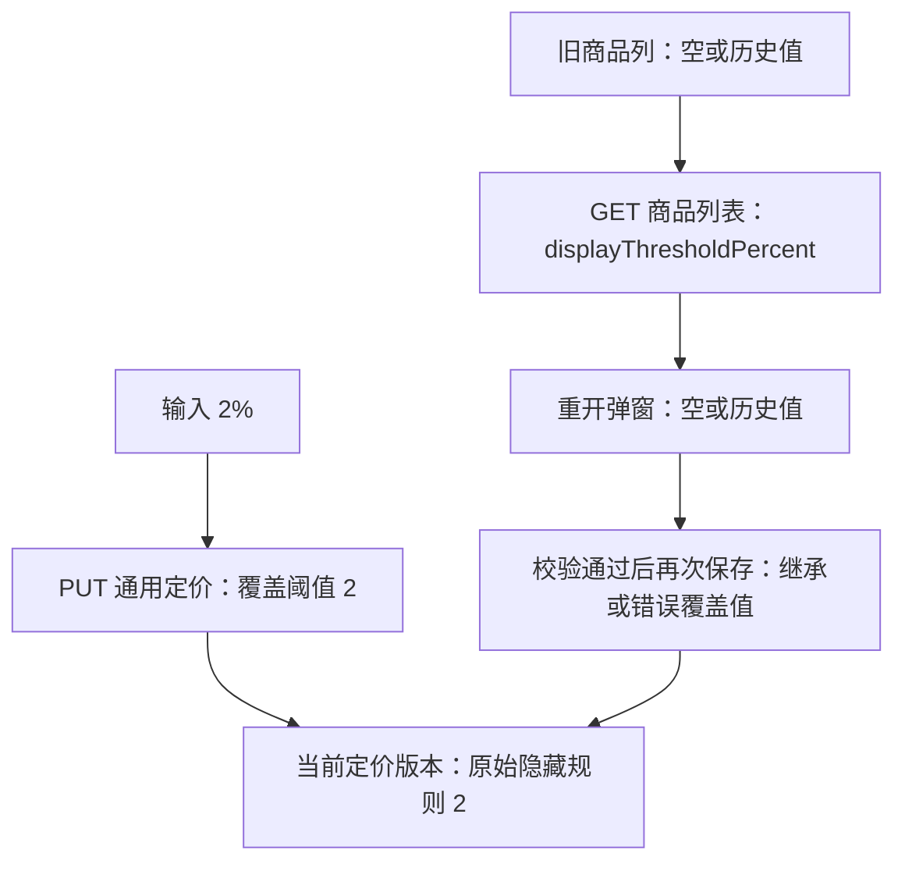

# 分销商品隐藏阈值：当前代码独立核查报告与解决方案

核查与修复日期：2026-10-14，Asia/Shanghai。第 1～8 节保留修复前基线与独立核查结论；第 9 节记录已完成的前后端修复、最终验证和部署后验收范围。当前为本地工作区实现，未部署。

## 1. 结论

**原 Amp 任务的核心判断成立，问题存在于修复前基线中。** 输入 2 会按 2% 提交；保存事务成功时，隐藏配置进入当前通用定价版本。但商品列表返回旧表的 `displayThresholdPercent`，弹窗又把旧字段当作新隐藏配置回填。因此重开为空不等于保存失败，也不能据此判断真实商品当前阈值。

**应修复完整的编辑配置往返。** 除阈值回显外，同一弹窗还不能可靠还原自定义公式，并可能将未编辑的销售价、服务费、销售区阈值和继承方式改写。只补一个数字会留下配置丢失风险。

需要修正原任务的一点表述：再次直接确定会覆盖为继承，**前提是其余表单校验通过**。等于市场价模式可复现该风险；自定义公式因参数未回填，真实校验器会先拒绝空百分比，不能声称所有商品都可以直接再次保存。

## 2. 核查范围与代码基线

- 后端：`/Users/mac/.codex/worktrees/9d54/supply-hub`，HEAD `7688bee7313d5cebf7c545850b4f0bc4cab63b56`。
- 前端：用户确认的 `/Users/mac/codespace/supplychainhubweb`，HEAD `21602fddb8157169e3e98adba2982327adbaaaaa`。
- 开始核查时两仓工作区均干净。已读取当前仓库规范、通用定价详细设计、实际 Controller/查询服务/保存服务/DDL，以及真实前端页面、表单、API、请求类型。
- 原任务：[Amp「分销隐藏阈值回显错位」](https://ampcode.com/threads/T-01a1342b-1cab-7471-ae36-06ecda052d60)。原任务内容仅作为待复核事项，本报告的判断来自当前源码和本轮执行证据。
- 仓库已有 [2026-10-13 复核报告](./2026-10-13-distribution-hide-threshold-independent-review.md)，本轮完成核心源码核对后才对照该报告；旧报告入库不代表业务修复已经实现。新基线下仍可复现相同缺口。
- 本轮未读取这条京东卡的真实业务数据库、保存请求或实际用户端，也未确认远端部署版本。以下数据库写入结论是源码中成功事务的契约，不是该真实记录已保存 2% 的实机证明。

## 3. 输入、保存、查询、回填的证据链

| 环节 | 当前实现 | 核查判断 |
| --- | --- | --- |
| 输入 | [表单 F1] 绑定 `distributionHideThresholdPercent`，范围 0～100，精度 2 | 2 表示 2%，不是 0.02；0 是明确的覆盖数值 |
| 请求构造 | [页面 F2] 数值非空时发送 `hideInherited=false` 和原数值；为空时发送 `hideInherited=true` | 空值表示切换继承，不能表示“保持原值” |
| HTTP 保存 | [API F3]、[Controller B1] 调用 `PUT /supply-chain/buyers/{buyerCode}/products/pricing` | 保存接口与通用定价契约一致 |
| 请求映射 | [映射器 B2] 生成 `hideRule(distribution=2, sales=null)` | 隐藏组是整组覆盖，不会局部合并上次销售区阈值 |
| 继承合并 | [合并器 B3] 每一组从父配置或本次请求二选一 | 该 PUT 不具有“未编辑组自动保留”的语义 |
| 事务发布 | [保存服务 B4]、[版本发布 B5] 保存 `override_json`、有效配置、计算结果，然后切换 `current_version_id` | 保存到 `sc_buyer_sku_pricing_version`；此路径不更新旧展示阈值列 |
| 提交后刷新 | [协调器 B6] 定价事务返回后再刷新受理目录，响应 `saveState=COMMITTED` | 定价保存与目录刷新是两个结果；刷新失败不能解释成保存回滚 |
| 商品列表 | [列表 B7] 已加载当前通用版本和原始覆盖配置，但阈值仍取 `product.getDisplayThresholdPercent()` | 后端读模型没有投影当前隐藏配置 |
| 弹窗回填 | [页面 F4] 只读列表行的旧字段，打开时没有请求定价详情 | 旧列 null 就回填空；旧列 7 就回填 7，均与当前新规则脱节 |



原始配置、有效配置和计算结果不能混用：

1. `override_json` 保存用户的继承标记与原始覆盖规则，编辑时应还原它。
2. `effective_config_json` / `hide_rule_json` 保存继承合并后的有效规则，适合解释当前生效行为。
3. `effective_hide_threshold_percent` 是分销区与销售区两个有效阈值的最大值，不能代替原始输入。

例如原始覆盖为分销区 2、销售区 5，编辑必须还原 2 和 5，实际阈值为 5。继承上游的有效值即使也是 2，再保存也必须保持继承，不能擅自变为覆盖 2。

旧列是 `INT`，DDL 明确标记“本批不消费”；新隐藏阈值允许两位小数，见 [旧 DDL B8]、[通用定价 DDL B9]。两者既不是同一类型，也不是同一保存/消费链路。

## 4. 问题与影响

| 优先级 | 问题 | 具体影响与条件 |
| --- | --- | --- |
| P1 | 隐藏阈值读写错位 | 保存 2 后重开为空或历史值；其他校验通过后再次保存会切换继承或覆盖为历史值 |
| P1 | 未编辑组被重置 | [页面 F2] 每次固定 `salesInherited=true`、`serviceFeeInherited=true`；当前如有这两组覆盖，改阈值也会丢失覆盖 |
| P1 | 隐藏组销售区阈值丢失 | 表单只发送分销区阈值，隐藏组整组覆盖使原销售区阈值变 null；原来有效最大阈值可能降低 |
| P2 | 自定义公式无法回填 | [规则文案 B10] 只返回“自定义公式”文案，而 [页面 F4] 用正则解析参数；实际结果是百分比与运算数没有还原，表单拒绝保存或要求用户重新填写 |
| P2 | 继承语义不能保持 | [页面 F2] 固定声明分销价覆盖、税务覆盖；税务从有效值回填后可能由继承变为覆盖，失去跟随父配置变化的行为 |
| P2 | 不含税覆盖被降级为继承 | [页面 F2] 仅含税时发税率编码；`false` 缺 `NON_TAXABLE`，被 [映射器 B2] 的税务归一化识别为残缺组并改为继承，上游若含税则与用户选择不一致 |

当前没有可直接替换调用的“分销商单商品通用定价详情 GET”：已实现的独立定价 GET 是平台 SKU 默认定价，无法返回分销商自己的继承与覆盖。因此“前端换成另一个现成接口”不能完成修复。

项目层已有 `projectPricingConfig` 的原始五组配置读模型，可参考 [项目查询 B11]；但其前端提交也有销售价/服务费强制继承及仅提交分销区阈值的写法。它是相关审查范围，不能因为已有结构化回填就认为完整往返已经正确。

## 5. 实际隐藏逻辑与结论边界

[计算器 B12] 与 [详细设计 D1] 一致：利润率按 `(分销价 - 最低有效供货价) / 最低有效供货价 × 100%`；税务和服务费不参与。两个非空阈值取最大值，严格低于阈值才进入 `MARGIN_HIDDEN`，比较使用未舍入交叉相乘。

供货价 10000 分，分销价 10199/10200/10201 分，阈值 2，依次应为隐藏/可售/可售。供货依赖缺失或为零则是 `DEPENDENCY_MISSING`，不能解释成阈值没有保存。

[目录查询 B13] 将 `availableOnly=true` 解释为只返回 READY 定价且满足目录/供给条件的商品；省略或 false 仍可能返回不可用商品，并输出不可用状态。能确认后端具有隐藏/不可售规则，不能由此宣称所有实际用户端已经正确筛选、同步和下架。项目定价还可能覆盖分销商隐藏规则，真实用户端的最终行为须核实其消费层级。

## 6. 解决方案

### 6.1 推荐：扩展现有列表的完整编辑配置

在 `BuyerProductListItem` 追加当前定价版本信息和 `buyerPricingConfig`，从当前指针所指版本的 `override_json` 投影五组原始配置；复用项目层结构化读模型的形式。该服务已经读取版本与 JSON，不需要为了一个阈值额外查询旧表。

建议新增字段：`currentPricingVersionId`、`pricingStatus`、`buyerPricingConfig`；如需展示，另提供 `effectiveHideRule` 和 `effectiveHideThresholdPercent`。当前版本主键不得复用现有 `sourceBuyerPricingVersionId`，后者表示目录商业快照引用的来源，可能与当前定价版本不同。

`buyerPricingConfig` 包含五组继承标记及完整的 `distributionRule`、`salesRule`、`serviceFeeRule`、`hideRule`、`taxMetadata`。DTO 不直接暴露 DAL 对象。规则按结构字段读取，不从展示文案解析；旧 `displayThresholdPercent` 保留兼容语义，退出新弹窗回填链。

无当前版本时明确返回 UNPRICED 与 null 配置，并进入显式的新配置流程；读取失败、当前版本损坏/归属不匹配、或服务缺少新增字段时禁用保存并提示，不把这些情况伪装为继承。MARGIN_HIDDEN/DEPENDENCY_MISSING 是合法可编辑状态，不能只对 READY 回填配置。

### 6.2 前端必须保持原始配置的完整性

打开弹窗时保留一份原始五组配置，从它构造表单。提交时复制原始配置，只替换用户实际编辑的组，再转换为当前 PUT 要求的扁平请求字段：

- 分销价公式按 `mode/base/percentage/operator/operand` 结构回填；继承/覆盖应明确区分。
- 隐藏规则使用显式的继承/覆盖状态，不靠输入框是否为空反推。0 是显式覆盖；覆盖组允许双 null 的已有语义也应保持。
- 若 UI 只编辑分销区阈值，保留原销售区阈值；选择整组继承时才按已有契约切换整个隐藏组。
- 未展示的销售价与服务费保留原始继承标记和覆盖规则，不能固定写 true。
- 税务保留原始继承方式；明确覆盖为不含税时输出已有常量 `NON_TAXABLE`，保证完整税务组。
- 配置读取失败禁用确定；保存后重新查询，区分保存已提交、目录刷新结果及网络结果不确定，不自动重复保存。

验收核心是“无修改重开再保存，五组配置业务等价”。保存服务可以按现有契约生成新版本，不要求版本号不变。该方案仍沿用当前并发写入语义；跨管理员陈旧覆盖需另行设计服务端 `expectedVersionId` 校验，仅返回版本 ID 不会自动获得并发保护。

### 6.3 其它方案的取舍

| 方案 | 优点 | 代价/不足 |
| --- | --- | --- |
| 推荐的列表追加完整配置 | 复用已加载的新版本与项目读模型形式；无需新 HTTP 路径 | 每行响应稍大；编辑使用列表读取时的快照，仍需明确并发边界 |
| 新增单商品定价详情 GET | 打开弹窗时读取更新的完整快照，列表保持轻量 | 新增接口、权限/归属/契约测试与加载状态；仍须保留五组配置，并发保护仍需服务端契约 |
| 只补旧列或返回一个生效阈值 | 表面改动少 | 整数丢精度、继承方式和销售区阈值丢失，公式/其它组风险仍在；不采用 |

本轮推荐列表扩展方案。若后续需要刷新更及时的编辑快照，可以采用详情 GET，但它不替代完整配置保持。

## 7. 实施顺序、发布与数据处置

1. 实施前更新通用定价详细设计 §6、管理端 API 设计 §6.3，明确原始配置/有效配置/兼容字段和完整提交语义；再改代码。
2. 后端新增查询投影与契约，前端改结构化回填和完整序列化，同一次变更维护中文注释与设计链接。
3. 后端先发布追加字段，再发布依赖新字段的前端；新前端连接旧后端时阻止静默回退旧字段保存。
4. 执行下节自动化与真实联调，结果持续记录 `docs/集成测试.md`。
5. 无需将新阈值同步到旧列或批量迁移历史规则。对疑似已被覆盖的真实商品，先只读核对当前版本与历史版本、发布时间/发布人和保存请求。历史版有 2 不足以证明后续继承操作是误操作；确认业务意图后，通过正常定价保存生成恢复版本，不直接改不可变历史 JSON。

## 8. 本轮执行证据与修复验收门禁

**本轮已完成的验证：**

- [只读复现脚本](./evidence/2026-10-14-distribution-hide-threshold-repro.cjs) 抽取当前 Vue 源码实际函数和自定义公式校验器，用真实 TypeScript/Vue 编译依赖执行，12 项断言确认上述行为。[输出](./evidence/2026-10-14-distribution-hide-threshold-repro.json) 记录源文件 SHA-256；通过表示观察到当前行为，不表示业务缺陷已修复。未执行真实 Element Plus 浏览器交互。
- 脚本首轮发现探针未提供组件默认 `priceLabel`，错误消息断言失败；补齐该探针上下文后 12 项通过。没有修改产品实现迎合断言。
- JDK21/Maven 离线执行 5 个既有后端测试类：请求映射 7、列表查询 15、定价服务 23、计算器 6、继承合并 3，共 **54 项，0 失败/错误/跳过，BUILD SUCCESS**，见 [本轮测试结果摘要](./evidence/2026-10-14-distribution-hide-threshold-backend-tests.json)。
- 日志：`/tmp/supplyhub-hide-review-20261014-maven.log`。这些是纯逻辑或 Mapper mock 测试，本轮没有真实 MySQL、HTTP 契约、架构全量门禁或远端联调。已有列表测试只验证价格与规则文案，未覆盖隐藏配置回显和再次保存；测试通过不否定本报告缺陷。

复现命令：

```sh
node docs/reports/evidence/2026-10-14-distribution-hide-threshold-repro.cjs
JAVA_HOME=/Library/Java/JavaVirtualMachines/jdk-21.jdk/Contents/Home \
  mvn -o -pl aifuli-module-supply-chain/aifuli-module-supply-chain-server -am \
  -Dtest=BuyerProductQueryServiceTest,GenericPricingRequestMapperTest,GenericBatchPricingServiceTest,GenericPricingCalculatorTest,ProjectPricingConfigMergerTest \
  -Dsurefire.failIfNoSpecifiedTests=false \
  -DLOG_FILE=/tmp/supplyhub-hide-review-20261014-runtime.log test
```

**实施后必须完成的验收：**

| 类别 | 场景与验证点 |
| --- | --- |
| 前端真实组件/API | 保存 2 → 重新查询 → 重开显示 2 → 无修改保存保持覆盖 2；旧列 null/7 不干扰；验证实际组件校验与请求 |
| 隐藏组边界 | 0、2.25、100；分销 2/销售 5；分销 null/销售 5；覆盖双 null；继承非零上游，均保留原始语义 |
| 五组配置往返 | 自定义公式四种运算及各基数；继承分销价；覆盖销售价/服务费；不含税覆盖和继承税务；未编辑组不变 |
| 后端单测与 HTTP 契约 | 查询 JSON 字段及精度、原始/有效区分、当前指针、无版本/损坏版本、分销商作用域及权限；读取不触发写入 |
| 真实 MySQL 集成 | Liquibase/Mapper/事务发布/指针切换/失败回滚/历史不变；保存后查询实际原始配置；继承上游变更仍保持继承 |
| 隐藏与目录 | 供货 10000，分销 10199/10200/10201，阈值 2；availableOnly=true/false；目录刷新失败与已提交分开处理 |
| 架构与实机 | `SupplyChainModuleArchitectureTest`；核对部署版本、真实保存请求与当前版本；实际用户端查询/同步/恢复可售 |

[表单 F1]: /Users/mac/codespace/supplychainhubweb/src/views/supplier/distribution/distributor/detail/DistributionPriceForm.vue:40
[页面 F2]: /Users/mac/codespace/supplychainhubweb/src/views/supplier/distribution/distributor/detail/ProductList.vue:347
[API F3]: /Users/mac/codespace/supplychainhubweb/src/api/supplier/distribution/index.ts:289
[页面 F4]: /Users/mac/codespace/supplychainhubweb/src/views/supplier/distribution/distributor/detail/ProductList.vue:286
[Controller B1]: /Users/mac/.codex/worktrees/9d54/supply-hub/aifuli-module-supply-chain/aifuli-module-supply-chain-server/src/main/java/com/aifuli/module/supplychain/interfaceapi/admin/BuyerAdminController.java:314
[映射器 B2]: /Users/mac/.codex/worktrees/9d54/supply-hub/aifuli-module-supply-chain/aifuli-module-supply-chain-server/src/main/java/com/aifuli/module/supplychain/interfaceapi/admin/pricing/GenericPricingRequestMapper.java:43
[合并器 B3]: /Users/mac/.codex/worktrees/9d54/supply-hub/aifuli-module-supply-chain/aifuli-module-supply-chain-server/src/main/java/com/aifuli/module/supplychain/tradecore/catalog/pricing/ProjectPricingConfigMerger.java:18
[保存服务 B4]: /Users/mac/.codex/worktrees/9d54/supply-hub/aifuli-module-supply-chain/aifuli-module-supply-chain-server/src/main/java/com/aifuli/module/supplychain/tradecore/catalog/pricing/GenericBatchPricingService.java:227
[版本发布 B5]: /Users/mac/.codex/worktrees/9d54/supply-hub/aifuli-module-supply-chain/aifuli-module-supply-chain-server/src/main/java/com/aifuli/module/supplychain/tradecore/catalog/pricing/GenericBatchPricingService.java:502
[协调器 B6]: /Users/mac/.codex/worktrees/9d54/supply-hub/aifuli-module-supply-chain/aifuli-module-supply-chain-server/src/main/java/com/aifuli/module/supplychain/tradecore/catalog/application/BuyerSelectionCatalogAdminCoordinator.java:69
[列表 B7]: /Users/mac/.codex/worktrees/9d54/supply-hub/aifuli-module-supply-chain/aifuli-module-supply-chain-server/src/main/java/com/aifuli/module/supplychain/tradecore/catalog/application/BuyerProductQueryService.java:289
[旧 DDL B8]: /Users/mac/.codex/worktrees/9d54/supply-hub/aifuli-module-supply-chain/aifuli-module-supply-chain-server/src/main/resources/db/changelog/releases/1.0.0/021-admin-frontend-alignment.sql:200
[通用定价 DDL B9]: /Users/mac/.codex/worktrees/9d54/supply-hub/aifuli-module-supply-chain/aifuli-module-supply-chain-server/src/main/resources/db/changelog/releases/1.0.0/035-generic-batch-pricing.sql:57
[规则文案 B10]: /Users/mac/.codex/worktrees/9d54/supply-hub/aifuli-module-supply-chain/aifuli-module-supply-chain-server/src/main/java/com/aifuli/module/supplychain/tradecore/catalog/application/BuyerProductQueryService.java:398
[项目查询 B11]: /Users/mac/.codex/worktrees/9d54/supply-hub/aifuli-module-supply-chain/aifuli-module-supply-chain-server/src/main/java/com/aifuli/module/supplychain/tradecore/catalog/application/ProjectListingQueryService.java:338
[计算器 B12]: /Users/mac/.codex/worktrees/9d54/supply-hub/aifuli-module-supply-chain/aifuli-module-supply-chain-server/src/main/java/com/aifuli/module/supplychain/tradecore/catalog/pricing/GenericPricingCalculator.java:19
[目录查询 B13]: /Users/mac/.codex/worktrees/9d54/supply-hub/aifuli-module-supply-chain/aifuli-module-supply-chain-server/src/main/java/com/aifuli/module/supplychain/tradecore/catalog/application/BuyerCatalogQueryService.java:43
[详细设计 D1]: /Users/mac/.codex/worktrees/9d54/supply-hub/docs/superpowers/specs/2026-09-15-generic-batch-pricing-design.md:53


## 9. 已实施修复与最终验证

### 9.1 实现结果

详细设计先更新 [通用定价设计 §6.3](../superpowers/specs/2026-09-15-generic-batch-pricing-design.md#63-分销商品原始配置回显与无损编辑2026-10-14-修复) 与 [管理端 API 设计](../superpowers/specs/2026-09-02-supply-chain-admin-frontend-api-design.md)，再实施 [修复计划](../superpowers/plans/2026-10-14-distribution-pricing-roundtrip.md)。

- 后端 [BuyerProductQueryService.java](/Users/mac/.codex/worktrees/9d54/supply-hub/aifuli-module-supply-chain/aifuli-module-supply-chain-server/src/main/java/com/aifuli/module/supplychain/tradecore/catalog/application/BuyerProductQueryService.java:434) 从同一定价身份的当前指针返回 `currentPricingVersionId`、`pricingStatus`、`buyerPricingConfig`，完整投影原始五组配置；不会用生效隐藏最大值或商业目录版本替代编辑配置。无当前版本明确返回 null／UNPRICED／null；归属不一致、损坏 JSON 和缺失必要字段拒绝读取。原始 JSON 数字直接反序列化为 BigDecimal，保留小数精度；响应使用生产 Jackson 配置验证大于 JS 安全整数的版本 ID 精确输出字符串。
- 前端 [distributionPrice.ts](/Users/mac/codespace/supplychainhubweb/src/views/supplier/distribution/distributor/detail/distributionPrice.ts:249) 结构化回填并构建完整 PUT；[ProductList.vue](/Users/mac/codespace/supplychainhubweb/src/views/supplier/distribution/distributor/detail/ProductList.vue:362) 不再使用旧展示列或规则文案还原定价。保存 2 后重开仍为 2；未编辑的销售价、服务费与销售区隐藏阈值保持原始覆盖语义。
- 编辑表单提供分销价、隐藏组与税务的显式继承开关；0、2.25、覆盖双 null 和继承被分别处理。不含税覆盖发送 `false + NON_TAXABLE`；空白税率／服务费文案、错误原始类型及超出两位小数的提交被拒绝。两位小数按实际 JSON 数值的十进制表示校验，避免 epsilon 校验接受 `0.30000000000000004` 或拒绝合法大数金额。
- 读取失败或新字段缺失不能继续保存；未定价仅在明确的 null／UNPRICED／null 契约下初始化全组继承。异步校验完成后重新核对买家、商品及编辑配置身份，避免切换行期间写入错误商品。
- 未调整 DDL、定价算法、既有 PUT 事务或并发契约。继承组的未使用规则可在 PUT 中省略，保留其继承业务语义；不宣称保留无业务作用的 JSON 字节形状或新增乐观锁。

### 9.2 最终自动化与独立复审

| 门禁 | 实际结果 | 证据与限制 |
| --- | --- | --- |
| 后端供应链普通及架构 | API 125 + Server 2286，共 2411 项，0 失败／错误／跳过 | 包含模块边界架构门禁；其它模块单测未执行 |
| 后端直接受影响 MySQL／HTTP 契约 | 23 项，0 失败／错误／跳过 | MySQL 8.4、Liquibase、真实 Spring／Mapper／事务；生产 Jackson HTTP 配置 |
| 前端新增往返用例 | 87 项通过 | 实际 SFC、校验器与 API；HTTP、字典和 Element UI 壳被隔离 |
| 前端直接受影响用例 | 112 项通过 | 包含上述 87 项，不重复累加 |
| 前端全量 | 328 项，327 通过，1 失败 | 与修改前 241 项中唯一失败一致：`routing-scope.test.mjs` 引用缺失的路由常量文件 |
| 前端 ESLint | 5 个修改源文件通过 | 无新增 lint 问题 |
| 前端类型检查 | 53 项诊断，基线 54 项 | 按文件路径／错误码计数无新增；本次 5 个源文件无诊断，消除表单既有 TS2769；全量检查仍未通过 |

后端总计 **2434 项通过**，其中新查询测试 27 项、HTTP 契约 6 项、MySQL 往返 4 项已包含在上述门禁中。真实数据库覆盖保存→读取→再次保存、历史版本保持、12 张表读前后无写入及第二次保存失败回滚；HTTP 契约覆盖作用域和权限。

前后端均经过独立规格与质量复审，最终通过。复审中发现的继承服务费 `hideCopy` 缺失、税率／文案空白、大整数 Jackson 契约及浮点精度校验问题已补回归并修复；最终合并契约复审确认前端平铺 PUT 与现有后端转换器一致。对应红灯与最终绿灯日志、基线对比见 [后端最终结果](./evidence/2026-10-14-distribution-pricing-fix-backend-results.json) 与 [前端最终结果](./evidence/2026-10-14-distribution-pricing-fix-frontend-results.json)。完整运行命令见 [集成测试记录](../集成测试.md)。

第 8 节的复现脚本与 12 项断言是**修复前缺陷证据**；其抽取的旧回填函数已经移除，不能将该历史脚本当作修复后的验收脚本。修复后以真实组件往返用例与本节门禁为准。

### 9.3 交付与发布后验收

前后端工作区位于 `codex/distribution-pricing-roundtrip` 分支，尚未提交、推送或部署。此次未读取或修复目标京东卡的真实数据，也未调用业务保存、采购或外部供应商接口。

发布时先上线后端追加字段，再上线前端；随后按 `docs/集成测试.md` 的本次修复记录执行浏览器回显、完整请求、用户端目录与 `availableOnly` 验收。真实 Element Plus 交互与实际部署版本验收尚未执行，自动化通过不代替线上证明。历史配置恢复须先核对真实业务意图，再通过正常定价保存生成新版本；本次未执行历史版本 SQL 修补。
