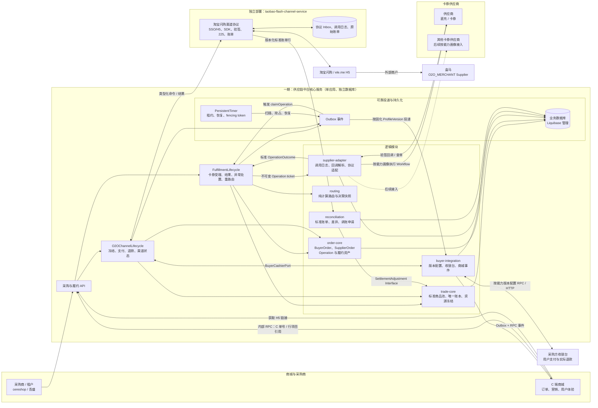
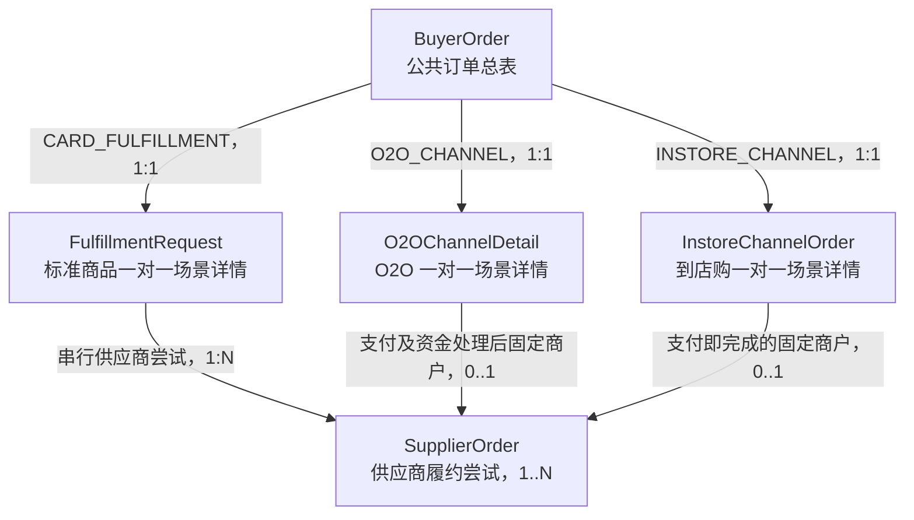

# 供应链中台一期核心设计

> 采购商项目化修订：采购商主体、项目应用身份、项目目录/价格、账户指派、项目路由及所有新订单项目归属，以[《供应链中台采购商主体与采购项目详细设计》](./2026-08-21-supply-chain-buyer-project-design.md)为准。本文中来源租户直接映射 Buyer、Buyer 级 Listing/集成/幂等等旧规则不再作为实现基线。
>
> PRD 对齐修订：三级结算价、加价模板、C 端销售价、标准商品仅退款、路由配置组与管理端 REST，以[《供应链中台 PRD 对齐详细设计》](./2026-08-28-supply-chain-prd-alignment-design.md)为准。

## 目标与范围

一期建设一个部署为单应用的 `供应链中台核心服务`。它拥有独立数据库，面向采购商与供应商维护标准商品池、统一 BuyerOrder 采购方订单总表、SupplierOrder 供应商订单、采购商账户唯一账本和场景履约详情。商城仍负责 C 端订单、支付、营销和用户体验，只能通过中台接口或事件消费商品与履约数据，禁止直接访问中台数据库。

直充/卡券履约、盒马 H5 的 O2O 渠道交易以及大润发 INSTORE 到店购都以 BuyerOrder 作为采购方订单聚合。CARD 的 FulfillmentRequest 保存目标和聚合进度，每次串行供应商尝试各生成一张 SupplierOrder；O2OChannelDetail 保存渠道支付、退款等私有事实，在采购方支付成功且资金处理完成后为固定外部商户生成一张 SupplierOrder；INSTORE 详情保存旅通订单、支付和退款事实，支付成功即为固定大润发商户生成成功 SupplierOrder。渠道内商品不伪装成中台 SKU，场景详情也不是订单副本。Cardshop 中除百联 `BL_STOCK` 和本地卡池 `STOCK` 外的 19 个外部供应商统一纳入标准模型兼容性评估；一期只实现奇那梦 Adapter，其余供应商后续应仅增加 Adapter/Workflow、配置、映射与契约测试。京东 VOP 实物商品为后续独立接入能力。

## 整体系统架构



`order-core` 内部的 BuyerOrder Module 为所有场景提供统一采购方订单身份、公共状态和详情定位；SupplierOrder Module 维护每次供应商履约尝试。`FulfillmentLifecycle` 负责标准商品详情，`O2OChannelLifecycle` 负责淘宝闪购详情。两个场景深模块共享 BuyerOrder/SupplierOrder Interface 与 `trade-core`，但不共享精细状态机。这里不新增物理服务或 Maven 模块，符合一期粗粒度拆分；内部包只能通过 Interface 协作，禁止跨包访问 DAO/Mapper。中台数据库是商品、BuyerOrder、SupplierOrder、采购商账本、场景详情、Timer 和 Outbox 的唯一真相源；商城、渠道服务、供应商 Adapter 与其他服务都不能直接访问。淘宝闪购渠道服务拥有独立数据库，只保存协议收件箱、调用/投递日志、外部与中台订单号映射及原始账单，不持有可变业务订单、支付或退款真相。

## 核心跨系统调用时序

SaaS 商城、供应链中台、渠道服务及供应商之间的调用关系独立维护，详见[《供应链中台核心跨系统调用时序》](2026-08-10-supply-chain-call-sequences.md)。

## 统一领域语言与主数据

`Brand` 是平台维护的商业品牌，独立于供应商；`Platform Product` 是中台标准商品池的 SPU/SKU 主数据；`Buyer` 是拥有稳定业务主键的采购主体；`Supplier` 是订单最终对应的外部供给或履约主体，`supplierType` 一期为 `STANDARD_SUPPLIER/O2O_MERCHANT`。供应商属于标准供应商，盒马属于 O2O 外部商户；淘宝闪购/ele.me 是 O2OChannel，不是 Supplier。`tenantId` 只是商城侧数据隔离标识，一期与 Buyer 一一映射，但不能直接充当永久 `buyerId`。完整术语见仓库根目录 `CONTEXT.md`。

标准商品池不考虑也不复用当前 SaaS 商城商品设计。参考 Cardshop 的 `McProduct`、`McProductForeign` 与 `McSupplier`，中台保留其对卡券、直充、卡号卡密和外部商品映射的业务经验，但拆除 `channel`、`externalProductId`、`couponType` 混在单一商品记录中的结构。目标模型如下：

| 模型 | 主要事实 | 不允许包含 |
| --- | --- | --- |
| `Brand` | 品牌编码、名称、启停状态 | 供应商凭证、采购价格 |
| `Platform SPU` | 标准名称、品牌、类目、使用说明、媒体 | 供应商外部商品号 |
| `Platform SKU` | 标准 SKU 编码、面值、币种、履约类型、目标/结果 schema 版本 | 采购商售价、单一供应商 ID |
| `SupplierOffer` | Supplier、平台 SKU、外部 SKU、供应商履约结算单价、库存策略、协议与元数据版本 | 商城商品 ID |
| `BuyerListing` | Buyer、平台 SKU、采购商 SKU 编码、固定采购价、可售状态、商业规则、发布版本 | 供应商协议字段 |
| `SupplierChannelBinding` | O2O 商户 Supplier、channelCode、外部商户标识、映射版本和状态 | 门店详情、渠道支付状态 |

一期标准商品履约类型采用封闭枚举：`DIRECT_RECHARGE`、`VOUCHER_CODE`、`CARD_CODE_SECRET`、`VOUCHER_URL` 与 `ACCOUNT_BOUND_BENEFIT`。履约类型决定结构化目标和结果，不允许用任意 JSON 替代；账户绑定权益表示直接绑定手机号或外部账号、仍可独立查询或撤销的权益，不能与普通直充混用。淘宝闪购 H5 自己提供商品浏览、选品和下单，中台只发布一个渠道入口配置，不同步 H5 内商品，也不创建 Platform SKU、BuyerListing 或 SupplierOffer；但必须把渠道外部商户映射为 `O2O_MERCHANT` Supplier。未来京东实物商品通过新的命令版本和专用物流聚合接入，不强迫复用卡券或 O2O 渠道状态机。

商品通过两类映射建立双边关系：

- `BuyerListing`：采购商对平台 SKU 的上架授权、采购商 SKU 编码、可售状态和商业规则。
- `SupplierOffer`：供应商对平台 SKU 的外部 SKU、履约结算单价、库存源、履约模式、优先级和私有配置。当前外部 SKU 的唯一性按 Connector 账号范围约束，历史 OfferVersion 不为此修改。

平台 SKU 可被多个采购商上架，也可由多个供应商供给。中台是 Brand、Platform Product、Buyer、Supplier、BuyerListing 和 SupplierOffer 的唯一写入者。商城仅保存 BuyerListing 的可售投影；中台在主数据事务内追加每 Buyer 单调递增的商品变更序号，推送只负责唤醒，商城通过全量/增量接口拉取。变更日志必须包含下架/删除 tombstone、`nextCursor`、`hasMore` 和 `minAvailableCursor`；游标过期后商城执行全量重建。

## 订单模型

`BuyerOrder` 是采购方视角的 B 端订单聚合，也是订单列表与公共查询的唯一入口；`SupplierOrder` 是供应商视角的一次履约尝试。CARD_FULFILLMENT 按 `(buyerId, buyerOrderNo)` 永久幂等创建一张 BuyerOrder，一张 BuyerOrder 可以按冻结候选顺序产生多张串行 SupplierOrder，但这不是拆单：一期仍只允许一个商品行且有效请求 `quantity = 1`，最多一张 SupplierOrder 处于活动态，最多一张被选为有效成功。未来多商品、批量数量和并行拆单必须使用新契约及 BuyerOrderItem 模型。

Buyer 已认证并解析后，即使 Buyer、Listing、数量、目标、余额或路由校验失败，也创建一张终态 `FAILED` BuyerOrder，记录安全的请求快照、`failureStage/failureCode`，但不创建 FulfillmentRequest、SupplierOrder、资金流水或供应商调用事件。无效目标只保存不可逆摘要，解析失败的商品、价格和 Supplier 字段保持 NULL，禁止伪造零值。只有身份无法解析、鉴权失败、报文无法解析或永久幂等键内容冲突时不创建 BuyerOrder，只写边界拒绝或安全审计。

`FulfillmentAcceptanceReceipt` 是 `(buyerId,buyerOrderNo)` 的永久受理真相，不是通用幂等工具。持久化生命周期只有 `PROCESSING/ORDER_CREATED/REJECTED_FINAL`：只要已创建 BuyerOrder，无论其为 `FULFILLING` 还是 `FAILED`，回执都进入 `ORDER_CREATED` 并返回同一 `orderNo`；相同摘要重放返回同一结果，不同摘要返回永久冲突。失败订单和回执都不得重新打开，修正请求必须使用新的 `buyerOrderNo`。进程在 `PROCESSING` 宕机时由恢复任务继续完成原受理，不得创建第二张订单。

`sc_buyer_order` 保存 `orderNo/orderType`、Buyer 与 buyerUserId、永久来源键、调用方商品/数量快照、可空的已解析商品及金额、公共状态、失败阶段、详情定位、供应商列表投影、尝试次数和风险投影。CARD 列表 Supplier 在处理中显示当前活动尝试，成功后显示有效成功 Supplier，全部失败时显示路由第一选择，零尝试失败时为空，MANUAL 时显示引发人工态的 Supplier；O2O 与 INSTORE 在支付准备建单时即显示已固化的外部商户 Supplier，即使此时尚未创建 SupplierOrder。完整路由和尝试历史只能查询 SupplierRoutingRecord 与 SupplierOrder。

CARD_FULFILLMENT 还在总表保存 `buyerOrderNo`、Platform SKU ID、SKU 编码/名称快照和数量；O2O 对这些字段为空；INSTORE 保存 `buyerOrderNo`（旅通 `order_id`），SKU 字段为空。`orderType` 一期枚举为 `CARD/O2O/INSTORE`（分别对应场景 `CARD_FULFILLMENT`/`O2O_CHANNEL`/`INSTORE_CHANNEL`）；CARD 以 `detailType=FULFILLMENT + fulfillmentRequestId` 定位，O2O 以 `detailType=O2O_CHANNEL + o2oChannelDetailId` 定位，INSTORE 以 `detailType=INSTORE_CHANNEL + instoreChannelOrderId` 定位。外部 SKU、充值目标、券码、渠道 payAmount、支付三方状态、门店和退款分摊仍是详情私有事实，禁止写入总表或通用 JSON。`requestFingerprint` 只用于同一业务幂等键重试时检测内容冲突，不建立唯一索引；`detailType/detailId` 只是类型安全定位键，不保存动态表名、URL 或任意路由脚本。

总表维护业务状态、售后状态和内部风险三个正交维度：

- `orderStatus`：`FULFILLING/SUCCEEDED/FAILED/MANUAL`。`SUCCEEDED/FAILED` 是业务终态；风险变化不得使终态回退。
- `aftersaleStatus`：`NONE/PROCESSING/PARTIALLY_REFUNDED/FULLY_REFUNDED/MANUAL`，表示退款与售后；退款不得覆盖已经发生的主流程结果。
- `riskStatus`：`NORMAL/OPEN`；同时投影 `primaryRiskType/openExceptionCount`，仅供中台管理端查询，不进入采购方接口。

标准商品订单按其唯一 FulfillmentRequest 映射：任一尝试待执行、处理中或结果未知为 FULFILLING；候选仍可继续时保持 FULFILLING；唯一有效成功且资产可交付时为 SUCCEEDED；全部候选权威失败为 FAILED；成功但缺少资产或存在未收敛冲突时为 MANUAL。中台受理后不接受采购商主动取消、退款或撤销。O2O 创建、支付协同及渠道履约非终态统一映射 FULFILLING，成功映射 SUCCEEDED，未支付关闭或渠道权威拒绝映射 FAILED，无法自动收敛时映射 MANUAL。售后状态仍由退款 Case 独立投影。

总表状态是平台级公共真相，场景详情状态是精细业务真相；总表状态只能由 BuyerOrder Module 的唯一汇总策略确定，不能由场景 Module 或 Adapter 指定。各场景 Lifecycle 不能直接修改总表 Mapper，也不能把目标 `orderStatus/aftersaleStatus` 作为参数传入，只能在自己的详情事务中调用 `BuyerOrderLifecycle.applyDetailSnapshot(buyerOrderId, detailVersion, OrderSummaryFact fact, reason)`。`OrderSummaryFact` 是封闭的类型化事实联合：CARD_FULFILLMENT 提交单个履约请求的请求数量、已交付数量、尝试结果与人工标记，O2O_CHANNEL 提交用户支付、资金、渠道履约、关闭及累计退款事实，INSTORE_CHANNEL 提交支付、固定商户完成、关闭、退款排队、累计返还和人工标记；不得传任意 Map、脚本或预计算总表状态。

BuyerOrder Module 按 `orderType` 唯一注册 `OrderSummaryPolicy`，启动时发现缺失或重复实现必须失败。Policy 将事实映射为 `OrderSummaryDecision`，统一执行本节状态映射、detailVersion 单调递增、终态回退保护、条件更新、状态变更审计与 Outbox；同版本同事实重复应用返回幂等成功，同版本不同事实返回冲突，旧版本不得覆盖新状态。CARD_FULFILLMENT 的 detailVersion 来自一对一 FulfillmentRequest 聚合版本，O2O_CHANNEL 来自 O2OChannelDetail 聚合版本，INSTORE_CHANNEL 来自 INSTORE 详情聚合版本。BuyerOrder Module 不反向读取场景详情表，Interface 的调用方也无权复制汇总规则。一期总表、详情、账本与 Outbox 使用同一 DataSource，因此创建和状态变化必须在同一本地事务中强一致。未来物理拆库后才改为详情事实事件驱动的最终一致投影，并保留相同策略与版本约束。

`FulfillmentRequest` 是 CARD_FULFILLMENT 的一对一详情根和整单稳定履约意图，保存 `buyerOrderId`、采购商 C 单号、唯一平台 SKU、固定数量一、目标密文和幂等业务键，但不复制 C 端订单内容。其 M1 状态为 `ACCEPTED → FULFILLING → SUCCEEDED | FAILED | MANUAL`。每次状态变化条件更新 FulfillmentRequest 版本，并在同一事务中提交该订单的 OrderSummaryFact。

`SupplierRoutingRound` 在首次路由时冻结完整有序候选、策略版本和重试策略；M1 只使用一轮，不因供应商失败重新读取当前配置。`SupplierRoutingRecord` 按候选序号保存 Supplier、Offer、Connector、资格检查和排序快照，每条记录最多关联一张 SupplierOrder。首个候选失败后，只能取同一冻结轮次的下一条未使用记录。

`SupplierOrder` 每次供应商路由尝试创建一张，关联唯一 SupplierRoutingRecord，固化 Supplier、Offer、Connector、外部 SKU、预计供应成本和前一尝试。编号语义固定为中台 `supplierOrderNo`、稳定出站 `supplierRequestNo` 和供应商返回的 `externalSupplierOrderNo`；同一 SupplierOrder 的网络重试和查单始终复用 `supplierRequestNo`，只新增 SupplierOrderOperation/CallLog。切换候选才创建新的 SupplierOrder 和新的 `supplierRequestNo`。

SupplierOrder 状态为 `PENDING → PROCESSING → RESULT_UNKNOWN | SUCCEEDED | FAILED | MANUAL`。只有权威且无重复履约风险的失败才允许清除 `activeFlag` 并创建下一张 SupplierOrder；超时、已受理、处理中、结果未知或成功但缺少资产都禁止切换。数据库以 `(buyerOrderId,activeFlag)` 保证最多一张活动单，以 `(buyerOrderId,effectiveSuccessFlag)` 保证最多一张有效成功单；迟到或重复成功仍记录真实事实，但不设置有效成功标记。

`O2OChannelUserBinding` 把 `(Buyer, buyerUserId, channelCode)` 映射为渠道侧随机、不透明的 `channelUserId`；两端组合和 `(channelCode, channelUserId)` 分别唯一。获取 H5 入口时中台只把 `channelUserId` 作为 `externalUserId/open_id` 交给渠道服务。后续 PayRequest 只能通过已启用绑定解析 Buyer 与 BuyerUser，不能直接把 `uid` 当作商城用户 ID，也不能接受外部请求指定内部 Buyer。

`O2OChannelDetail` 是 O2O_CHANNEL 的一对一场景详情，不是另一张订单表；它以 `(channelCode,transactionId)` 为永久幂等键，保存支付、渠道、退款和门店私有事实。它不复制 H5 商品明细，也不关联 FulfillmentRequest 或标准商品路由。采购方支付成功、采购资金处理完成并准备通知 ele.me 时，为 SupplierChannelBinding 固定映射出的外部商户（如盒马）创建一张 SupplierOrder；该订单不含 Offer/报价，不允许自动切换商户。O2O 外部副作用继续记录为 O2OOperation，其中支付结果通知 Operation 关联这张 SupplierOrder；不得为 O2O 创建 CARD 专用的 SupplierOrderOperation。O2O 合同与报价字段只预留，不纳入本期实现。

`InstoreChannelOrder` 是 INSTORE_CHANNEL 的一对一场景详情，以 `(channelCode,order_id)` 和 `(channelCode,trade_id)` 为永久幂等键，二者基数固定 1:1。每个采购商租户以独立 `app_key` 恢复 `(sourceSystem,externalTenantId)`，`user_code` 等于该租户内不透明的 `buyer_user_id`；稳定用户绑定与可并存的一次性入口凭证分表。中台调用该租户 SaaS 收银台创建会员支付单，支付/退款结果均回调优先、按原业务号权威查询兜底。支付成功并提交采购资金后为 `company_code` 固定映射的大润发 Supplier 创建一张直接成功的 SupplierOrder；不走商品路由、不切商户。部分退款按 INSTORE 交易串行协同，用户退款确认后由 INSTORE Lifecycle 在同一本地事务调用 trade-core 的唯一账户返还入口，并自行推进退款 Case 与售后投影；trade-core 不反向依赖 INSTORE。退款不回退成功主状态。详细不变量见 `docs/superpowers/specs/2026-08-18-rtmart-instore-channel-design.md#45-生产事务与幂等不变量`。

O2O 支付核心状态为 `CREATED → FUNDS_RESERVED → CASHIER_CREATING → CASHIER_CREATED → BUYER_PAID → CHANNEL_NOTIFY_PENDING → CHANNEL_PAID_CONFIRMED → FULFILLING → SUCCEEDED | CLOSED | MANUAL`。三个外部事实不能压缩成一个“支付成功”：采购商回调只证明用户支付成功；FundReservation 确认才证明 B 端采购资金已扣减；ele.me 通知成功或查单确认才证明渠道已收敛。未知结果进入查询/人工状态，不能释放资金或重复创建支付单。

`O2ORefundCase` 保存 `buyerOrderId`、`channelCode`、`refundKind`、稳定 `refundKey`、渠道退款金额、采购商实际退款金额和 BuyerAccount 返还金额。渠道级 `(channelCode, refundKey)` 永久唯一，Buyer 和订单详情不参与扩大退款键命名空间；相同键但原 transactionId、金额或摘要不同返回冲突。`CHANNEL_REQUESTED` 以 ele.me refundNo 为 refundKey；`PAYMENT_COMPENSATION` 使用 `COMP:{transactionId}`；`LATE_PAYMENT_COMPENSATION` 使用 `LATE:{outTradeNo}`。对外状态在完成前统一为 `PROCESSING`，内部阶段为 `QUEUED → BUYER_REFUNDING → BUYER_REFUND_SUCCEEDED → CHANNEL_NOTIFY_PENDING`，终态为 `SUCCEEDED | FAILED | MANUAL`。渠道退款支持多次部分退款；只有累计渠道退款金额达到原渠道支付金额时，BuyerOrder 的 aftersaleStatus 才能成为 FULLY_REFUNDED。普通渠道退款和拒付补偿三方金额相等，迟到支付补偿的 BuyerAccount 返还金额固定为零。

### BuyerOrder、SupplierOrder 与场景详情的关系

这些模型不是同一订单保存多份，而是不同业务粒度的事实：BuyerOrder 是唯一采购方订单总表和列表投影；FulfillmentRequest、O2OChannelDetail 或 InstoreChannelOrder 是互斥的场景详情；SupplierOrder 是每次对具体 Supplier 的履约尝试。关系如下：



| 模型 | 业务粒度与基数 | 权威事实 | 不应承担的职责 |
| --- | --- | --- | --- |
| `BuyerOrder` | 每个采购方业务键一条；所有场景唯一列表聚合 | `buyerOrderNo/orderNo`、Buyer、商品及金额摘要、公共状态、失败原因、展示 Supplier、尝试数和风险投影 | 目标账号、卡密、供应商协议状态、每次调用和供应成本明细 |
| `FulfillmentRequest` | CARD 与 BuyerOrder 为 `1:0..1`；前置失败时不存在 | 单商品履约目标、冻结 Listing、数量、尝试聚合和资产交付进度 | 采购方订单身份、某次供应商执行结果、O2O 渠道事实 |
| `SupplierOrder` | CARD 为 `1:N` 串行尝试；O2O/INSTORE 为固定商户 `0..1` | Supplier/Offer/Connector 快照、供应商编号、成本事实、本次状态及有效成功标记 | 跨尝试总状态、采购方账本、支付退款和场景私有状态 |
| `O2OChannelDetail` | O2O 与 BuyerOrder 一对一 | ele.me transaction、商户/门店、渠道金额、支付协同、退款和渠道精细状态 | 第二张采购方订单、标准 SKU、自动供应商路由或供应商成本报价 |
| `InstoreChannelOrder` | INSTORE 与 BuyerOrder 一对一，`order_id:trade_id=1:1` | 采购商租户、旅通订单/支付、固定商户、门店快照、退款排队和账户返还事实 | 第二张采购方订单、匿名渠道会员、标准 SKU 或自动供应商路由 |

两条聚合路径严格互斥：

- 标准商品校验失败为 `1 BuyerOrder + 0 FulfillmentRequest + 0 SupplierOrder`；受理并无切换时为 `1 + 1 + 1`；串行尝试三个候选时仍只有一张 BuyerOrder 和一张 FulfillmentRequest，但保留三张 SupplierOrder 及三条一对一 SupplierRoutingRecord。新增尝试不是拆单。
- O2O 在支付准备阶段为 `1 BuyerOrder + 1 O2OChannelDetail + 0 SupplierOrder`；采购方支付成功且资金处理完成后，为固定盒马 Supplier 增加一张 SupplierOrder。O2O 不创建 FulfillmentRequest 或标准商品 SupplierRoutingRecord，也不自动更换外部商户。
- INSTORE 在建单冻结阶段为 `1 BuyerOrder + 1 InstoreChannelOrder + 1 条支付卫星 + 0 SupplierOrder`；支付成功且资金提交后，为固定大润发 Supplier 增加一张直接成功的 SupplierOrder。支付卫星由 `UNIQUE(instore_order_id)` 锁死 1:1，不创建标准商品路由记录。

数据库必须保证 `detailType/detailId` 类型一致：前置失败 CARD 使用 `NONE/NULL`，有效 CARD 定位 FULFILLMENT_REQUEST，O2O 定位 O2O_CHANNEL，INSTORE 定位 INSTORE_CHANNEL。CARD SupplierOrder 必须属于 FulfillmentRequest 和唯一 SupplierRoutingRecord；O2O/INSTORE SupplierOrder 属于 BuyerOrder 与各自场景详情，路由记录为空。任一时刻最多一张活动 SupplierOrder，最多一张有效成功 SupplierOrder。

少量字段重复属于有意的历史快照或列表投影，而不是重复真相。BuyerOrder 可以保存 Buyer、列表 Supplier、SKU、金额、公共状态和业务阶段快照；SupplierOrder 必须固化当次 Supplier、Offer、供应商结算金额及协议版本；场景详情保存自己的精细事实。外部 SKU、充值目标、卡密、渠道 payAmount、退款分摊、门店和协议原始状态不得为了查询方便复制到总表。详情或 SupplierOrder 只能提交类型化事实，由 BuyerOrder Policy 唯一计算公共状态；反过来总表也不能修改详情状态。

一期这些表在同一中台数据库中，但数据所有权仍按 Module 隔离。创建和状态转换时，详情/SupplierOrder、BuyerOrder、状态日志与 Outbox 使用同一本地事务提交；未来物理拆库后改为带 detailVersion 的事实事件投影，不改变上述粒度和唯一数据所有者。

## 下游订单状态规范化

点餐、电影和 Cardshop 的状态属于下游场景或供应商协议事实，不是采购商商城 C 单状态，也不能直接写入中台总订单。中台不参与这些子系统的支付；`UNPAID/NEW/WAIT` 仅表示下游当前阶段，不触发支付、冻结、扣减或释放。状态统一采用三层模型：`BuyerOrder.orderStatus/aftersaleStatus` 是跨场景公共真相；类型化 `businessStage` 是可读业务进度；`RawStatusObservation` 是不可变协议审计事实。

总表增加 `businessStageCode/businessStageTextSnapshot/businessStageVersion` 列表投影，与公共状态在同一事务中更新。阶段编码必须带场景语义，例如 `DINING_READY_FOR_PICKUP`、`MOVIE_TICKETING`、`CARD_AWAITING_RESULT`；它只用于列表展示和筛选，不参与账本、路由、终态或售后判断。普通采购商接口不返回原始下游码，授权管理详情才能查询原始观察。公共状态允许转换如下：

| 当前状态 | 允许的目标状态 |
| --- | --- |
| `FULFILLING` | `SUCCEEDED/FAILED/MANUAL` |
| `MANUAL` | 仅受控领域命令可转 `SUCCEEDED/FAILED`，并记录依据 |
| `SUCCEEDED/FAILED` | 业务状态不得离开；矛盾事实只更新内部风险投影和异常工单 |

退款只改变 `aftersaleStatus`。下游 `REFUND` 先形成 `RefundObserved`，售后进入 `PROCESSING`；只有退款金额与唯一账本确认后，才能映射为 `PARTIALLY_REFUNDED/FULLY_REFUNDED`。原始退款、失败或取消状态不得直接释放、返还或扣减 BuyerAccount。

### 点餐、电影与 Cardshop 映射基线

| 子系统原始状态 | `businessStage` | 类型化事实 | 公共状态结果 |
| --- | --- | --- | --- |
| 点餐 `UNPAID(0)` | `DINING_WAITING_SUBSYSTEM_PAYMENT` | `ProgressObserved` | `FULFILLING` |
| 点餐 `UNDELIVERED(10)` | `DINING_PREPARING` | `ProgressObserved` | `FULFILLING` |
| 点餐 `DELIVERED(20)` | `DINING_READY_FOR_PICKUP` | `ProgressObserved` | `FULFILLING` |
| 点餐 `COMPLETED(30)` | `DINING_COMPLETED` | `DeliveryCompleted` | `SUCCEEDED` |
| 点餐 `CANCELED(40)` | `DINING_CANCELLED` | `RemoteCancellationObserved` | 未发生交付时 `FAILED`；已有交付且未终态时 `MANUAL`；已终态时只记风险 |
| 电影 `INIT(0)` | `MOVIE_INITIALIZED` | `ProgressObserved` | `FULFILLING` |
| 电影 `NEW(1)` | `MOVIE_PENDING` | `ProgressObserved` | `FULFILLING` |
| 电影 `WAIT(2)` | `MOVIE_TICKETING` | `ProgressObserved` | `FULFILLING` |
| 电影 `SHIPPED(3)` / `ISSUED` | `MOVIE_TICKET_ISSUED` | `DeliveryCompleted` | `SUCCEEDED` |
| 电影 `FAILED(6)` | `MOVIE_FAILED` | `RemoteFailureObserved` | 候选耗尽时 `FAILED` |
| 电影 `CANCEL(9)` | `MOVIE_CANCELLED` | `RemoteCancellationObserved` | 未发生交付时 `FAILED`；已有交付且未终态时 `MANUAL`；已终态时只记风险 |
| 电影 `REFUND(11)` | `MOVIE_REFUND_REPORTED` | `RefundObserved` | 主状态不变，售后进入 `PROCESSING` |
| 电影 `SUCCESS/FINISH(12)` | `MOVIE_COMPLETED` | `DeliveryCompleted` | `SUCCEEDED` |
| 电影 `SUCCESS_HD(13)` | `MOVIE_CAMPAIGN_COMPLETED` | `DeliveryCompleted` | `SUCCEEDED` |
| Cardshop `NEW(0)` | `CARD_REQUEST_CREATED` | `ProgressObserved` | `FULFILLING` |
| Cardshop `DISPOSAL(1)` | `CARD_PROCESSING` | `ProgressObserved` | `FULFILLING` |
| Cardshop `WAIT(2)` | `CARD_DISPATCH_PENDING` | `ProgressObserved` | `FULFILLING` |
| Cardshop `SUCCESS_PUSH_HD(3)` | `CARD_NOTIFY_PENDING` | `ProgressObserved` | 保持既有履约主状态 |
| Cardshop `SUCCESS_PUSH(4)` | `CARD_NOTIFIED` | `ProgressObserved` | 保持既有履约主状态 |
| Cardshop `FAILED(6)` | `CARD_FAILED` | `RemoteFailureObserved` | 只终结当前 SupplierOrder；候选耗尽时 `FAILED` |
| Cardshop `CANCEL(9)` | `CARD_CANCELLED` | `RemoteCancellationObserved` | 未发生交付时当前 SupplierOrder 置 `FAILED`；矛盾交付且未终态时转 `MANUAL`，已终态时只记风险 |
| Cardshop `REFUND(11)` | `CARD_REFUND_REPORTED` | `RefundObserved` | 主状态不变，售后进入 `PROCESSING` |
| Cardshop `SUCCESS(12)` | `CARD_COMPLETED` | `DeliveryCompleted` | `SUCCEEDED` |
| Cardshop `SUCCESS_HD(13)` | `CARD_AWAITING_RESULT` | `ProgressObserved` | `FULFILLING` |
| Cardshop `SUCCESS_DOUBT(18)` | `CARD_UNCERTAIN` | `UncertainObserved` | `MANUAL` |

电影子系统的 `SHIPPED(3)/ISSUED` 即代表供应商出票成功并交付有效取票凭证，映射为 `DeliveryCompleted` 并达成 `SUCCEEDED` 终态（线下纸质票打印与实际观影属于后续消费进度，不作为中台履约门槛）；电影子系统的 `SUCCESS_HD(13)` 是终态成功，而 Cardshop 同名状态是等待回调，因此映射唯一键必须至少包含 `(orderType, subsystemCode, rawStatus, mappingVersion)`，禁止只按数字或常量名全局映射。Cardshop 电影父单的 `SUCCESS_PUSH_HD(3)/SUCCESS_PUSH(4)` 只表示通知阶段，不能独立证明履约成功。

### 映射元数据与可靠处理

`StatusMappingDefinition` 是版本化发布元数据，允许配置子系统/供应商、orderType、原始状态、标准业务阶段、封闭事实类型、下游终态提示及是否需要查单；禁止配置目标 `orderStatus/aftersaleStatus`、账本动作、重路由、Supplier 覆盖、脚本、SpEL、动态类名或数据库更新表达式。每个场景详情或 SupplierOrder 在创建时冻结 `protocolVersion/mappingVersion`；升级不得静默重解释历史订单，旧订单只能通过带审计的显式升级并重放命令采用新版本。

创建响应、回调和查单统一进入 Inbox 去重，Adapter 使用冻结版本输出 `ProgressObserved/DeliveryCompleted/PartialDeliveryObserved/RemoteFailureObserved/RemoteCancellationObserved/RefundObserved/UncertainObserved` 等封闭 `SceneStatusFact`，不能输出目标总表状态。场景 Lifecycle 在一个事务中追加 `RawStatusObservation`，条件更新详情或 SupplierOrder，并提交 `OrderSummaryFact`；BuyerOrder Policy 随后更新公共状态、业务阶段投影、状态日志和 Outbox。`RawStatusObservation` 至少保存 order/详情/attempt 引用、subsystemCode、外部单号、原始码与名称、来源 `CREATE_RESPONSE/CALLBACK/QUERY`、远端时间、payload digest、mappingVersion、去重键和处理结果，不保存未脱敏原始报文。

重复事件幂等返回；成功后迟到的处理中状态记录为 `IGNORED_STALE`，不得回退；SUCCEEDED/FAILED 后又收到相反终态、失败或取消，只创建异常 Case 并更新内部风险投影，不改变 BuyerOrder 主状态或实际交付 Supplier；仅非终态流程无法判定时进入 `MANUAL`。未知原始码或映射缺失记录 `UNKNOWN_RAW_STATUS`，停止自动推进并告警；回调与查单并发使用 detailVersion 乐观锁，失败方重读后按终态保护重新判断。同版本同事实幂等，同版本不同事实冲突。

## 采购商（SaaS 商城）集成接口

商城保留 C 端订单、支付和用户体验；中台不读取商城订单表。商城在支付成功后提交单商品 C 单，中台在本地事务中原子受理整单，再异步执行供应商调用。所有入口先构造统一的 `BuyerCallerPrincipal`，其中包含不可伪造的 Buyer、scope、凭证与配置版本；请求可以声明 `sourceSystem + externalTenantId` 供绑定解析和一致性校验，但不得直接指定或覆盖 `buyerId`、供应商、供应商结算金额或 SupplierOrder 字段。

### 统一契约与传输模式

规范业务 DTO 与传输注解分离。跨场景查询统一进入 `BuyerOrderQueryFacade`，列表和摘要只读取 BuyerOrder，返回 Buyer、展示 Supplier、公共状态、售后状态和业务阶段；采购方接口不返回 SupplierOrder 历史、供应成本、内部风险或异常工单。中台管理端使用独立的 `SupplierOrderAdminQueryFacade`，按中台 `orderNo` 查询串行 SupplierOrder、路由候选、Operation、原始观察和异常 Case，权限与脱敏策略不能复用采购方查询。BuyerOrder 详情通过 `detailType` 委托已注册的 `OrderDetailProvider`，使用带 `orderType/schemaVersion` 的封闭 tagged union。标准履约入站为 `BuyerFulfillmentCommandFacade` 和 `BuyerCatalogQueryFacade`，回执与履约查询由 `BuyerFulfillmentQueryFacade` 提供，卡密只能通过独立授权的 `getFulfillmentAssets` 读取。O2O 按信任域拆分为 BuyerO2OEntryFacade、O2OChannelCommandFacade、BuyerO2OPaymentCallbackFacade 与 BuyerCashierPort；INSTORE 独立拆分 BuyerEntry、ChannelMember、ChannelCommand Facade 与 `BuyerMemberProfilePort`，不复用 O2O 匿名身份。外部调用者都看不到内部冻结、路由、SupplierOrder 创建或 Outbox 顺序。

- `RPC`：一期 SaaS 商城调用中台、中台调用商城收银台及通过 Outbox 投递商城事件均使用内部 RPC。组合部署使用本地 `ApiImpl @Primary`，拆分部署使用 `@FeignClient(primary = false)`，两者实现同一 Interface。
- `HTTP`：为后续其他采购商保留版本化 REST + HMAC-SHA256 Adapter。签名覆盖 method、path、规范 query、时间戳、Nonce、请求体摘要和 Trace ID；凭证使用 ACTIVE/PREVIOUS 双版本轮换。

所有传输 Adapter 都要构造同一个不可变 `CallContext`，至少包含 `traceId`、`requestId`、`correlationId`、`causationId`、已鉴权 Buyer、来源、业务键、幂等键和契约版本。外部 `X-Tenant-Id/X-App-Id` 只能作为声明值与凭证映射结果比对，不能决定 Buyer；网关转发的内部 Buyer 上下文必须经过服务身份或签名保护。RPC/HTTP、Outbox、PersistentTimer 和外部 Adapter 调用都传播或关联该上下文；异步重试创建新的 requestId/trace span，但保留 correlationId、causationId 和原业务键。

每个 Buyer 维护一个 `BuyerIntegrationProfile`，一个不可变发布版本内按 `CASHIER/ORDER_EVENT/FULFILLMENT_EVENT/CATALOG_EVENT` 分别选择 `RPC/HTTP`，同一能力不得在运行时 fallback。配置生命周期为 `DRAFT → VALIDATED → PUBLISHED → SUPERSEDED → RETIRED`；新版本发布后，已固化旧版本的收银台操作和 Outbox 仍用旧版收敛。凭证只保存密钥系统引用，生命周期为 `PENDING → ACTIVE → PREVIOUS → RETIRED`；调用日志记录实际配置和凭证版本，不保存原始请求、响应或敏感载荷。

中台与采购商的收银台契约、资金冻结/扣减/返还和 ele.me 对账全部只使用 `CNY` 分。采购商内部 POINT 换算和退还只能存在 SaaS 商城的 `BuyerCashierRpcApi` 实现之后，不得进入中台 DTO、订单、账本、DDL、日志或对账。

`buyerUserId` 是采购商商城内用户的必填唯一标识，类型为 `String`，唯一范围为 `(buyerId, buyerUserId)`；它用于履约归属、售后核验和资产查询，不参与鉴权，默认不下传供应商、不进入中台出站通知且不得出现在日志中。敏感资产查询同时校验 Buyer、`buyerUserId` 所有权和 `FULFILLMENT_ASSET_READ` scope，不能仅凭可枚举的请求 ID 读取。支付或退款回调不依赖回调参数重新传递 BuyerUser，Lifecycle 必须先按 `outTradeNo/middleRefundNo` 加载订单归属；遗留协议若包含 buyerUserId，只能与订单固化值比较，禁止由回调字段重新决定 Buyer 或 BuyerUser。

### 商城调用中台

| 能力 | RPC 契约 / 保留 HTTP 端点 | 规则 |
| --- | --- | --- |
| 创建标准商品订单 | `acceptFulfillment` / `POST /supply-chain-api/v1/buyer/fulfillment-orders` | 支付成功后调用；一期只接受一个商品行，返回一条 B 端 orderNo。 |
| 查询受理回执 | `getAcceptanceReceipt` / `GET /supply-chain-api/v1/buyer/fulfillment-receipts?buyerOrderNo=` | 受理超时后查询唯一真相；只有明确拒绝才表示未受理。 |
| 查询履约 | `getFulfillmentResult` / `GET /supply-chain-api/v1/buyer/fulfillment-requests?buyerOrderNo=` | 用于订单页展示与漏回调补偿，不返回卡密或券码。 |
| 拉取商品增量 | `getCatalogChanges` / `GET /supply-chain-api/v1/buyer/catalog/changes?cursor=&limit=` | 商品变更通知只负责唤醒；商城以持久化游标拉取真相快照。 |
| 读取敏感资产 | `getFulfillmentAssets` / `GET /supply-chain-api/v1/buyer/fulfillment-requests/{fulfillmentRequestNo}/assets?buyerUserId=` | 券码等资产不放在履约结果或回调中；同时校验 Buyer、buyerUserId 和 `FULFILLMENT_ASSET_READ` scope，并全程审计。 |

创建请求包含 `buyerOrderNo`、必填 `buyerUserId`、`paidAt` 与唯一 `item`。商品项包含 `buyerSkuCode/listingVersion/quantity/fulfillmentTarget`。`(buyerId,buyerOrderNo)` 是永久业务幂等键：同键同摘要返回原结果，同键不同摘要返回 `IDEMPOTENCY_CONFLICT`，不存在可重开状态；修正请求必须使用新 buyerOrderNo。Buyer 已解析后的数量、Listing、目标、余额或路由失败仍创建 FAILED BuyerOrder，并以正常响应返回 orderNo 与 failureCode。

```json
{
  "buyerOrderNo": "C202608050001",
  "buyerUserId": "member-1024",
  "paidAt": "2026-08-05T10:30:00+08:00",
  "item": {
    "buyerSkuCode": "TELCO-100",
    "listingVersion": 42,
    "quantity": 1,
    "fulfillmentTarget": {
      "type": "DIRECT_RECHARGE",
      "schemaVersion": 1,
      "accountType": "MOBILE",
      "accountValue": "<仅经 TLS 传输并加密存储的充值账号>"
    }
  }
}
```

受理成功返回唯一 B 端订单：

```json
{
  "buyerOrderNo": "C202608050001",
  "receiptStatus": "ORDER_CREATED",
  "receiptVersion": 1,
  "orderNo": "ORD_01K1XXXXXXXXXXXXXXX",
  "fulfillmentRequestNo": "FR_01K1XXXXXXXXXXXXXXX",
  "supplier": {
    "supplierId": "SUP_QNM",
    "supplierCode": "QNM",
    "supplierName": "供应商"
  },
  "orderStatus": "FULFILLING"
}
```

中台先用独立短事务创建或读取 `PROCESSING` 回执，并暂存可清除的加密请求快照；此时不创建 BuyerOrder。动态资格事实在事务外采集，随后用最终落单短事务重新锁定回执并完成决策：业务失败时创建 FAILED BuyerOrder 与 `ORDER_CREATED` 回执，但不创建 FulfillmentRequest、SupplierOrder 或资金事实；全部校验通过且资金冻结成功时，原子创建 BuyerOrder、FulfillmentRequest、冻结候选、首张 SupplierOrder/Operation 与 Outbox。回执完成时清除暂存密文，进程中断遗留的 `PROCESSING` 由 PersistentTimer 读取同一密文快照恢复。

一期请求只允许一个商品项、请求体最多 64 KiB，回执落盘和最终落单两个短事务各自超时 3 秒；受理接口目标为 P95 小于 1.5 秒、P99 小于 3 秒。实现按 BuyerAccount、Platform SKU 和 Offer 的稳定顺序加锁，并在条件更新 SQL 中再次校验余额和可预占库存，不能依赖事务前预检。

### 中台通知商城与补偿

中台通过 Outbox 至少一次投递 `ORDER_SUMMARY_CHANGED`、`FULFILLMENT_RESULT` 和 `CATALOG_CHANGED`。订单汇总事件包含 `orderNo/orderType/orderStatus/aftersaleStatus/businessStage/orderVersion/supplierAttemptCount` 及当前展示 Supplier；内部风险、异常工单、SupplierOrder 历史和供应成本不进入采购方事件。履约结果只包含交付数量、标准状态及 `assetAvailable/assetReference`，卡密和隔离资产绝不进入事件。

商城必须在同一本地事务中持久化 `eventId + payloadDigest` 并更新 C 单/商品投影，然后才 ACK。同 eventId/同摘要幂等成功，同 eventId/不同摘要报契约冲突，`orderVersion` 阻止乱序回退。终态订单只有内部风险变化时不发送商城回调。

网络超时或 5xx 时，商城必须以相同业务幂等键查询回执或重试，不能另造 C 单号；`ORDER_CREATED` 必须读取对应 BuyerOrder，只有 `REJECTED_FINAL` 才表示没有订单。业务校验失败以正常 FAILED 订单响应返回，不通过异常让商城猜测受理结果。

中台内部实现详见[《供应链中台一期详细设计》](./2026-08-07-supply-chain-phase1-detailed-design.md)，SaaS 商城团队的实现交付详见[《SaaS 商城接入供应链中台实现规范》](./2026-08-11-saas-mall-supply-chain-integration-spec.md)。

## 淘宝闪购 O2O 渠道集成

`taobao-flash-channel-service` 是独立协议 Adapter 服务，不是 Supplier Adapter。吾盛 App 调用中台 `BuyerO2OEntryFacade.getH5Entry`，中台校验 BuyerCallerPrincipal 后创建或读取 O2OChannelUserBinding，把随机不透明 `channelUserId` 作为 `externalUserId` 通过类型化 RPC/HTTP 命令交给渠道服务的 SSO 能力；渠道服务内部才调用 `TbsgLoginController#getTbsgH5UrlBySso` 等 ele.me SDK 逻辑。中台不得透传任意 URL、Header 或 JSON，渠道服务也不能凭外部参数指定 Buyer。后续 PayRequest 的 `uid/open_id` 必须先按 `(channelCode, channelUserId)` 解析唯一 Buyer 与 BuyerUser，绑定缺失、歧义或停用时必须在建单和冻结前拒绝。渠道服务后续使用独立的 `O2OChannelCommandFacade` 提交支付准备、渠道状态和退款事实，不能复用采购商入口身份。

该链路的直接协议对手是淘宝闪购/ele.me，盒马是 H5 中面向用户的外部商户 Supplier。渠道服务提取 externalMerchantId，中台通过 SupplierChannelBinding 固化盒马 Supplier。O2O 不创建 SupplierOffer、SupplierRoutingRecord 或 FulfillmentRequest；采购方支付成功且资金处理完成后，为固化商户创建至多一张 SupplierOrder，并让通知 ele.me 的 O2OOperation 关联该订单，不进入自动路由或商户切换。

ele.me 支付、查单、关闭、退款、退款查询和 225 推送先由渠道服务完成 SDK 验签、解码与防重放，再转换为稳定的中台命令。`O2OChannelCommandFacade` 对外提供 `preparePayment/applyChannelStatus/acceptRefund`，`BuyerO2OPaymentCallbackFacade` 对外提供 `confirmPayment/reportRefundResult`；它们分别委托 Lifecycle 的 `createPaymentPreparation/recordCashierOrder/applyChannelOrderStatus/confirmBuyerPayment/applyBuyerRefundResult` 等原子转换。外部查询接口始终读取中台真相。渠道服务可保存 `transactionId/outTradeNo/alscOrderNo/middleOrderNo` 映射和原始协议报文，但其状态只是协议投影。它不直接调用采购方收银台；采购商支付/退款协议统一由中台的 BuyerCashierPort 隔离。

支付流程固定为：渠道服务收到 ele.me PayRequest 后调用 `preparePayment`；中台先按 `(channelCode, uid/open_id)` 解析唯一 O2OChannelUserBinding，再用 externalMerchantId 解析并固化 O2O_MERCHANT Supplier，并以 `(channelCode, transactionId)` 作为永久键在一个本地事务内幂等创建 BuyerOrder、O2OChannelDetail 与唯一 `PREORDER` O2OOperation，按 ele.me `payAmount` 冻结 BuyerAccount，通过类型化汇总事实将总表初始化为 `FULFILLING`。相同 transactionId 的 uid、Buyer、金额、商户或摘要不一致时必须拒绝，不能创建第二张订单。PREORDER 使用 `PREORDER:{channelCode}:{transactionId}` 作为稳定 idempotencyKey 并设置恢复时间。该请求必须立即返回采购商收银台参数，因此正常路径采用 `渠道服务 → 中台 → BuyerCashierPort` 的短同步链路，不经过 Outbox 排队。事务提交后，当前请求在外部调用前以短事务同时 CAS 抢占 PREORDER Operation 并执行 `FUNDS_RESERVED → CASHIER_CREATING`，生成绑定 Buyer、BuyerUser、Supplier、transactionId、outTradeNo、`settlementMode=CHANNEL_AMOUNT`、金额和唯一 invocationId 的不可变 `PaymentPreparationTicket`；`sc_o2o_operation.operation_no` 就是 invocationId，只有 claim 成功的执行者才能在事务外通过 BuyerCashierPort 以该 outTradeNo 调用采购方 `/cash/prepay`。节点在创建后、抢占前宕机时，PersistentTimer 与原 transactionId 重试竞争同一 CAS，不得另建 Operation 或支付单号。

预下单调用必须位于独立有界 bulkhead，设置连接、读取和端到端 deadline、并发/响应体上限及按 Buyer 的熔断和限流；不得使用通用客户端自动重试。`recordCashierOrder` 仅接受相同 invocationId，把 `CASHIER_CREATING` 转为 `CASHIER_CREATED` 并返回协议所需支付参数。超时或结果未知时保持原 outTradeNo 和冻结，交由 PersistentTimer 查单，不能重新预下单或把普通 `NOT_EXIST` 当作安全释放依据。吾盛支付成功通过已鉴权的 `BuyerO2OPaymentCallbackFacade` 直接通知中台；`confirmBuyerPayment` 必须先按 outTradeNo 加载并核对已固化 Buyer、BuyerUser、金额和 PREORDER Operation，再从匹配的 `CASHIER_CREATING/CASHIER_CREATED` 条件转换，在一个本地事务内把 FundReservation 转为 COMMITTED、写账本、幂等创建固定商户 SupplierOrder、更新详情并提交汇总事实、创建关联该 SupplierOrder 的 CHANNEL_NOTIFY O2OOperation 和 Outbox，然后立即返回。回调线程不得同步等待 ele.me 通知。若支付回调先于 `recordCashierOrder` 到达，后者只能补齐相同 invocationId 的支付单引用，不能覆盖已支付状态。事务提交后才由渠道服务通知 ele.me；若支付回调丢失，PersistentTimer 必须经 BuyerCashierPort 按 outTradeNo 查询吾盛并应用同一确认命令。

用户已支付后的渠道通知若结果未知，SupplierOrder 进入 `RESULT_UNKNOWN`，资金保持已扣减，渠道详情保持非终态，并按 transactionId 查询/重试；BuyerOrder Module 根据详情事实继续投影为 `FULFILLING`。查询确认 ele.me 已接受支付通知时，SupplierOrder 只收敛为 `PROCESSING`，不能据此判定盒马履约成功；必须再由权威渠道履约终态映射为 `SUCCEEDED/FAILED/MANUAL`，BuyerOrder Policy 才据此收敛。若 ele.me 明确拒绝、订单已关闭且无法接受支付，则记录渠道明确失败事实，由 Policy 投影主状态为 FAILED，并以确定性的 `COMP:{transactionId}` 创建 `PAYMENT_COMPENSATION` 退款协同单：先按 channelPayAmount 让吾盛原路退用户，明确成功后才按相同金额返还 BuyerAccount；累计退款事实由 Policy 投影售后状态为 FULLY_REFUNDED。补偿过程不得直接释放已 COMMITTED 的 FundReservation，也不得因通知重试重复退款。

`CASHIER_CREATING` 状态禁止关闭或释放资金。预下单得到同一次调用的明确业务拒绝时，可在确认 ele.me 未支付后条件关闭；网络超时后的 `NOT_EXIST` 不是释放证据，因为查单可能先于仍在途的创建请求到达吾盛。一期在此场景保持 `CASHIER_CREATING/UNKNOWN` 和 FundReservation，持续按 outTradeNo 查单，超过时限转 MANUAL 仍不释放。只有吾盛返回具有“迟到创建不可能再成功”语义的权威 `CLOSED/EXPIRED`，且 ele.me 明确未支付，才可关闭并释放。未来若 BuyerCashierPort 增加持久化 invocationId 与原子 `abort/close(outTradeNo, invocationId)` 墓碑能力，可在 CLOSED 响应后安全释放；在此之前禁止把普通 NOT_EXIST 当作关闭。

资金已 RELEASED 后出现迟到支付时，回调仍须原子记录 `USER_PAID_LATE`，但禁止提交 FundReservation 或通知 ele.me；同一事务以 `LATE:{outTradeNo}` 创建 `LATE_PAYMENT_COMPENSATION`、提交售后处理中事实并写退款 Outbox，由 Policy 投影 aftersaleStatus 为 PROCESSING。该补偿按 channelPayAmount 让吾盛原路退款，查单和重试始终使用同一 refundKey，`buyerRefundSettlementAmount=0`，绝不写 BuyerAccount 返还流水；退款成功后提交累计全额退款事实，Policy 保持主状态 `FAILED` 并将售后状态投影为 FULLY_REFUNDED。只有退款结果未知且持续无法查明时才进入 MANUAL。

## 唯一账本与资源预占

`trade-core` 独立维护 Buyer 机构账户，是采购资金余额、冻结和流水的唯一真相源，不复用商城或支付模块的 `pay_wallet`。一期仍维护预付账户汇总 `available = balance - frozen`，且 `frozen >= 0`；**不**要求 `balance >= frozen >= 0`。冻结、确认扣减和释放仍必须产生不可变流水，并以整数最小货币单位和 `currency` 记录，禁止浮点金额。一期不因可用余额不足拒单，允许透支与负余额；缺账户仍拒绝。详见[《一期弱化采购商账户余额门槛》](./2026-08-17-supply-chain-phase1-buyer-account-overdraft.md)。

M1 不建设日常入金页面、审批流或充值 API。上线前通过一次性、受控的期初资金初始化程序同时更新 BuyerAccount 并追加 `DEPOSIT` 流水（期初允许为 0）；初始化批次号唯一，记录操作人、审批工单和备注，重复执行必须幂等。禁止只改余额或把普通 SQL 作为持续入金能力；正式 BuyerAccountFundingOrder 后续另行设计。

卡券 BuyerListing 的每个发布版本固定 `buyerPurchasePrice` 与币种；FulfillmentRequest 按该版本价格乘数量确定整单采购商应付金额，不能使用供应商结算金额冻结资金。每个 FulfillmentRequest 对应一个 `FundReservation`，包含 `total/committed/released/remainingAmount`、Buyer、履约请求、业务幂等键、币种、状态和版本，并始终满足 `total = committed + released + remaining`。

状态为 `RESERVED/PARTIALLY_COMMITTED/COMMITTED/RELEASED/PARTIALLY_COMMITTED_RELEASED/MANUAL`；部分提交状态仅为后续批量数量保留，M1 的标准商品数量固定为一。供应商重路由只改变预计供应商结算金额与平台毛利事实，不改变采购商应付金额，也不会新建或重复扣减资金冻结。任一尝试发生交付后禁止继续切换 Supplier。

O2O 一期没有合同和报价，固定使用 `settlementMode=CHANNEL_AMOUNT`：`buyerSettlementAmount = channelPayAmount = ele.me PayRequest.payAmount`，`spreadAmount = 0`。该金额同时用于吾盛用户支付、中台 BuyerAccount 冻结/扣减/返还和 ele.me 支付退款对账。合同、报价和差额结算仅预留为未来版本能力，不创建一期表或 Liquibase 变更集。

每个 O2OChannelDetail 对应一个 FundReservation，冻结金额为 ele.me `payAmount`。采购商用户尚未支付时保持 RESERVED；采购商支付成功后，中台必须先在本地事务中转为 COMMITTED 并写账本/Outbox，随后才能通知 ele.me。任何对账调整都必须追加独立 SettlementAdjustment 流水，禁止修改原冻结或扣款流水。

库存按可兑现能力分为四种策略：

- `REMOTE_ON_DEMAND`：下单后由供应商实时发码或直充；供应商一期使用该模式。
- `REMOTE_OBSERVED`：供应商远程库存或余额，仅作为带采集时间的路由信号，不承诺本地预占；供应商缺货时按失败策略重路由。
- `LOCAL_QUANTITY`：中台本地数量库存，可用条件更新原子预占。
- `LOCAL_ASSET_POOL`：已预存的卡号/卡密/券码池，受理时锁定具体资产。

一期只实现 `REMOTE_ON_DEMAND/REMOTE_OBSERVED`，两者都不创建 SupplyReservation。`REMOTE_OBSERVED` 只保存带时间戳的可用性快照；快照过期表示未知，不表示零库存。

`LOCAL_QUANTITY/LOCAL_ASSET_POOL` 及 SupplyReservation 仅作为后续设计基线，不进入一期代码和 Liquibase。后续启用时，前者预占数量，后者锁定具体资产；尝试成功时确认预占，失败、取消或重路由时幂等释放。

`routing` 接收 `FulfillmentLifecycle` 构造的不可变 `RoutingContextSnapshot`，只做纯计算并返回 `RoutingDecision`。M1 决策保存候选、资格检查、淘汰原因、显式优先级、稳定 SupplierCode/OfferId 顺序、规则版本、输入版本和选中的 SupplierOffer；供应商健康度等只读快照最多作为硬资格事实注入，不能形成动态评分，routing 不访问 fulfillment 表。

## 单应用模块边界

`供应链中台核心服务` 内按逻辑模块隔离，而非一期拆成独立进程：

| Module | Interface 职责或权威事实 | 约束 |
| --- | --- | --- |
| `FulfillmentLifecycle` | 编排整单受理、Operation 抢占/结果应用、异常处置和重路由事务 | 对外 Interface 为 `acceptOrder/queryAcceptanceReceipt/resolveException`，内部通过 SupplierOrderLifecycle 创建或推进尝试；受理后不提供采购商主动取消 |
| `O2OChannelLifecycle` | 编排渠道详情、资金冻结及支付/退款协同 | 事实分别归 O2O_CHANNEL 与 trade-core；所有金额和状态转换使用类型化命令，外部网络不进入事务 |
| `INSTOREChannelLifecycle` | 编排到店购详情、一次性凭证、整笔资金冻结、支付即完成及串行退款 | 事实分别归 INSTORE_CHANNEL 与 trade-core；租户作用域和完整摘要先校验，外部网络不进入事务 |
| `trade-core` | 标准商品池、Buyer 账户唯一账本、资金/库存/资产预占 | 唯一写入主数据、账户、流水和 reservation 表；一期不实现 O2O 合同与报价 |
| `order-core/BuyerOrder` | 统一订单身份、详情定位、公共状态策略、业务阶段列表投影、状态审计 | 唯一计算并写入 `orderStatus/aftersaleStatus`；校验按 orderType 封闭的业务阶段，不读取场景详情表 |
| `order-core/SupplierOrder` | 每次供应商尝试、串行单链、活动/有效成功唯一性、SupplierOrderOperation 与状态审计 | CARD/O2O/INSTORE Lifecycle 只能通过 SupplierOrderLifecycle 创建或推进；Adapter 和场景包不得写其 Mapper |
| `order-core/CARD_FULFILLMENT` | FulfillmentAcceptanceReceipt、FulfillmentRequest、SupplierRoutingRecord、FulfillmentAsset、FulfillmentExceptionCase 及精细状态 | M1 单商品、数量一；同一冻结路由轮次内串行尝试，只提交类型化汇总事实 |
| `order-core/O2O_CHANNEL` | O2OChannelDetail、O2ORefundCase、O2OOperation 及精细状态 | O2OChannelDetail 不是订单表；通过 SupplierOrderLifecycle 创建固定商户订单，不参与自动路由 |
| `order-core/INSTORE_CHANNEL` | INSTORE 详情、稳定绑定、入口凭证、退款 Case、Operation 及精细状态 | `order_id:trade_id=1:1`；凭证单次消费；退款通过 trade-core 返还账户，不参与自动路由 |
| `routing` | 基于输入快照的候选过滤、显式优先级和不可变路由决策 | 纯计算，不查表、不调供应商、不改订单状态；M1 禁止权重随机和动态成本/健康评分 |
| `supplier-adapter` | 卡券供应商 Workflow/Adapter、调用日志、回调解析、版本化状态映射元数据 | 只消费 Operation ticket 或原始状态并返回 OperationOutcome/SceneStatusFact；不指定总表状态，不拥有或修改 Operation/SupplierOrder 状态机 |
| `reconciliation` | 标准账单行、对账批次、差异、处理状态和调账申请 | 不修改历史订单/报价/流水；通过 trade-core Interface 创建 SettlementAdjustment |
| `taobao-flash-channel-service` | ele.me 协议 Inbox、SSO/SDK、签名、225、原始账单与调用映射 | 独立部署和独立数据库；不调用采购商收银台，不访问中台表，不持有业务订单/账本真相 |

物理上使用同一应用和独立数据库。应用显式定义命名的 `supplyChainDataSource`、`supplyChainTransactionManager` 与对应 MyBatis Mapper 扫描范围，Liquibase 也只绑定该数据源；不得依赖默认 `@Primary` 数据源，更不能加入商城事务。中台表以 `sc_` 命名并按模块归属维护。所有中台同步事务参与者必须加入同一个 `supplyChainTransactionManager` 事务，禁止 `REQUIRES_NEW`；模块只能通过公开接口和领域事件交互，禁止跨模块 DAO/Mapper 访问。工程至少拆分 `supply-chain-api` 与 `supply-chain-server`，server 内用 internal/package-private 包和 ArchUnit 验证依赖方向。

未来拆服务时保留领域语言和表归属，但本地事务必须重构为 Saga/流程管理器；不能承诺把 Java Facade 直接替换成 RPC 即可保持原有原子性。

## 一致性与履约流程

以下 FulfillmentRequest 流程只适用于卡券/直充；淘宝闪购 O2O 使用后述渠道交易流程。

`FulfillmentLifecycle.acceptOrder` 根据 `BuyerCallerPrincipal` 和 `(buyerId, buyerOrderNo)` 建立永久幂等，采用两个短事务和一段事务外事实采集：

1. 回执事务创建或锁定 FulfillmentAcceptanceReceipt，以完整请求摘要判断原键重放或冲突；首次请求写 `PROCESSING`、安全摘要和信封加密的最小恢复快照。此阶段不创建 BuyerOrder，不执行供应商调用；快照无法解密时保持 PROCESSING 并告警，必须恢复原密钥后继续，禁止猜测失败或另建订单。
2. 事务外校验无需锁的命令结构并采集路由所需库存、余额和健康事实；超时或节点宕机保留 PROCESSING 回执，调用方原键重试或 PersistentTimer 可用同一密文快照重新采集。Timer 按 `recoverAfter` 扫描并以回执版本 CAS 递增恢复次数、计算下一恢复时间；并发恢复即使重复采集事实，也只能有一个执行者在最终事务完成回执和订单。
3. 最终落单事务重新锁定回执，按固定锁顺序校验 Buyer、Listing、数量、目标、金额、策略与候选静态有效性。任一业务失败时创建 `FAILED` BuyerOrder、记录 `failureStage/failureCode`、完成 `ORDER_CREATED` 回执、清除暂存密文并写安全订单事件；路由失败可以追加不可变失败决策审计，但不创建 FulfillmentRequest、SupplierOrder 或资金事实。
4. 校验成功后冻结一轮完整有序候选及策略版本，并按 BuyerListing 采购价通过 `trade-core` 原子创建 FundReservation；资金冻结失败同样创建 FAILED BuyerOrder 并完成回执。
5. 只有资金冻结成功，才在该最终事务内原子创建 BuyerOrder、FulfillmentRequest、全部 SupplierRoutingRecord、首张 `PENDING` SupplierOrder 及首个 `FULFILL` SupplierOrderOperation。SupplierOrder 固化首个候选、Offer、Connector、重试策略和供应成本快照。
6. 把回执推进为 `ORDER_CREATED`，清除回执内暂存请求密文，BuyerOrder 投影为 `FULFILLING`，写供应商投递和商城订单事件 Outbox；所有外部调用均在事务提交后发生。

最终落单数据库或系统错误只回滚最终事务，已提交的 `PROCESSING` 回执仍可恢复；业务校验失败是已创建的终态订单，不通过异常回滚。事务提交后，PersistentTimer 触发 Outbox，Handler 条件抢占 SupplierOrderOperation 并返回包含 capability、stepCode、`supplierRequestNo`、配置版本和加密目标引用的不可变 ticket。Adapter 只返回封闭 OperationOutcome，不能访问订单 Mapper 或账本。BuyerOrder 一经中台受理即不支持采购方自动退款、取消或撤销。

节点在抢占后宕机或外呼超时时，SupplierOrder 进入 `RESULT_UNKNOWN`，资金保持冻结且不得切换 Supplier。允许重放时必须复用原 `supplierRequestNo`；权威查单明确失败且证明无重复交付风险后，才可在一个事务内终结当前 SupplierOrder、清除活动标记并基于同一冻结轮次的下一候选创建新 SupplierOrder。任一事务失败整体回滚，外部调用只能在新事务提交后开始。

回调、外呼结果或主动查单先追加 RawStatusObservation，再映射为 `ACCEPTED/SUCCEEDED/PARTIALLY_SUCCEEDED/REJECTED/NOT_FOUND/RESULT_UNKNOWN/MANUAL_REQUIRED`。`SupplierOrderLifecycle.applyOperationOutcome` 在调用方事务中条件更新 Operation 与 SupplierOrder，并返回封闭的尝试转换事实；FulfillmentLifecycle 再据此更新 FulfillmentRequest、确认或释放 FundReservation、回写 SupplierRoutingRecord、提交 OrderSummaryFact，并写订单汇总与商城通知 Outbox。整个调用链共用一个本地事务，公共状态仍由 BuyerOrder Policy 计算；状态映射不能配置路由或账本动作。

正常活动 SupplierOrder 权威成功时原子设置唯一 `effectiveSuccessFlag=1`、提交采购方冻结资金一次、更新展示 Supplier，并在资产完整时完成 BuyerOrder。当前尝试权威失败且尚有候选时，BuyerOrder 保持 FULFILLING并切换展示 Supplier；全部候选失败时释放资金一次，BuyerOrder 置 FAILED 并保留路由第一选择 Supplier。供应商迟到或重复成功不得覆盖有效成功单、重复扣款或继续交付，只记录原始成功事实、潜在成本、隔离资产和异常工单。

异常工单类型包括 `RECOVER_ASSET`、`LATE_SUCCESS_AFTER_FAILOVER`、`DUPLICATE_SUPPLIER_SUCCESS`、`LATE_SUCCESS_AFTER_RELEASE`，以稳定 `exceptionKey` 唯一。BuyerOrder 投影 `riskStatus/primaryRiskType/openExceptionCount`，风险优先级依次为资金释放后迟到成功、重复成功、切换后迟到成功、缺失资产。资金仍冻结时迟到成功使订单进入 MANUAL；资金已提交时保持 SUCCEEDED；资金已释放时保持 FAILED，均不得自动补扣或调账。风险变化只发布内部事件；只有 BuyerOrder 业务状态进入 MANUAL 才向商城发送通用 `FULFILLMENT_EXCEPTION`。

奇那梦直充调用 `/GameOrder/Send`。请求使用 SupplierOffer 外部商品号、充值账号、固定数量一、稳定 `supplierRequestNo`（协议字段 billno）和回调地址；签名按供应商要求使用凭证、时间戳和参数排序 MD5。创建与 `/GameOrder/Query` 查单分别形成 `FULFILL` 与 `QUERY_ORDER` Operation；供应商受理后 SupplierOrder 保持 PROCESSING，仅在验签回调或查单得到终态后成功或失败。网络超时进入 RESULT_UNKNOWN 并按 PersistentTimer 恢复。Adapter 同时支持 `/GameOrder/SendKm` 发码，正常响应中的卡密形成 FulfillmentAsset。

已知风险 `QNM-ASSET-RECOVERY-001`：若查单权威成功但没有必需卡密，SupplierOrder 仍为 SUCCEEDED 且成为唯一有效成功，采购方资金提交一次，FulfillmentRequest 与 BuyerOrder 进入 MANUAL，并创建 `RECOVER_ASSET:{supplierOrderId}`。补录并加密卡密后订单转 SUCCEEDED，不再次扣款。迟到或重复成功返回的卡密必须加密保存为 `QUARANTINED`，只关联事实 SupplierOrder，不向采购方查询或事件暴露，M1 不提供解除隔离并交付能力。

淘宝闪购 O2O 不进入标准商品自动路由。渠道服务收到 PayRequest 后，中台创建 BuyerOrder 与 O2OChannelDetail，并通过 BuyerCashierPort 创建采购商收银台订单；用户支付仍发生在采购商侧。采购商支付成功通知中台后，中台按 ele.me `payAmount` 处理采购方资金，并为固定盒马 Supplier 创建一张 SupplierOrder 与关联的 CHANNEL_NOTIFY O2OOperation。渠道通知未知时保持资金状态和 SupplierOrder RESULT_UNKNOWN，以原 transactionId 查单或重试，禁止切换商户、重复扣款或再次创建供应商订单。

ele.me 发起退款时，`acceptRefund` 锁定 O2OChannelDetail，以 refundNo 幂等创建 O2ORefundCase，原子校验及增加 `reservedChannelRefundAmount`，并提交存在未终结退款 Case 的汇总事实，由 Policy 投影 aftersaleStatus 为 PROCESSING，同时保证 `confirmedChannelRefundAmount + reservedChannelRefundAmount <= channelPayAmount`。相同 refundNo 但 transactionId、金额或请求指纹不同返回 `IDEMPOTENCY_CONFLICT`。一期同一订单最多一个 `BUYER_REFUNDING`，其余 Case 按 refundSequence 排队；worker 只按顺序 claim，避免两个在途请求同时调用采购商退款。

claim 时固化本 Case 的 `buyerRefundSettlementAmount = channelRefundAmount`，然后通过 BuyerCashierPort 调用采购商退款。采购商退款接口必须接收并持久化 `middleRefundNo/refundNo`，查退款也必须按该键查询；现有仅按 `orderFormid + amount` 查单的协议不得用于自动闭环。明确退款成功后，`applyBuyerRefundResult` 在一个事务中把渠道退款预留转为 confirmed、按相同金额返还 BuyerAccount、写不可变反向流水、提交包含累计退款的 OrderSummaryFact 并写 ele.me/订单汇总 Outbox。明确永久失败时释放对应预留并提交更新后的退款事实；未知结果保持预留并按 refundKey 查单。通知失败只重试通知，绝不再次退款或再次返还账户。

部分退款逐笔保持渠道退款金额、采购商实际退款金额和 BuyerAccount 返还金额相等，累计返还不得超过 channelPayAmount。只有累计 confirmedChannelRefundAmount 等于 channelPayAmount 才向采购商传递关单语义；现有固定 `ifcolse=1` 的行为必须删除。未知退款结果先按 refundKey 查单，禁止切换 legacy/after-ext 等另一条路径造成双退。

## Adapter 与元数据

Adapter 的目标是减少重复开发，而不是把供应商协议解释为任意 JSON。领域 Module 只依赖自己定义的出站 Interface，`supplier-adapter` 是该 seam 上唯一允许访问卡券供应商网络的 Adapter；组合根负责注入实现，领域 Implementation、Outbox/Timer 基础设施和其他 Module 都不能绕过 Interface 直连第三方。Outbox Dispatch Handler 是调用应用 Interface 的入站 Adapter，不把 Mapper 或可变聚合暴露给供应商 Adapter。

每个卡券协议 Adapter 负责签名/验签、请求与响应编解码、回调解析、私有资产解析和协议步骤规划，通过 `FulfillmentWorkflowPort` 与 `OperationExecutorPort` 接入。Connector 能力采用封闭集合：`CREATE_RECHARGE/ISSUE_ASSET/BIND_BENEFIT/QUERY_ORDER/QUERY_ASSET/VOID_ASSET/UNBIND_ASSET/QUERY_BALANCE/QUERY_INVENTORY/RECEIVE_CALLBACK`。禁止用空实现或 `UnsupportedOperationException` 填充统一大接口；淘宝闪购 O2O 使用独立渠道服务接口，不加入这些 Supplier Adapter capability。

Platform SKU 的 Fulfillment Type 表达采购商最终获得什么；Connector Capability 表达账号接口能够做什么；SupplierOfferVersion 的执行画像表达当前外部 SKU 如何完成和恢复。执行画像冻结 `primaryCapabilityCode`、`completionMode`、`createIdempotencyMode`、`unknownResultPolicy`、`partialDeliveryMode`、`resultMultiplicity` 与经封闭 Schema 校验的 `fulfillmentConfigJson`。创建幂等分为 `NONE/DEDUP_ONLY/REPLAYABLE_RESULT`；未知结果策略为 `QUERY_ORDER/WAIT_CALLBACK/REPLAY_SAME_KEY/MANUAL`，其中 `REPLAY_SAME_KEY` 只允许与经过契约验证的 `REPLAYABLE_RESULT` 组合。不再用单一布尔能力混淆“防止重复副作用”和“能够返回上次结果”。

Adapter 还提供 `validateMetadata`，在 SupplierOffer 或凭证配置发布时验证必填字段、类型、允许字段和履约类型兼容性。新供应商复用同一协议族时只新增配置；canonicalization、签名、回调语义或数据格式不同才新增 Adapter 实现。

运营可配置的差异包括供应商端点、启用状态、加密凭证引用、SKU 映射、路由规则、限流/熔断/重试/超时策略、错误码动作和低频私有参数。所有影响交易的配置都采用不可变发布版本，记录状态、生效区间、操作人、审批人、变更原因和发布时间；订单、路由决策、Operation ticket 与调用日志固化实际使用的配置版本，历史订单不得按当前配置重算。配置与数据归属如下：

| 载体 | 用途 | 逻辑归属 |
| --- | --- | --- |
| `sc_supplier_offer_version.fulfillment_config_json` | 经 Adapter Schema 校验的低频 SKU 私有参数 | `trade-core` |
| `sc_supplier_channel_binding` | O2O 外部商户到 Supplier 的版本化映射 | `trade-core` |
| `sc_supplier_error_code_map` | 外部错误码到 `REJECT/RETRY_SAFE/QUERY_FIRST/MANUAL` 的受限映射 | `supplier-adapter` |
| `sc_status_mapping_definition` | 下游原始状态到业务阶段和封闭事实类型的版本化映射 | `supplier-adapter` |
| `sc_platform_kv_config` | 采购商/供应商低频可调参数 | `trade-core` |
| `sc_supplier_routing_round` | 每轮路由头、输入和规则版本；保证每轮只有一个选中候选 | `order-core` |
| `sc_supplier_routing_record` | 每轮每个候选的顺序、规则、选择原因和尝试关联 | `order-core` |
| `sc_raw_status_observation` | 原始状态、来源、映射版本、载荷摘要和处理结果的追加式审计 | `order-core` |
| `sc_fulfillment_asset` | 逐券、卡密、链接或账户绑定权益及数量和生命周期 | `order-core` |
| `sc_supplier_order_operation` | 履约、查单、查资产、作废和解绑等可恢复业务操作 | `order-core` |
| `sc_fulfillment_call_log` | 脱敏请求/响应和传输审计 | `supplier-adapter` |
| `sc_supplier_account_balance_snapshot` | Connector 账号资金、授信或通用额度观察 | `supplier-adapter` |

金额、供应商账号余额、SKU 库存、订单状态、外部单号、幂等键、密钥、乐观锁和高频查询字段必须结构化、可索引。SupplierAccountBalanceSnapshot 与 InventorySnapshot 分别表示账号余额和外部 SKU 数量/配额，禁止互相替代。不创建或预留通用 `sc_fulfillment_ext`；低频 SKU 参数进入 OfferVersion，协议恢复的最小上下文进入加密 Operation checkpoint。供应商一期正式使用 Connector、Offer、Capability、Operation、错误码/状态映射、调用审计和敏感资产；其 productid、account、number、billno、orderSn、sumPrice、status 和 cards 分别落入已定义的标准事实，禁止重复保存。淘宝闪购协议元数据、O2O 商户映射和 Buyer 收银台配置分别归渠道服务、`trade-core` 和 Buyer 集成配置，不得塞入 SupplierOffer；具体门店只属于 O2OChannelDetail。

Cardshop 兼容性评估覆盖 TONG_KA、MINISO、TAO_BAO、IKEA、POT_CIRCLE、SZ_CARD、HZ_PG、FU_NENG、LF、RS、DY、NAI_XUE、ELEMO、QNM、JQ_CARD、TF_KA、DIDI、FNK_CGS 和 RENYUE。它们归入异步直充、卡券/直充混合、账户绑定权益、多步骤履约、交付后资产操作及远程余额/库存观察六类；除当前仅有不完整实现、必须标记 `EVIDENCE_INCOMPLETE` 的 POT_CIRCLE 外，统一模型均可覆盖。百联与本地卡池不在本轮评估。后续接入允许增加 Adapter/Workflow、Connector/Offer 配置、封闭 Schema、状态/错误映射和 ContractTest，禁止增加供应商专属订单、资产、账本或资金冻结表。

## O2O 对账与调账

O2O 必须同时完成三套核对，不能用一个金额字段替代：

1. ele.me 渠道对账严格使用 `transactionId + channelPayAmount(payAmount)`，退款使用 `refundNo + channelRefundAmount`；
2. 采购商支付核对要求用户实付/实退金额分别等于 ele.me 支付/退款金额；
3. 中台账本核对要求 FundReservation、确认扣减和返还分别等于 ele.me `payAmount/refundAmount`。

渠道服务负责下载、验签和保存 ele.me 原始账单，并向中台提交版本化标准账单行；中台 `reconciliation` Module 拥有标准账单行、对账结果、差异及处理状态。支付账、退款账和中台账本分别按业务键幂等入库。首次缺失先进入 `PENDING_OBSERVATION`，超过宽限期仍不收敛才生成正式差异。差异不得直接改订单或历史流水，只能由 reconciliation Module 创建人工调账申请或无需调账结论，再通过 trade-core Interface 追加 `SettlementAdjustment`；申请人与审批人必须不同，正向补扣必须受 BuyerAccount 可用余额约束，负向调差写不可变返还流水。原始账单、标准账单行、三方金额快照和调账流水可通过同一 traceId/transactionId/refundNo 追溯。一期不允许阈值或全自动调账。

对账数据分别归属：`sc_reconciliation_batch` 保存渠道、账期、原始账单引用、文件摘要和处理状态；`sc_reconciliation_line` 保存版本化标准支付/退款账单行；`sc_reconciliation_difference` 保存差异类型、三方金额快照、处理状态和工单引用；`sc_settlement_adjustment_request` 保存调账申请、审批与 trade-core 流水引用。reconciliation Module 只能通过 trade-core Interface 请求调账，不能直接写 BuyerAccount 或账本表。

## 持久化 Timer、Outbox 与数据库变更

一期不使用 `@Scheduled` 或 Quartz 承担业务调度，而是在 `供应链中台核心服务` 内封装 `PersistentTimer`。其设计借鉴 JAIN-SIP 的可插拔调度契约、任务包装和异常隔离，但不复用其内存实现：JAIN-SIP 的 `TimerTask`/`ScheduledFuture` 无法跨节点，也不能在进程重启后恢复。

业务侧 `PersistentTimer` 接口只暴露 `scheduleOnce(taskType, payload, fireAt, idempotencyKey)`、`upsertFixedDelay(...)`、`cancel(taskId, expectedVersion)`、`reschedule(taskId, fireAt)` 和 `get(taskId)`。`start/stop` 属于容器生命周期；worker 内部另有 `claim/renew/complete/fail` 接口。`PersistentTimerTaskHandler` 按 `taskType` 注册为 Spring Bean；`TimerTaskContext` 提供任务标识、执行号、fencing token、取消状态和分片键。禁止持久化 Java `Runnable`、闭包或 `Future`。

`sc_timer_task` 保存任务定义和可恢复调度状态；`sc_timer_execution` 保存每次执行审计。JVM `ScheduledExecutorService` 只唤醒扫描，不是真相源。所有节点使用数据库时间，在 MySQL 8 `READ COMMITTED` 短事务中通过 `SELECT ... FOR UPDATE SKIP LOCKED` 抢占到期任务；Handler 在提交后由独立有界工作池执行并周期续租。卡券外呼以 `supplierOrderNo/supplierRequestNo/eventId`，O2O 以 `transactionId/supplierRequestNo/refundNo/eventId` 保证业务幂等，不能只依赖 Timer fencing。

Outbox 使用三个持久化任务：`OUTBOX_DISPATCH`（高频批量投递）、`OUTBOX_LEASE_RECLAIM`（回收过期事件租约）和 `OUTBOX_DEAD_LETTER_AUDIT`（低频死信巡检）。`sc_outbox_event` 保存唯一 `event_id`、聚合信息、事件类型、载荷、`PENDING/PROCESSING/SENT/RETRY/DEAD` 状态、重试时间、事件级租约、尝试次数和版本。Timer 的任务级租约只保证可靠触发；每个事件仍须单独抢占，内部消费者先写 Inbox/eventId 幂等记录再应用业务，整体语义为至少一次。

一期的可靠异步语义由 Outbox、Inbox 和 PersistentTimer 保证，不以 RocketMQ 或 XXL-Job 为前提。Outbox Handler 可以直接调用本地应用 Interface、RPC/HTTP Adapter，未来也可以增加 RocketMQ 投递 Adapter；更换传输方式不得改变 eventId、幂等、租约、重试、死信和人工恢复语义。XXL-Job 不承担一期业务调度。

供应链模块已经建立，但一期 Liquibase 基线尚未在任何环境执行，因此本次直接修改 `1.0.0` 原始变更集，不新增迁移文件或兼容视图。基线首次执行并打 `supply-chain-v1.0.0-baseline` 标签后，所有变更集只追加，生产回退采用前向修复。

现有 `yudao-module-taobao` 的 `tbsg_payment_order/tbsg_refund_order` 只保留切流前历史交易，不迁入中台账本。渠道协议库必须先新增不可变唯一注册表 `transaction_owner(channel_code, transaction_id, owner)` 和 `refund_owner(channel_code, refund_no, transaction_id, owner)`，owner 取 `LEGACY/CORE_V1`；切流前把历史与在途支付、退款分别全量回填为 LEGACY。首次出现的 PayRequest 先在渠道库原子注册 transaction owner，再进入唯一处理器；首次退款按原支付 owner 原子注册 refund owner。切流时间只决定“首次未见业务键”的默认 owner，不能用于路由已有交易。

支付、查单、关闭、回调、225 与账单都按 transaction_owner 路由；退款必须继承原支付交易 owner，退款查询按 refund_owner 路由，即使协议只携带 refundNo 也不能探测两套系统。任何未知结果都禁止在 LEGACY 与 CORE_V1 间 fallback。CORE_V1 新流量必须先在中台原子创建 BuyerOrder 与 O2OChannelDetail，再生成渠道映射；禁止同时把同一交易写成两套可变业务订单。渠道服务不得共享或直连中台数据库，存量协议映射、Inbox、原始账单、transaction_owner、refund_owner 和调用日志通过其自己的 Liquibase 变更集演进。现有模块仓库中的初始支付/退款建表 SQL 被 XML 注释，切流前必须从实际环境核验 `uk_transaction_id/uk_refund_no`，并以 Liquibase 前向补齐缺失约束。

首个 schema 基线至少强制以下不变量：BuyerOrder 的 `order_no` 与 `(buyer_id,buyer_order_no)` 唯一；前置失败允许商品、金额、详情和 Supplier 为空，但必须保存 `failureStage/failureCode`。`order_status` 只允许 FULFILLING/SUCCEEDED/FAILED/MANUAL。PROCESSING 回执必须具有加密恢复快照和 `recover_after`，完成回执必须清除二者；`sc_buyer_order_status_log(buyer_order_id,order_version)` 唯一；StatusMappingDefinition 和 RawStatusObservation 按协议版本与事件键去重。

主数据的 `buyer_code`、Supplier 编码、`(buyer_id, buyer_sku_code)` 和 Offer 业务编码唯一；当前外部 SKU 映射投影的 `(connector_id, external_sku_code)` 唯一。SupplierChannelBinding 的 `(channel_code, external_merchant_id, mapping_version)` 唯一，同一商户只能条件发布一个当前有效映射。O2OChannelUserBinding 的 `(buyer_id, buyer_user_id, channel_code)` 与 `(channel_code, channel_user_id)` 分别唯一。FulfillmentAcceptanceReceipt 的 `(buyer_id, buyer_order_no)`、FulfillmentRequest 的 `buyer_order_id` 分别唯一；BuyerOrder 与 FulfillmentRequest 保存的请求指纹只用于幂等冲突比对而非唯一键。

M1 每个 FulfillmentRequest 只有一个冻结 SupplierRoutingRound；SupplierRoutingRecord 的 `(routing_round_id,candidate_sequence)` 与非空 `supplier_order_id` 唯一。SupplierOrder 的 `supplierOrderNo/supplierRequestNo`、`(buyerOrderId,attemptSequence)` 和路由记录分别唯一；CARD 的非空供应商外部单号唯一，O2O 通过非空 `o2oChannelDetailId` 唯一保证固定商户订单至多一张。nullable `activeFlag/effectiveSuccessFlag` 分别限制最多一张活动单和有效成功单。SupplierOrderOperation 的 `operationNo/idempotencyKey` 与 `(supplierOrderId,sequenceNo)` 唯一。FulfillmentExceptionCase 的 `exceptionKey` 唯一，FulfillmentAsset 明确区分可交付和 QUARANTINED。

O2OChannelDetail 的 `buyer_order_id`、`(channel_code, transaction_id)` 和 `out_trade_no` 分别唯一；O2ORefundCase 的 `(channel_code, refund_key)` 与详情内 refund sequence 唯一，O2OChannelDetail 通过 `active_refund_case_id` 的条件更新保证每单最多一个 BUYER_REFUNDING。对账批次的 `(channel_code, statement_period, file_digest)`、标准账单行的 `(channel_code, bill_type, business_key, bill_version)`、差异业务键、调账申请幂等键及 trade-core 调账流水业务键分别唯一。FundReservation 业务键唯一；后续实现的 SupplyReservation 也必须按 SupplierOrder 业务键唯一。

Inbox/Outbox `event_id` 唯一；Timer 任务业务幂等键唯一并建立 `(status, next_fire_at, lease_until)` 扫描索引；卡券资产唯一且与 Buyer、buyerUserId、FulfillmentRequest 绑定。SupplierAccountBalanceSnapshot 按 Connector/余额类型/观察时间索引，InventorySnapshot 按 InventorySource/观察时间索引，两类事实不得共表冒充。数据库约束与条件更新还必须保证 confirmed + reserved channelRefundAmount 不超过 channelPayAmount、累计 BuyerAccount 返还不超过 channelPayAmount。

BuyerOrder 的 `request_fingerprint` 和各场景详情指纹均为普通字段，只在命中同一业务幂等键后比较；任何指纹本身都不得建立唯一索引。

中台表不创建物理外键；关系通过非空、唯一约束、应用事务校验、条件更新、逻辑引用索引、孤儿审计和集成测试保证。内部主键统一使用 `BIGINT AUTO_INCREMENT`，对外业务编号使用业务前缀加大写 ULID，接口和日志不暴露自增主键。数据库、所有中台表及文本列统一使用 `utf8mb4/utf8mb4_0900_ai_ci`；摘要、密文和令牌等字节值使用二进制类型。发版检查必须验证空库迁移、上一标签升级、无物理外键、排序规则一致以及关键逻辑引用索引。

## 技术基线

一期采用 Java 21、Spring Boot 3.5.x、Spring MVC、MyBatis/MyBatis-Plus 和 MySQL 8.x。创建模块前先把根 POM 与依赖 BOM 当前不一致的 Spring Boot patch 版本收敛为一个版本，再固定 Liquibase 版本并建立首个 tag。配置前缀 `spring.datasource.supply-chain` 只承载中台库连接，`spring.liquibase` 的自定义 Bean 显式注入 `supplyChainDataSource`，避免组合部署时误迁移商城库。`供应链中台核心服务` 不使用 WebFlux：现有数据库访问和事务为阻塞式 JDBC/MyBatis，Buyer/Tenant 上下文也依赖线程上下文。Gateway 可继续使用 WebFlux；供应商 HTTP/RPC 调用放在独立有界 worker/bulkhead 中，配置连接池、连接/读取超时和响应大小限制，不能占用 Timer 扫描线程。

金额统一为最小货币单位整数加币种；数据库内部时间使用 `Asia/Shanghai` 和数据库时钟，外部事件使用带
offset 的 ISO-8601，精度统一到毫秒。完整约束见
[《供应链数据库本地时间统一设计》](./2026-09-04-supply-chain-database-local-time-design.md)。

## 一期交付矩阵

| 能力 | 一期结论 | 验收边界 |
| --- | --- | --- |
| 中台订单总表 | M1 实现并作为统一订单入口 | 标准商品一张单商品、数量一的 C 单一条 B 端订单；多商品或数量不为一拒绝；整单顺序重路由；显示 Buyer、Supplier、商品摘要与公共状态；列表不扇出 |
| 标准商品池与租户映射 | 实现并生产使用 | 覆盖直充、兑换码、卡号卡密、链接券、账户绑定权益及游标重建；O2O 发布渠道入口并维护商户 Supplier 映射 |
| 采购商唯一账本 | M1 实现并生产使用 | 期初资金一次性受控初始化；卡券按 BuyerListing 发布价冻结；O2O 在 M2 按 ele.me payAmount 冻结；确认、释放和返还均幂等 |
| 库存源与供给预占 | 一期只实现远程库存源 | 供应商使用 REMOTE_ON_DEMAND；本地余额、资产池和 SupplyReservation 只保留设计 |
| Operation、资产与能力画像 | 实现通用结构并由供应商使用 | 创建/查单均落 Operation；支持多步骤、三种创建幂等、多资产、作废/解绑及账号余额与 SKU 库存分离 |
| 标准履约受理与异常处置 | M1 实现并生产使用 | 永久受理回执、受理后不可主动取消、可重试拒绝受限更新 ListingVersion、单人异常处置和敏感资产补录 |
| `吾盛 → 奇那梦` | M1 正式联调并生产闭环 | 直充成功、超时查单成功、明确失败释放/重路由、发码资产；接受 `QNM-ASSET-RECOVERY-001` 风险并提供人工恢复 |
| `吾盛 → 淘宝闪购/盒马 H5` | M2 条件上线 | 渠道用户绑定、盒马 Supplier 映射、支付前冻结、采购方收银台、支付确认、部分退款和三方对账；SaaS 权威 queryPayment/queryRefund 为门禁 |
| Cardshop 其余外部供应商 | 完成严格 A 模型兼容性评估 | 百联与本地卡池排除；POT_CIRCLE 为 EVIDENCE_INCOMPLETE；其余不实现 Adapter、不纳入一期生产验收 |
| 京东 VOP | 后续独立能力 | 不进入一期接口与状态机验收 |

## 异常处理与验证

网络超时或未知结果将 Operation 与 SupplierOrder 置为 RESULT_UNKNOWN，保持资金冻结并禁止切换。允许重放时复用原 supplierRequestNo。权威失败且无重复履约风险时，才在同一事务清除活动标记并消费同一冻结轮次的下一候选；全部候选失败后释放资金一次。

供应商回调先验签和防重放，再持久化原始事实。迟到或重复成功不得覆盖有效成功 Supplier、重复扣款或交付：资金仍冻结时 BuyerOrder 进入 MANUAL，已提交时保持 SUCCEEDED，已释放时保持 FAILED；均创建幂等异常工单和风险投影，返回的卡密进入 QUARANTINED。

充值账号和卡券资产使用带 KMS key version 的信封加密，只有 Adapter 调用点和授权资产查询可最小化解密；任何加解密失败都必须失败关闭，禁止回退保存明文。O2O 商品、地址和联系人保留在淘宝闪购/盒马 H5 及其协议边界，中台不复制；中台只保存 buyerUserId、订单引用、盒马 Supplier、外部门店快照、金额、状态和必要审计。日志采用字段白名单，禁止打印原始请求体、解密值、Token、签名材料或异常对象中的敏感载荷；回调来源、目标 URL 与 Buyer/渠道凭证必须绑定并执行 allowlist、验签和防重放。Cardshop 中硬编码或进入迁移文件的真实凭证不得复制，接入前必须移除并轮换。缓存和批量导出默认关闭。敏感资产查询、解密与导出写入不可变审计，保留期和销毁策略按商品类型配置。调用日志、Timer execution、Inbox/Outbox 和审计表分别配置保留、归档和清理任务，避免影响订单和到期扫描索引。

验收至少包括：

- M1 有效请求必须单商品且 `quantity=1`；业务校验失败创建一张 FAILED BuyerOrder，但不创建 FulfillmentRequest、SupplierOrder、资金流水或供应商事件。回执验证 `PROCESSING/ORDER_CREATED/REJECTED_FINAL`、回执提交后各宕机点恢复、临时密文清除、双节点 CAS、同摘要重放和不同摘要冲突。
- CARD 基数为 `1 BuyerOrder + 0..1 FulfillmentRequest + 0..N SupplierOrder`；O2O 为 `1 BuyerOrder + 1 O2OChannelDetail + 0..1固定商户SupplierOrder`；INSTORE 为 `1 BuyerOrder + 1 INSTORE详情 + 1:1支付身份 + 0..1固定商户SupplierOrder`。O2O/INSTORE 不创建标准路由记录，场景详情不是第二张采购方订单。
- BuyerOrder 保存 Buyer、调用方商品/数量、安全摘要、可空解析结果和展示 Supplier；处理中显示当前活动 Supplier，成功显示有效成功 Supplier，全部失败显示第一候选，零尝试失败为空。
- 标准履约状态映射覆盖完整成功、全部候选失败和 MANUAL；受理后采购商主动取消恒定拒绝，明确履约失败才释放资金。O2O 覆盖未支付关闭、已支付渠道拒绝和履约成功；INSTORE 覆盖未支付取消、支付即完成、部分/全额退款和人工收敛。退款只改变 aftersaleStatus，不能覆盖原 orderStatus。场景 Module 不能传入目标汇总状态；每个 orderType 恰有一个 OrderSummaryPolicy。detailVersion 同版本同事实重复幂等、同版本不同事实冲突，旧版本和迟到事件不能回退总表。
- 点餐、电影和 Cardshop 的每个已知原始码都由冻结版本唯一映射为业务阶段与类型化事实；非终态统一映射 FULFILLING，只有业务完成才为 SUCCEEDED；取消且未交付映射 FAILED。
- 下游 UNPAID/NEW 不触发中台支付，FAILED/CANCEL 不直接释放资金，REFUND 不直接返还账本；未知码、映射缺失使非终态流程进入 MANUAL，成功或失败终态后的矛盾事实只更新内部风险。重复事件、回调与查单并发、旧版本重放和显式映射升级均有幂等及审计测试。
- 订单列表只查询总表，可按 Buyer、Supplier、SKU 和状态筛选且不触发 OrderDetailProvider；显式详情按 detailType 只调用一个 Provider，详情不可用时仍以成功的 `OrderDetailResult` 返回摘要，并设置 `detailAvailability=UNAVAILABLE/detailErrorCode=DETAIL_UNAVAILABLE`，不得伪造空详情或错误终态。履约结果查询不能夹带卡密或券码；独立资产查询必须覆盖 BuyerUser 所有权、`FULFILLMENT_ASSET_READ` 和访问审计。
- 标准商品池不依赖商城商品表，商城只能通过全量/增量投影获得 BuyerListing；下架 tombstone、重复变更和游标过期可恢复。
- `trade-core` 唯一账本在并发下保持预留与流水原子一致；一期允许透支冻结，不因可用余额不足拒单；卡券由 BuyerListing 采购价决定 FundReservation，O2O 与 ele.me 按 payAmount 对账；缺账户拒绝；其它业务校验失败保留 FAILED BuyerOrder 与安全事件，但没有 reservation 或履约详情。
- `FulfillmentLifecycle` 保证受理后不可主动取消；SupplierOrder 的尝试序号、唯一前序、活动标记和有效成功标记共同保证每个 BuyerOrder 只有一条串行尝试链、最多一张活动单和一张有效成功单。SupplierRoutingRecord 完整保存冻结候选和选择，迟到失败不能反转成功终态，双供应商成功只创建异常 Case、风险投影和 QUARANTINED 资产，不改变有效成功及已展示 Supplier；supplier-adapter 只能消费不可变 Operation ticket 并返回封闭 OperationOutcome。
- 供应商创建与查单均形成 SupplierOrderOperation；同一 SupplierOrder 的网络重试复用 supplierRequestNo。多步骤 Workflow 只能恢复未完成步骤，不创建新的供应商订单或重复前一步副作用。
- M1 正常发码成功必须形成唯一资产；专门验证 `QNM-ASSET-RECOVERY-001`：查单成功无资产时只把 SupplierOrder 和资金推进成功，总订单保持 MANUAL，异常 Case 单人补录、加密和指纹防重后才完成订单且不重复扣款。MINISO/NAI_XUE 作废和 DIDI 查询/解绑作为后续兼容性契约，不进入 M1 实现。
- SupplierAccountBalanceSnapshot 与 InventorySnapshot 分别覆盖账号余额和 SKU 库存/配额；过期均为 UNKNOWN。Adapter 契约覆盖 `NONE/DEDUP_ONLY/REPLAYABLE_RESULT`、回调/查询竞态、敏感日志脱敏和加解密失败关闭。
- `RPC/HTTP` 传输通过同一契约测试；伪造 externalTenantId、Buyer、服务身份、签名或 scope 被拒绝，重复商城事件不重复更新 C 单；CallContext 在 RPC/HTTP/Outbox/Timer/Adapter 间保持 correlation/causation 链路。
- `吾盛 → 供应商` 覆盖直充成功、超时查单成功、明确失败重路由/释放、发码资产与重复供应商回调。
- `吾盛用户 → 淘宝闪购/盒马 H5` 覆盖：SSO 生成不透明 channelUserId，PayRequest 通过 O2OChannelUserBinding 唯一解析 Buyer/BuyerUser；外部商户稳定映射为盒马 O2O_MERCHANT Supplier；相同 `(channelCode,transactionId)` 的用户、金额或商户冲突不能产生第二张订单；缺账户时在创建收银台前拒绝，可用余额不足不拒绝；预下单超时后的普通 NOT_EXIST 不释放资金；支付成功使 FundReservation、账本、订单和 Outbox 原子提交；渠道拒绝与迟到支付补偿均不重复返还账户。
- O2O 退款覆盖渠道级唯一 `(channelCode,refundKey)`、两笔同金额不同 refundNo 的部分退款、并发退款预留与串行外呼、请求指纹冲突、未知结果按 refundKey 查单、逐笔三方金额相等及仅累计全额退款关单；采购商退款成功只产生一次 BuyerAccount 返还和 ele.me 通知。
- O2O 切流覆盖边界时刻 PayRequest 重试、历史支付单在切流后的新退款、只携带 refundNo 的退款查询、迟到 callback/225 和跨切流账单；支付由 transaction_owner、退款由 refund_owner 唯一路由，禁止跨 LEGACY/CORE_V1 fallback。
- Timer 覆盖双节点扫描、lease 续租、宕机接管、fencing 拒绝旧执行写入、未知 Operation 先查单、`NONE/DEDUP_ONLY` 无法恢复时转人工、`REPLAYABLE_RESULT` 原键重放、任务取消/重调度；Outbox 覆盖事件级抢占、Inbox 去重和死信恢复。
- 架构测试证明 BuyerOrder Module 不读取场景详情表，场景包不直接写总表 Mapper，order-core 不访问账本/库存表，routing 不访问数据库，supplier-adapter 不直接修改 SupplierOrder，O2O 不创建 FulfillmentRequest 或标准路由但可创建固定商户 SupplierOrder；Liquibase 从空库完整创建 schema。

当前仓库没有有效 CI，一期不建设 CI 流水线。开发和发版前通过 `mvn -pl aifuli-module-supply-chain-server -am test` 及 `mvn -pl aifuli-module-supply-chain-server -am verify -Psupply-chain-integration` 执行统一质量门禁；发版清单归档测试和 Liquibase 检查结果。未来 CI 只能调用相同 Maven 入口，不能另写一套验证逻辑。
