# 供应链中台一期详细设计

> 采购商项目化修订：采购商主体、项目应用身份、项目目录/价格、账户指派、项目路由及所有新订单项目归属，以[《供应链中台采购商主体与采购项目详细设计》](./2026-08-21-supply-chain-buyer-project-design.md)为准。本文中来源租户直接映射 Buyer、Buyer 级 Listing/集成/幂等等旧规则不再作为实现基线。
>
> PRD 范围修订：本期是否建设加价模板、C 端销售价来源、平台售后边界、谁走路由、下单前选源 API、路由排序与数据权限，以[《供应链中台 PRD 一期范围对齐》](./2026-09-12-supply-chain-prd-scope-alignment-design.md)为准。该文已明确本期不建设加价模板、下单前选源 API、路由四级配置组与 `PRICE_ASC`；本文及[《供应链中台 PRD 对齐详细设计》](./2026-08-28-supply-chain-prd-alignment-design.md)中的对应旧方案仅作后续设计背景，不作为本期实现或验收基线。供应商 / 分销商 / 项目管理端 REST 字段继续以 09-02 设计为准。

## 1. 文档定位

本文是《供应链中台一期核心设计》的工程化落地基线，覆盖一期模块组织、数据模型、事务、可靠任务、外部集成、数据库迁移、错误处理和测试。核心业务边界保持不变：标准商品首期正式接入吾盛（采购商）到奇那梦（供应商）的卡券/直充链路，并闭环吾盛到淘宝闪购/盒马的 O2O 链路。Cardshop `SupplierServiceFactory` 中除百联 `BL_STOCK` 和本地卡池 `STOCK` 外的 19 个外部供应商统一纳入模型兼容性评估，但除奇那梦外不进入一期 Adapter 实现；京东 VOP 实物商品仍作为后续独立能力。

一期明确不处理以下能力：一张商城 C 单包含多个商品或多个履约供应商、O2O 合同与报价、跨供应商拆量履约、物理微服务拆分、RocketMQ/XXL-Job/Quartz、WebFlux、自动对账调账、CI 流水线和采购商可用余额硬门槛。账户冻结/扣减/释放与账本仍落地，但不因可用余额不足拒单，允许透支；缺账户仍拒绝。修订见[《一期弱化采购商账户余额门槛》](./2026-08-17-supply-chain-phase1-buyer-account-overdraft.md)。

库存模型完整定义远程按需、远程观察、本地数量和本地逐张资产四种模式。首版只实现 `InventorySource` 与远程库存能力；奇那梦采用 `REMOTE_ON_DEMAND`。本地库存余额、批次、资产池、预占和补货只形成后续设计基线，不进入一期代码和 Liquibase 首批表。

## 2. 工程与模块组织

工程新增两个 Maven 模块：

```text
aifuli-module-supply-chain-api
aifuli-module-supply-chain-server
```

`api` 只包含采购商调用契约、DTO、稳定错误码和 Client 抽象；`server` 是一期单应用实现，使用独立数据库。`server` 内以深模块而非 Maven 子模块隔离职责：

```text
com.aifuli.module.supplychain
├── tradecore
│   ├── buyer                # Buyer 与来源租户绑定
│   ├── catalog              # Brand、Category、SPU/SKU、BuyerListing
│   ├── supply               # Supplier、Connector、Offer、InventorySource
│   ├── availability         # 供给可用性投影与商品变更序列
│   ├── account              # BuyerAccount 与资金预留
│   └── ledger               # 唯一账本与人工调账入口
├── border
│   ├── order                 # BuyerOrder、SupplierOrder、Operation与公共状态策略
│   ├── fulfillment           # 受理回执、FulfillmentRequest、路由记录、资产与异常Case
│   └── o2o                   # O2OChannelDetail、退款协同、外部操作
├── routing                   # 无数据库、HTTP 和系统时钟依赖的纯路由计算
├── supplieradapter           # 卡券供应商协议、元数据和调用审计
├── reconciliation           # 标准账单、差异和人工调账申请
├── integration
│   ├── buyer                 # 采购商集成配置、Adapter、收银台与事件出站端口
│   └── taobaoflash           # 淘宝闪购渠道服务端口
└── infrastructure
    ├── persistence
    ├── timer
    ├── inbox
    ├── outbox
    └── configuration
```

模块只能通过自身公开的 Application/Domain Interface 协作，禁止跨模块访问 Mapper、DO 或内部实现。ArchUnit 验证以下依赖规则：`routing` 不依赖持久化；`supplieradapter` 不修改 SupplierOrder；`fulfillment/o2o` 只能通过 `SupplierOrderLifecycle` 创建或推进供应商订单；场景模块不直接写 BuyerOrder 总表；`order-core` 不直接写账户和账本；领域实现不直连第三方。

## 3. 开放接口与应用编排

### 3.1 部署、身份与调用模式

商城和中台可以组合部署，但两者的数据源与数据库完全独立。商城及其他服务不得读取或写入中台表；即使处于同一 JVM，也不建立商城数据库与中台数据库的跨库事务。

商城只依赖 `supply-chain-api` 定义的 Buyer Client Interface（下文统称 `SupplyChainBuyerClient`）。一期商城调用中台固定使用内部微服务 RPC，不开放按单选择传输方式：

```yaml
aifuli:
  supply-chain:
    client:
      mode: rpc
```

- 组合部署时，RPC Client 由同 JVM 的本地 `ApiImpl` 实现并标记 `@Primary`。
- 拆分部署时，由 `@FeignClient(primary = false)` 实现同一 RPC Interface。
- 两种部署形态共享 DTO、幂等键、错误码和契约测试；配置只选择 `RPC`，不感知本地实现或 Feign。

RPC 必须使用可验证的内部服务身份、受保护的租户上下文和契约版本。调用方提交 `sourceSystem + externalTenantId`，中台通过 `sc_buyer_tenant_binding` 解析 Buyer；接口不得信任调用方自行指定的 `buyerId`。为后续其他采购商保留独立的 HTTP + HMAC Adapter，但它与 RPC 是发布时互斥的能力配置，禁止在 RPC 超时或失败后自动切换到 HTTP。

统一 `CallContext` 包含 `traceId/correlationId/causationId/sourceSystem/buyerId/buyerUserId/orderNo` 等字段，并在 RPC、HTTP、Outbox、Inbox、Timer 和 Adapter 调用之间传播。`buyerUserId` 是 `(buyerId, buyerUserId)` 范围内的采购商用户唯一标识，不参与服务鉴权。

### 3.2 Interface 分层与职责

开放接口采用“入站 Adapter → Application Facade → 场景 Lifecycle/Query Module → 领域 Module/出站 Port”的固定调用方向：

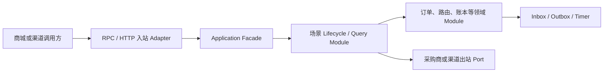

- API 模块保存稳定 Command、Query、Result、Buyer Client Interface 和错误码，不包含领域实现。
- 入站 Adapter 解析传输协议、认证调用方、解析 Buyer 绑定并构造 `CallContext`，不得编排业务或访问 Mapper。
- Application Facade 校验 scope、deadline 和命令结构，规范化业务字段并生成请求指纹，负责跨事务、跨 Port 的完整用例编排以及稳定 Result/错误转换；写 Facade 委托 Lifecycle，查询 Facade 委托只读 Query Module，Lifecycle 在业务事务内原子比较幂等键和请求指纹。
- Lifecycle 维护一次原子状态转换的固定顺序、锁顺序、事务边界和并发条件，不执行外部网络调用。
- 领域 Module 维护自身唯一事实和不变量；Lifecycle 只能调用公开 Domain/Application Interface，禁止跨模块访问 Repository、Mapper 或 DO。
- 出站 Port 只声明采购商收银台、商城通知、目录通知和淘宝闪购渠道能力；RPC/HTTP 选择、配置、超时和投递重试在采购商集成专章设计。
- Inbox、Outbox 和 Timer Handler 是系统入站 Adapter，只能重新调用指定 Facade 或 Lifecycle 恢复 Interface，不能直接修改领域表。

Facade 是外部用例 Interface，Lifecycle 是内部一致性编排者。二者不得合并成只转发参数的浅模块，也不得建立一个混合全部场景的 `SupplyChainManager`。

### 3.3 开放 Facade 与信任域

| Facade | 已认证调用主体 | 核心方法 | 职责 |
| --- | --- | --- | --- |
| `BuyerCatalogQueryFacade` | 采购商商城 | `pageCatalog`、`getCatalogChanges` | 查询标准商品池和增量变更。 |
| `BuyerFulfillmentCommandFacade` | 采购商商城 | `acceptFulfillment` | 受理标准商品履约；中台受理后不提供采购方自动取消、退款或撤销能力。 |
| `BuyerFulfillmentQueryFacade` | 采购商商城 | `getAcceptanceReceipt`、`getFulfillmentResult`、`getFulfillmentAssets` | 分别查询受理真相、履约结果和经独立权限保护的卡密/券码资产。 |
| `BuyerOrderQueryFacade` | 采购商商城、运营端 | `pageOrders`、`getOrderDetail` | 查询总订单摘要及类型化场景详情。 |
| `SupplierOrderAdminQueryFacade` | 中台运营端 | `pageSupplierOrders`、`getSupplierOrderDetail` | 按采购方订单查询串行尝试、路由候选、Operation、原始观察和异常 Case；不向采购方暴露。 |
| `BuyerO2OEntryFacade` | 采购商 App | `getH5Entry` | 校验 Buyer、用户和场景后生成 H5 入口。 |
| `O2OChannelCommandFacade` | 淘宝闪购渠道服务 | `preparePayment`、`applyChannelStatus`、`acceptRefund` | 接收 ele.me 支付请求、订单状态和退款事实。 |
| `BuyerO2OPaymentCallbackFacade` | 采购商收银台 | `confirmPayment`、`reportRefundResult` | 接收采购商支付和退款结果。 |

采购商 H5 入口与渠道交易命令分属不同信任域，禁止使用一个混合入口与渠道命令的 Facade。Facade 接收入站 Adapter 构造的 `BuyerCallerPrincipal` 或 `ChannelCallerPrincipal`，不得接受调用方直接指定内部 `buyerId`。标准履约下单、O2O H5 入口及创建采购商收银台订单的业务链路必须携带 `buyerUserId`；渠道服务通过已固化的会话或交易绑定传递该用户身份。采购商支付或退款回调不依赖回调参数重新传递 BuyerUser，必须先按 `outTradeNo/middleRefundNo` 加载订单中已固化的 Buyer 与 BuyerUser，再核对已认证 Principal；遗留协议若同时声明 `buyerUserId`，只能用于一致性比较，不能决定订单归属。

请求可以提交外部业务号、平台商品、数量、履约目标值、渠道金额和原始状态，但不能提交最终 Supplier、公共订单状态、账本动作或资金冻结状态。标准履约目标的 Schema 编码与版本由已发布 Listing 关联的平台 SKU 决定，调用方不得提交或覆盖；Facade 在加密前读取该只读元数据，并继续把派生后的 Schema 纳入密文关联数据和持久化快照。标准履约永久幂等键为 `(buyerId, buyerOrderNo)`，O2O 支付为 `(channelCode, transactionId)`，O2O 退款为 `(channelCode, refundNo)`。一期标准履约只接受 `quantity=1`；其他数量以 `QUANTITY_NOT_SUPPORTED` 原子拒绝。相同键和相同请求指纹返回首次结果；相同键但不可变业务字段不同返回 `IDEMPOTENCY_CONFLICT`。

查询 Facade 不产生状态推进，也不在查询线程中访问供应商或渠道。`getFulfillmentResult` 只返回履约状态、交付数量和脱敏摘要，不返回卡密或券码；`getFulfillmentAssets` 必须同时校验 Buyer、`buyerUserId` 所有权和 `FULFILLMENT_ASSET_READ` scope，并追加不可变访问审计。需要主动查单时，由独立恢复命令创建受控 Operation，再由 Outbox/Timer 异步执行。`pageOrders` 只读 `sc_buyer_order`；`getOrderDetail` 再按 `detailType` 调用唯一注册的 `OrderDetailProvider`，详情不可用时返回成功的 `OrderDetailResult`，其中保留总表摘要并设置 `detailAvailability=UNAVAILABLE/detailErrorCode=DETAIL_UNAVAILABLE`，不得伪造空详情或错误终态。`SupplierOrderAdminQueryFacade` 必须使用中台运营权限，按 `attempt_sequence` 返回单链，并默认隐藏目标、卡密、凭证和原始报文；敏感资产仍只能走独立审计接口。

### 3.4 CallContext、命令结果与错误契约

入站 Adapter 认证后构造的 `CallContext` 至少包含：

```text
traceId / correlationId / causationId / requestId / idempotencyKey
sourceSystem / principalType / principalId / buyerId / buyerUserId / deadlineAt / contractVersion
```

业务 Command、Query 和 Result 使用封闭类型，不返回任意 `Map`。Application Facade 返回类型化 Result，并通过 `SupplyChainApplicationException` 表达稳定业务错误；RPC 与 HTTP Adapter 共享同一个 `SupplyChainExceptionMapper`。HTTP/Feign 层按现有工程规范包装为 `CommonResult<T>`，仅使用其现有 `code/msg/data` 结构；`traceId` 通过 `X-Trace-Id` 响应头传播，`retryDirective` 由 API 模块中的稳定错误码目录静态映射。领域 Module 和 Lifecycle 不依赖 `CommonResult`、Feign 或 MVC 注解。

标准履约写接口的结果至少包含 `requestId/receiptStatus/receiptVersion/orderNo/orderStatus/failureCode/fulfillmentRequestNo/createdAt/idempotentReplay`。Buyer 身份已解析后的业务校验失败也返回 `ORDER_CREATED + FAILED + orderNo + failureCode`，不抛出让调用方猜测事务结果的业务异常；只有边界 `REJECTED_FINAL` 没有 orderNo。重复命中原业务请求返回首次结果快照，当前状态通过 Query Facade 获取。

| 指令 | 语义 | 典型错误 |
| --- | --- | --- |
| `DO_NOT_RETRY` | 当前请求内容或调用权限无效，修正前禁止原样重试。 | `INVALID_TARGET`、认证或授权失败。 |
| `RETRY_SAME_KEY` | 仅可使用原幂等键退避重试。 | 业务事务提交前的 `TEMPORARILY_UNAVAILABLE` 或并发失败。 |
| `QUERY_BY_BUSINESS_KEY` | 先按原业务号查询，禁止生成新单号。 | `IDEMPOTENCY_CONFLICT`、`ORDER_STATE_CONFLICT`、`CANCEL_NOT_SUPPORTED_AFTER_ACCEPTANCE`、`DOWNSTREAM_RESULT_UNKNOWN`。 |
| `MANUAL` | 停止自动动作并进入人工处置。 | `MANUAL_REQUIRED`。 |

`DETAIL_UNAVAILABLE` 是查询结果的详情可用性标记。FulfillmentAcceptanceReceipt 状态为 `PROCESSING/ORDER_CREATED/REJECTED_FINAL`；以 `(buyerId,buyerOrderNo)` 唯一，相同摘要重放，不同摘要永久冲突。回执和 FAILED BuyerOrder 均不可重新打开，修正请求必须使用新的 buyerOrderNo。

回执同时保存采购商提交的 `listingVersionNo` 和校验后解析的 `listingVersionId`；解析失败时后者为空。PROCESSING 期间还保存 `requestSnapshotSchemaVersion/requestSnapshotCiphertext/requestSnapshotKeyVersion/recoveryAttemptCount/recoverAfter`，完成时清除密文和恢复时间。回执与 BuyerOrder 保存 quantity 原值，只有成功创建的 FulfillmentRequest 和 SupplierOrder 强制 `quantity=1`。
目标加密必须由环境或 Nacos 注入 `AIFULI_SUPPLY_CHAIN_SECURITY_KEY_VERSION`、
`AIFULI_SUPPLY_CHAIN_ENVELOPE_KEY_BASE64` 和 `AIFULI_SUPPLY_CHAIN_FINGERPRINT_KEY_BASE64`；
后两者都是独立的 256 位随机密钥。任一缺失或长度非法时应用启动失败，不使用默认密钥。

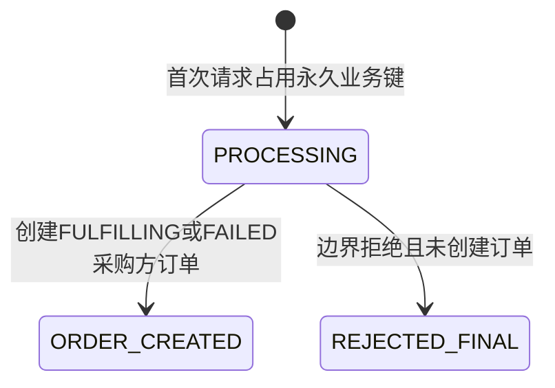

Facade 开始事务前发现 deadline 已过期时返回 `REQUEST_EXPIRED`；已经创建订单、冻结资金或发起外部调用后，deadline 只终止同步等待。RPC/HTTP 超时必须用原键查单；业务失败订单修正后使用新 buyerOrderNo，不得复用终态失败键。

### 3.5 标准履约应用编排

`BuyerFulfillmentCommandFacade.acceptFulfillment` 先完成 Principal、scope、deadline 和足以解析永久业务键的边界校验，再调用 `FulfillmentLifecycle.acceptOrder`。Lifecycle 按固定顺序执行：

1. 回执短事务锁定或创建 `(buyerId,buyerOrderNo)` 唯一回执；相同摘要重放，不同摘要冲突。首次请求写 PROCESSING、安全摘要和信封加密的最小请求恢复快照，此时不创建 BuyerOrder。
2. 事务外完成命令结构校验并采集路由动态资格事实；该阶段不持有数据库锁，不执行供应商履约副作用。
3. 最终落单短事务重新锁定回执，校验 Buyer、BuyerListing、PlatformSKU、数量、目标 schema、金额以及策略/候选静态有效性。业务失败时创建 FAILED BuyerOrder、状态日志、安全事件和 `ORDER_CREATED` 回执并清除暂存密文；路由失败可追加不可变失败决策审计，但不创建履约详情、供应商订单或资金事实。
4. 校验成功后冻结完整候选并由 trade-core 原子创建 FundReservation。缺账户拒绝且不创建资金事实；可用余额不足不构成失败，按应付金额透支冻结。其它业务失败仍只创建 FAILED BuyerOrder 并完成回执。
5. 资金冻结成功后在同一最终事务原子创建 BuyerOrder、FulfillmentRequest、单个路由轮次及全部候选、首张 SupplierOrder 和 SupplierOrderOperation；回填详情并投影 BuyerOrder 为 FULFILLING。
6. 将回执推进为 `ORDER_CREATED`、清除暂存请求密文，写供应商执行与订单事件 Outbox。外部调用只在最终事务提交后发生。

最终落单数据库或系统异常只回滚最终事务，已提交的 PROCESSING 回执保留供恢复；业务校验失败是最终事务内的正常终态订单，不使用异常触发回滚。事务提交后返回订单结果，供应商调用由 Outbox/Timer 异步触发。

`PROCESSING` 回执由调用方原键重试或 PersistentTimer 解密暂存快照恢复；Timer 按 `recover_after` 扫描并以 `version` CAS 递增 `recovery_attempt_count`、设置下一恢复时间，恢复过程重新采集动态事实，再在最终落单事务锁定同一回执执行原受理决策。并发已 `ORDER_CREATED` 时回放原结果。回执完成后必须清除暂存密文与恢复时间；解密失败时保持 PROCESSING、告警并等待原密钥恢复，禁止创建替代订单。状态受 `CHECK (status IN (0,10,30))` 约束，不引入人工态。

中台受理成功即形成不可逆的 B 端履约责任，采购方不能在 `FULFILLING` 期间自动取消、退款或撤销。兼容接口若仍暴露取消方法，必须稳定返回 `CANCEL_NOT_SUPPORTED_AFTER_ACCEPTANCE`，不得修改订单、Operation 或资金预留。只有中台从供应商获得显式履约失败事实时，才按状态机内部释放资金；这属于失败收敛，不是采购方退款。主状态已 `SUCCEEDED` 的标准商品仅退款售后见[《供应链中台 PRD 对齐详细设计》](./2026-08-28-supply-chain-prd-alignment-design.md#7-标准商品售后)。

### 3.6 O2O 应用编排

`BuyerO2OEntryFacade.getH5Entry` 在本地完成 Principal、BuyerUser 和采购商场景接入配置校验后，先读取或创建 `O2OChannelUserBinding`，再把不可枚举的随机 `channelUserId` 作为渠道 `externalUserId/open_id`，并在数据库事务外调用淘宝闪购渠道 Port 获取类型化入口结果。内部 `buyerId/buyerUserId` 不得直接暴露给渠道。此时尚无 PayRequest 和 externalMerchantId，不校验 SupplierChannelBinding。中台不接收或透传任意 URL、Header 或 JSON。

`O2OChannelCommandFacade.preparePayment` 固定分为四段：

1. `O2OChannelLifecycle.createPaymentPreparation` 先以 `(channelCode,channelUserId)` 唯一映射解析启用的 Buyer 与 BuyerUser；缺失、歧义或停用均在建单和冻结前拒绝。缺账户同样在建单和冻结前拒绝（`BUYER_ACCOUNT_NOT_OPENED`）；可用余额不足不拒绝。随后按 `(channelCode,transactionId)` 幂等创建 BuyerOrder、O2OChannelDetail、按 ele.me `payAmount` 建立的 FundReservation，以及状态为待执行的唯一 `PREORDER` O2OOperation；Operation 使用 `PREORDER:{channelCode}:{transactionId}` 作为稳定 `idempotencyKey` 并设置恢复时间，此时详情停留在 `FUNDS_RESERVED`，不返回可外呼 Ticket。相同渠道交易号但用户、Buyer、金额、商户或请求指纹不一致时返回身份冲突，不得创建第二张订单。
2. Facade 调用 `O2OChannelLifecycle.claimPaymentPreparation`，在新短事务中以 Operation 状态和 `expectedVersion` 做 CAS，将 `PREORDER` 从待执行改为执行中，同时把详情从 `FUNDS_RESERVED` 推进为 `CASHIER_CREATING`。只有抢占成功者获得不可变 `PaymentPreparationTicket`；`sc_o2o_operation.operation_no` 即唯一 `invocationId`。抢占失败者只能读取已有结果或按原业务键查单，禁止调用收银台。
3. Facade 在事务外调用 `BuyerCashierPort.createCashierOrder(ticket)`，调用绑定原 `outTradeNo/invocationId`，禁止客户端自动重试。
4. 调用成功后，`O2OChannelLifecycle.recordCashierOrder` 在新事务中按 `invocationId + expectedVersion` 记录收银台结果。

若节点在创建 PREORDER Operation 后、抢占前宕机，PersistentTimer 与同一 transactionId 的重试请求竞争同一个 CAS，仍只能有一个执行者获得原 Ticket。网络超时保持 `CASHIER_CREATING/UNKNOWN` 和原资金冻结，由 PersistentTimer 使用同一 `outTradeNo` 查单，禁止生成新支付单号。`BuyerO2OPaymentCallbackFacade.confirmPayment` 先按 `outTradeNo` 加载已固化的 Buyer、BuyerUser、金额和 PREORDER Operation，再校验已认证 Principal 及回调声明值，随后委托 `O2OChannelLifecycle.confirmBuyerPayment`，在一个事务内确认 FundReservation、追加账本流水、幂等创建固定商户 SupplierOrder、更新 O2OChannelDetail、提交汇总事实并创建关联该 SupplierOrder 的 CHANNEL_NOTIFY O2OOperation 与 Outbox。`O2OChannelCommandFacade.acceptRefund` 以 `(channelCode,refundNo)` 全局幂等键创建 O2ORefundCase、增加退款预留、推进售后事实并写采购商退款 Outbox；同键归属、原交易、金额或指纹不同即冲突。`BuyerO2OPaymentCallbackFacade.reportRefundResult` 同样按 `middleRefundNo` 加载固化归属后，委托 `O2OChannelLifecycle.applyBuyerRefundResult`，在一个事务内确认或释放退款预留、返还 BuyerAccount、写反向流水、更新累计退款并写通知 Outbox。`O2OChannelCommandFacade.applyChannelStatus` 委托 Lifecycle 的 `applyChannelOrderStatus`，原始渠道状态不能直接覆盖公共订单状态。

### 3.7 事务、恢复与权限规则

- 所有本地业务事务显式使用 `supplyChainTransactionManager`，禁止加入商城事务和使用 `REQUIRES_NEW` 隐藏部分提交。
- HTTP、RPC、供应商、采购商收银台和渠道网络调用一律位于数据库事务外。
- 所有异步恢复使用原业务号、原幂等键和 expectedVersion 重新进入 Lifecycle 条件更新方法，不直接写领域表。
- 标准履约使用领域专用 `FulfillmentAcceptanceReceipt`，O2O 使用详情/退款唯一键；回调防重由 Inbox 保证，异步交付由 Outbox/Timer 保证。本模块不建设跨业务的通用幂等结果表。
- 已发生外部副作用或结果未知时，deadline、节点下线或调用超时都不能成为释放资金或重路由的依据。

最小 scope 如下：

| 主体 | scope |
| --- | --- |
| 采购商商城 | `CATALOG_READ`、`FULFILLMENT_WRITE`、`ORDER_READ`、`FULFILLMENT_ASSET_READ`、`O2O_ENTRY`；敏感资产权限必须独立授予。 |
| 采购商收银台 | `O2O_PAYMENT_CALLBACK`、`O2O_REFUND_CALLBACK`。 |
| 淘宝闪购渠道服务 | `O2O_PAYMENT_PREPARE`、`O2O_STATUS_WRITE`、`O2O_REFUND_WRITE`。 |
| Timer/Outbox 系统身份 | `SYSTEM_RECOVERY`，且只能调用指定恢复 Interface。 |
| 供应链运营人员 | `FULFILLMENT_EXCEPTION_RESOLVE`；只允许通过受控命令处置异常，不授予数据库直写权限。 |

### 3.8 包结构与验收测试

```text
aifuli-module-supply-chain-api/com.aifuli.module.supplychain.api
├── catalog / fulfillment / order / o2o
├── client
└── error

aifuli-module-supply-chain-server/com.aifuli.module.supplychain
├── interfaceapi/rpc / http / authentication
├── application/facade
├── tradecore/catalog/application
├── border/order/application
├── border/fulfillment/application
├── border/o2o/application
└── integration/buyer / taobaoflash
```

`api` 保存稳定契约；`interfaceapi` 保存 RPC/HTTP 入站 Adapter；顶层 `application/facade` 只保存外部用例入口和跨 Port 编排，不拥有领域事实。Lifecycle 与 Query Module 放在所属深模块的 `application` 包内，例如 `border.fulfillment.application` 和 `border.o2o.application`，避免形成集中访问所有 Repository 的浅应用层。领域事实仍归现有 `tradecore`、`border` 和 `routing` 深模块。除第 17 章通用门禁外，本模块必须覆盖：

- 组合部署本地 `ApiImpl` 与拆分部署 Feign 对同一 RPC 命令返回相同结果、错误码、deadline 和幂等语义。
- 同一标准订单并发受理只生成一张回执、一张总订单、一次冻结和一组 Outbox；超时后以原键查回执，相同不可变字段返回同一快照。
- FAILED BuyerOrder 和 ORDER_CREATED 回执不能重开；同键同摘要重放，不同摘要冲突，修正请求必须使用新 buyerOrderNo。
- 在标准受理每一步注入异常时订单事务完全回滚；受理后取消始终返回 `CANCEL_NOT_SUPPORTED_AFTER_ACCEPTANCE` 且不产生状态变更。
- 两个并发 O2O 预下单请求只能有一个 CAS 抢占 `PREORDER` Operation 并调用收银台；超时后保持原 `outTradeNo/invocationId` 和冻结，`recordCashierOrder` 与支付回调乱序到达时不能覆盖已确认支付。
- 支付、退款回调重复或乱序时账本只追加一次；deadline 到期不能释放已经产生副作用的冻结。
- 履约结果查询不返回敏感资产；资产查询缺少 BuyerUser 所有权或 `FULFILLMENT_ASSET_READ` 时拒绝并记录审计。
- 详情 Module 故障时 `CommonResult` 仍成功，并返回总表摘要和 `detailAvailability=UNAVAILABLE/detailErrorCode=DETAIL_UNAVAILABLE`。
- ArchUnit 验证 Adapter 不访问 Mapper、Facade 不跨模块访问 Repository、领域 Module 不依赖 Feign/MVC。

本章不新增数据库表或字段；一期 DDL 只需明确 `sc_o2o_operation.operation_no` 同时承担 `invocationId`。

## 4. 持久化通用约定

### 4.1 标识、金额与状态

- 内部数据库主键统一为 `BIGINT AUTO_INCREMENT`。
- 对外业务编号使用“前缀 + 大写 ULID”，例如 `RCP_`、`ORD_`、`FR_`、`SO_`、`SREQ_`、`OP_`、`RR_`、`CASE_`、`EVT_`、`TMR_`；接口和日志不得暴露自增主键。
- 2026-10-13 订单编号修订（用户已评审通过，实施中）：用户要求Redis参与防重、自增，否决专用连接池。新建总订单号与标准履约 `billno` 使用固定24位日期型数字编号：MySQL预留各实例互不重叠专属号段，Redis原子消费，正常取号不更新数据库流水行；编号时间取Redis TIME转上海时间，其它数据库业务时钟保持原规则。单一号段所有权、本地返回高水位和不确定时弃段共同防Redis回退重发，历史编号不改写。详见 [供应链日期型订单号与 Redis／MySQL 协作发号详细设计](2026-10-13-supply-chain-order-number-design.md)。实施与自动化证据按实现计划和联调文档维护，本条不表示已部署切换。
- 外部系统的 `transactionId/refundNo/externalSupplierOrderNo/externalOperationNo` 按原始字符串保存。
- 金额使用 `BIGINT` 最小货币单位和 `CHAR(3)` 币种；一期只允许 CNY，Java 领域值对象为 `Money(long amount, Currency currency)`。
- 费率等未来精度值使用 `DECIMAL(18,8)`，禁止浮点数。
- 高频生命周期状态使用 `SMALLINT`，业务类型、协议码和原始外部状态使用 `VARCHAR(32/64)`；API 只返回稳定枚举名称。
- 业务稳定编码（状态、拒单码、履约类型、路由主体、Outbox 事件类型、业务号前缀等）必须落在 Java 领域枚举或常量类中，禁止在 Lifecycle/Facade 中散落字面量；DDL `COMMENT`/`CHECK` 与领域枚举 `name()` 或常量值保持一致。标准履约编码目录见第 7.2.1 节。
- 时间使用 `DATETIME(3)` 并以 `Asia/Shanghai` 存储，当前时间由 MySQL 数据库时钟提供；外部事件采用带
  offset 的 ISO-8601，并在持久化边界转换为上海本地时间。完整约束与字段清单见
  [《供应链数据库本地时间统一设计》](./2026-09-04-supply-chain-database-local-time-design.md)。

### 4.2 可变与追加式事实

主数据和配置 DO 可以复用带创建/更新时间的可变基类，但通过停用或发布新版本变更，不删除已被交易引用的数据。订单、路由、原始状态观察、账本、Inbox、Outbox 和 Timer execution 使用不包含逻辑删除字段的 `SupplyChainRecordDO`；事实表只追加或进行受版本控制的状态转换。

数据库不创建物理外键。引用完整性由 `NOT NULL`、唯一索引、MySQL 8 `CHECK`、应用事务校验、固定锁顺序、条件更新、孤儿审计和集成测试共同保证。每个逻辑引用列必须有适配查询路径的索引。

### 4.3 字符集与排序规则

数据库、所有业务表和文本列统一为：

```sql
DEFAULT CHARACTER SET utf8mb4
COLLATE utf8mb4_0900_ai_ci
```

ULID 统一生成大写。摘要、密文和随机令牌等需要字节级比较的值使用 `BINARY/VARBINARY/BLOB`，不依赖文本排序规则。

## 5. 主数据与标准商品池

标准商品池以 PlatformSKU 为中心，同时把采购商商业配置和供应商供给拆成两个独立方向。平台商品不依赖商城商品表，不把 Brand、Supplier、Connector 或 InventorySource 混为一个“渠道商品”。

淘宝闪购 H5 内商品不进入标准商品池。O2O 只使用 Buyer、Supplier、SupplierChannelBinding 和场景详情，不创建 PlatformSKU、BuyerListing、SupplierOffer 或 InventorySource。

### 5.1 核心关系

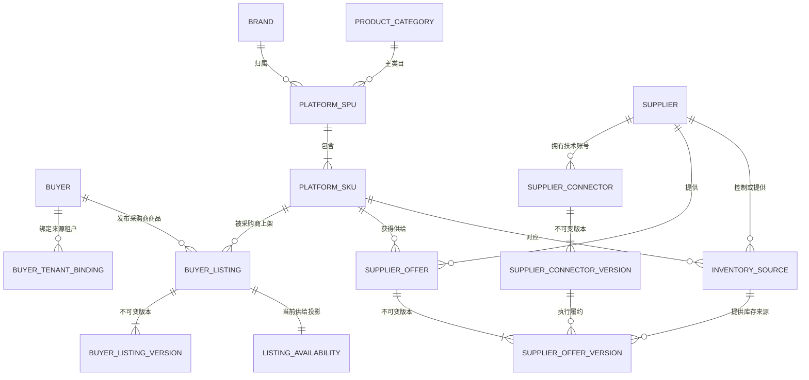

关键基数与边界如下：

- 一个 Brand 可以包含多个 SPU；一期一个 SPU 只有一个平台主类目。
- 一个 SPU 至少包含一个 SKU；面值或履约语义不同必须拆成不同 SKU。
- 一个 PlatformSKU 可以被多个 Buyer 上架，也可以由多个 Supplier 提供。
- BuyerListing 不绑定 Supplier；SupplierOffer 不绑定 Buyer。订单时由中台路由连接二者。
- 一个 Supplier 可以有多个 Connector；一个 OfferVersion 固化一个 ConnectorVersion。
- 多个 OfferVersion 可以共享同一 InventorySource，但 Supplier、SKU、履约类型和库存所有权必须一致。

### 5.2 主数据通用规则

主数据身份表保存稳定业务编号、当前版本指针、管理状态和乐观锁。发布版本表只追加，不逻辑删除；发布后禁止原地修改。名称等展示信息可以更新，但涉及履约类型、价格、外部商品号、Connector 或库存源的变化必须发布新版本。

#### 5.2.1 管理状态实际含义

同名状态必须结合模型理解。`ACTIVE` 只代表本对象具备参与新业务的资格，不代表整条链路必然可用；实际可用性还要组合父对象、当前版本、库存、报价、Connector 和场景规则计算。

| 模型 | 状态 | 实际意义 | 对新业务的影响 | 恢复与历史规则 |
| --- | --- | --- | --- | --- |
| Buyer | `ACTIVE（启用）` | 采购主体处于正常合作期。 | 允许创建订单、发布 Listing 和新增资金预留。 | 可暂停或归档；仍需通过租户绑定、额度等校验。 |
| Buyer | `SUSPENDED（暂停）` | 因风控、欠款或运营原因临时暂停合作。 | 拒绝新订单、Listing 发布和资金预留。 | 可恢复为 `ACTIVE`；历史查单、供应商回调、O2O 退款及对账继续执行。 |
| Buyer | `ARCHIVED（已归档）` | 采购主体永久退出，是不可逆终态。 | 永久拒绝新业务。 | 不可重新启用；历史数据只读，在途义务仍须收敛。 |
| Brand、PlatformSPU、PlatformSKU | `DRAFT（草稿）` | 主数据尚在录入或审核，允许修改。 | 不可发布给采购商，不可进入路由或下单。 | 可激活；放弃时可直接归档。 |
| Brand、PlatformSPU、PlatformSKU | `ACTIVE（启用）` | 主数据已经确认，可参与标准商品池。 | 满足全部依赖后可用于 Listing、Offer、路由和下单。 | 可临时停用或永久归档。 |
| Brand、PlatformSPU、PlatformSKU | `INACTIVE（停用）` | 主数据临时下架，但身份和历史关系保留。 | 阻止由该对象形成的新发布、路由和订单。 | 可恢复为 `ACTIVE`；不打断引用其冻结快照的在途订单。 |
| Brand、PlatformSPU、PlatformSKU | `ARCHIVED（已归档）` | 标准主数据永久退场，是不可逆终态。 | 永久禁止新引用。 | 不可重新激活；语义不同的商品必须创建新身份，历史订单保留旧编码和快照。 |
| BuyerListing、SupplierOffer | `DRAFT（草稿）` | 商业关系及其首个版本尚未发布，可编辑。 | Listing 不可推送或下单，Offer 不可作为路由候选。 | 可发布首个不可变版本；放弃时可直接退役。 |
| BuyerListing、SupplierOffer | `PUBLISHED（已发布）` | 至少一个不可变版本已生效，当前版本指针可供业务读取。 | Listing 可进入采购商目录，Offer 可成为路由候选，但仍须通过组合有效性校验。 | 已发布版本禁止修改；调整或回滚均创建并发布新版本。 |
| BuyerListing、SupplierOffer | `SUSPENDED（暂停）` | 临时停止当前商业关系，已发布版本仍保留。 | Listing 不接受新订单，Offer 不参与新路由。 | 未改变配置时可恢复为 `PUBLISHED`；有配置变更时先发布新版本；在途订单继续使用冻结版本。 |
| BuyerListing、SupplierOffer | `RETIRED（已退役）` | 商业关系永久结束，是不可逆终态。 | 永久禁止新目录、订单或路由引用。 | 不可恢复；需要重新开展业务时创建新的 Listing 或 Offer 身份。 |
| Supplier | `ACTIVE（启用）` | 供应商处于正常合作期。 | 具备参与新路由和新增 O2O 商户映射的资格。 | 实际路由还须验证 Offer、Connector 和库存源。 |
| Supplier | `SUSPENDED（暂停）` | 因合同、风控或故障临时停止新履约。 | 排除出新路由和新商户映射。 | 可恢复为 `ACTIVE`；已调用外部供应商的 SupplierOrder 仍可查单、接收回调，已支付 O2O 退款继续收敛。 |
| Supplier | `ARCHIVED（已归档）` | 供应商永久退出，是不可逆终态。 | 永久禁止新路由和新映射。 | 不可重新启用；历史和在途履约仍保留供应商身份及冻结配置。 |
| SupplierConnectorVersion | `DRAFT（草稿）` | Connector 配置版本正在编辑，尚未验证。 | 不可被 OfferVersion 引用执行新履约。 | 可提交验证；修改已验证内容会回到此状态并使旧验证结论失效。 |
| SupplierConnectorVersion | `VALIDATED（已验证）` | Schema、地址、凭证可解析性、能力及连通性校验已通过，但尚未发布。 | 仍不可执行新履约。 | 可发布或退役；验证结论只在配置内容和规定有效期内成立。 |
| SupplierConnectorVersion | `PUBLISHED（已发布）` | 不可变配置版本已经发布，可被 OfferVersion 固化引用。 | 满足其他依赖时可执行新履约。 | 禁止原地修改或退回草稿；回滚须复制目标历史配置并发布一个新版本。 |
| SupplierConnectorVersion | `RETIRED（已退役）` | 配置版本停止承接新履约，是不可逆终态。 | 新 OfferVersion 和新操作不得选择该版本。 | 已冻结该版本的 SupplierOrder 仍可按兼容策略查单和处理回调；不得重新发布。 |
| InventorySource | `DRAFT（草稿）` | 库存来源正在配置，尚未启用。 | 不可成为路由库存依据。 | 可激活；放弃时可直接退役。 |
| InventorySource | `ACTIVE（启用）` | 库存来源可参与供给可用性计算。 | 类型、观测新鲜度、Supplier、Connector 和 Offer 均有效时可支持新路由。 | 可临时暂停或永久退役。 |
| InventorySource | `SUSPENDED（暂停）` | 库存来源因异常或运营操作临时退出。 | 排除出新路由，但保留库存观测和已有引用。 | 可恢复为 `ACTIVE`；不影响在途订单的冻结事实。 |
| InventorySource | `RETIRED（已退役）` | 库存来源永久废弃，是不可逆终态。 | 永久禁止新路由引用。 | 不可恢复；历史观测和订单中的冻结引用继续保留。 |

#### 5.2.2 生命周期图

Buyer 与 Supplier 使用相同的管理状态集合；业务含义按上表分别执行。

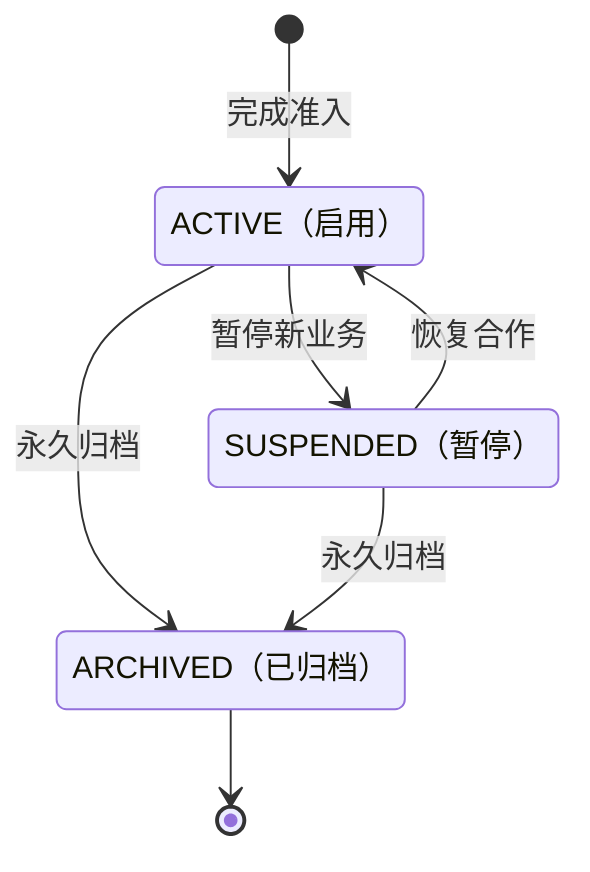

Brand、PlatformSPU 与 PlatformSKU 共用标准主数据生命周期。

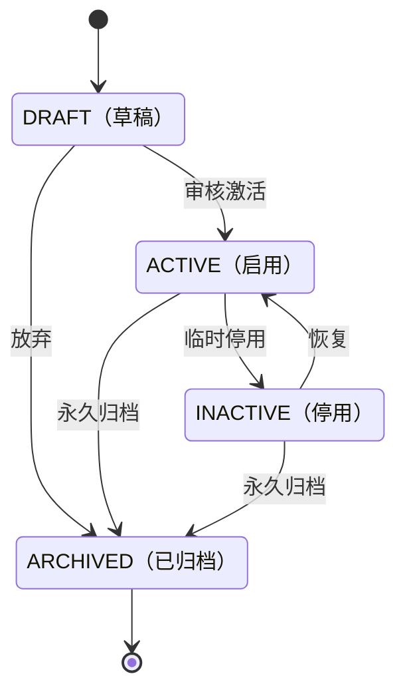

BuyerListing 与 SupplierOffer 共用商业关系生命周期；发布行为同时生成或切换不可变版本。

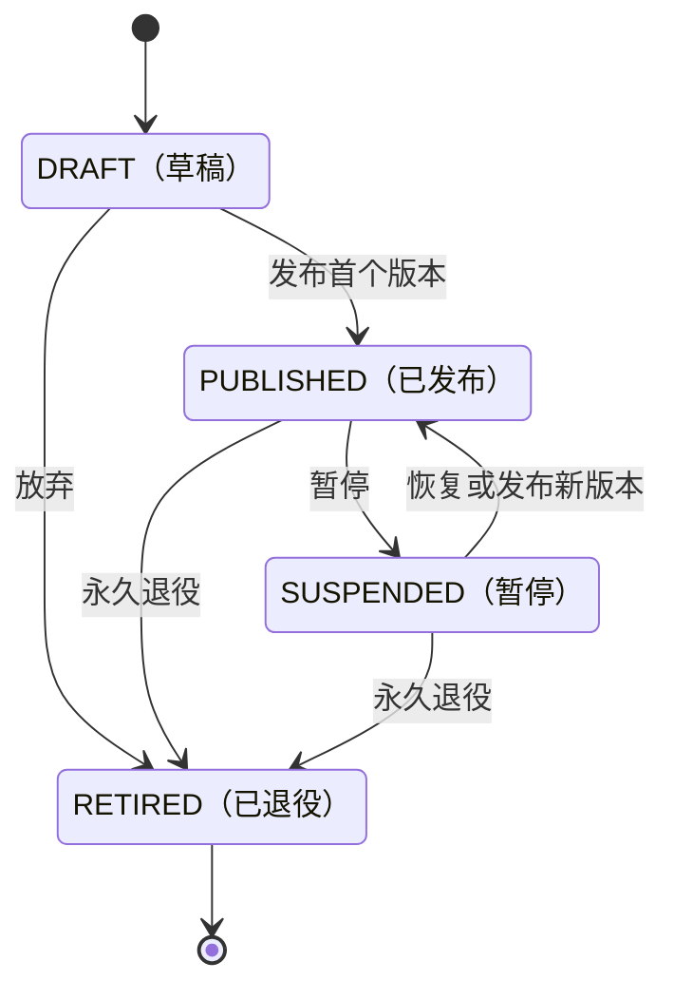

SupplierConnectorVersion 自身就是不可变版本；发布后没有回退路径。

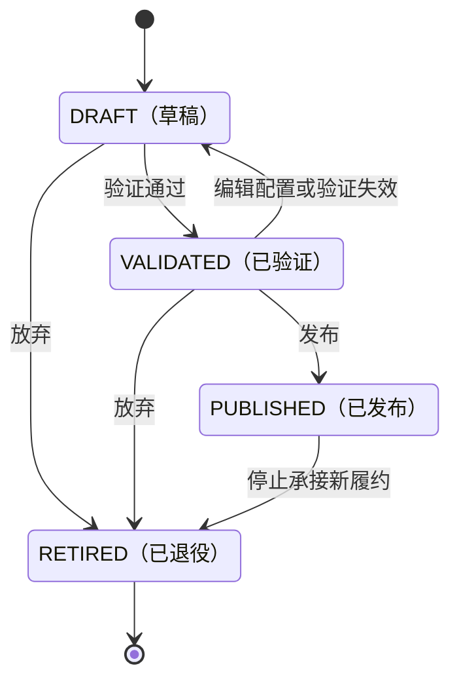

InventorySource 使用可恢复的暂停状态和不可恢复的退役状态。

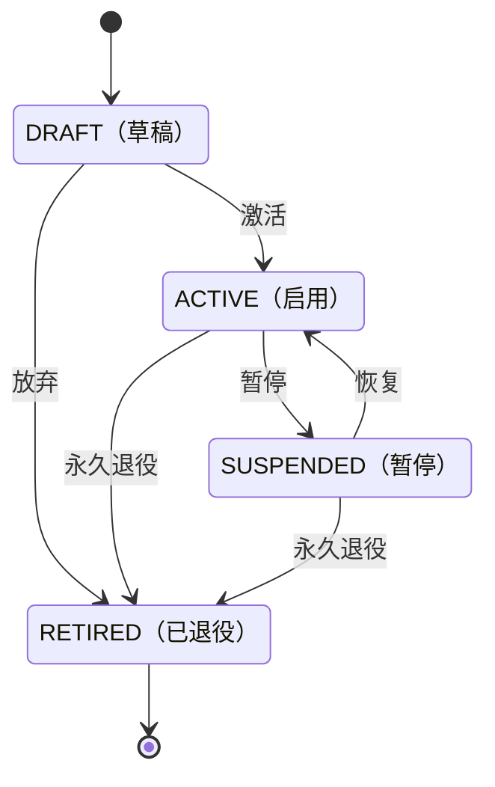

#### 5.2.3 状态转换统一约束

- `SUSPENDED（暂停）` 和 `INACTIVE（停用）` 是可恢复状态；`ARCHIVED（已归档）` 和 `RETIRED（已退役）` 是不可逆终态。终态不等于删除，历史数据和审计记录永久保留。
- 停用父对象时不批量覆盖子对象状态。发布、路由和下单实时组合父子对象及依赖项的有效性；父对象恢复后，未被单独停用的子对象可重新生效。
- 所有身份表包含 `version`。状态切换和当前版本指针更新使用 `WHERE id = ? AND version = ?` 条件更新，并记录操作者、原因、前后状态和 Trace ID；需要刷新可用性投影时在同一事务写入 Outbox。
- 已发布版本只追加、不修改。所谓“回滚”是复制目标历史配置并发布一个更高版本，而不是把已发布版本改回 `DRAFT` 或重新启用已退役版本。
- 暂停或进入终态只阻止新业务，不得破坏订单中已经固化的 ListingVersion、OfferVersion、ConnectorVersion、价格和供应商引用，也不得阻断查单、回调、退款、对账及账本收敛。

### 5.3 采购商 Buyer

`sc_buyer` 是采购主体，不等同于商城 tenant。核心字段如下：

| 字段 | 说明 |
| --- | --- |
| `id/buyer_code` | 内部主键与永久业务编码；`buyer_code` 唯一。 |
| `buyer_name/short_name` | 标准名称与列表简称。 |
| `buyer_type` | 一期固定为 `SAAS_MALL`，为其他采购主体预留封闭枚举。 |
| `status/version` | 管理状态与乐观锁。 |
| `contact_name/contact_mobile` | 最小运营联系人信息，不进入订单回调。 |

Buyer 停用后拒绝创建订单、发布 Listing 和新增资金预留。历史查单、供应商回调、O2O 退款和对账仍然允许执行，不能因主体停用而丢失收敛能力。

`sc_buyer_tenant_binding` 把调用方身份解析为 Buyer：

```text
id, buyer_id, source_system, external_tenant_id
binding_version, valid_from, valid_to, current_flag, status
```

`(source_system,external_tenant_id,binding_version)` 唯一。当前记录使用可空 `current_flag=1`，历史记录置空，并通过 `(source_system,external_tenant_id,current_flag)` 唯一约束保证同一来源租户最多一个当前绑定。

### 5.4 品牌与类目

`sc_brand` 保存平台统一品牌，不保存 Supplier 或 SupplierOffer：

```text
id, brand_code, brand_name, english_name
logo_url, status, sort, version
```

`brand_code` 唯一。品牌改名不改变商品身份；品牌归并不能直接改历史订单，只能停用旧品牌并通过受审计命令迁移尚未交易的草稿商品。

`sc_brand_alias` 保存外部或历史名称：

```text
brand_id, source_system, alias_name, status
```

`(source_system,alias_name)` 唯一，用于 Cardshop 数据清洗和后续供应商商品匹配。别名不能参与订单展示或替代 `brand_code`。

`sc_product_category` 是平台类目树：

```text
id, category_code, category_name, parent_id
category_level, sort, status, version
```

`category_code` 唯一。一期 PlatformSPU 只保存一个 `primary_category_id`，不提前建设多类目关系表。

### 5.5 标准商品 PlatformSPU/PlatformSKU

`sc_platform_spu` 描述采购商可理解的标准产品概念：

| 字段 | 说明 |
| --- | --- |
| `spu_code` | 平台永久 SPU 编码，唯一。 |
| `brand_id/primary_category_id` | 品牌和平台主类目。 |
| `spu_name/subtitle` | 标准展示名称。 |
| `cover_url/use_instruction` | 最小媒体与使用说明。 |
| `status/version` | 生命周期和乐观锁。 |

`sc_platform_sku` 是可精确下单和履约的最小标准商品：

| 字段 | 说明 |
| --- | --- |
| `sku_code/spu_id` | 永久 SKU 编码与所属 SPU。 |
| `fulfillment_type` | `DIRECT_RECHARGE/VOUCHER_CODE/CARD_CODE_SECRET/VOUCHER_URL/ACCOUNT_BOUND_BENEFIT`。 |
| `face_value/currency` | 面值最小货币单位与币种；一期只允许 CNY。 |
| `target_schema_code/target_schema_version` | 充值账号等履约目标结构。 |
| `result_schema_code/result_schema_version` | 直充结果或卡券资产结构。 |
| `status/version` | 生命周期和乐观锁。 |

相同品牌和面值的直充、兑换码、卡号卡密和账户绑定权益是不同 SKU，因为目标、结果、售后和敏感数据处理不同。`ACCOUNT_BOUND_BENEFIT` 表示供应商直接绑定到手机号或外部账号、仍可作为独立权益查询或撤销的结果，不得与没有独立资产生命周期的普通直充混用。SKU 不保存采购商价格、Supplier、外部商品号、Connector 或库存数量。

SKU 首次激活后，`spu_id/fulfillment_type/face_value/currency/schema` 不可修改。语义发生变化时创建新 SKU；名称和说明变化通过商品变更日志推送，不重解释历史订单。

### 5.6 采购商商品 BuyerListing

`sc_buyer_listing` 表示 Buyer 获准采购并销售一个 PlatformSKU：

```text
id, listing_no, buyer_id, platform_sku_id
buyer_sku_code, current_version_id, status, version
```

`listing_no` 全局唯一；`(buyer_id,platform_sku_id)` 和 `(buyer_id,buyer_sku_code)` 分别唯一。一期同一 Buyer 对一个 PlatformSKU 只有一个 Listing。

`sc_buyer_listing_version` 保存不可变商业版本：

```text
id, listing_id, version_no
buyer_settlement_unit_price, currency
display_name, min_quantity, max_quantity
valid_from, valid_to, publish_reason, published_at
```

`(listing_id,version_no)` 唯一。`buyer_settlement_unit_price` 是 Buyer 为一个计价单位向中台结算的价格，不是商城 C 端零售价，也不是供应商履约结算单价。

发布事务依次插入 ListingVersion、条件切换当前版本、追加 `sc_buyer_catalog_change` 并写 Outbox。订单受理时固化 ListingVersion；之后调价或下架不得重算已受理订单。

`sc_buyer_catalog_change` 使用自增 ID 作为 Buyer 范围内单调递增但允许有间隙的游标：

```text
id, buyer_id, change_type, listing_id, listing_version_id
availability_version, occurred_at, payload_digest
```

索引为 `(buyer_id,id)`。`change_type` 只允许 `UPSERT/TOMBSTONE/AVAILABILITY_CHANGED`。商城按 `buyerId + cursor` 拉取；游标低于 `minAvailableCursor` 时执行全量重建。

#### 5.6.1 目录读取字段与注释契约

目录 DTO 的中文字段注释与 `@Schema.description` 必须描述真实查询投影，不能把数据库内部主键、数字状态或其它定价层的含义套到对外字段上。本节为既有读取行为的注释勘误，不修改字段名、类型、校验、查询、金额计算、生命周期或已发布 DDL。

- `BuyerCatalogItemRespDTO.listingVersion` 来自 `sc_buyer_listing_version.version_no`，含义为「采购商商品业务版本号，从1递增」，不是版本内部主键；内部主键仍由 `current_version_id` 引用。
- `displayName` 来自同一商业版本的 `display_name`，含义为「向采购商商城展示的商品名称」，不是实时读取的 SKU 标准名称。
- `buyerSettlementUnitPrice` 来自该版本的 `buyer_settlement_unit_price`，含义为「采购商向中台结算的单位价格，单位为分」，不把它描述为模板 L2，也不在本次勘误中切换到通用定价。`currency` 为「结算币种，一期固定CNY」。上述四个字段表述与 `002-product-and-offer.sql` 的对应 `COMMENT` 一致。
- `listingStatus` 对外返回 `DRAFT/PUBLISHED/SUSPENDED/RETIRED` 枚举名；`availabilityStatus` 对外返回 `AVAILABLE/UNAVAILABLE/UNKNOWN` 枚举名。数字编码只用于持久化，已有定价非 READY 覆盖为 UNAVAILABLE 的规则保持不变。
- `updatedAt` 来自 `sc_buyer_listing.updated_at`，是采购商商品最后修改时间，不是供给可用性投影更新时间。该时间及 `BuyerCatalogChangeRespDTO.occurredAt` 的数据库值按 `Asia/Shanghai` 解释，经 `SupplyChainDatabaseClock.toInstant` 转为绝对时刻后以 UTC 偏移输出；对外注释注明 UTC，不改变数据库会话时区。

实现证据为 `BuyerCatalogReadMapper.READ_COLUMNS` 与 `BuyerCatalogQueryService.toItem/getCatalogChanges`。`BuyerCatalogContractTest` 固定上述描述、字段类型及原字段集合；其余 DTO 保留现有完整中文注释，不做整组历史版本回退。人工核验及自动化执行记录维护在 `docs/集成测试.md` 的对应章节。

### 5.7 供应商 Supplier

`sc_supplier` 只保存业务主体：

```text
id, supplier_code, supplier_name, short_name
supplier_type, legal_entity_name, status, version
```

`supplier_code` 唯一。`supplier_type` 一期为 `STANDARD_SUPPLIER/O2O_MERCHANT`：奇那梦属于前者，盒马属于后者。Supplier 不保存接口地址、凭证、外部 SKU、结算价或库存数量。

Supplier 停用后不参与新路由。已经外呼的 SupplierOrder 仍允许按已固化 ConnectorVersion 查单和接收回调；O2O 已发生支付的退款也必须继续收敛。

`sc_supplier_channel_binding` 只服务 O2O：

```text
channel_code, external_merchant_id, supplier_id
mapping_version, valid_from, valid_to, current_flag, status
```

`(channel_code,external_merchant_id,mapping_version)` 唯一。当前记录使用可空 `current_flag=1`，历史记录置空，并以 `(channel_code,external_merchant_id,current_flag)` 唯一约束当前映射。

它把 ele.me 等渠道中的稳定商户标识映射为 `O2O_MERCHANT` Supplier，不保存门店；具体门店只属于 O2OChannelDetail。

### 5.8 Supplier Connector 与配置发布

Supplier Connector 是技术接入身份，不是 Supplier 或 SupplierOffer。一个 Supplier 可以拥有生产账号、备用账号或不同协议族的多个 Connector。

`sc_supplier_connector` 保存稳定身份：

```text
id, connector_no, supplier_id, connector_code
adapter_type, current_version_id, status, version
```

`(supplier_id,connector_code)` 唯一。`adapter_type` 选择代码中的受控协议实现，例如 `QNM_GAME_ORDER_V1`，不能由页面填写动态类名。

`sc_supplier_connector_version` 保存不可变非秘密配置：

```text
id, connector_id, version_no
base_url, merchant_account, credential_slot_id
protocol_version, callback_path
connect_timeout_ms, read_timeout_ms
rate_limit, concurrency_limit
adapter_config_schema_version, adapter_config_json
validation_status, validated_at, published_at, config_digest
```

标准、高频和需要索引的字段必须结构化。`adapter_config_json` 只承载低频协议差异，由对应 Adapter 的封闭 JSON Schema 校验；禁止脚本、SpEL、动态 SQL、类名或数据库更新表达式。

管理端创建连接器草稿时只提交 `adapter_type` 与 `adapter_config_json`，不提交 `adapter_config_schema_version`；应用服务必须从代码内 `AdapterMetadata.connectorSchemaVersion()` 取得当前版本并用于校验、摘要和持久化，避免页面伪造版本。

`sc_supplier_connector_capability` 保存 `connector_version_id/capability_code/enabled/metadata_version`，`(connector_version_id,capability_code)` 唯一。封闭能力集合为 `CREATE_RECHARGE/ISSUE_ASSET/BIND_BENEFIT/QUERY_ORDER/QUERY_ASSET/VOID_ASSET/UNBIND_ASSET/QUERY_BALANCE/QUERY_INVENTORY/RECEIVE_CALLBACK`；未通过对应契约测试的能力不能启用。能力只表示接口存在，不承载重试、状态或账本动作。

`sc_supplier_account_balance_snapshot` 保存 Connector 账号级的追加式余额观察：

```text
id, connector_version_id, balance_type, amount, currency
observed_status, observed_at, valid_until, supplier_request_no, raw_digest
```

索引为 `(connector_version_id,balance_type,observed_at)`。资金、授信或通用额度属于供应商账号余额；某个外部 SKU 的数量或产品配额属于 InventorySnapshot。两者均只在有效期内辅助路由，不能解释为中台已经冻结供应商资金或锁定远程库存。

`sc_credential_slot` 只保存凭证引用：

```text
id, slot_no, provider_type, secret_ref
masked_hint, active_secret_version, status, updated_at
```

`appKey/appSecret/userKey`、AES/SM2/RSA 私钥、Token、密码和证书私钥不以明文进入业务表。优先由 KMS/密钥系统托管；一期若使用信封加密过渡，主密钥必须位于 Nacos、环境变量或独立密钥系统，不能与密文同库。

配置存储边界如下：

| 位置 | 保存内容 |
| --- | --- |
| 数据库 | Supplier、ConnectorVersion、端点、非秘密商户标识、能力、受限超时/限流、映射、发布状态和审计。 |
| 密钥系统 | 各类密钥、私钥、Token、密码及证书秘密材料；数据库只保存引用。 |
| Nacos/部署配置 | 数据源、Redis、服务发现、KMS 引用、当前环境公网回调基础域名、HTTP 出口白名单、全局超时/重试上限和平台紧急总开关。 |
| 代码 | 协议签名、编解码、固定 API 语义和封闭能力接口。 |

页面发布采用简化流程 `DRAFT → VALIDATED → PUBLISHED → RETIRED`。一期同一 `SUPPLY_CHAIN_ADMIN` 可以编辑、验证和发布，不强制双人审批；`SUPPLY_CHAIN_VIEWER` 只读。

发布前必须通过字段 Schema、Adapter 能力、凭证可解析性、超时范围和 URL 安全校验。生产 URL 只允许 HTTPS 和出口白名单域名，并阻止本机、私网、链路本地及云元数据地址，防止页面配置形成 SSRF。

连通性或余额测试在数据库事务外执行，保存短期有效的脱敏测试结果。发布事务只校验结果未过期，然后插入不可变版本、条件切换当前版本、追加 `sc_supplier_config_publish_record` 并写 Outbox。

回滚通过复制历史内容发布新版本完成，不修改或删除旧版本。多节点按版本 ID 缓存不可变配置；SupplierOrder 固化 ConnectorVersion，因此不依赖 Nacos Refresh 广播保证在途订单一致性。

奇那梦现有 `qnm.backUrl` 拆为 Nacos 中可信公网回调基础域名与 Adapter 固定/版本化回调路径。供应商 API 地址和非秘密账号信息进入 ConnectorVersion，实际凭证进入 CredentialSlot。

### 5.9 SupplierOffer 与供应商结算事实

`sc_supplier_offer` 是 Supplier 向一个 PlatformSKU 提供履约的稳定商业身份：

```text
id, offer_no, offer_code, supplier_id, platform_sku_id
current_version_id, status, version
```

`offer_no` 全局唯一，`(supplier_id,offer_code)` 唯一；索引为 `(platform_sku_id,status)`。同一 Supplier 与 PlatformSKU 可以存在多个 Offer，但路由必须选中一个确定版本。

`sc_supplier_offer_version` 保存不可变供给条件：

```text
id, offer_id, version_no, external_sku_code
supplier_settlement_unit_price, currency
connector_version_id, inventory_source_id
min_quantity, max_quantity, quantity_step
primary_capability_code, completion_mode
create_idempotency_mode, unknown_result_policy
partial_delivery_mode, result_multiplicity
fulfillment_config_schema_version, fulfillment_config_json
valid_from, valid_to, publish_reason, published_at
```

执行画像采用封闭枚举：`completion_mode` 为 `SYNCHRONOUS/QUERY/CALLBACK/QUERY_OR_CALLBACK`，`create_idempotency_mode` 为 `NONE/DEDUP_ONLY/REPLAYABLE_RESULT`，`unknown_result_policy` 为 `QUERY_ORDER/WAIT_CALLBACK/REPLAY_SAME_KEY/MANUAL`，`partial_delivery_mode` 为 `FORBIDDEN/ALLOWED`，`result_multiplicity` 为 `NONE/SINGLE/MULTIPLE`。只有 `REPLAYABLE_RESULT` 可以发布 `REPLAY_SAME_KEY`，且必须有供应商协议和契约测试证明重复请求返回第一次结果。`fulfillment_config_json` 只保存 DIDI `canvasId` 等低频 SKU 私有参数，由对应 Adapter 的封闭 JSON Schema 校验；外部 SKU、金额、数量、状态和外部单号不得放入其中。

`(offer_id,version_no)` 唯一。发布版本一经写入不再修改；当前外部 SKU 唯一性由可重建投影 `sc_supplier_external_sku_binding` 承担：

```text
connector_id, external_sku_code, offer_id, offer_version_id, version
```

`(connector_id,external_sku_code)` 和 `offer_id` 分别唯一。发布 OfferVersion 时，在同一事务中条件更新该投影、切换 `current_version_id`、追加发布审计和 Outbox；历史 OfferVersion 始终不变。

发布时必须验证 Supplier、PlatformSKU、ConnectorVersion 和 InventorySource 之间的逻辑引用一致，Connector 能力覆盖 SKU 的 fulfillmentType，并且执行画像、Adapter Schema 与 ConnectorVersion 兼容。

管理端发布 Offer 时只提交 `fulfillment_config_json`，不提交 `fulfillment_config_schema_version`；应用服务按已选 Connector 的 `adapter_type` 从 `AdapterMetadata.offerSchemaVersion()` 派生版本并用于校验和持久化。数据库版本字段继续保留，作为不可变历史配置的解释依据。

供应商履约相关金额分为五种事实：

| 事实 | 归属与含义 |
| --- | --- |
| 供应商履约结算单价 | SupplierOfferVersion 报价，表示成功履约一个计价单位后的应结单价。 |
| 预计供应商结算金额 | SupplierOrder 创建时按已固化单价和请求数量计算。 |
| 供应商报告结算金额 | 创建响应、查单或账单中由供应商报告的金额，例如奇那梦 `sumPrice`。 |
| 确认供应商结算金额 | 报告金额通过履约数量和对账规则确认后的最终应结金额。 |
| 供应商实际付款金额 | 后续供应商资金/结算模块记录，可能通过预充值、即时支付或账期支付发生。 |

SupplierOrder 分别保存 `expected/reported/confirmed_supplier_settlement_amount` 和 `settlement_status`。报告金额等于预计金额且履约数量明确时可以确认；不一致时生成对账差异并进入 `DIFFERENCE/MANUAL`，不能覆盖预计金额或 OfferVersion。

履约成功与供应商结算差异是两个维度。卡密已经成功交付时，金额差异不能回退交付结果或重复发码，只冻结自动结算并进入人工核对。O2O 一期没有 SupplierOffer、合同和报价，不使用上述供应商结算字段。

### 5.10 InventorySource 与库存模型

`sc_inventory_source` 表示 Supplier 对一个 PlatformSKU 的实际供给来源：

```text
id, source_no, supplier_id, platform_sku_id
source_type, external_source_code, owner_type
current_policy_version_id, status, version
```

`source_no` 唯一；索引为 `(supplier_id,platform_sku_id,status)`。一个 OfferVersion 只引用一个 InventorySource；共享来源时 Supplier、SKU、履约类型和库存所有权必须相同。

`current_policy_version_id` 对远程库存源可为空。后续启用本地库存时，它指向只追加的 `sc_inventory_policy_version`，保存安全库存、预占有效期、FEFO 规则、自动补货阈值和发布审计。

| `source_type` | 含义 | 一期实现 | 本地预占 |
| --- | --- | --- | --- |
| `REMOTE_ON_DEMAND` | 下单后供应商实时发码或直充；奇那梦使用该模式。 | 是 | 否 |
| `REMOTE_OBSERVED` | 中台可以查询供应商库存，但只保存带时效的观察快照。 | 是 | 否 |
| `LOCAL_QUANTITY` | 中台控制的非序列化数量库存。 | 否，设计保留 | 是 |
| `LOCAL_ASSET_POOL` | 中台控制的逐张卡密、券码或链接资产池。 | 否，设计保留 | 是 |

`sc_inventory_snapshot` 是一期追加式远程观察事实：

```text
id, inventory_source_id, observed_quantity, observed_status
observed_at, valid_until, supplier_request_no, raw_digest
```

索引为 `(inventory_source_id,observed_at)`。快照只在 `valid_until` 前辅助路由；过期表示 `UNKNOWN`，不能解释为零库存或本地已预占。`REMOTE_ON_DEMAND` 可以没有数量快照，只根据 Supplier、Connector、余额和健康事实判断候选资格。

以下模型完整保留，但不进入一期 Liquibase：

| 后续表 | 责任 |
| --- | --- |
| `sc_inventory_balance` | `on_hand/reserved/quarantined/version`，满足 `available = onHand - reserved - quarantined >= 0`。 |
| `sc_inventory_transaction` | 追加 `RECEIPT/RESERVE/COMMIT/RELEASE/ADJUST/QUARANTINE/EXPIRE` 库存流水。 |
| `sc_inventory_batch` | 卡密批次、来源、批次取得结算单价、导入摘要、数量、有效期和验收结果。 |
| `sc_inventory_asset` | 单张加密卡号、卡密、券码或链接及其指纹、有效期和状态。 |
| `sc_inventory_policy_version` | 本地库存安全阈值、预占有效期、FEFO 和补货规则的不可变版本。 |
| `sc_supply_reservation` | 本地数量或逐张资产的业务预占，按 SupplierOrder 业务键唯一。 |

后续 SupplyReservation 满足：

```text
reservedQuantity = committedQuantity + releasedQuantity + remainingQuantity
```

本地资产状态为 `IMPORTED → AVAILABLE → RESERVED → DELIVERED`，异常分支为 `QUARANTINED/EXPIRED/INVALID`。抢占使用数据库短事务和 `FOR UPDATE SKIP LOCKED`，不能仅依赖 Redis 锁或先查后改。

卡密已解密、已发送或外部结果未知时不得重新置为 AVAILABLE，必须进入隔离或人工处理。后台只显示脱敏标识；资产内容使用包含 KMS key version 的信封加密和 HMAC 指纹去重。

InventoryAsset 是履约前本地库存真相；FulfillmentAsset 是订单交付结果。后续本地卡密履约时 FulfillmentAsset 引用 InventoryAsset，不复制密文；奇那梦实时返回卡密时直接创建 FulfillmentAsset，不伪造 InventoryAsset 或 SupplyReservation。

### 5.11 供给可用性与商城推送

BuyerListing 的 `PUBLISHED` 只表示人工发布，不代表当前一定能够履约。`sc_buyer_listing_availability` 保存可重建投影：

```text
listing_id, availability, reason_code
evaluated_at, basis_version, version
```

`listing_id` 唯一，投影通过 `WHERE listing_id = ? AND version = ?` 条件更新。

`availability` 为 `AVAILABLE/UNAVAILABLE/UNKNOWN`。稳定原因码包括 `NO_ACTIVE_OFFER/SUPPLIER_SUSPENDED/CONNECTOR_UNAVAILABLE/INVENTORY_UNKNOWN/INVENTORY_UNAVAILABLE/PRODUCT_INACTIVE`。

有效性按以下条件组合计算：

```text
BuyerListing已发布
 Buyer、Brand、SPU、SKU有效
 至少一个有效SupplierOfferVersion
 Supplier与Connector可用于新履约
 InventorySource满足该模式的供给条件
 路由策略允许
```

商城只有在 `AVAILABLE` 时允许购买。`UNAVAILABLE/UNKNOWN` 使商城临时不可购买，但不把 BuyerListing 改成 SUSPENDED；供给恢复后重新计算并推送恢复。

Brand、商品、Supplier、Connector、Offer、InventorySource 或快照变化都触发 ListingAvailability 重算。变化时追加 BuyerCatalogChange 并通过 Outbox 唤醒商城拉取。

商城投影包含品牌、SPU/SKU 展示信息、履约类型、Buyer 商品编码、采购商结算单价、Listing 状态、供给可用性和游标。投影不包含 Supplier、Connector、供应商外部商品号、供应商履约结算价或供应商库存原始数量。

商城投影可能短暂滞后，因此订单受理必须重新校验 ListingVersion 和当前供给；不能把商城页面状态作为中台履约依据。

### 5.12 聚合与应用服务边界

| 聚合根 | 聚合内部事实 | 不得直接包含 |
| --- | --- | --- |
| Buyer | Buyer 当前身份和状态 | 账户、Listing、订单 |
| Brand | 品牌及别名 | SPU、Supplier |
| PlatformSPU | SPU 与所属 SKU 身份 | Offer、Listing、库存 |
| BuyerListing | 不可变 ListingVersion | Supplier、Connector |
| Supplier | 供应商主体 | 凭证、Offer、订单 |
| SupplierConnector | ConnectorVersion 与能力 | Offer、明文密钥 |
| SupplierOffer | 不可变 OfferVersion | BuyerListing、库存余额 |
| InventorySource | 来源身份和策略引用 | 商品展示、报价、订单 |

应用层提供 `BuyerCommandService`、`ProductCatalogCommandService`、`BuyerListingPublicationService`、`SupplierCommandService`、`ConnectorPublicationService`、`SupplierOfferPublicationService`、`ListingAvailabilityService` 和 `BuyerCatalogQueryService`。

应用服务可以在同一个中台本地事务中协调多个聚合的引用校验、不可变版本插入、当前版本切换、审计和 Outbox。领域对象不访问 Mapper、Nacos、KMS 或外部供应商；模块不能级联保存其他聚合。

### 5.13 Cardshop 模型借鉴与一期主数据初始化

Cardshop 仅用于验证业务事实和辅助人工初始化，不作为运行期数据源，也不实施生产主数据、历史订单或卡密资产迁移。

| Cardshop 模型 | 中台建模意见 |
| --- | --- |
| `mc_equity` | 作为 Brand 候选；先区分真实品牌、类目和服务类型，不能直接全量导入。 |
| `mc_category` | 作为 ProductCategory 候选，人工清洗编码和父子关系。 |
| `mc_product` 父/子记录 | 分别参考 PlatformSPU/PlatformSKU；剥离 channel、externalProductId、价格和库存。 |
| `mc_depart_product` | 参考 BuyerListing 与 BuyerListingVersion；原 price 对应采购商结算单价。 |
| `mc_product_depart` | 参考 Buyer 商品编码映射；一期合并到 BuyerListing。 |
| `mc_supplier` | 拆为 Supplier、Connector 和 CredentialSlot，不能继续把主体与密钥混表。 |
| `mc_product.channel/external_product_id` | 参考 SupplierOfferVersion 与 InventorySource，补齐 Supplier 维度。 |
| `mc_product.quantity/enable_quantity` | 不作为中台库存真相，也不用于初始化 InventorySource 数量。 |
| `mc_voucher_batch/list`、`bank_self_stock` | 只借鉴后续批次和逐张资产模型，一期不迁移。 |

一期通过管理端人工创建吾盛、奇那梦和首批标准商品。可以使用离线只读脚本生成核对清单，但不建设 `sc_legacy_id_mapping`，不允许中台连接 Cardshop 数据库，也不建立双写或持续同步。

Cardshop 暴露出的安全问题作为中台反向约束：供应商请求不得记录签名密钥或完整参数，卡密响应不得进入普通日志，凭证不能出现在实体 `toString`、查询 DTO 或 Excel 导出中，仓库中的硬编码凭证必须在联调前移除并轮换。

## 6. 唯一账本与资源预占

`trade-core` 是采购商账户、资金流水和资金冻结的唯一写入者，不复用商城钱包。后续启用本地库存时，SupplyReservation 也由 `trade-core` 唯一维护。

### 6.1 表结构

| 表 | 核心字段与约束 |
| --- | --- |
| `sc_buyer_account` | `account_no/buyer_id/currency/balance/frozen/status/version`；`account_no`、`(buyer_id,currency)` 唯一。 |
| `sc_account_ledger` | 追加式流水；保存金额变化、余额/冻结前后值、reservation/order/trace 引用；`(account_id,entry_key)` 唯一。 |
| `sc_fund_reservation` | `total_amount/committed_amount/released_amount/remaining_amount`、引用类型/编号、状态和版本；每个业务引用唯一。 |

一期仍维护预付账户汇总：`available = balance - frozen`，且 `frozen >= 0`。一期弱化可用余额门槛：不要求 `balance >= 0` 或 `balance >= frozen`，冻结不检查 `available >= amount`，确认扣减允许 `balance` 为负。冻结使用带账户版本的原子更新（不再带可用余额条件），账户汇总、账本流水、资金预留、订单事实及 Outbox 在同一本地事务中提交。详见[《一期弱化采购商账户余额门槛》](./2026-08-17-supply-chain-phase1-buyer-account-overdraft.md)。

一期不建设采购商入金单。首次启用 Buyer 前，由受控初始化命令在一个事务中创建账户、写入经审批确认的期初余额（**允许为 0**），并追加唯一 `entry_key=OPENING_BALANCE:{buyerId}:{currency}` 的 `DEPOSIT（入金）`账本流水；命令必须记录操作人、依据和审计摘要且只允许成功一次。缺账户时卡券受理与 O2O 预下单拒绝，错误码 `BUYER_ACCOUNT_NOT_OPENED`。后续充值能力不属于 M1，禁止运营人员直接更新 `balance`。

`sc_supply_reservation` 属于本地数量或资产池启用后的后续模型，一期不建表。`REMOTE_ON_DEMAND/REMOTE_OBSERVED` 都不能创建虚假供给预占；奇那梦履约只冻结 Buyer 资金并固化 Offer/Connector 版本。

`FundReservation` 满足：

```text
totalAmount = committedAmount + releasedAmount + remainingAmount
```

状态包括 `RESERVED/PARTIALLY_COMMITTED/COMMITTED/RELEASED/PARTIALLY_COMMITTED_RELEASED/MANUAL`，以兼容 O2O 分次退款和后续多数量履约。M1 标准履约固定 `quantity=1`，只会整笔提交、整笔释放或保持冻结；发生权威成功后禁止自动切换 Supplier。

## 7. 统一订单与标准商品履约

### 7.1 BuyerOrder

`sc_buyer_order` 是采购方订单聚合总表，也是列表和公共查询的唯一入口。它保存：

- `order_no/order_type`、Buyer 和 BuyerUser 快照；
- 列表 Supplier 快照和 `supplier_attempt_count`；
- 可空的 Buyer 结算金额、已解析商品和 Listing 快照；
- 调用方 `buyer_sku_code/quantity/request_digest`，无效目标只保存不可逆摘要；
- `order_status/aftersale_status/business_stage/failure_stage/failure_code`；
- `risk_status/primary_risk_type/open_exception_count`；
- `detail_type/detail_id/detail_version`、请求指纹和乐观锁。

唯一约束为 `order_no`、`(detail_type,detail_id)`；CARD 场景还要求 `(buyer_id,order_type,buyer_order_no)` 唯一。请求指纹只在命中同一业务幂等键后比较，不建立唯一索引。

CARD 的 Supplier 展示规则为：处理中显示当前活动 SupplierOrder 的 Supplier；成功显示唯一有效成功 Supplier；全部失败显示冻结路由的第一选择；MANUAL 显示引发人工态的 Supplier；前置校验失败且没有 SupplierOrder 时 Supplier 为空、尝试数为零。O2O 与 INSTORE 在支付准备创建 BuyerOrder 时即展示 SupplierChannelBinding 固化的外部商户 Supplier，此时 `supplier_attempt_count=0`；支付及资金处理后创建固定商户 SupplierOrder 并将计数推进为 1。INSTORE 绑定键为旅通 `company_code`，门店不是 Supplier。所有历史由路由记录和 SupplierOrder 维护，总表不设置 initial/current/terminal 指针。

公共主状态为 `FULFILLING/SUCCEEDED/FAILED/MANUAL`，售后状态为 `NONE/PROCESSING/PARTIALLY_REFUNDED/FULLY_REFUNDED/MANUAL`。`SUCCEEDED/FAILED` 不因后续风险事实回退；迟到成功通过风险投影表达。

`sc_buyer_order_status_log` 按 `(buyer_order_id,order_version)` 追加状态或列表投影审计。切换活动 Supplier 时即使 `order_status` 仍为 FULFILLING，也必须记录 `ORDER_SUMMARY_CHANGED`，并在同一事务递增订单版本。

场景模块只提交封闭的 `OrderSummaryFact`，`OrderSummaryPolicy` 唯一计算并写入公共状态。总表不反向读取场景详情。

### 7.2 FulfillmentRequest、路由与 SupplierOrder

标准履约受理请求中的 `target` 只包含业务目标 `values`。`schemaCode/schemaVersion` 是平台 SKU 的内部协议元数据，由 Facade 根据 `(buyerId, buyerSkuCode)` 解析 Listing 与平台 SKU 后取得；调用方不能传入。解析结果在事务外完成字段校验、规范化和加密，Lifecycle 在事务内再次与实际可售 SKU 比较，防止并发漂移。

| 表 | 核心职责与约束 |
| --- | --- |
| `sc_fulfillment_acceptance_receipt` | `(buyer_id,buyer_order_no)` 永久唯一；状态为 PROCESSING/ORDER_CREATED/REJECTED_FINAL。PROCESSING 保存临时加密恢复快照、恢复次数和下一恢复时间，完成时清除密文；BuyerOrder 创建后无论成功受理还是业务失败都返回同一 `order_no`。 |
| `sc_fulfillment_request` | CARD 的 `1:0..1` 详情；仅在业务校验、路由和资金冻结全部成功后创建，保存目标密文、冻结 Listing、数量、尝试计数、当前候选序号和聚合版本；不保存当前 SupplierOrder 指针。 |
| `sc_supplier_routing_round` | 首次路由冻结完整有序候选、策略和恢复策略；M1 每个请求只创建一轮，供应商切换不重新读配置。 |
| `sc_supplier_routing_record` | 每个候选一条追加事实；每条最多通过唯一 `supplier_order_id` 关联一次实际尝试。 |
| `sc_supplier_order` | 每次串行供应商尝试一张；保存 Supplier/Offer/Connector 快照、`supplier_order_no/supplier_request_no/external_supplier_order_no`、前一尝试、成本事实、状态和活动/有效成功标记。 |
| `sc_supplier_order_status_log` | 追加记录 SupplierOrder 的每次状态转换、来源事实、Operation、原始观察和原因。 |

`supplier_order_no` 和 `supplier_request_no` 全局唯一；`(buyer_order_id,attempt_sequence)`、非空 `previous_supplier_order_id`、`routing_record_id`、非空 `o2o_channel_detail_id` 唯一，保证尝试只能形成单链；第 1 次为 `INITIAL_ROUTE/O2O_FIXED_MERCHANT`，后续只能为 `FAILOVER`。CARD 的非空外部单号按 `(supplier_id,connector_version_id,external_supplier_order_no)` 唯一。nullable `active_flag=1` 通过 `(buyer_order_id,active_flag)` 唯一约束最多一张活动单；nullable `effective_success_flag=1` 通过 `(buyer_order_id,effective_success_flag)` 限制最多一张有效成功单。状态为 `PENDING/PROCESSING/RESULT_UNKNOWN/SUCCEEDED/FAILED/MANUAL`。同一 SupplierOrder 的重试、回调和查单复用原 `supplier_request_no`，只新增 Operation、RawObservation 和 CallLog。

Buyer 身份已解析后，Buyer、Listing、数量、目标或路由校验失败仍创建终态 FAILED BuyerOrder，但不创建 FulfillmentRequest、SupplierOrder 或资金事实。缺账户拒绝且不创建资金事实；可用余额不足不再作为业务失败。正常请求只有一个商品行且 `quantity=1`；供应商权威失败时只能使用同一冻结路由轮次的下一候选，不拆量、不新增 BuyerOrder。

供应商路由策略、版本、匹配、事务和重路由规则见第 8 章。路由记录是追加式决策事实，不以覆盖字段保存“当前候选”；SupplierOrder 的权威履约结果通过关联查询获得。

#### 7.2.1 标准履约稳定编码与 Java 领域枚举

Lifecycle、Facade、集成测试与 Outbox/Timer 处理器必须共用下列领域类型；持久化字符串使用枚举 `name()`（或常量类的公开常量值），`SMALLINT` 状态使用枚举 `getCode()`。拒单码枚举名与 `SupplyChainErrorCodeConstants` / API 错误目录同名对齐。

| 领域类型 | 包位置 | 稳定值（与 DDL/契约一致） |
| --- | --- | --- |
| `AcceptanceReceiptStatus` | `border.fulfillment.domain` | `PROCESSING=0（处理中）`、`ORDER_CREATED=10（已创建采购方订单）`、`REJECTED_FINAL=30（边界最终拒绝）`；不存在可重开状态 |
| `BuyerOrderStatus` | `border.order.domain` | `FULFILLING=10（履约中）`、`SUCCEEDED=30（采购方订单成功）`、`FAILED=40（采购方订单失败）`、`MANUAL=90（自动流程无法收敛）` |
| `FulfillmentRequestStatus` | `border.fulfillment.domain` | `PENDING_ROUTING=0（待路由）`、`ROUTING=10（路由中）`、`FULFILLING=20（履约中）`、`SUCCEEDED=40（已交付）`、`FAILED=50（候选耗尽）`、`MANUAL=90（等待受控恢复）`；码值与 `sc_fulfillment_request.status` CHECK/COMMENT 一致 |
| `SupplierOrderStatus` | `border.order.domain` | `PENDING=0（待执行）`、`PROCESSING=10（供应商处理中）`、`RESULT_UNKNOWN=20（结果未知）`、`SUCCEEDED=30（供应商事实成功）`、`FAILED=40（供应商权威失败）`、`MANUAL=90（自动流程无法收敛）` |
| `BuyerOrderFailureStage` | `border.order.domain` | `BUYER_VALIDATION`、`LISTING_VALIDATION`、`REQUEST_VALIDATION`、`FUND_RESERVATION`、`ROUTING`、`SUPPLIER_FULFILLMENT` |
| `BuyerOrderFailureCode` | `border.order.domain` | `BUYER_SUSPENDED`、`LISTING_VERSION_EXPIRED`、`QUANTITY_NOT_SUPPORTED`、`INVALID_TARGET`、`BUYER_ACCOUNT_NOT_OPENED`、`BUYER_BALANCE_INSUFFICIENT`（二期恢复余额门槛前不受理/预下单抛出）、`NO_ROUTABLE_SUPPLIER`、`ALL_SUPPLIERS_FAILED` 等稳定编码 |
| `BuyerOrderRiskStatus` / `FulfillmentExceptionType` | `border.order.domain` | 风险：`NORMAL/OPEN`；异常：`RECOVER_ASSET`、`LATE_SUCCESS_AFTER_FAILOVER`、`DUPLICATE_SUPPLIER_SUCCESS`、`LATE_SUCCESS_AFTER_RELEASE` |
| `FulfillmentType` | `tradecore.catalog.domain` | `DIRECT_RECHARGE`、`VOUCHER_CODE`、`CARD_CODE_SECRET`、`VOUCHER_URL`、`ACCOUNT_BOUND_BENEFIT` |
| `AdapterStepCode` | `border.fulfillment.domain` | `SEND`（直充等默认）、`SEND_KM`（券码/卡密/券链接）；由 `FulfillmentType` 映射，不得在调用点硬编码 |
| `SupplierOrderOperationKind` | `border.order.domain` | `FULFILL`、`QUERY_ORDER`、`QUERY_ASSET`、`VOID_ASSET`、`UNBIND_ASSET` |
| `SupplierOrderOperationStatus` | `border.order.domain` | `PENDING=0（待执行）`、`CLAIMED=10（已认领）`、`EXECUTING=20（执行中）`、`RESULT_UNKNOWN=30（结果未知）`、`SUCCEEDED=40（操作成功）`、`FAILED=50（操作明确失败）`、`MANUAL=90（停止自动执行）` |
| `FulfillmentAssetStatus` | `border.fulfillment.domain` | `AVAILABLE=10（可交付）`、`DELIVERED=20（已交付）`、`VOIDED=30（已作废）`、`UNBOUND=40（已解绑）`、`EXPIRED=50（已过期）`、`QUARANTINED=90（隔离且不可向采购方交付）` |
| `FulfillmentExceptionCaseStatus` | `border.fulfillment.domain` | `OPEN=0（待处置）`、`PROCESSING=10（处置中）`、`RESOLVED=20（已解决）`、`CLOSED=30（已关闭）`；与 `sc_fulfillment_exception_case.status` CHECK 一致 |
| `FulfillmentTargetSchemaCode` 及目标字段封闭值 | `border.fulfillment.domain` | Schema：`DIRECT_RECHARGE_TARGET`、`ACCOUNT_BOUND_BENEFIT_TARGET`、`VOUCHER_DELIVERY_TARGET`；`accountType`：`MOBILE`/`EXTERNAL_ACCOUNT`；`deliveryMode`：`BUYER_ASSET_QUERY` |
| `RoutingType` / `RoutingSubjectType` / `RoutingDecisionStatus` | `routing.domain` | 类型：`STANDARD_PRODUCT`/`SCENARIO`；主体：`STANDARD_REQUEST`/`SCENARIO_REQUEST`；决策：`SELECTED=10`、`NO_CANDIDATE=20`、`CONFLICT=30` |
| `RoutingRecordDecisionCode` | `routing.domain` | 候选记录：`SELECTED`、`ELIGIBLE_NOT_SELECTED`（淘汰原因仍可来自引擎动态列表） |
| `FundReferenceType` | `tradecore.account.domain` | `CARD_ORDER`、`O2O_ORDER`、`INSTORE_ORDER` |
| `FulfillmentOutboxCodes` / `FulfillmentTimerTaskTypes` | `border.fulfillment.domain` | 聚合：`BUYER_ORDER/SUPPLIER_ORDER`；事件：`SUPPLIER_ORDER_OPERATION_READY/BUYER_ORDER_SUMMARY_CHANGED`；Timer：`SUPPLIER_ORDER_OPERATION_EXECUTE` |
| `BusinessNoPrefixes` | `infrastructure.identity` | `RCP_`/`ORD_`/`FR_`/`SO_`/`SREQ_`/`OP_`/`RR_`/`CASE_` 等，禁止旧 `BO_/BILL_` 含糊前缀 |
| 币种 | `Money.CURRENCY_CNY` | 一期固定 `CNY` |

订单状态审计的 `sourceEventType=FULFILLMENT_ACCEPTED`、`reasonCode=ACCEPTED` 使用 `border.order.domain` 中的稳定常量，不得在受理编排中写死字面量。

BuyerOrder 生命周期只表达采购方可见结果。业务校验失败可以从创建直接进入 FAILED；Supplier 切换不改变 FULFILLING；SUCCEEDED/FAILED 后的迟到事实只更新风险投影：

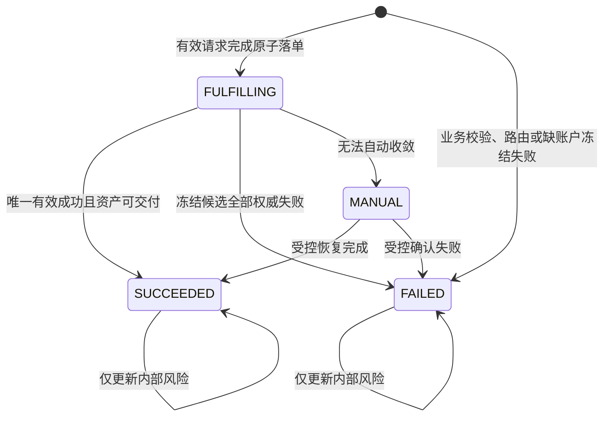

SupplierOrder 生命周期表达某一次供应商尝试的最终事实。`FAILED → SUCCEEDED` 只允许权威迟到成功，并必须保持 `effective_success_flag=NULL`、创建异常 Case、隔离资产；它不能反转 BuyerOrder 或触发第二次扣款：

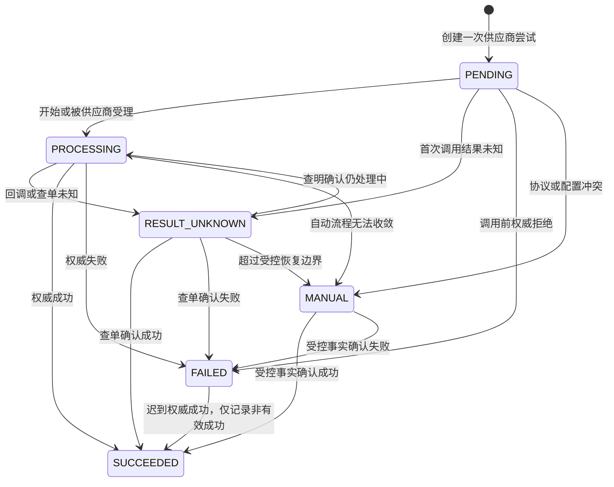

### 7.3 SupplierOrderOperation 与 FulfillmentAsset

`sc_supplier_order_operation` 表示 SupplierOrder 内一项可独立识别和恢复的外部业务副作用，而不是新的订单：

```text
id, operation_no, supplier_order_id, target_asset_id
operation_kind, adapter_step_code, sequence_no
idempotency_key, request_fingerprint, external_operation_no
status, result_class, attempt_count, next_recover_at
checkpoint_schema_version, checkpoint_ciphertext
created_at, completed_at, version
```

`operation_no` 和 `idempotency_key` 分别唯一，`(supplier_order_id,sequence_no)` 唯一。`operation_kind` 为 `FULFILL/QUERY_ORDER/QUERY_ASSET/VOID_ASSET/UNBIND_ASSET`；状态为 `PENDING/CLAIMED/EXECUTING/RESULT_UNKNOWN/SUCCEEDED/FAILED/MANUAL`。网络重试新增调用审计但不新增 SupplierOrder；checkpoint 使用 Adapter 封闭 Schema 和信封加密。

标准结果 `OperationOutcome` 限定为 `ACCEPTED/SUCCEEDED/PARTIALLY_SUCCEEDED/REJECTED/NOT_FOUND/RESULT_UNKNOWN/MANUAL_REQUIRED`。`PARTIALLY_SUCCEEDED` 只为未来批量数量和供应商兼容性保留；M1 收到该结果属于协议冲突并转 `MANUAL`，不得部分扣款。Adapter 只返回这些类型化事实；`SupplierOrderLifecycle` 在调用方事务中条件更新 Operation 与 SupplierOrder 并返回封闭尝试转换事实，`FulfillmentLifecycle` 再更新 FulfillmentRequest、路由结果和资金命令。供应商原始状态先追加 RawStatusObservation，再经冻结映射产生标准结果。

`sc_fulfillment_asset` 按实际交付单位保存：

```text
id, asset_no, fulfillment_request_id, supplier_order_id, operation_id
supplier_id, buyer_id, buyer_user_id, sequence_no, unit_quantity
asset_type, external_asset_id, external_product_id
encrypted_payload, masked_value, fingerprint, key_version
valid_from, valid_until, lifecycle_status, version
```

`asset_no` 唯一，`(supplier_order_id,sequence_no)` 唯一；存在外部资产号时 `(supplier_id,external_asset_id)` 唯一。生命周期为 `AVAILABLE/DELIVERED/VOIDED/UNBOUND/EXPIRED/QUARANTINED`。只有 `effective_success_flag=1` 的 SupplierOrder 所属资产可进入 AVAILABLE/DELIVERED；迟到或重复成功返回的资产必须加密保存为 QUARANTINED，不参与 FulfillmentRequest 交付数量，也不向采购方暴露。

`FulfillmentWorkflowPort` 根据已完成 Operation 规划下一协议步骤，`OperationExecutorPort` 执行一个不可变 Operation ticket 并返回标准结果。简单协议复用单步骤 Workflow；ELEMO 的“创建任务→发权益”和 TAO_BAO 的“创建订单→取卡密”只增加 Adapter Workflow，不增加订单表。Operation 是恢复真相，CallLog 只是每次网络尝试的脱敏传输审计，PersistentTimer 只负责可靠唤醒。

#### 7.3.1 OperationExecutorPort 契约模型

`OperationExecutorPort` 位于供应链履约域（`border.fulfillment.domain`），定义统一的领域出站调用端口：

```java
public interface OperationExecutorPort {
    boolean supports(String adapterType);
    OperationOutcome execute(OperationTicket ticket);
}
```

1. **不可变输入凭据 `OperationTicket`**：
   - 标识信息：`operationNo`、`bOrderNo`、`billno`（稳定业务单号）、`externalOrderNo`、`idempotencyKey`、`traceId`。
   - 步骤与能力：`operationKind`（`FULFILL/QUERY_ORDER/...`）、`adapterStepCode`（`SEND/SEND_KM/...`）、`sequenceNo`。
   - 标品与充值目标：`externalSkuCode`（供应商商品编码/`productid`）、`quantity`（固定1）、`rechargeAccount`（明文充值账号）、`targetSchemaCode`、`callbackUrl`。
   - 配置与通信：`supplierCode`、`adapterType`、`baseUrl`、`merchantAccount`、`secretKey`（通信密钥，禁止日志明文记录）、`timeoutSeconds`、`checkpointPayload`、`extraParameters`。
2. **标准化输出结果 `OperationOutcome`**：
   - 结果分类：`outcomeClass`（`ACCEPTED/SUCCEEDED/PARTIALLY_SUCCEEDED/REJECTED/NOT_FOUND/RESULT_UNKNOWN/MANUAL_REQUIRED`）。
   - 外部业务事实：`externalOrderNo`（供应商订单号/`orderSn`）、`reportedSettlementAmount`（报告结算金额/`sumPrice`，单位分）、`externalErrorCode`、`externalErrorMessage`。
   - 资产事实：`List<OperationAssetFact>`（包含 `assetType`、`externalAssetId`、`cardNo`、`cardSecret`、`validFrom`、`validUntil` 等）。
   - 观测与审计事实：`rawObservation`（`RawObservationFact`）、`callDigest`（`CallDigestFact`）。
   - 状态隔离不变量：Adapter 仅返回上述类型化事实，严禁在适配器内部直接持久化订单表或操作账本。

#### 7.3.2 Task 11 任务执行器接入状态机推进与资产资金闭环

1. **Outbox 派发处理器补齐**：
   - `SupplyChainOrderEventDispatchHandler`：处理目标 `supply-chain-order-event`（`FulfillmentOutboxCodes.TARGET_SUPPLY_CHAIN_ORDER_EVENT`），消费中台订单状态变更事件（如 `SUPPLY_CHAIN_ORDER_CHANGED`），记录结构化日志；
   - `BuyerEventRpcDispatchHandler`：处理目标 `buyer-event-rpc`（`FulfillmentOutboxCodes.TARGET_BUYER_EVENT_RPC`），消费采购商事件（如 `BUYER_ORDER_SUMMARY_CHANGED`、`O2O_ORDER_SUMMARY_CHANGED`、`INSTORE_ORDER_SUMMARY_CHANGED`），解耦采购商异步 RPC 通知，消除 Outbox 派发引擎抛出 `No OutboxDispatchHandler for targetName` 的崩溃隐患。

2. **履约操作执行器 `FulfillmentOperationExecuteHandler`**：
   - 实现 `PersistentTimerHandler`，消费 `FulfillmentTimerTaskTypes.OPERATION_EXECUTE`；
   - 幂等保护：若 Operation 已处于终态（40 SUCCEEDED / 50 FAILED / 90 MANUAL），直接跳过返回；若已为 `RESULT_UNKNOWN=30` 或 `EXECUTING=20`，本切片禁止再次 `/GameOrder/Send`，等待 Task 12 查单恢复；
   - 加载依赖：从数据库装配 BOrder、Operation、FulfillmentRequest、SupplyChainOrder、Supplier 档案与已发布连接器版本配置；
   - 凭证解析与账号解密：通过 `CredentialProvider` 解析供应商通信密钥；使用 `EnvelopeCryptoPort` 对称解密 `targetCiphertext` 提取目标手机号或账号。**解密失败或密文无法解析出账号必须失败关闭**：不得外呼供应商，立即 `transition(MANUAL_REQUIRED)`；
   - 短事务 claim：仅当 Operation 为 `PENDING=0` 或 `CLAIMED=10` 时 CAS 推进为 `EXECUTING=20`，claim 成功后才允许事务外调用适配器（§14）；claim 失败则跳过外呼；
   - 组装不可变 `OperationTicket`：`timeoutSeconds` 默认 10（与 OkHttp 读/写 10s、连接 5s 对齐，禁止默认 15s 覆盖读超时）；`callbackUrl`=`aifuli.supply-chain.fulfillment.public-callback-base-url` + ConnectorVersion.`callbackPath`，作为 QNM `notifyurl`；
   - 调用 `OperationExecutorPort.execute(ticket)`，将 `OperationOutcome` 交给 `SupplierOrderLifecycle.transition`。

3. **供应商订单生命周期 `SupplierOrderLifecycle`**：
   - 短事务与 CAS 乐观锁：在 `@Transactional(transactionManager = "supplyChainTransactionManager")` 中加锁/条件更新 BOrder 与 Operation；
   - 状态机收敛：
     - **权威成功（`SUCCEEDED`）**：Operation 状态更新为 40（SUCCEEDED），BOrder 状态更新为 40（SUCCEEDED），`active_flag` 设为 NULL，`completed_at` 设为当前时间，更新结算金额并标记 `settlement_status=10（已匹配）`；FulfillmentRequest 状态更新为 40（SUCCEEDED）；通过 `CardOrderSummaryPolicy` 推进总订单为 30（SUCCEEDED）、业务阶段为 `CARD_FULFILLED`；追加写入 `sc_order_status_log` 审计日志；调用 `fundReservationService.commitByReference` 实扣预冻结资金；将交付资产写入 `sc_fulfillment_asset`（`lifecycle_status=AVAILABLE=10`）；同步追加 `sc_fulfillment_call_log` 与 `sc_raw_status_observation`（只存摘要，禁止明文卡密）；
     - **权威成功但卡密为空（SEND_KM）**：BOrder/Operation 仍标记供应商权威成功并 `commit` 一次资金；FulfillmentRequest 与 BuyerOrder 进入 MANUAL；写入 `sc_fulfillment_exception_case`（`reason_code=QNM_ASSET_MISSING_AFTER_SUCCESS`，活动 Case 唯一键 `(operation_id, active_case_flag)`），订单状态日志 `reasonCode=QNM-ASSET-RECOVERY-001`；
     - **权威失败（`REJECTED`）**：Operation 状态更新为 50（FAILED），BOrder 状态更新为 50（FAILED），`active_flag` 设为 NULL，`completed_at` 设为当前时间；M1 阶段单候选耗尽，FulfillmentRequest 状态更新为 50（FAILED）；通过 `CardOrderSummaryPolicy` 推进总订单为 40（FAILED）、业务阶段为 `CARD_FAILED`；追加写入 `sc_order_status_log` 审计日志；调用 `fundReservationService.releaseByReference` 释放预冻结资金；
     - **结果未知（`RESULT_UNKNOWN`）**：Operation 状态更新为 30（RESULT_UNKNOWN），递增 `attempt_count`，设置 `next_recover_at`；BOrder 状态保持 20（查询中 / RESULT_UNKNOWN）；总订单与资金保持不变，返回 `RESULT_UNKNOWN` 由 PersistentTimer 等待查单或重试。

4. **敏感履约资产加密入库与授权查询**：
   - 持久化模型：`FulfillmentAssetDO` 与 `FulfillmentAssetMapper` 映射 `sc_fulfillment_asset` 表；
   - 卡密信封加密与指纹计算：调用 `EnvelopeCryptoPort.encrypt` 对卡密明文进行 AES-GCM 信封加密，附加 `associatedData` 防止跨订单串改；调用 `HmacFingerprintPort.fingerprint` 生成 HMAC SHA-256 指纹保证供应商维度卡密去重；
   - 授权解密查询：`BuyerFulfillmentQueryApi.getFulfillmentAssets` 入口由 `BuyerFulfillmentQueryFacade` 做非空校验后委派至 `BuyerFulfillmentQueryService`；必须同时校验采购商、`buyerUserId` 所有权和请求声明的 `FULFILLMENT_ASSET_READ` scope（缺省或其它 scope 拒绝并写审计 `result_status=20`）；只返回 `lifecycle_status∈{AVAILABLE=10, DELIVERED=20}` 的资产，隔离态 `QUARANTINED=90` 不得暴露；解密失败写审计 `result_status=30` 并失败关闭。

### 7.4 FulfillmentExceptionCase 与奇那梦卡密恢复

`sc_fulfillment_exception_case` 是履约风险事实工单，不是订单或审批流。它以 `case_no/exception_key` 唯一，保存 BuyerOrder、FulfillmentRequest、SupplierOrder、可选 Operation、异常类型、证据、解决说明和时间。状态只允许 `OPEN/RESOLVED`。稳定幂等键为 `RECOVER_ASSET:{supplierOrderId}`、`LATE_SUCCESS_AFTER_FAILOVER:{supplierOrderId}`、`DUPLICATE_SUPPLIER_SUCCESS:{buyerOrderId}:{supplierOrderId}`、`LATE_SUCCESS_AFTER_RELEASE:{supplierOrderId}`；重复回调只追加观察和调用审计。

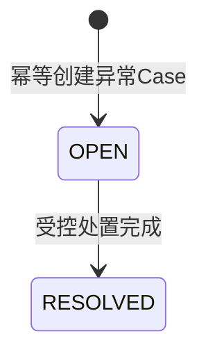

奇那梦权威成功但缺少卡密时，SupplierOrder 仍为 SUCCEEDED 且设置唯一有效成功标记，Buyer 资金 COMMIT 一次，FulfillmentRequest 与 BuyerOrder 进入 MANUAL。补录一份加密卡密后请求和订单转 SUCCEEDED，不再次扣款。迟到或重复成功不改变有效成功 Supplier；资金仍冻结、已提交、已释放时 BuyerOrder 分别保持/进入 MANUAL、保持 SUCCEEDED、保持 FAILED。工单创建/关闭与 BuyerOrder 的 `risk_status/primary_risk_type/open_exception_count` 在同一事务更新；风险变化不向商城回调。

## 8. 供应商路由模块

供应商路由负责在订单受理前，从已发布策略和当前供给事实中确定一个 Supplier；它不执行供应商调用、不修改履约状态，也不自行操作账本。模块同时支持标准商品供给路由和点餐、电影等场景供应商路由。淘宝闪购/盒马通过 SupplierChannelBinding 直接解析外部商户，不进入候选排序，也不创建路由轮次。

### 8.1 模块接口与职责边界

`SupplierRoutingApplicationService` 是订单受理方使用的应用接口，只暴露首次路由和受限重路由两个用例。它负责加载已发布策略、收集候选事实、调用纯计算模块及持久化结果。`SupplierRoutingEngine` 是无数据库、HTTP、缓存和系统时钟依赖的深模块：

```text
RoutingDecision decide(
    RoutingInput input,
    RoutingPolicySnapshot policy,
    CandidateFactsSnapshot facts
)
```

调用方显式传入业务时间和不可变快照；相同输入、策略版本和事实快照必须得到相同结果。结果只允许 `SELECTED（已选择）`、`NO_CANDIDATE（无可用候选）` 和 `CONFLICT（规则冲突）`。Engine 只计算，不读取 Repository、不调用 Adapter，也不产生资金或订单副作用。

架构门禁据此约束 `routing.domain` 纯领域包不得依赖持久化、Spring 或 MyBatis；`routing.application`
负责事务与持久化编排，`routing.dal` 负责数据访问，不属于纯计算约束范围。

### 8.2 两类路由画像

| 路由类型 | 输入 | 候选来源 | 选中后事实 |
| --- | --- | --- | --- |
| `STANDARD_PRODUCT` 标准商品供给路由 | Buyer、PlatformSKU、履约类型、数量、业务时间 | 规则声明的 Supplier 与当前有效 SupplierOffer | Supplier、OfferVersion、ConnectorVersion、InventorySource；可创建 SupplierOrder |
| `SCENARIO` 场景供应商路由 | Buyer、场景编码、外部商户标识、业务时间 | 场景规则显式声明的 Supplier | 不创建 FulfillmentRequest；场景开始实际履约时可为选定 Supplier 创建 SupplierOrder |

标准候选配置只绑定 Supplier，不绑定报价版本；运行时按 Buyer、PlatformSKU、数量和业务时间解析唯一适用的 SupplierOfferVersion，使报价正常发布不必同步重发路由策略。场景路由不依赖中台 PlatformSKU、SupplierOffer、菜品、影片、场次或座位。

一期实现 `STANDARD_PRODUCT` 路由；奇那梦也必须通过该路由模块选出，不能由业务代码硬编码。本期保持现有规则维度和静态优先级（`candidatePriority` → `supplierCode` → `offerId`，原因码 `SELECTED_BY_STABLE_PRIORITY`），不物化四级配置组，不启用 `PRICE_ASC`、综合权重、自动学习、表达式 DSL 或拆量路由。稳定性/时效评分允许运营人工写在 `sc_supplier_offer` 身份列，作为预备输入；`SupplierRoutingEngine` 本期不读这些分，`routing.domain` 不引入分数字段。挂点契约见[《合作商品履约能力评分》](./2026-09-21-offer-fulfillment-score-design.md)。`SCENARIO` 表保留但不建设应用服务；淘宝闪购与大润发继续使用渠道绑定的固定商户，不进入标准商品路由。边界见[《供应链中台 PRD 一期范围对齐》§7](./2026-09-12-supply-chain-prd-scope-alignment-design.md#7-路由)。

### 8.3 策略、版本和强类型规则

共享模型为 `RoutingPolicy` 与 `RoutingPolicyVersion`，强类型明细分别为 `StandardProductRoutingRule/Candidate` 和 `ScenarioRoutingRule/Candidate`。数据库使用六张配置表：

| 表 | 职责 |
| --- | --- |
| `sc_supplier_routing_policy` | 策略稳定身份、路由类型和启停状态。 |
| `sc_supplier_routing_policy_version` | 不可变版本、生效区间、`ranking_mode`、发布审计和配置摘要。 |
| `sc_standard_product_routing_rule` | `scope_type`、Buyer、主类目、PlatformSKU、履约类型、数量区间和规则优先级。 |
| `sc_standard_product_routing_candidate` | 标准商品规则下的 Supplier 顺序及库存、余额检查模式。 |
| `sc_scenario_routing_rule` | Buyer、场景编码、外部商户标识和规则优先级。 |
| `sc_scenario_routing_candidate` | 场景规则下的 Supplier 顺序和健康检查模式。 |

版本生命周期为 `DRAFT（草稿） -> PUBLISHED（已发布） -> RETIRED（已停用）`。页面只能编辑草稿；发布后版本和明细不可修改。一期每种 `routing_type` 同时只能启用一个 Policy，采购商差异由该 Policy 版本内的强类型规则表达。发布在锁定策略行的短事务中完成，校验生效区间不重叠、引用对象有效、至少一个候选、数量区间合法及规则无歧义。调整策略时复制为新草稿版本；紧急停用 Policy 或 Supplier 立即阻止新路由，但不改写历史轮次。

规则条件和操作符由代码封闭定义，不支持 SpEL、脚本、动态 SQL 或任意表达式。管理端只能维护结构化字段、候选顺序和受控枚举，并提供无副作用的校验与模拟路由。

### 8.4 规则匹配与稳定排序（后续目标）

> 本节以下四级配置组、`MANUAL` / `PRICE_ASC` 和动态资格检查描述是后续目标模型，本期不实施、不启用，也不作为测试或验收门禁。本期排序口径以上一节及 09-12 范围对齐 §7 为准。

规则按固定特异性选择，四级配置组与 SKU 专属规则见[PRD 对齐设计 §8.2](./2026-08-28-supply-chain-prd-alignment-design.md#82-四级配置组)。同一特异性按 `rule_priority` 升序。两个同优先级规则可能匹配同一输入时禁止发布；运行时再次检测，出现冲突即失败关闭，不能按数据库主键随机兜底。

候选处理顺序固定为：

1. 校验策略、Supplier、SupplierOffer、Connector、履约能力和生效时间等静态硬约束。
2. 把已配置且可获得的库存、供应商余额或健康事实作为硬资格条件；`PRICE_ASC` 仅使用快照中的供应商结算单价排序，不把 OPTIONAL 事实转化为分数。
3. 淘汰硬约束不满足、必需事实未知或已经尝试过的候选。
4. 按策略版本 `ranking_mode` 排序：`MANUAL` 为显式 `candidate_priority` 升序再 `supplier_code`/`offer_id`；`PRICE_ASC` 为 `supplierSettlementUnitPrice` 升序再 `candidate_priority`、`supplier_code`、`offer_id`。不得按综合权重、健康分、数据库返回顺序或随机权重改变名次。
5. 选择第一名，并为所有候选生成稳定原因码和检查快照。

库存、余额和健康检查模式只允许 `REQUIRED（必需）`、`OPTIONAL（可选）`、`UNSUPPORTED（不支持）`。`REQUIRED` 查询失败、超时、过期或结果未知时淘汰候选；`OPTIONAL` 只记录审计，不淘汰也不改变候选顺序；`UNSUPPORTED` 不发起查询。若 Connector 未声明相应能力，则候选不能把该检查发布为 `REQUIRED`。这些动态检查与 `MANUAL` / `PRICE_ASC` 均属于后续目标；启用前必须另立设计、实现和测试门禁，不能静默改变本期静态优先级语义。

### 8.5 路由轮次与候选审计

`SupplierRoutingRound` 使用 `buyer_id + routing_subject_type + routing_subject_key + round_sequence` 标识一次决策。M1 标准商品 `round_sequence` 固定为 1：首次计算即冻结完整有序候选、策略版本和恢复策略，后续 SupplierOrder 串行切换只消费下一条未使用记录，不创建新轮次、不重新读取配置。无候选时仍可保存路由审计并将 BuyerOrder 置 FAILED，但 `fulfillment_request_id` 和 SupplierOrder 为空。

每轮冻结 `routing_type/policy_id/policy_version_id/matched_rule_id/input_digest/snapshot_schema_version/fact_snapshot/candidate_count/decision_status`。`SupplierRoutingRecord` 追加保存 Supplier 快照、可选 Offer/Connector/InventorySource、配置优先级、结算单价、事实采集时间、检查模式与结果、稳定原因码及选中标记。Offer 字段在场景路由中为空。快照必须脱敏，不保存凭证、卡密、充值目标明文或完整第三方报文。

稳定原因码至少包括 `POLICY_NOT_MATCHED`、`OFFER_INACTIVE`、`SUPPLIER_DISABLED`、`CAPABILITY_MISMATCH`、`CONNECTOR_UNAVAILABLE`、`INVENTORY_INSUFFICIENT`、`BALANCE_INSUFFICIENT`、`FACT_UNAVAILABLE`、`HEALTH_BLOCKED`、`ALREADY_ATTEMPTED` 和 `SELECTED`。原因码是程序契约，中文说明是审计快照。

### 8.6 事务、并发和资金边界

库存、余额和健康度等网络查询不得位于数据库事务中。应用层先采集事实；超过策略规定的新鲜度阈值时必须重新查询，不能把过期快照当成零库存或可用事实。计算完成后开启短事务：

1. 以回执和 BuyerOrder 版本确认请求身份及业务状态未变化。
2. 重新校验策略版本、Offer、Supplier 和 Connector 静态有效性，冻结完整候选。
3. 无候选或冲突时完成 FAILED BuyerOrder 与回执，不冻结资金、不创建 FulfillmentRequest/SupplierOrder，也不写供应商调用事件。
4. 有候选时先通过 `trade-core` 原子冻结 Buyer 资金。缺账户或账户非正常状态构成冻结失败，只完成 FAILED BuyerOrder，不创建履约详情或供应商订单；可用余额不足不构成冻结失败。
5. 冻结成功后在同一事务创建 FulfillmentRequest、路由轮次及候选、首张 SupplierOrder、首个 SupplierOrderOperation 和 Outbox。
6. 事务提交后才允许执行供应商调用。

乐观冲突时丢弃本次事实快照并重新计算，达到固定重试上限后返回 `ROUTING_CONCURRENT_CONFLICT`。不得在长事务中等待外部检查，也不得先调用供应商再补写路由、SupplierOrder 或资金冻结。

### 8.7 受限重路由与总表 Supplier 投影

自动切换仅适用于标准商品：上一 SupplierOrder 必须得到权威失败、`fulfilled_quantity=0`，并证明不存在重复履约风险。切换在一个本地事务内完成：追加观察，当前单置 FAILED 并清除活动标记，锁定同一冻结轮次下一候选，创建新 SupplierOrder/Operation，更新 FulfillmentRequest 与 BuyerOrder 投影并写 Outbox。`RESULT_UNKNOWN`、超时、已受理、处理中、成功缺少资产或任何交付事实均禁止切换。

总表展示 Supplier 在切换时更新为当前活动 Supplier；成功后锁定有效成功 Supplier；全部失败时回写第一候选 Supplier。展示变化与 `supplier_attempt_count`、订单版本、状态日志和 Outbox 同事务更新。零尝试失败时展示 Supplier 为空。

### 8.8 错误、指标与测试

无已发布策略、规则冲突或全部候选淘汰属于路由业务拒绝，不得降级为随机 Supplier。外部履约调用失败属于 SupplierOrder 生命周期，不回滚已提交的路由决策。路由日志只记录订单/请求业务号、策略版本、轮次、Supplier 和原因码；指标覆盖决策耗时、无候选率、各原因淘汰量、Supplier 选择量、动态检查失败/过期量、重路由次数和并发冲突。

本期纯 Engine 单元测试覆盖现有规则匹配、`candidatePriority` / `supplierCode` / `offerId` 静态排序、原因码 `SELECTED_BY_STABLE_PRIORITY`、输入候选乱序、无候选和重复计算一致性。四级配置组、`PRICE_ASC`、综合权重和动态资格检查不作为本期门禁。MySQL 集成测试继续覆盖路由记录唯一约束、资金 / SupplierOrder / Outbox 原子性和既有受限重路由。

## 9. O2O 与 INSTORE 场景详情

O2O 在中台也只有一条 `BuyerOrder`。`sc_o2o_channel_detail` 是与总订单一对一的场景详情，不是第二张订单表。

### 9.1 O2OChannelUserBinding

`sc_o2o_channel_user_binding` 保存中台用户与渠道匿名用户标识的稳定映射：`buyer_id/buyer_user_id/channel_code/channel_user_id/status/version`。状态只允许 `ACTIVE（已启用）/DISABLED（已停用）`；停用只阻止新的 H5 入口和支付受理，不改变历史订单归属。`(buyer_id,buyer_user_id,channel_code)` 和 `(channel_code,channel_user_id)` 分别唯一；`channel_user_id` 由中台生成高熵随机值，不得编码或散列可反推出 Buyer、手机号、会员号等内部身份的信息。H5 入口只向渠道传递该值；支付请求必须通过启用的映射反查 Buyer 与 BuyerUser，映射缺失、歧义或停用时在建单和冻结前失败关闭。

### 9.2 O2OChannelDetail

详情保存 `transaction_id/channel_code`、O2OChannelUserBinding 与渠道用户快照、Buyer、SupplierChannelBinding 版本、盒马 Supplier、外部门店快照、`out_trade_no`、渠道/采购商金额、收银台引用、用户支付状态、资金状态、渠道履约状态、累计退款、活动退款 Case 和版本。

唯一约束为 `buyer_order_id`、`channel_detail_no`、`(channel_code,transaction_id)` 和 `out_trade_no`；transactionId 的命名空间属于渠道，不能再以 Buyer 缩小唯一范围。相同永久键若 Buyer、BuyerUser、金额、外部商户或请求指纹不一致，必须报告身份冲突。淘宝闪购/盒马不创建 Platform SKU、BuyerListing、SupplierOffer、FulfillmentRequest 或 SupplierRoutingRecord；支付成功且采购方资金处理完成后，以 SupplierChannelBinding 固定解析的盒马 Supplier 创建至多一张 SupplierOrder。支付结果通知和后续渠道副作用仍由 O2OOperation 恢复，其中 CHANNEL_NOTIFY Operation 关联该 SupplierOrder；不创建 CARD 专用 SupplierOrderOperation，也不允许商户切换。

O2O SupplierOrder 创建为 `PENDING`；开始通知 ele.me 后为 `PROCESSING`，通知或查单结果未知时为 `RESULT_UNKNOWN`。ele.me 仅确认支付通知时回到 `PROCESSING`，不能据此置成功；只有 225 推送、权威订单查询或后续等价终态事实才能映射为 `SUCCEEDED/FAILED/MANUAL`。本期若不接 225 且无权威订单查询，只能完成受控支付/退款联调，SupplierOrder 与 BuyerOrder 不具备自动收敛到履约终态的生产条件。

一期没有 O2O 合同和报价表，不创建 `sc_settlement_contract`、`sc_settlement_contract_version`、`sc_settlement_quote`。金额规则固定为：

```text
buyerSettlementAmount = channelPayAmount = ele.me payAmount
spreadAmount = 0
settlementMode = CHANNEL_AMOUNT
```

中台不执行 C 端用户支付，实际支付始终发生在采购商收银台。`FundReservation` 按上述金额冻结，一期不因采购商可用余额不足拒绝预下单；采购商支付成功通知中台后，中台先在本地事务中提交预留、写账本和 Outbox，随后通知 ele.me。

### 9.3 退款与外部操作

`sc_o2o_refund_case` 保存稳定中台退款号、`channel_code`、ele.me refundNo、顺序、退款种类、渠道退款金额、采购商实际退款金额、账户返还金额、状态和版本。永久唯一键为 `(channel_code,channel_refund_no)`，不能以 Buyer 或 O2O 详情缩小范围；同键关联原交易、Buyer、金额或请求指纹不同即冲突。普通渠道退款和拒付补偿的三者一期相等；迟到支付补偿只退用户，账户返还金额为零。同一详情最多有一个 `BUYER_REFUNDING`，其余退款 Case 顺序排队。

`sc_o2o_operation` 保存预下单、支付查单、退款、退款查单和渠道通知等语义外部操作。Operation 与 Outbox 分工明确：Operation 表示业务副作用及其幂等键，Outbox 表示可靠投递载体。

ele.me 发起退款后，中台先把售后状态投影为 `PROCESSING`，再以稳定退款键调用采购商退款。结果未知时只按原退款键查单；明确成功后才返还 BuyerAccount、追加反向流水并通知 ele.me。通知失败只重试通知，不再次退款或返还账户。

### 9.4 淘宝闪购渠道服务切流归属

现有 `yudao-module-taobao` 的支付设计已经按全局 `transaction_id` 查询，退款按全局 `refund_no` 查询，对账使用 `(transType,transactionId)`，因此中台采用渠道级唯一键不与其业务语义冲突；现有渠道隐含固定为 ELEME。切流时不能仅按时间把重试请求分到新旧实现，渠道服务自己的数据库必须新增两张不可变注册表：`transaction_owner(channel_code,transaction_id,owner)` 与 `refund_owner(channel_code,refund_no,transaction_id,owner)`，`owner` 只允许 `LEGACY/CORE_V1`。

切流前将历史和在途支付/退款回填为 `LEGACY`。首次 PayRequest 先原子注册交易 owner，再调用唯一处理器；退款 owner 必须继承原支付交易 owner。支付、查单、关闭、回调、225 和账单均按 transaction owner 路由，退款及退款查询按 refund owner 路由；结果未知时严禁跨两套实现 fallback。现有 `init_tbsg.xml` 中初始建表 SQL 被 XML 注释，实施前必须核验生产库是否真实存在 `UNIQUE(transaction_id)` 与 `UNIQUE(refund_no)`，缺失约束和 owner 表均由渠道服务自己的 Liquibase 前向补齐，不能加入中台 DDL，也不能访问中台数据库。

### 9.5 INSTORE 租户身份与入口凭证

INSTORE 不复用 O2O 匿名 `channelUserId`。每个采购商租户配置独立旅通 `app_key`，渠道服务验签后将其唯一映射为 `(sourceSystem, externalTenantId)`；同一 `app_key` 禁止跨租户共享。旅通 `user_code` 等于租户内不透明字符串 `buyer_user_id`，会员资料必须通过 `BuyerMemberProfilePort.resolve(sourceSystem, externalTenantId, buyerUserId)` 获取，禁止直接转换为 `Long` 会员主键。

`sc_instore_channel_user_binding` 保存 `(source_system, external_tenant_id, buyer_user_id, channel_code)` 稳定绑定。首页与详情每次签发独立 `sc_instore_entry_credential`：同一绑定允许并存多枚 ACTIVE 凭证，每枚默认十分钟过期且只消费一次；数据库只保存 token SHA-256 摘要。`HOME` 与 `DETAIL` 用途不可互换，DETAIL 必须绑定目标 `instore_order_id`。消费以版本 CAS 执行 `ACTIVE → PROCESSING → USED`：只有抢占者调用会员端，查询明确失败且凭证未过期时释放回 ACTIVE；重复、过期、用途、订单不匹配或并发抢占失败时按稳定错误失败关闭。

### 9.6 INSTORE 支付与退款资金闭环

旅通 `order_id` 与 `trade_id` 固定 1:1。建单以 `(channelCode,order_id)`、`(channelCode,trade_id)` 双重永久键防重，请求摘要覆盖租户作用域、用户、商户、金额、订单类型和门店快照；同键不同摘要永久冲突。`sc_instore_payment_flow` 仅是过渡 1:1 卫星，由 `UNIQUE(instore_order_id)` 兜底；FundReservation 使用 `INSTORE_ORDER + instoreOrderNo`，不得使用支付卫星号。

支付确认必须在同一本地事务完成资金提交、支付卫星 PAID、固定商户 SupplierOrder SUCCEEDED、BuyerOrder SUCCEEDED、状态审计与 Outbox。所有条件更新检查影响行数；供应商订单关联和 PAID 状态合并为一次支付卫星 CAS，禁止连续使用同一旧版本。

退款受理锁定 INSTORE 详情，以成功、处理中和排队 Case 的金额总和防并发超退；同一交易最多一个 BUYER_REFUNDING，其余串行排队。已支付取消只在从未存在退款协同时创建全额 `CANCEL_REFUND`。采购商收银台确认实际退款金额等于申请金额后，INSTORE Lifecycle 在外层本地事务调用 `BuyerAccountReturnService`；该服务只拥有账户与账本，以 `REFUND_RETURN:{refundCaseNo}` 为账户范围内永久幂等键执行 `balance += amount` 并追加 `REFUND_RETURN` 账本，随后由 Lifecycle 推进 Case、累计退款与售后投影，任一步失败全部回滚。金额缺失或不一致时不入账并转人工。退款只改变 aftersaleStatus，不能回退 SUCCEEDED 主状态。详细设计见 `docs/superpowers/specs/2026-08-18-rtmart-instore-channel-design.md#45-生产事务与幂等不变量`。

INSTORE 建单事务提交后，中台先固化 `outTradeNo`，再通过 `BuyerCashierPort.createCashierOrder` 调用对应 SaaS 商城收银台，以 `(sourceSystem, externalTenantId, buyerUserId)` 路由租户和会员并取得 `cashierUrl/cashierOrderNo`；`buyerUserId` 为不透明字符串，不得沿用当前联调 Port 的 `Long` 参数。支付与退款结果均以 SaaS 回调优先，接口③/⑥和 Timer 在本地非终态时分别按原 `outTradeNo/refundCaseNo` 权威查询兜底。外呼前用 Operation CAS 抢占，外呼后以独立事务进入与回调相同的 Lifecycle 收敛路径；回调、渠道查询和 Timer 并发只允许一次状态与账本推进。供应链核心统一把旅通、大润发和 POS 视为 `RT_MART` 渠道边界，不建三套调用方身份。

## 10. Adapter 元数据、调用审计与敏感资产

`supplier-adapter` 通过 `FulfillmentWorkflowPort` 与 `OperationExecutorPort` 执行统一 Operation，并按声明能力组合直充、发资产、绑定权益、查单、查资产、作废、解绑、查余额、查库存和回调解析实现。禁止用空实现或 `UnsupportedOperationException` 填充大接口；一期奇那梦正式使用同一 Operation/元数据机制，其余供应商仅验证模型兼容性，不实现 Adapter。

| 表 | 核心职责 |
| --- | --- |
| `sc_supplier_connector` / `sc_supplier_connector_version` | 端点、协议族、凭证引用、超时/限流/熔断/重试策略的不可变发布版本。 |
| `sc_supplier_connector_capability` | Connector 支持的履约、查询、资产操作和回调能力。 |
| `sc_credential_slot` | KMS/密钥系统中的供应商凭证引用和脱敏提示，不保存可回显明文。 |
| `sc_supplier_config_publish_record` | 配置验证、发布、回滚、操作人、原因和版本摘要审计。 |
| `sc_supplier_error_code_map` | 外部错误码到 `REJECT/RETRY_SAFE/QUERY_FIRST/MANUAL` 的受限映射。 |
| `sc_status_mapping_definition` | 原始状态到业务阶段和封闭事实类型的版本化映射；不能配置公共状态或账本动作。 |
| `sc_raw_status_observation` | 创建响应、回调和查单的追加式状态审计。 |
| `sc_fulfillment_call_log` | 调用方向、配置版本、耗时、结果分类、请求/响应摘要和脱敏审计。 |
| `sc_supplier_account_balance_snapshot` | Connector 账号级资金、授信或通用额度观察；不混入 SKU 库存。 |
| `sc_fulfillment_asset` | SupplierOrder 所属的逐券、卡密、链接或账户绑定权益。 |
| `sc_supplier_order_operation` | SupplierOrder 所属的履约、查询、作废和解绑等可恢复业务操作。 |

奇那梦的 baseUrl、非秘密账号和回调路径属于 ConnectorVersion，appKey 属于 CredentialSlot；

公网回调基础域名属于环境配置。

productid 属于 SupplierOfferVersion，account 属于 FulfillmentRequest 加密目标，number 属于数量，billno/orderSn 属于 SupplierOrder，sumPrice 形成供应商报告结算金额并参与确认，status 属于原始状态观察，cards 属于 FulfillmentAsset。

上述事实不得复制到 `fulfillment_config_json`。

不创建也不预留通用 `sc_fulfillment_ext`。低频 SKU 参数进入经 Adapter Schema 校验的 OfferVersion `fulfillment_config_json`；可恢复协议步骤的最小私有上下文进入加密 checkpoint；金额、外部订单号、状态、幂等、重试时间、密钥和高频检索字段必须结构化。页面配置不得包含脚本、状态机、账本动作或动态类名。

充值目标和卡券资产采用包含 KMS key version 的信封加密；业务表只保存密文、摘要和最小检索字段。只有 Adapter 调用点和授权资产查询可以最小化解密，所有查询、解密和导出写不可变审计。加密或供应商密文解码失败必须失败关闭并转 `MANUAL`，严禁回退保存明文。Cardshop 中的敏感响应日志、硬编码通知地址和疑似凭证种子只作为迁移风险证据，不能复制；进入过代码或迁移文件的真实凭证必须在接入前移除并轮换。

`sc_fulfillment_call_log` 至少保存 `call_no/operation_id/attempt_no/direction/connector_version_id/endpoint_code/started_at/duration_ms/result_class/http_status/request_digest/response_digest/redaction_version/trace_id`；`call_no` 和 `(operation_id,attempt_no)` 唯一。CallLog 不保存可用于恢复的明文上下文，也不能作为 Operation 当前状态来源。

### 10.1 奇那梦（QNM）GameOrder V1 协议实现规约

奇那梦适配器（`QnmSupplierAdapter`）作为一期首个落地供应商适配器，实现 `OperationExecutorPort` 端口，封装 `/GameOrder/Send`、`/GameOrder/SendKm` 与 `/GameOrder/Query` 端点：

1. **接口签名算法（MD5）**：
   - 过滤 `sign` 与 `sign_type` 以及空值/空白参数；参数键前后空白自动 trim；
   - 必须包含至少一个有效业务参数方可验签，防止空载荷利用伪造空签名绕过；
   - 剩余键按 ASCII 字典序升序排序；
   - 以 `k1=v1&k2=v2...&key={secretKey}` 格式拼接待签规范串；
   - 使用 UTF-8 编码计算 32 位小写 MD5 十六进制散列；
   - 验签时进行忽略大小写的常量时间比较。
2. **直充外呼 `/GameOrder/Send`**：
   - 参数组装：`customerid`、`productid`（`externalSkuCode`）、`billno`、`account`、`number=1`（`quantity <= 0` 默认兜底为 1）、`notifyurl`、`timestamp`、`sign`。
   - 响应处理：
     - HTTP 5xx / 408 / 429 瞬时网关服务端错误与连接超时：映射为 `RESULT_UNKNOWN`，严禁误判为终态 `REJECTED`；
     - HTTP 400 / 401 / 403 客户端配置/鉴权错误：映射为 `MANUAL_REQUIRED`；
     - HTTP 200 业务响应：`ResCode=1` 或 `ResCode=OK` 映射为 `ACCEPTED`，提取 `orderSn` 与 `sumPrice`（支持浮点元转分与整型分）；若返回非 1 则映射为 `REJECTED` 并记录错误码/错误信息。
3. **卡密/券码发券 `/GameOrder/SendKm`**：
   - 参数组装：与直充一致；
   - 响应处理：成功响应（`ResCode=1/OK`）同步解析 `cards` 列表，支持对象数组（`cardNo`/`cardPwd`/`expireTime` 及其别名）以及纯字符串数组；无卡密仅有卡号时自动分类为 `VOUCHER_CODE`，包含卡密时为 `CARD_CODE_SECRET`。
   - 若响应声明成功但未返回卡密（空 `cards`），返回 `SUCCEEDED`（或待查 `ACCEPTED`）并在生命周期层触发 `QNM-ASSET-RECOVERY-001` 人工处置流程。
4. **主动查单 `/GameOrder/Query`**：
   - 参数组装：`customerid`、`billno`、`orderSn`（可选）、`timestamp`、`sign`。
   - 响应状态映射：
     - HTTP 404 或 `ResCode` 提示订单不存在：映射为 `NOT_FOUND`；
     - `orderStatus=0` -> `ACCEPTED`（供应商处理中）；
     - `orderStatus=1` -> `SUCCEEDED`（成功，提取 `sumPrice` 与可选 `cards`）；
     - `orderStatus=2` -> `REJECTED`（供应商明确失败）；
     - 未知状态码或 HTTP 5xx / 408 / 429 -> `RESULT_UNKNOWN`。
5. **异常与脱敏边界**：
   - 网络超时、连接异常及 HTTP 5xx / 408 / 429：统一映射为 `RESULT_UNKNOWN`，交由 PersistentTimer 触发重试/查单，不抛出非受控异常打断业务事务。
   - 日志脱敏：充值账号掩码（如手机号 `138****1234`）、卡号掩码（前4后4）、卡密密文掩码（`****`）、密钥明文严禁打印。
   - 契约不可变性：`OperationTicket` 防御性复制 `extraParameters` 与 `checkpointPayload` 并支持 null 安全，`OperationOutcome` 防御性过滤 `assets` 中的 null 元素。

### 10.2 Cardshop 外部供应商兼容性评估

评估基线是 Cardshop `SupplierServiceFactory` 中除百联 `BL_STOCK` 和本地卡池 `STOCK` 外的 19 个外部供应商。严格接入标准为：后续只增加 Adapter/Workflow、Connector 与 Offer 配置、封闭 JSON Schema、错误码/状态映射和 ContractTest，不增加供应商专属订单、资产、账本或资金冻结表。

| 供应商 | 已知履约模式 | 统一模型覆盖重点 |
| --- | --- | --- |
| `TONG_KA` | 发券、直充、远程库存、回调 | 多履约类型 Offer 与 Connector 账号差异。 |
| `MINISO` | 手机号绑定多券、查单、单券作废 | `ACCOUNT_BOUND_BENEFIT`、多资产、`VOID_ASSET`。 |
| `TAO_BAO` | 卡密、直充；建单后取卡 | 两步 Workflow 和加密资产；与盒马 O2O Adapter 无关。 |
| `IKEA` | 异步直充、回调 | `CREATE_RECHARGE` 与回调恢复。 |
| `POT_CIRCLE` | 当前仅有不完整下单实现 | 标记 `EVIDENCE_INCOMPLETE`，取得完整协议或沙箱契约前禁止发布。 |
| `SZ_CARD` | 卡密、直充、话费、查单、余额 | 未知受理、查询恢复和多资产。 |
| `HZ_PG` | 卡密、链接、图片、密码、直充 | 通过 Result Schema 表达多态资产，不增加专属表。 |
| `FU_NENG` | 多券、查单、产品额度 | 部分交付、资产数量核对和 SKU 配额。 |
| `LF` | 手机和油卡直充 | 不同 Target Schema 复用直充模型。 |
| `RS` | 话费直充、查单 | 异步状态映射和查询恢复。 |
| `DY` | 异步直充、回调 | 回调去重和未知结果保持。 |
| `NAI_XUE` | 发码、手机号发券、库存、查券、回收 | 多资产、`VOID_ASSET` 和远程库存。 |
| `ELEMO` | 建发放任务后发权益、查单、批次库存 | 两步 Workflow 和账户绑定权益。 |
| `QNM` | 发码、直充、查单、回调 | 一期正式 Adapter；供应商报告结算金额。 |
| `JQ_CARD` | 卡密、直充、库存、余额、查单 | 加密多资产及余额/库存分离。 |
| `TF_KA` | 卡密、直充、查单、余额 | 多资产和供应商报告金额。 |
| `DIDI` | 绑定权益、查券、解绑 | `DEDUP_ONLY`、`QUERY_ASSET`、`UNBIND_ASSET`。 |
| `FNK_CGS` | 多券、查单、产品配额 | 多资产、配额快照和幂等契约验证。 |
| `RENYUE` | 直充、查单、回调、余额 | 查询恢复和供应商结算金额核对。 |

完成本章通用结构后，除协议证据不足的 `POT_CIRCLE` 外，其余 18 个供应商均可在不修改订单主干和唯一账本的前提下接入。本地卡池模型继续作为远期库存设计保留，但 `STOCK` 不属于本轮 Adapter 兼容性验收。

## 11. 采购商集成模块

### 11.1 模块边界与金额口径

`integration.buyer` 是中台与采购商系统之间的深模块，对领域层只暴露收银台和事件通知 Port，对管理端只暴露配置验证、发布和查询 Interface。它负责解析 Buyer 集成版本、选择 Adapter、执行超时/隔离/限流/熔断策略、解析凭证引用并记录脱敏调用审计；它不拥有订单、账户、账本、Outbox 或 Timer 状态。

中台所有采购商收银台命令、订单、资金冻结/扣减/返还和对账只使用 `CNY` 分。`channelPayAmount` 与 `buyerSettlementAmount` 一期均为 CNY 且在 O2O 中相等。采购商内部的 POINT、充值比例、四舍五入、积分预支与积分退还全部属于 SaaS 商城实现，不得进入中台契约、领域模型、DDL、日志或对账口径。

### 11.2 深 Interface 与配置解析

| Interface | 能力编码 | 责任 |
| --- | --- | --- |
| `BuyerCashierPort` | `CASHIER` | `createCashierOrder/queryPayment/refund/queryRefund`，输入输出仅 CNY。 |
| `BuyerOrderEventNotifier` | `ORDER_EVENT` | 投递供应链订单汇总变化。 |
| `BuyerFulfillmentResultNotifier` | `FULFILLMENT_EVENT` | 投递履约结果和敏感资产可用提示。 |
| `BuyerCatalogChangeNotifier` | `CATALOG_EVENT` | 投递目录变更唤醒事件。 |

`BuyerIntegrationRegistry.resolve(buyerId, capabilityCode, occurredAt)` 按业务发生时间解析一个不可变 `BuyerIntegrationSnapshot`，至少固化 `profileVersionId/capabilityCode/transportMode/adapterCode/contractVersion/credentialSetId`及所有执行策略。`BuyerIntegrationPublisher` 只负责验证和发布配置；业务调用禁止读取未发布草稿。吾盛一期四项能力均发布为 `RPC/AIFULI_SAAS/v1`。

Adapter 注册键为 `(capabilityCode, transportMode, adapterCode, contractVersion)`；缺失或重复注册时应用启动失败。一个 ProfileVersion 可为每个能力独立选择 `RPC/HTTP`，但同一能力在一个版本中只能有一个 Adapter，不得运行时 fallback。

### 11.3 配置、版本与凭证生命周期

| 表 | 核心职责 |
| --- | --- |
| `sc_buyer_integration_profile` | Buyer 唯一集成档案、当前版本引用和管理状态。 |
| `sc_buyer_integration_profile_version` | 不可变发布版本、生效时间、发布摘要与审计。 |
| `sc_buyer_integration_capability` | 版本内每项能力的传输、Adapter、契约、超时、限流和熔断配置。 |
| `sc_buyer_credential_set` / `sc_buyer_credential_version` | 入站/出站凭证集及实际密钥引用版本。 |
| `sc_buyer_access_client` | 为保留 HTTP 入站能力映射 appKey、Buyer、scope 和凭证集。 |
| `sc_buyer_integration_call_log` | 追加记录每次调用实际使用的配置/凭证版本和脱敏结果。 |

ProfileVersion 生命周期为 `DRAFT（草稿） → VALIDATED（已验证） → PUBLISHED（已发布） → SUPERSEDED（已被替代） → RETIRED（已退役）`。发布新版本时原当前版本改为 `SUPERSEDED`，但已固化的在途调用和 Outbox 仍可使用原版本收敛；回滚是复制历史内容并发布新版本，不修改历史行。Profile 暂停时拒绝新业务，但支付查询、退款查询、退款和已有通知补偿继续收敛。

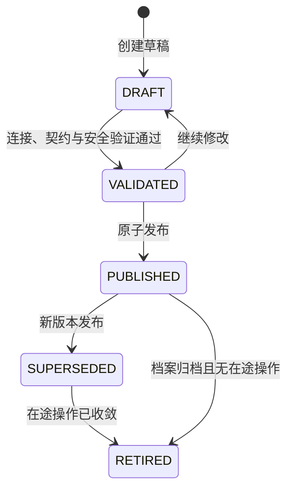

Profile 管理状态另为 `ACTIVE（启用）/SUSPENDED（暂停新业务）/ARCHIVED（归档）`；它控制 Buyer 整体可用性，不取代版本状态。

CredentialVersion 生命周期为 `PENDING（待激活） → ACTIVE（当前使用） → PREVIOUS（轮换过渡） → RETIRED（已退役）`。每个 CredentialSet 最多一个 ACTIVE 和一个 PREVIOUS；出站只使用 ACTIVE，HTTP 入站在轮换窗口内可验证 ACTIVE/PREVIOUS。表中只保存 `secretRef`，密钥由 `CredentialProvider` 在调用时解析；每次调用必须记录实际 `credentialVersionId`。

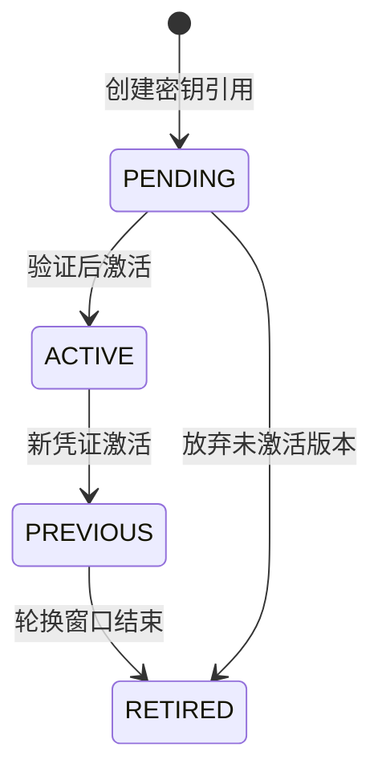

### 11.4 能力配置与发布验证

能力配置至少包含 `capabilityCode/transportMode/adapterCode/contractVersion/httpBaseUrl/credentialSetId/connectTimeoutMs/readTimeoutMs/totalTimeoutMs/maxResponseBytes/bulkheadConcurrency/rateLimitPerSecond/circuitBreakerPolicy/retryPolicyCode`。RPC 禁止配置 HTTP URL；HTTP 必须使用 HTTPS 和 CredentialSet。HTTP 路径由 Adapter + contractVersion 在代码中固定，页面不得配置任意路径、Header、脚本或类名。

发布前必须验证 Adapter Bean 存在、契约版本兼容、参数不超过平台上限、HTTP 安全属性合法，以及 `CASHIER` 同时声明四个操作。自动未知结果收敛还要求采购商提供按 `outTradeNo` 权威查支付和按 `refundKey` 权威查退款。吾盛现有 `PlatformPointApi.queryPayOrder` 只能按已知 `prepayOrderId` 查询，无法覆盖“创单超时且未取得 prepayOrderId”；同时也没有 `queryRefund`。

因此交付严格拆为两个里程碑：M1 只上线“吾盛采购商 → 奇那梦标准商品履约”，不依赖采购商收银台；M2 才上线“吾盛采购商 → 淘宝闪购/盒马 O2O”。M2 的生产发布硬门禁是 SaaS 商城已经提供并通过 ContractTest 的权威 `queryPayment(outTradeNo)` 与 `queryRefund(refundKey)`，覆盖创单/退款超时、重复查询及结果终态。门禁未满足时 O2O 只能用于设计验证或受控联调，不能依靠转 `MANUAL` 代替生产可恢复性。

### 11.5 BuyerCashierPort 契约

| 操作 | 稳定键 | 标准状态 | 重试规则 |
| --- | --- | --- | --- |
| `createCashierOrder` | `invocationId + outTradeNo` | `CREATED/REJECTED/UNKNOWN` | 禁止自动重创；UNKNOWN 查原 outTradeNo。 |
| `queryPayment` | `outTradeNo` | `NOT_FOUND/CREATING/PENDING/SUCCEEDED/FAILED/CLOSED/UNKNOWN` | 可退避重试。 |
| `refund` | `invocationId + refundKey` | `PROCESSING/SUCCEEDED/REJECTED/UNKNOWN` | 禁止自动重退；UNKNOWN 查原 refundKey。 |
| `queryRefund` | `refundKey` | `NOT_FOUND/PROCESSING/SUCCEEDED/FAILED/UNKNOWN` | 可退避重试。 |

创单命令包含 `invocationId/outTradeNo/sourceSystem/externalTenantId/buyerUserId/amount(CNY分)/subject/expiresAt/expectedProfileVersion`；标准结果包含 `cashierOrderNo/status/launchDescriptor/confirmedAmountCny/errorCode/observedAt`。退款命令包含 `invocationId/refundKey/outTradeNo/sourceSystem/externalTenantId/amount(CNY分)/expectedProfileVersion`，支付与退款查询同样携带来源租户作用域，防止跨租户路由。`buyerUserId` 在生产契约中是不透明字符串；现有联调 Port 的 `Long buyerUserId` 是过渡实现，INSTORE 接入时必须迁移，禁止把外部值直接转换为 `Long`。`launchDescriptor` 是封闭类型，禁止透传任意 Map/JSON。SaaS 商城侧 `BuyerCashierRpcApi` Adapter 可在内部调用 `PlatformPointApi` 并完成 CNY 到 POINT 的换算，但中台只接收标准 CNY 结果。

支付/退款回调是首选事实入口，`queryPayment(outTradeNo)` 与 `queryRefund(refundKey)` 是回调未到、创单/退款结果未知及渠道主动查询时的权威兜底。回调和查询结果必须进入同一幂等收敛方法；查询不能创建新的支付号或退款号。退款成功回调与查询结果都必须返回 `confirmedAmountCny`，金额缺失或不一致时不得返还账户。

### 11.6 商城事件与 Outbox 交付

| 事件 | 能力 | 载荷边界 |
| --- | --- | --- |
| `ORDER_SUMMARY_CHANGED` | `ORDER_EVENT` | `orderNo/buyerOrderNo/orderType/orderStatus/aftersaleStatus/businessStage/detailVersion/supplierSnapshot/updatedAt`。 |
| `FULFILLMENT_RESULT` | `FULFILLMENT_EVENT` | 履约号、请求/交付数量、标准状态、完成时间及 `assetAvailable/assetReference`；不含卡密、目标、成本、路由或协议私有字段。 |
| `CATALOG_CHANGED` | `CATALOG_EVENT` | 只含 `latestCursor/changeType/occurredAt`，商城必须按游标拉取真实快照。 |

事件信封统一为 `eventId/eventType/schemaVersion/occurredAt/traceId/correlationId/causationId/data`。创建 Outbox 时必须固化 `buyerId/capabilityCode/integrationProfileVersionId/targetType/targetName`，后续配置发布不能改变已创建事件的目标。一期中台通过 Outbox + RPC 调用 SaaS 商城 `BuyerEventRpcApi.receiveEvent(BuyerEventEnvelope)`；一个深接口使用 tagged union 载荷区分三类事件。

商城必须先以 `eventId + payloadDigest` 持久化 Inbox，再在同一商城本地事务中更新投影并 ACK。同 eventId/同摘要按幂等成功处理，同 eventId/不同摘要报契约冲突；商城按 `detailVersion` 拒绝过时事件。2xx 或重复 ACK 表示投递成功；408/429/5xx/超时使用原 eventId 重试；401/403 短重试并立即告警；确定性其他 4xx 转死信。死信不回滚中台已完成的业务。

### 11.7 RPC、HTTP 与运行时治理

RPC Adapter 依赖商城提供的 `BuyerCashierRpcApi` 和 `BuyerEventRpcApi`，并传播服务身份、`sourceSystem`、受保护的租户上下文、Trace/Request ID、ProfileVersion 和 contractVersion。不得信任请求中未保护的 externalTenantId。

保留的 HTTP Adapter 在两个方向使用分离凭证的 HMAC-SHA256。规范签名串按固定顺序包含 `method/path/canonicalQuery/timestamp/nonce/bodySha256/traceId`；验签时间窗默认 5 分钟，Nonce 使用共享 Redis `SET NX`防重放，写请求在 Redis 不可用时失败关闭。HTTP 只允许 HTTPS、固定路径和 egress allowlist，禁止跳转；发布及调用时都要防止 DNS 解析到私网、回环、链路本地或保留地址。

调用按 `(buyerId, capabilityCode)` 隔离线程池、并发舱、限流器和熔断器，收银台与事件通知不得互相拖垮。Feign/HTTP Client 禁止自动重试写操作；收银台未知结果由原业务键查单，事件重试只由 Outbox/Timer 驱动。每次尝试在外呼前新建 `sc_buyer_integration_call_log` 的 `CALLING`行，返回后只允许一次终结为成功、业务拒绝、结果未知或技术失败；宕机留下的 CALLING 只能作为未知证据，不能驱动重复写操作。日志只记录业务键摘要、请求/响应摘要、结果分类、耗时和 Trace；不得保存原始请求/响应、密钥、POINT 或敏感业务载荷。

SaaS 商城需要实现的 RPC、Inbox、收银台与内部结算适配详见[《SaaS 商城接入供应链中台实现规范》](./2026-08-11-saas-mall-supply-chain-integration-spec.md)。该文档是商城团队的实现交付基线；本任务不修改 SaaS 商城代码或数据库。

## 12. 持久化 Timer、Inbox 与 Outbox

一期不使用 `@Scheduled`、Quartz、XXL-Job 或消息队列承担业务可靠性。`PersistentTimerEngine` 实现 `SmartLifecycle`，内部 `ScheduledExecutorService` 只负责唤醒数据库扫描，不是真相源。

### 12.1 Timer

`sc_timer_task` 保存 `task_no/task_type/idempotency_key/payload_version/payload_json/schedule_type/next_fire_at/priority/shard/status/attempt_count/lease_owner/lease_until/fencing_token/version`。

`(task_type,idempotency_key)` 唯一，扫描索引为 `(status,next_fire_at,lease_until,id)`。

所有节点使用 MySQL 数据库时间，在 `READ COMMITTED` 短事务中以 `FOR UPDATE SKIP LOCKED` 抢占到期任务。claim 提交后 Handler 才在独立有界线程池执行；长任务周期续租。完成、失败、续租和受保护的业务写入都校验 fencing token，旧执行者不能覆盖新租约结果。

`sc_timer_execution` 为每次执行保存追加式审计，`attempt_no` 从 1 开始且 `(task_id,attempt_no)` 唯一。claim SQL 原子递增 `sc_timer_task.attempt_count` 后，执行上下文与审计必须使用递增后的同一次数；完成/失败状态与执行审计保持同一本地事务。失败按任务策略退避并更新非空 `next_fire_at`；超过限制转 `DEAD/MANUAL` 时不再参与扫描，保留最后计划时间，禁止向该非空列写入 `NULL`。死信日志只能在状态与执行审计事务提交成功后输出；外部结果未知必须先查单。

### 12.2 Outbox 与 Inbox

`sc_outbox_event` 保存事件、聚合版本、类型、目标、版本化载荷、可投递时间、尝试次数、事件级租约、Trace、状态和投递状态乐观锁 `version`。目标类型支持 `LOCAL/RPC/HTTP`；采购商事件额外固化 `target_capability_code` 和 `target_config_version_id`。`event_id` 及 `(aggregate_type,aggregate_id,aggregate_version,event_type)` 唯一，扫描索引为 `(status,available_at,lease_until,id)`；同一聚合按版本有序投递。claim 校验乐观锁版本，claim 后的续租、开始投递、成功和失败推进校验租约持有者与 fencing token；所有状态更新递增 `version`。实现及前向修复见[《Timer / Outbox 持久化基础设施修复设计》](./2026-08-20-timer-outbox-schema-repair-design.md)。

内部消费者在同一事务中完成 `sc_inbox_event` 去重插入、业务变更及后续 Outbox 写入，唯一键为 `(consumer_name,event_id)`。整体承诺是至少一次投递和幂等消费，不宣称 exactly-once。

## 13. 对账与人工调账

### 13.1 O2O 三方对账

O2O 支付三方比较：ele.me `transactionId + payAmount`、采购商收银台实际支付金额、中台 FundReservation 已提交金额和账本流水。退款比较 `refundNo + refundAmount`、采购商实际退款金额和中台账户返还流水。三方金额一期必须相等，ele.me 对账始终以其 `payAmount/refundAmount` 为准。

### 13.2 标准供应商履约金额核对

奇那梦订单以 SupplierOrder 的预计供应商结算金额为报价快照，以响应或查单中的 `sumPrice` 为供应商报告结算金额。履约数量明确且两者相等时确认应结金额；不一致时生成 `SUPPLIER_AMOUNT_MISMATCH`，不得修改 OfferVersion、预计金额或 Buyer 资金流水。

一期没有供应商付款账户、合同账期和自动付款模块，因此不宣称已经完成供应商资金结算。后续接入供应商账单或付款流水时，再比较确认供应商结算金额与供应商实际付款金额。

卡密已经交付但金额不一致时，履约状态保持成功或部分成功，结算状态进入 `DIFFERENCE/MANUAL`。人工处理只能追加差异结论；禁止为了消除差异回退交付、重复发码或修改历史报价。

| 表 | 核心职责 |
| --- | --- |
| `sc_reconciliation_batch` | 来源类型、渠道或 Supplier、账期、原始文件引用和摘要、导入版本、统计及批次状态。 |
| `sc_reconciliation_line` | 不可变标准支付、退款或供应商履约账单行；账单修订增加 `bill_version`。 |
| `sc_reconciliation_difference` | O2O 三方或供应商预计/报告/确认金额与状态快照、关联订单、处理状态与结论。 |
| `sc_settlement_adjustment_request` | 人工调账方向、金额、证据、申请人、审批人、幂等键和账本流水引用。 |

单边缺失先进入 `PENDING_OBSERVATION`，超过配置宽限期仍不收敛才产生 `OPEN` 差异。差异可以记录“无需调账”或“申请 Buyer 账户调账”；Supplier 金额差异一期只能人工确认，不触发供应商付款。

`reconciliation` 不直接写账户、订单或历史流水。Buyer 账户调账仍要求申请人与审批人不同；审批通过后只能调用 `SettlementAdjustmentCommandService`，由 `trade-core` 追加独立流水。补扣受预付账户可用余额约束，余额不足时保留申请并标记执行失败，禁止形成负余额。一期没有阈值自动调账或全自动调账。

## 14. 事务与外部调用规则

- 中台订单、场景详情、账户、账本、状态日志和 Outbox 共用 `supplyChainDataSource` 与 `supplyChainTransactionManager`，需要原子一致的动作加入同一本地事务。
- 内部资金命令使用调用方事务；禁止为资金与订单更新使用 `REQUIRES_NEW`。
- 商城数据库和中台数据库不组成跨库事务；调用成功后的跨系统通知通过 Outbox 和接收方 Inbox 收敛。
- 任何供应商、渠道或采购商网络调用都不得位于数据库事务中，统一使用“短事务 claim → 事务外调用 → 短事务应用结果”。
- 外部超时表示结果未知，不得直接释放资金、重路由或生成新业务编号。
- 外部副作用同时依赖业务幂等键、Operation/CallLog 和可恢复 Timer，不能只依赖线程锁或 Timer 租约。

## 15. 错误、审计与可观测性

沿用项目 `CommonResult` 和数值型 `ErrorCode`，为供应链模块分配独立错误码段。错误分类为 `VALIDATION/AUTHORIZATION/BUSINESS_REJECTED/CONFLICT/RETRYABLE/RESULT_UNKNOWN/MANUAL_REQUIRED/INTERNAL`。供应商原始错误经元数据转换为标准动作，不向采购商暴露未脱敏报文。

日志采用字段白名单，不记录卡密、充值账号明文、Token、密钥、签名原文或完整外部请求体。配置发布、人工调账、人工改单、资产解密、任务重放和死信恢复均写不可变审计。

重点指标包括下单成功率、幂等冲突、资金冻结失败、供应商超时/未知结果、Timer 到期延迟和积压、Outbox 最老未投递时长、死信、MANUAL 订单及未处理对账差异。指标标签只允许模块、Supplier、能力和结果分类等低基数字段，订单号、用户标识和 Trace ID 不能作为标签。

## 16. Liquibase 与数据库发布

第一张中台表必须由 Liquibase 创建。采用 YAML 编排和 formatted SQL 叶子变更集：

```text
aifuli-module-supply-chain-server/src/main/resources/db/changelog/
├── db.changelog-master.yaml
└── releases/1.0.0/
    ├── db.changelog-1.0.0.yaml
    ├── 001-identity-and-master.sql
    ├── 002-product-and-offer.sql
    ├── 003-account-and-ledger.sql
    ├── 004-routing-order-and-fulfillment.sql
    ├── 005-o2o-detail.sql
    ├── 006-adapter-and-observation.sql
    ├── 007-reconciliation.sql
    ├── 008-timer-inbox-outbox.sql
    ├── 009-buyer-integration.sql
    ├── 010-sensitive-access-audit.sql
    ├── 011-buyer-account-overdraft.sql
    ├── 012-o2o-supplier-order.sql
    ├── 013-instore-channel.sql
    ├── 014-instore-production-invariants.sql
    └── 015-timer-outbox-schema-repair.sql
```

已发布变更集只追加、不修改；修复使用新变更集。开发环境可随应用启动迁移，生产环境使用部署前 Migration Job 和独立 DDL 身份，运行期应用账号不持有 DDL 权限。示例数据仅使用 `local,test` context，生产字典属于正式变更集。首版完成后打 `supply-chain-v1.0.0-baseline` 标签，生产回退使用前向修复而非自动删表。

Liquibase 显式绑定 `supplyChainDataSource`，不能依赖默认 DataSource。发版检查必须验证空库完整迁移、从上一标签升级、排序规则一致、无物理外键、逻辑引用索引和唯一约束。

`001-identity-and-master.sql` 创建 Buyer、Brand、Category、Supplier、Connector、CredentialSlot 与发布审计；

`002-product-and-offer.sql` 创建 SPU/SKU、Listing/Version、带执行画像的 Offer/Version、ExternalSkuBinding、InventorySource/Snapshot、ListingAvailability 和 CatalogChange；

`004-routing-order-and-fulfillment.sql` 创建路由策略/版本/强类型规则、FulfillmentAcceptanceReceipt、BuyerOrder、FulfillmentRequest、路由轮次、SupplierOrder、SupplierOrderOperation、FulfillmentAsset、FulfillmentExceptionCase、RawStatusObservation 和状态审计；

`005-o2o-detail.sql` 创建 O2OChannelUserBinding、O2OChannelDetail、O2ORefundCase 与 O2OOperation，并以渠道维度唯一键约束支付和退款；

`006-adapter-and-observation.sql` 创建 Connector 能力、配置发布、错误/状态映射、FulfillmentCallLog 和 SupplierAccountBalanceSnapshot。

`009-buyer-integration.sql` 创建采购商集成档案/版本/能力、凭证集/版本、HTTP 访问客户端和脱敏调用日志，并扩展 Outbox 的 RPC 目标与固化配置引用。

`010-sensitive-access-audit.sql` 创建履约目标与交付资产的不可变查询、解密和导出审计。

`011-buyer-account-overdraft.sql` 放宽账户与账本金额 `CHECK`：账户只保证 `frozen >= 0`，允许 `balance` 为负且 `frozen > balance`；账本允许负余额、允许 `frozen > balance`，且 `DEPOSIT` 允许 `balance_delta = 0`。不修改已发布的 `003-account-and-ledger.sql`。

`012-o2o-supplier-order.sql` 增加 O2O 固定商户供应商订单；`013-instore-channel.sql` 引入 INSTORE 联调切片表和总表类型扩展。两者均视为已发布变更集，不原地修改。

`014-instore-production-invariants.sql` 以前向方式增加 INSTORE 租户作用域、独立入口凭证、支付卫星 `UNIQUE(instore_order_id)` 和兼容列迁移。变更集前置检查要求每条旧 INSTORE 绑定都能唯一反查当前采购商租户绑定；零条或多条时升级失败，禁止猜测回填。

`015-timer-outbox-schema-repair.sql` 以前向方式为 `sc_outbox_event` 补齐投递状态乐观锁 `version`；Timer 对象同步使用无参属性映射，避免 `SELECT *` 构造器映射依赖列顺序。该修复不修改 `008` 或其它已发布变更集。

`sc_buyer_account_funding_order`、`sc_inventory_balance/transaction/batch/asset/policy_version` 与 `sc_supply_reservation` 不进入一期变更集。

一期基础叶子变更集对应的完整可执行 MySQL 8 DDL 见[《供应链中台一期数据库 DDL》](./2026-08-07-supply-chain-phase1-database-ddl.md)；INSTORE 的 `013/014` 以实际 Liquibase SQL 与大润发详细设计为准。已发布变更集只追加：账户透支约束走 `011`，INSTORE 生产不变量走 `014`，Timer/Outbox 结构修复走 `015`，均不回改旧 SQL。

## 17. 测试与发版门禁

测试使用 JUnit 5、Mockito、MockWebServer、Testcontainers MySQL 8 和 ArchUnit：

- `*Test`：状态机、金额不变量、路由策略和错误映射。
- `*IntegrationTest`：真实 MySQL、Liquibase、Mapper、事务、锁和并发约束。
- `*ContractTest`：RPC/HTTP 契约一致性，以及每项声明 Capability 的采购商和供应商协议行为。
- `*ArchitectureTest`：模块依赖和数据所有权边界。
- 真实奇那梦/O2O 沙箱通过独立 Maven profile 手工启用，凭证不得进入仓库。

当前仓库没有有效 CI；现有 GitHub Actions 模板不属于供应链验收，且不在一期范围内修改。一期通过 Maven 和人工发版清单执行质量门禁：

```bash
mvn -pl aifuli-module-supply-chain-server -am test
mvn -pl aifuli-module-supply-chain-server -am verify -Psupply-chain-integration
```

核心验收必须覆盖：

1. Brand、SPU、SKU、Listing、Offer 和 Connector 的业务唯一约束、乐观发布和版本不可变性。
2. Listing/Offer 调价后历史订单价格不变；商城投影不包含 Supplier、外部 SKU 或供应商结算信息。
3. Supplier/Connector/Offer 停用使 ListingAvailability 临时不可用，恢复后自动推送可用，但不改 Listing 发布状态。
4. Connector 并发发布只有一个版本成为当前版本；回滚产生新版本，在途 SupplierOrder 继续使用原版本。
5. 缺失凭证、非法 URL、私网地址、过期验证结果或超出平台上限的配置不能发布，管理接口和日志不泄露秘密。
6. 标准路由保持既有规则维度和静态优先级；`candidatePriority` 相同时按 `supplierCode`、`offerId` 稳定兜底，候选输入乱序不改变结果，选中原因码为 `SELECTED_BY_STABLE_PRIORITY`。
7. 路由规则与候选引用有效；无候选、并发冲突和相同输入重复计算保持既有一致性。四级配置组、`PRICE_ASC` 与动态资格检查不作为本期验收门禁。
8. 只有权威失败且零交付才可消费同一冻结路由轮次的下一候选并新建 SupplierOrder；不得新建路由轮次或重新读取配置。尝试序号、唯一前序、活动/有效成功标记在并发下保持单链；结果未知、部分交付和场景订单均禁止自动切换 Supplier。
9. 标准商品有效请求 `quantity=1`；回执三种状态、独立回执事务、各宕机点恢复、临时密文完成后清除、多节点恢复 CAS、相同摘要重放、不同摘要冲突，FAILED BuyerOrder 不可重开。
10. 奇那梦直充/发码均创建 SupplierOrderOperation；覆盖成功、确定失败、超时查单、回调去重和敏感资产加密。查单成功但无卡密时必须提交一次资金、SupplierOrder 成功、BuyerOrder 转 MANUAL、创建异常 Case，补录资产后 BuyerOrder 成功且不二次扣款。
11. 奇那梦使用 `REMOTE_ON_DEMAND`，不产生 InventoryAsset、InventoryBalance 或 SupplyReservation。
12. O2O 用户绑定双唯一约束、匿名 channelUserId、缺失/停用绑定失败关闭；同一 `(channelCode,transactionId)` 单总表/单详情、同一 `(channelCode,refundNo)` 单退款 Case及身份冲突防护。
13. O2O 按 payAmount 冻结提交、通知未知恢复、部分退款、迟到支付和重复退款防护；M2 未通过两个权威查询 ContractTest 时禁止生产发布。
14. 账户期初余额初始化仅成功一次（允许 0）且账户与 DEPOSIT 流水原子提交；一期允许透支冻结与负余额，并发下仍保持账本、预留、路由、订单、SupplierOrder 和 Outbox 原子一致；缺账户拒绝。
15. 双 Timer Engine 抢占、续租、宕机接管、fencing、Outbox 重投和 Inbox 去重。
16. 三方对账差异只进入人工审核，调账只追加独立账本流水。
17. `NONE/DEDUP_ONLY/REPLAYABLE_RESULT` 分别覆盖未知结果、查单、原键重放和转人工；查询/回调并发、重复与乱序不重复创建资产或操作账本。
18. Adapter 契约基类覆盖相同业务键、明确拒绝、查询不存在、多步骤中途宕机、资产作废/解绑幂等、余额/库存分类和敏感日志脱敏；加解密失败必须失败关闭。
19. 采购商 Profile/凭证生命周期、在途版本固化、Adapter 唯一解析、禁止 RPC→HTTP fallback、收银台未知结果按原键查询，以及缺少按 outTradeNo 查支付或按 refundKey 查退款时的生产门禁。
20. 采购商 Outbox 固化 ProfileVersion，每次重试记录实际 CredentialVersion；RPC 事件重复、乱序、ACK 分类、CASHIER/事件熔断隔离及日志不含密钥、敏感载荷和 POINT。
21. HTTP 保留 Adapter 覆盖 HMAC 规范串、ACTIVE/PREVIOUS 轮换、时间窗、Nonce 共享防重放、SSRF、禁止跳转和写请求失败关闭。
22. Liquibase 空库及 `010→011` 升级迁移、`utf8mb4_0900_ai_ci`、无外键、回执/异常Case/O2O用户绑定/全局幂等键、账户透支 `CHECK` 及一期未创建本地库存表检查。
23. INSTORE `013→014` 前向升级、旧绑定唯一租户回填、支付卫星 1:1、一次性凭证并发消费与 HOME/DETAIL 用途隔离；空库完整迁移和已有 `013` 升级都必须验证。
24. INSTORE 支付成功必须原子提交 FundReservation、账户账本、支付 PAID、固定商户 SupplierOrder、BuyerOrder、状态审计和 Outbox；完整摘要冲突及任一 CAS 失败不得留下部分状态。
25. INSTORE 并发部分退款不得超额，重复成功回调只返还账户一次，实际退款金额不一致不入账并转人工；部分/全额退款只推进售后状态，不回退成功主状态。

一期不以全仓统一覆盖率代替业务验收；`trade-core`、订单状态机、幂等和资金并发的每条决策分支必须有测试。

### 17.1 部署脚本配置输出安全门禁

`aifuli-module-supply-chain/scripts/deploy-pro143.sh` 的远程配置摘要仅允许输出四个明确的非敏感键：`SUPPLY_CHAIN_IMAGE`、`AIFULI_SUPPLY_CHAIN_INSTORE_RTMART_INBOUND_TIMESTAMP_TOLERANCE_SECONDS`、`SPRING_CLOUD_NACOS_CONFIG_NAMESPACE`、`SPRING_CLOUD_NACOS_DISCOVERY_NAMESPACE`。必须按完整键名及行首匹配，不能用 `RECHARGE_FREQUENCY`、`NACOS_.*` 等宽泛片段匹配整行，否则会将身份密钥或后续新增敏感配置打印到部署日志。密钥生成、写入、轮换行为保持原流程，本次只收窄打印边界。

`scripts/tests/test_deploy_pro143.py` 使用临时目录中的合成配置执行脚本实际摘要片段，断言白名单四项仍完整显示、所有非白名单项均不显示。测试不读取真实 `.env`，不调用 SSH、Docker 或供应商。联调与运行证据同步记录在 `docs/集成测试.md#786-未提交改动安全整理与目录契约勘误2026-10-04`，该局部门禁不代替真实部署验收。

## 18. 淘宝闪购 O2O 优先受控联调实现方案

### 18.1 背景与工程验证优先级

生产交付里程碑保持不变：M1 为「吾盛→奇那梦标准商品履约」，M2 为满足收银台与履约终态门禁后的「吾盛→淘宝闪购/盒马 O2O」。工程验证阶段可以优先或并行打通 O2O 受控联调切片，用于验证渠道拆分、支付/退款编排和唯一账本，但不能据此把 O2O 标记为 M1 生产能力。本章在第 3.6、9、11 章既有设计基础上，固化该受控联调切片的范围裁剪与实现决策。

### 18.2 关键认知：原 `yudao-module-taobao` 的真实定位

原 `yudao-module-mall/yudao-module-taobao` 并非完整 O2O 商品/库存/履约中台，而是「淘宝闪购（饿了么）渠道支付适配层 + 账务落地层 + 日对账流水线」：商品浏览、门店履约、配送/自提/核销主业务在淘宝闪购平台侧完成；本模块负责 SSO/登录、支付、退款、回调、账单、对账与 225 订单状态旁路同步；实际收银台在外部海狸/宜卡通。

因此接入本质 = 将该模块切流改造为独立部署的 `taobao-flash-channel-service`，把其「收银台下游」从海狸替换为中台（中台再调 SaaS 商城收银台），并补齐中台侧 O2O 垂直切片。

### 18.3 本期范围裁剪决策

| 决策项 | 结论 | 影响 |
| --- | --- | --- |
| 收银台就绪度 | SaaS 商城 `BuyerCashierRpcApi`（含 `queryPayment`/`queryRefund`）未就绪 | 建单由 `BuyerCashierRpcAdapter` 签发会员 SSO 并拼 H5 收银台 URL（见 `docs/superpowers/specs/2026-08-28-buyer-cashier-h5-url-adapter-design.md`）；查支付/退款仍为处理中 stub。不满足 M2 权威查询生产门禁 |
| 切流策略 | 不建切流机制 | 原服务继续承接海狸宜卡通（生产流量不动）；新 `taobao-flash-channel-service` 不接入海狸，走中台 + stub 收银台。无需 `transaction_owner`/`refund_owner` 表，无需 `LEGACY`/`CORE_V1` 分支 |
| 盒马 | 盒马即淘宝闪购，仅 H5 入口 URL 不同 | 单渠道 `O2OChannelCode = ELEME`；盒马差异仅体现在 `getH5Entry` 返回的 H5 URL（配置项，对标现有 `mockElemeH5BaseUrl`/PPE/PROD）。仍需一条配置化的 `O2O_MERCHANT` Supplier + 一条 `SupplierChannelBinding` 满足 DDL NOT NULL，但不做盒马独立映射逻辑 |
| 225 消息 | 本期不接入 | `O2OChannelCommandApi.applyChannelStatus` 本期不实现（接口可保留不接）；`sc_o2o_channel_detail.channel_fulfillment_status` 字段保留但本期不驱动；225 收件箱留在渠道服务侧、不进中台 |

### 18.4 目标架构与调用链

三方职责切分：

| 方 | 角色 | 持有真相 | 不持有 |
| --- | --- | --- | --- |
| `taobao-flash-channel-service`（新） | 渠道协议适配 | ele.me SDK 验签/支付退款回调、账单、对账 | 订单资金、账本、BuyerOrder；不接海狸 |
| `supply-chain-server`（中台） | O2O 编排 + 资金账本 | BuyerOrder、固定商户 SupplierOrder、O2OChannelDetail、O2ORefundCase、O2OOperation、FundReservation、AccountLedger | ele.me 协议细节、SaaS 商城积分换算 |
| SaaS 商城收银台（待就绪） | C 端真实收银 | 支付/退款执行 | — |

核心调用链：

1. 用户开淘宝闪购 H5 → ele.me 调渠道服务 `/tbsg/channel/pay`。
2. 渠道服务（Feign）→ 中台 `O2OChannelCommandApi.preparePayment(channelCode,transactionId,channelUserId,payAmount,...)`。
3. 中台 `O2OChannelCommandFacade`：解析 `(channelCode,channelUserId)`→Buyer/BuyerUser；按 `(channelCode,transactionId)` 幂等建 BuyerOrder + O2OChannelDetail + FundReservation + PREORDER Operation；CAS 抢占 PREORDER → 调 `BuyerCashierPort.createCashierOrder`（本期 stub）。
4. 中台返回收银台 `launchDescriptor` → 渠道服务 → 跳转收银台。
5. 收银台支付成功 → 中台 `BuyerO2OPaymentCallbackApi.confirmPayment(outTradeNo)`。
6. 中台 `confirmBuyerPayment`：确认 FundReservation + 追加账本 + 幂等创建固定商户 SupplierOrder + 更新 Detail + 创建关联的 CHANNEL_NOTIFY O2OOperation 与 Outbox。
7. 中台 Outbox worker → 渠道服务 CHANNEL_NOTIFY 端点 → ele.me SDK `payCallback`。
8. 退款：ele.me refund → 渠道服务 → 中台 `acceptRefund` → 收银台退款 → `reportRefundResult` → 通知 ele.me。
9. 225 状态推送本轮联调不接入，因此只能验证支付与退款编排；SupplierOrder 和 BuyerOrder 不作为已完成履约结果生产发布。

### 18.5 中台侧代码结构

`aifuli-module-supply-chain-api` 新增：

```text
com.aifuli.module.supplychain.api.o2o
├── BuyerO2OEntryApi.java            // 采购商App: getH5Entry
├── O2OChannelCommandApi.java        // 渠道服务: preparePayment/acceptRefund（applyChannelStatus 保留不接）
├── BuyerO2OPaymentCallbackApi.java  // 收银台: confirmPayment/reportRefundResult
└── dto/ (O2OEntryReq/Resp, PreparePaymentReq, PaymentPreparationTicket,
         AcceptRefundReq, ConfirmPaymentReq, ReportRefundResultReq, 及枚举)
```

`aifuli-module-supply-chain-server` 新增：

```text
application/facade/
  BuyerO2OEntryFacade / O2OChannelCommandFacade / BuyerO2OPaymentCallbackFacade
border/o2o/
  application/O2OChannelLifecycle        // 核心编排，对标 FulfillmentAcceptanceLifecycle
  application/O2OChannelUserBindingResolver
  application/O2ORefundSequencer
  application/O2OOperationRecoveryHandler // Timer 恢复入口
  domain/  O2OChannelCode, O2OPaymentStatus, O2OFundStatus,
          O2OChannelFulfillmentStatus, O2ODetailStatus, O2OOperationType,
          O2OOperationStatus, O2ORefundType, O2ORefundStatus,
          O2OOutboxCodes, O2OTimerTaskTypes, O2OIdempotencyKeys, O2ORejectionCode
  dal/dataobject/ O2OChannelUserBindingDO, O2OChannelDetailDO,
                  O2ORefundCaseDO, O2OOperationDO
  dal/mysql/      对应四个 Mapper（LambdaQuery/Update）
integration/buyer/
  BuyerCashierPort(接口) + BuyerCashierStubAdapter(本期写死/配置) + BuyerCashierRpcAdapter(待就绪)
integration/taobaoflash/
  TaobaoFlashChannelPort(接口) + TaobaoFlashChannelRpcAdapter(CHANNEL_NOTIFY→渠道服务)
interfaceapi/rpc/  三个 ApiImpl(@Primary 本地实现)
```

### 18.6 关键编排与幂等

`O2OChannelLifecycle` 四段方法对应第 3.6 节，全部使用 `supplyChainTransactionManager`、短事务 + CAS：

- `createPaymentPreparation`：建单 + 冻结 + PREORDER Operation（事务内），幂等键 `(channelCode,transactionId)`。
- `claimPaymentPreparation`：CAS 抢占 PREORDER 0→10，详情 `FUNDS_RESERVED`→`CASHIER_CREATING`（短事务）。
- `recordCashierOrder`：按 `invocationId + expectedVersion` 记录收银台结果（事务内）。
- `confirmBuyerPayment`：FundReservation 提交 + 账本 + 固定商户 SupplierOrder + Detail + CHANNEL_NOTIFY O2OOperation + Outbox（单事务）。
- `acceptRefund`：`(channelCode,refundNo)` 幂等建 O2ORefundCase + 退款预留 + 采购商退款 Outbox。
- `applyBuyerRefundResult`：确认/释放退款预留 + 返还 BuyerAccount + 反向流水 + 通知 Outbox。

幂等键常量（`O2OIdempotencyKeys`）：

- `PREORDER:{channelCode}:{transactionId}`
- `PAYQ:{outTradeNo}`
- `BRFD:{middleRefundNo}`
- `RFDQ:{refundKey}`

恢复路径：`O2OTimerTaskTypes.O2O_OPERATION_RECOVER` → `O2OOperationRecoveryHandler` 用原 `outTradeNo/invocationId` + `expectedVersion` 重新进入 Lifecycle 条件更新，禁止生成新支付单号。

### 18.7 渠道服务侧改造

| 保留 | 替换/新增 |
| --- | --- |
| eleme-openapi-h5-sdk 支付/退款/关单/账单、RSA 验签 | 海狸 `/cash/prepay` 等 → **Feign 调中台 `O2OChannelCommandApi`** |
| SSO/登录、JWT、`getTbsgH5UrlBySso` | H5 URL 配置化（盒马差异仅 URL 配置） |
| 机构/平台账单、日对账流水线 | 新增 **接收中台 CHANNEL_NOTIFY 的 HTTP 端点** → 调 ele.me `payCallback`/`refundCallback` |
| 225 收件箱 + 状态机 | 本期保留但不接入中台（不调 `applyChannelStatus`） |

渠道服务不访问中台表，只通过 RPC 契约交互；其自有库表与中台 DB 物理隔离。本期不建切流 owner 表。

#### 18.7.1 代码结构与 Maven 归属

渠道服务落地为 `aifuli-module-supply-chain/aifuli-channel-taobao-flash-server` 子模块（`packaging=jar`，独立 spring-boot 打包），与中台 server 同父模块、同 Git 仓库，便于契约联调与 Maven 依赖直连。

```
aifuli-channel-taobao-flash-server/
├── pom.xml                       # 依赖 aifuli-module-supply-chain-api + eleme-openapi-h5-sdk + aifuli starters
└── src/main/
    ├── java/com/aifuli/channel/taobaoflash/
    │   ├── TaobaoFlashChannelApplication.java   # @EnableFeignClients 扫描中台 api 包
    │   ├── controller/
    │   │   ├── ChannelPayController.java         # /tbsg/channel/pay 验签→调中台→跳转收银台
    │   │   ├── ChannelLoginController.java       # /tbsg/channel/sso/getTbsgH5Url SSO 免登录
    │   │   └── ChannelNotifyEndpoint.java        # /tbsg/channel/notify/{payment,refund} 接收中台 CHANNEL_NOTIFY
    │   ├── service/
    │   │   ├── ChannelPaymentService.java        # PayRequest→PreparePaymentReqDTO→调 O2OChannelCommandApi；落本地交易表
    │   │   ├── ChannelRefundService.java          # RefundRequest→AcceptRefundReqDTO→调中台 acceptRefund；落本地退款记录；返回 RefundResponse
    │   │   ├── ChannelLoginService.java          # SSO 验签/nonce/JWT/H5 URL（支持 hema 变体）
    │   │   └── ChannelNotifyService.java         # 中台通知→查本地交易/退款→构造 Pay/RefundCallbackRequest→加签 POST ele.me
    │   ├── dal/
    │   │   ├── dataobject/TbsgChannelTransactionDO.java   # 渠道交易注册表（缓存 notifyUrl 等）
    │   │   ├── dataobject/TbsgChannelRefundDO.java         # 渠道退款记录表（缓存 notifyUrl/refundCaseNo）
    │   │   ├── mysql/TbsgChannelTransactionMapper.java
    │   │   └── mysql/TbsgChannelRefundMapper.java
    │   └── dto/
    │       ├── ChannelSsoH5UrlRequest.java
    │       ├── ChannelH5UrlResponse.java
    │       ├── ChannelPaymentNotifyPayload.java
    │       └── ChannelRefundNotifyPayload.java
    └── resources/
        ├── application.yaml                     # 应用名 taobao-flash-channel，端口 48400，context-path /taobaoh5
        ├── application-local.yaml               # 本地独立 DB taobao_flash_channel，关闭 nacos
        └── db/
            ├── tbsg_channel_transaction.sql       # 渠道交易注册表 DDL（渠道服务自有库）
            └── tbsg_channel_refund.sql             # 渠道退款记录表 DDL（渠道服务自有库）
```

应用名 `taobao-flash-channel`，端口 `48400`，context-path `/taobaoh5`；eleme 凭证（公钥/私钥）、SSO secret、JWT consumer-secret 等敏感项通过 Nacos 注入，不进仓库。

#### 18.7.2 javax → jakarta 适配（关键决策）

`eleme-openapi-h5-sdk:1.0.15-RELEASE` 基于 `javax.servlet`（Spring Boot 2.x 时代），而 aifuli 框架是 Spring Boot 3（`jakarta.servlet`）。直接继承 SDK 的 `BasePayService` 会因 servlet 命名空间冲突无法编译。

适配方案：**不继承 `BasePayService`**，在 `ChannelPayController` 用 `jakarta.servlet` 手动复刻其验签/签响应流程，调用 SDK 的静态工具 `PaySignUtil`（`verify(String,String):boolean`、`sign(Object,String):String`）与 model 类（`PayRequest`/`ReturnCode`），这些类不依赖 servlet，可直接使用。`PayRequest.getPayAmount()` 为 `Integer`（分），映射中台 `Long` 时用 `longValue()` 转换。

> 注：`eleme-openapi-h5-sdk` 版本为 `1.0.15-RELEASE`（H5 支付 SDK，含 PaySignUtil/BasePayService/JWTUtil）；`1.31.40` 是另一个 `eleme-openapi-sdk`（机构账单查询），本期未引入。

#### 18.7.3 配置项

| 配置 | 说明 |
| --- | --- |
| `tbsg.pay.platform-public-key` / `merchant-private-key` | eleme 验签公钥 / 机构签响应私钥（Nacos） |
| `tbsg.pay.merchant-id` | 渠道外部商户标识，本期配置化；TODO 从 `PayRequest.extendParams` 解析 |
| `tbsg.sso.enabled/secret/timestamp-skew-seconds/nonce-ttl-seconds/token-expire-days` | SSO 开关与防重放参数 |
| `tbsg.login.consumer-secret` | ele.me JWT 签发密钥（原 `tbsg.login.consumerSecret`，Nacos） |
| `tbsg.entry.h5-url-default` / `h5-url-hema` | 淘宝闪购 / 盒马 H5 base URL，盒马差异仅此 |
| `tbsg.entry.from/opensite-source/welfare-3pp` | H5 URL 透传参数 |
| `aifuli.supply-chain.rpc.service-name` | 中台 Feign 目标服务名（`supply-chain-server`） |
| `tbsg.pay.code` | 机构支付码，回调 ele.me 时填入 `PayCallbackRequest.payCode`（Nacos） |
| `tbsg.notify.http-connect-timeout-seconds` / `http-request-timeout-seconds` | 回调 ele.me HTTP 超时 |

> 以上 `tbsg.pay.*`/`tbsg.sso.*`/`tbsg.entry.*`/`tbsg.notify.*` 属渠道服务配置；以下属中台 server 配置：

| 配置 | 说明 |
| --- | --- |
| `tbsg.channel.rpc.enabled` | 中台启用 `TaobaoFlashChannelRpcAdapter`（HTTP 投递渠道服务）；false 时回退 `StubAdapter` 仅日志 |
| `tbsg.channel.notify-base-url` | 渠道服务 base URL，如 `http://taobao-flash-channel:48400/taobaoh5` |
| `tbsg.channel.http-connect-timeout-seconds` / `http-request-timeout-seconds` | 中台投递渠道服务 HTTP 超时 |

#### 18.7.4 本期实现状态

- 已完成：`/pay` 验签→中台 `preparePayment`→`launchDescriptor` 跳转；SSO 免登录 + H5 URL（含盒马变体）；CHANNEL_NOTIFY 支付通知闭环（查本地交易→构造 `PayCallbackRequest`→`PaySignUtil.sign` 加签→POST ele.me `notifyUrl`→更新本地状态）；退款链路闭环（`/refund` 验签→中台 `acceptRefund`→落本地退款记录→签响应 `RefundResponse`；中台退款通知→查本地退款记录→构造 `RefundCallbackRequest`→加签 POST ele.me `refundCallback`）；编译通过。
- 渠道服务本地表：`tbsg_channel_transaction`（pay 缓存 notifyUrl/outTradeNo/payAmount）、`tbsg_channel_refund`（refund 缓存 notifyUrl/refundCaseNo/outTradeNo/refundAmount）；DDL 见 `src/main/resources/db/`（渠道服务自有库，不进中台 Liquibase）。
- 中台 `acceptRefund` 契约调整为返回 `CommonResult<String>`（refundCaseNo），供渠道服务回填 `RefundResponse.outRefundNo`。
- 占位待接通：`queryPay/queryRefund/close/downloadBill`（待中台对应能力）；`externalMerchantId`/`refundType` 从 `extendParams` 解析。
- 中台侧 Outbox→渠道服务投递链路已实现：`TaobaoFlashChannelNotifyDispatchHandler`（`OutboxDispatchHandler`，targetName=`taobao-flash-channel-notify`）消费 `O2O_PAYMENT_NOTIFY`/`O2O_REFUND_NOTIFY` 事件，调 `TaobaoFlashChannelPort`；`TaobaoFlashChannelRpcAdapter`（`@ConditionalOnProperty=tbsg.channel.rpc.enabled`）HTTP POST 渠道服务 `/tbsg/channel/notify/{payment,refund}`，未启用时回退 `TaobaoFlashChannelStubAdapter`。中台 `O2OChannelLifecycle.confirmBuyerPayment`/`applyBuyerRefundResult` 已写对应 Outbox 事件。
- 中台 `BuyerO2OEntryFacade` 本期用配置 stub 返回 H5 URL，后续可改为调渠道 `/sso/getTbsgH5Url`。

### 18.8 落地顺序

1. 中台 `api/o2o` 契约 + `border/o2o` Domain 枚举/DO/Mapper（纯结构，无外部依赖）。
2. `O2OChannelLifecycle` 编排 + 三个 Facade（用 stub `BuyerCashierPort` 联调）。
3. 渠道服务改造：`PaymentService` 调中台 `preparePayment`；新增 CHANNEL_NOTIFY 端点。
4. `integration/taobaoflash` CHANNEL_NOTIFY 闭环 ele.me `payCallback`。
5. 收银台就绪后：替换 `BuyerCashierPort` Adapter，按需放量。

### 18.9 待办与门禁

- 本期不满足第 17 章验收第 13 条「M2 未通过两个权威查询 ContractTest 时禁止生产发布」，故仅用于设计验证/受控联调。
- `applyChannelStatus` 与 225 收件箱接入留待后续里程碑。
- 盒马独立映射（若未来需要区分 Supplier）留待后续里程碑。
