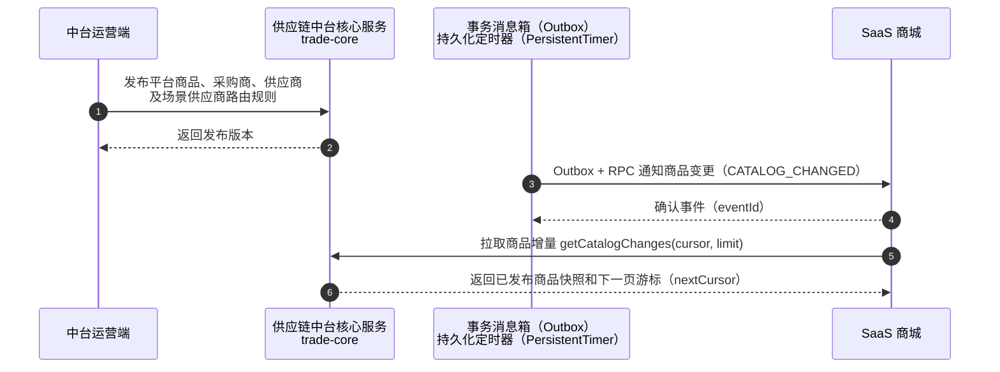
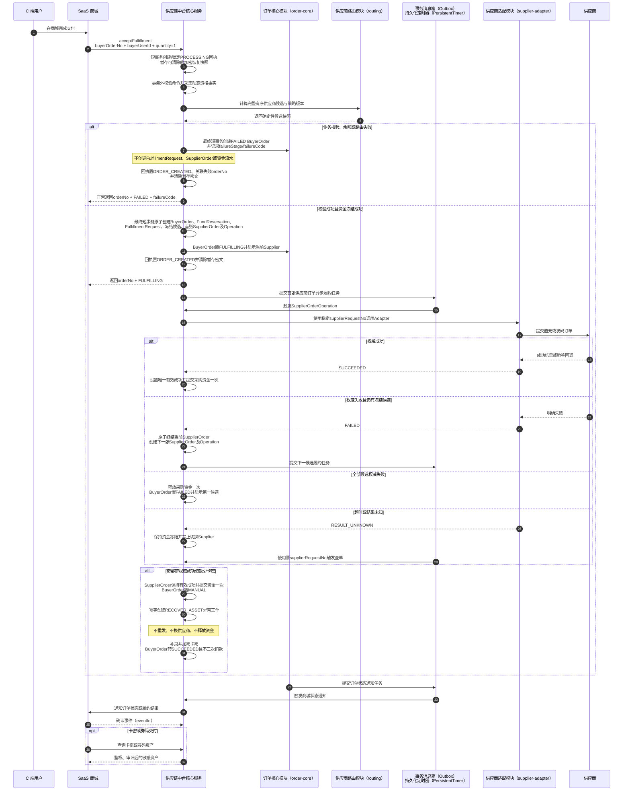
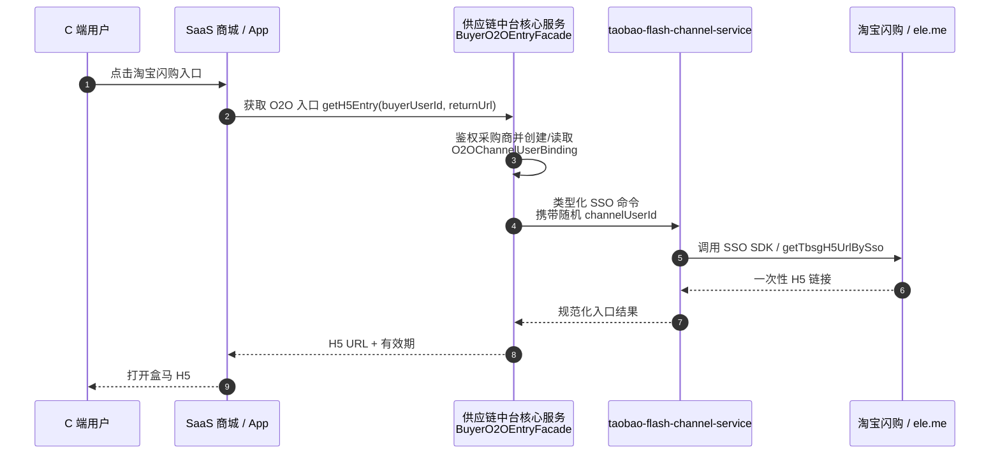
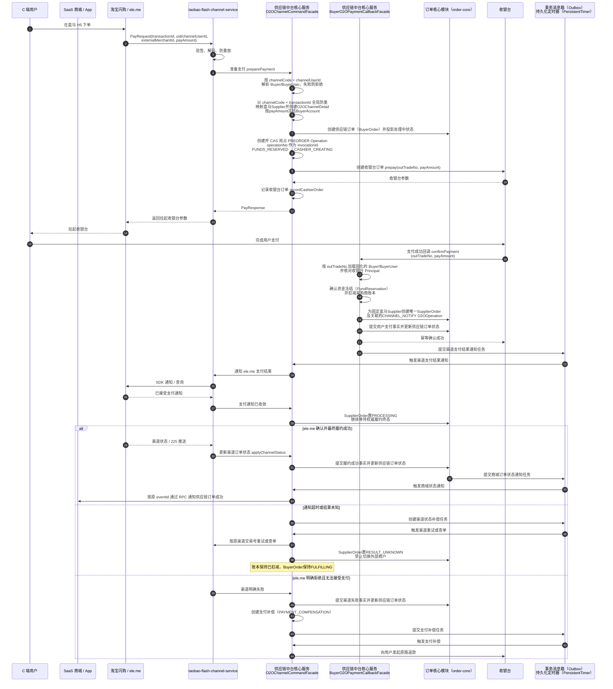
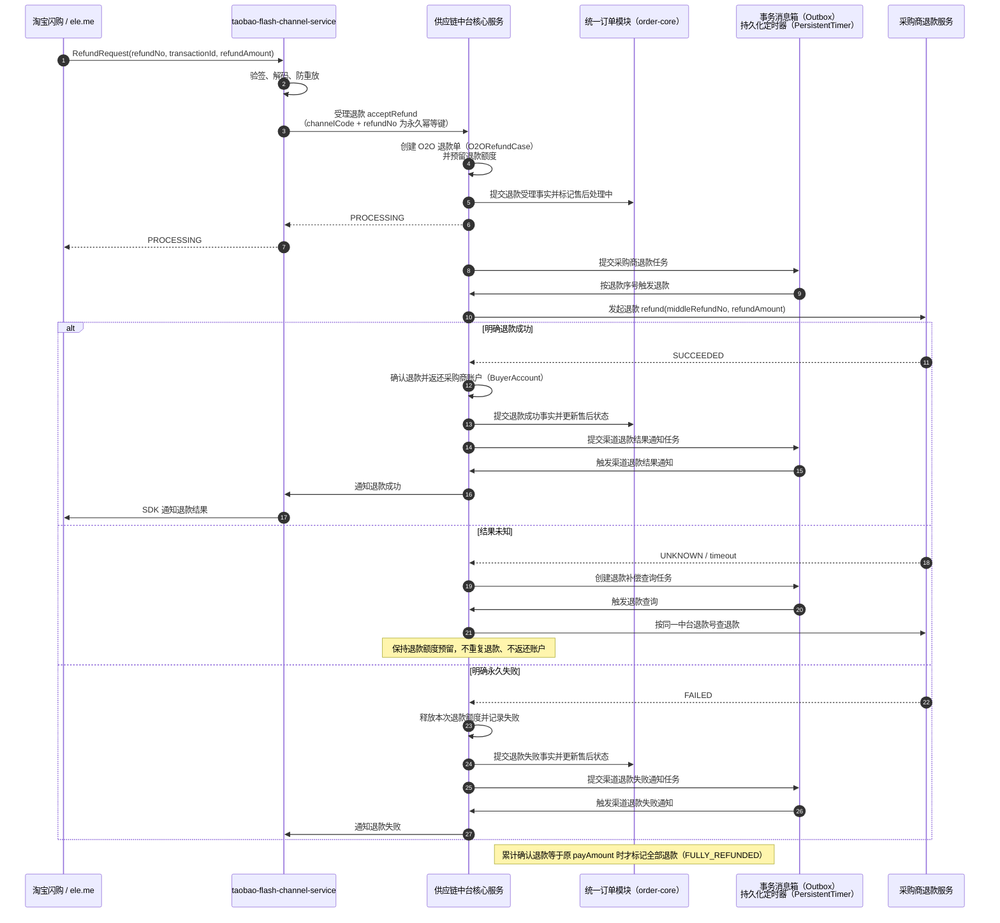
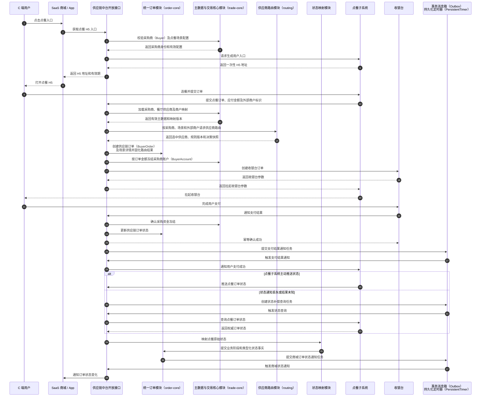

# 供应链中台核心跨系统调用时序

本文档是《供应链中台一期核心设计》的配套时序设计，只表达参与方之间的业务调用，不展开数据库读写和中台内部事务步骤。一期 SaaS 商城与中台双向都走内部 `RPC`：组合部署使用本地 `ApiImpl`，拆分部署使用 Feign 实现同一 Interface。保留的 `HTTP + HMAC` 是后续其他采购商 Adapter，不得在 RPC 失败后自动切换。

## 主数据同步

`CATALOG_CHANGED` 只负责唤醒，商城必须通过游标拉取中台发布快照；通知重复或丢失都不能导致商品真相分叉。商城商品表是消费投影，不得反向修改中台标准商品、报价或供应商映射。

## 卡券、卡密与直充履约

商城不直接调用供应商，也不保存 SupplierOrder 历史。受理 RPC 超时时只能按原 `(buyerId,buyerOrderNo)` 查询回执或原键重试；`ORDER_CREATED` 可能对应 FULFILLING 或 FAILED BuyerOrder，只有边界 `REJECTED_FINAL` 才没有订单。同键同摘要返回原结果，同键不同摘要永久冲突。中台受理后不支持采购方自动取消、退款或撤销；供应商结果未知必须查单，禁止换业务号或切换 Supplier。

## O2O 入口与 H5 跳转

中台不透传任意协议参数；渠道服务负责 ele.me SDK、签名和编解码。`channelUserId` 是中台生成的不可枚举随机标识，不包含 Buyer 或用户内部标识。此时尚未创建 BuyerOrder，也不冻结资金，盒马 H5 内商品仍由渠道侧维护。

## O2O 下单

用户支付发生在采购商侧；中台只协调支付结果，并在通知 ele.me 前原子确认采购资金。只有 CAS 抢占 PREORDER Operation 成功的请求可以调用收银台，并发请求只能读取已有结果或按原业务键查单。同一 `(channelCode,transactionId)` 的用户、Buyer、金额、商户或指纹不一致时属于身份冲突，不能建立第二张订单。`payAmount` 以 CNY 分传输，是冻结、扣减、退款及与 ele.me 对账的唯一一期金额基线；采购商内部 POINT 换算不进入中台。渠道通知未知不能释放或重复扣减资金。

## O2O 退款

渠道服务、采购商退款服务都不修改中台订单或账本。中台先把退款对外置为 `PROCESSING`，再串行调用采购商；只有采购商明确退款成功后才返还 BuyerAccount 并通知 ele.me，避免“用户未退款但采购资金已返还”的结算漏洞。

O2O 属于 M2：只有 SaaS 商城提供并通过权威 `queryPayment(outTradeNo)` 与 `queryRefund(refundKey)` ContractTest 后才允许生产发布。M1 的奇那梦标准商品履约不依赖该能力，可独立上线。

## 点餐子系统

点餐子系统同时承担 H5 场景、业务编排和渠道协议职责，定位等价于“淘宝闪购/ele.me + 淘宝闪购渠道服务”的组合。菜品、规格、购物车和配送/取餐信息由点餐子系统维护，不进入中台标准商品池；采购商（Buyer）、餐厅供应商（Supplier）、子系统商户映射及场景供应商路由规则由中台统一维护。中台不设置点餐场景编排模块，只通过开放接口提供主数据、供应商路由、统一订单、账本和状态映射能力。

点餐子系统的待支付、制作中、待取餐、完成和取消状态只作为外部场景事实进入中台状态映射。只有“已完成”映射为供应链订单成功；待取餐仍是处理中。中台统一维护采购商、餐厅供应商、商户映射和场景供应商路由规则，并在建单时固化选中供应商、规则版本和决策快照。路由不依赖菜品 SKU 或供应商报价；没有可用候选时必须在创建订单和冻结资金前拒绝。

## 电影子系统

电影子系统同样承担 H5 场景、业务编排和渠道协议职责。影片、场次、座位、票价和出票信息由电影子系统维护，不进入中台标准商品池；采购商（Buyer）、影院供应商（Supplier）、子系统商户映射及场景供应商路由规则由中台统一维护。中台不设置电影场景编排模块，只通过开放接口提供主数据、供应商路由、统一订单、账本和状态映射能力。

电影子系统的初始、待处理、出票中、已出票、完成、失败、取消和退款状态只作为外部场景事实进入中台状态映射。电影子系统出票成功并返回取票凭证（`ISSUED`）即代表供应链履约成功（`SUCCEEDED`），中台采购订单进入完成终态并提交采购资金扣减（线下纸质票打印与实际观影属于后续消费进度，不影响供应链订单终态）；退款状态只推进售后状态，不能覆盖主订单状态。中台统一维护采购商、影院供应商、商户映射和场景供应商路由规则，并在建单时固化选中供应商、规则版本和决策快照。路由不依赖影片、场次或供应商报价；没有可用候选时必须在创建订单和冻结资金前拒绝。
