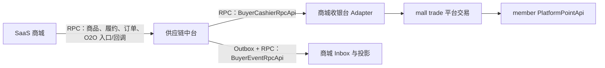

# SaaS 商城接入供应链中台实现规范

> 采购商侧身份与契约已项目化，最新规则见[《供应链中台采购商主体与采购项目详细设计》](./2026-08-21-supply-chain-buyer-project-design.md)。本文中 `sourceSystem + externalTenantId` 解析 Buyer、Buyer 级幂等及 Buyer 级事件投递规则不再作为目标契约。

## 1. 目标与边界

本文是 SaaS 商城开发团队的实现交付基线，规定商城如何调用供应链中台、如何实现采购商收银台与事件接收端。中台和商城即使组合部署，也使用独立数据库和事务管理器；双方禁止跨库 SQL、共享 Mapper 或跨库事务。

中台契约只接受 `CNY` 分。商城内部的 POINT、兑换比例、舍入规则、预支、扣减和退还均属于商城边界；不得把 POINT 数量、单位或换算规则写入中台 DTO、Header、错误、日志或回调。

## 2. 调用关系



一期双向均使用内部 RPC。组合部署由本地 `ApiImpl @Primary` 实现，拆分部署由 `@FeignClient(primary = false)` 实现同一 Interface；业务配置不区分本地或 Feign。HTTP + HMAC 是后续其他采购商的备选 Adapter，不得在 RPC 失败后自动切换。

## 3. 商城调用中台

商城依赖 `aifuli-module-supply-chain-api` 中的稳定 RPC Interface，不依赖中台 server 或领域实现。一期至少接入：

| Interface | 使用时机 | 关键规则 |
| --- | --- | --- |
| `BuyerCatalogQueryFacade` | 商品首次同步和收到目录事件后拉取。 | 商城持久化游标，中台快照是真相。 |
| `BuyerFulfillmentCommandFacade` | C 端订单在商城支付成功后。 | 一期单商品且 `quantity=1`；`buyerOrderNo` 永久幂等；必传 `buyerUserId`。 |
| `BuyerFulfillmentQueryFacade` | 查受理回执、订单补偿、按权限查卡密。 | 回执、履约摘要与敏感资产分离查询。 |
| `BuyerOrderQueryFacade` | 商城展示采购方 B 端订单摘要和详情。 | 只读取 BuyerOrder 公共投影，包含展示 Supplier 与尝试次数；不返回 SupplierOrder 历史、供应成本或内部风险。 |
| `BuyerO2OEntryFacade` | 用户从采购商 App 进入盒马 H5。 | 传递已认证 Buyer 与 `buyerUserId`，不透传任意 URL/Header。 |
| `BuyerO2OPaymentCallbackFacade` | 商城收银台支付/退款结果落库后。 | 按原 `outTradeNo/refundKey` 幂等通知，不以入参重新决定 Buyer。 |

RPC 请求必须传播内部服务身份、`sourceSystem`、受保护的租户上下文、`traceId/requestId/correlationId/causationId`、契约版本和 deadline。商城不得提交最终 Supplier、供应商成本、账本动作或中台目标状态。

### 3.1 标准履约受理与超时处理

商城提交 `buyerOrderNo/buyerUserId/buyerSkuCode/listingVersion/quantity/target`，其中 `buyerOrderNo` 是采购方永久幂等键，`buyerUserId` 必填。中台返回 `receiptStatus/receiptVersion/orderNo/orderStatus/failureCode/fulfillmentRequestNo/idempotentReplay`。回执状态只有 `PROCESSING（已持久化受理键、尚未完成落单）/ORDER_CREATED（已创建采购方订单）/REJECTED_FINAL（边界最终拒绝且无订单）`。RPC 超时或连接中断不能解释为失败，商城必须以原 `(buyerId,buyerOrderNo)` 查询回执或原键重试完全相同的请求；PROCESSING 时不得自行创建新业务号。

Buyer 身份已解析后，Buyer、Listing、数量、目标、余额或路由校验失败仍返回 `ORDER_CREATED + FAILED + failureCode`，`fulfillmentRequestNo` 为空；商城应保存并展示该失败订单，不得把它当成“未受理”而复用原业务号。相同键同摘要返回原结果，不同摘要返回 `IDEMPOTENCY_CONFLICT`；修正请求必须生成新的 `buyerOrderNo`。中台受理后不可自动退款、取消或撤销，明确供应商失败后的资金释放由中台状态机完成。

商城可见的 BuyerOrder 状态只有 `FULFILLING/SUCCEEDED/FAILED/MANUAL`。`MANUAL` 只返回通用 `FULFILLMENT_EXCEPTION`；SupplierOrder 历史、失败供应商、供应成本、`riskStatus/primaryRiskType` 和异常工单均为中台内部信息。已是 SUCCEEDED 或 FAILED 的订单发生迟到/重复成功风险时，中台不发送商城回调，也不会再次扣款或交付隔离资产。

订单摘要稳定返回 `orderNo/orderType/orderStatus/aftersaleStatus/businessStage/orderVersion/supplierAttemptCount/displaySupplier`。`displaySupplier` 是 `supplierId/supplierCode/supplierName` 快照：CARD 处理中为当前尝试、成功后为有效成功 Supplier、全部失败为第一路由选择、零尝试失败为空；O2O 从建单起为固化外部商户。商城不得根据该快照推断或重建 SupplierOrder 历史。

## 4. BuyerCashierRpcApi

### 4.1 稳定契约

SaaS 商城必须实现一个收银台 RPC Interface，并在内部适配已有交易和积分服务：

```java
public interface BuyerCashierRpcApi {
    CashierCreateResult createCashierOrder(CashierCreateCommand command);
    PaymentQueryResult queryPayment(PaymentQuery query);
    RefundResult refund(RefundCommand command);
    RefundQueryResult queryRefund(RefundQuery query);
}
```

| 方法 | 幂等/查询键 | 允许结果 |
| --- | --- | --- |
| `createCashierOrder` | `invocationId + outTradeNo` | `CREATED/REJECTED/UNKNOWN` |
| `queryPayment` | `outTradeNo` | `NOT_FOUND/CREATING/PENDING/SUCCEEDED/FAILED/CLOSED/UNKNOWN` |
| `refund` | `invocationId + refundKey` | `PROCESSING/SUCCEEDED/REJECTED/UNKNOWN` |
| `queryRefund` | `refundKey` | `NOT_FOUND/PROCESSING/SUCCEEDED/FAILED/UNKNOWN` |

`CashierCreateCommand` 至少包含 `invocationId/outTradeNo/buyerUserId/amountCny/subject/expiresAt/expectedProfileVersion`；`RefundCommand` 至少包含 `invocationId/refundKey/outTradeNo/refundAmountCny/expectedProfileVersion`。金额类型必须同时表达 `currency=CNY` 和正整数分值，不接受 `BigDecimal` 含糊单位。返回的 `launchDescriptor` 必须是封闭类型，不能使用任意 Map/JSON。

### 4.2 商城内部处理

Adapter 以 `amountCny` 为外部唯一金额事实，使用商城已有价格规则生成内部 POINT 快照，再调用 `PlatformPointApi`。可复用的现有能力为：

- `MallPlatformPointPriceRuleApi`：只在商城内部解析 CNY 到 POINT 的规则和舍入。
- `PlatformPointApi.createPrepay`：创建内部积分预支单。
- `PlatformPointApi.queryPayOrder`：只能按已持久化的 `prepayOrderId` 查询，可覆盖已取得预支单号后的状态查询。
- `PlatformPointApi.refundPoint`：按稳定退款键发起内部积分退款。

`MallPlatformTradeDO.sourcePayPrice` 可作为中台 CNY 请求金额快照，`platformPayPrice/platformRealPayPrice/platformPriceUnit` 仅作为商城内部积分事实。商城必须持久化请求的 `invocationId/outTradeNo/refundKey/amountCny`、内部换算规则版本与积分快照；重放同一键时返回首次结果，同键不同 CNY 金额必须拒绝。

收银台 Adapter 禁止将 `UNKNOWN/超时` 解释为失败，也禁止自动创建新 outTradeNo 或 refundKey。创单未知后只能查原 outTradeNo；退款未知后只能查原 refundKey。

### 4.3 queryPayment 与 queryRefund 阻断项

当前 `PlatformPointApi.queryPayOrder` 要求 `prepayOrderId`。如果创建预支单的 RPC/网络结果未知且商城未持久化到 `prepayOrderId`，该方法不能实现 `queryPayment(outTradeNo)`。SaaS 团队必须增加按 `outTradeNo` 权威查支付，或提供能按原 `invocationId/outTradeNo` 返回首次创建结果的持久化幂等网关。补齐前不得将 O2O 能力发布到生产；受控联调中的该类 `UNKNOWN` 必须保持中台资金冻结，禁止以 `NOT_FOUND` 释放资金。

当前 `PlatformPointApi` 只提供 `refundPoint`，没有按 `refundKey` 查询退款结果的权威 `queryRefund`。SaaS 团队必须在商城交易/积分边界补充该能力，并保证它不依赖“同订单号 + 金额猜测退款”。在此之前不得将 O2O 能力发布到生产；受控联调中的退款 `UNKNOWN` 必须保持退款预留，不得开启自动退款闭环。

M1 只包含“吾盛采购商 → 奇那梦标准商品履约”，不依赖收银台查询能力。M2“吾盛采购商 → 淘宝闪购/盒马 O2O”必须在上述两个查询接口通过超时、重复和终态 ContractTest 后才能上线。

## 5. BuyerEventRpcApi

SaaS 商城实现一个统一事件接收 Interface：

```java
public interface BuyerEventRpcApi {
    BuyerEventAck receiveEvent(BuyerEventEnvelope event);
}
```

`BuyerEventEnvelope` 包含 `eventId/eventType/schemaVersion/occurredAt/traceId/correlationId/causationId/data`，`data` 是只允许 `ORDER_SUMMARY_CHANGED/FULFILLMENT_RESULT/CATALOG_CHANGED` 的 tagged union。商城必须实现：

1. 在本地事务中插入 Inbox `(consumerName,eventId,payloadDigest)`，再更新商城投影和业务状态。
2. 同 eventId/同 digest 返回 `DUPLICATE_ACCEPTED`；同 eventId/不同 digest 返回确定性契约冲突。
3. 按 `orderVersion` 忽略过时订单事件，但仍幂等 ACK；禁止订单状态回退。
4. `CATALOG_CHANGED` 只唤醒同步任务，不把事件数据当商品真相；任务使用已持久游标调用 `getCatalogChanges`。
5. 订单事件携带 `supplierAttemptCount/displaySupplier`，切换供应商即使主状态仍为 FULFILLING 也通过递增 `orderVersion` 发布新摘要；履约事件不包含卡密，仅有效成功 SupplierOrder 的 `assetAvailable=true` 时，授权场景再用 `getFulfillmentAssets` 拉取。隔离资产永不对商城可见。

ACK 持久化成功前禁止返回成功。中台会用原 eventId 至少一次重投，因此接收方不得依赖“消息只来一次”。

## 6. 建议的商城侧数据模型

表名可按商城现有命名调整，但业务约束不得弱化：

| 模型 | 必要字段/约束 |
| --- | --- |
| 中台订单绑定 | `(tenantId,buyerOrderNo)` 唯一，保存 `receiptStatus/receiptVersion/orderNo/orderStatus/failureCode/fulfillmentRequestNo/orderVersion/supplierAttemptCount/displaySupplier`；仅 PROCESSING 或 REJECTED_FINAL 时订单号为空，业务失败时订单号存在而履约请求号为空。 |
| 收银台交易 | `(tenantId,outTradeNo)` 唯一，`invocationId` 唯一，保存 CNY 源金额、内部结算快照和标准查询状态。 |
| 收银台退款 | `(tenantId,refundKey)` 唯一，`invocationId` 唯一，保存 CNY 退款金额、内部退款引用和可权威查询状态。 |
| 中台事件 Inbox | `(consumerName,eventId)` 唯一，保存 `payloadDigest/status/detailVersion/processedAt`。 |
| 商品同步游标 | `(tenantId,catalogScope)` 唯一，与商品投影在同一事务中推进。 |

商城应使用自身 Liquibase 变更集创建或扩展这些表。不得在中台 DDL 中创建商城表，也不得让商城应用账号访问 `sc_` 表。

## 7. HTTP + HMAC 备选契约

若后续对某个 Buyer 显式发布 HTTP 能力，请求路径必须由契约版本固定，双向使用独立 HMAC-SHA256 凭证。签名规范串按 `method/path/canonicalQuery/timestamp/nonce/bodySha256/traceId` 排列；时钟偏差默认不超过 5 分钟，Nonce 使用共享 Redis 防重放。写接口在防重放存储不可用时必须拒绝。

HTTP 只允许 HTTPS、allowlist 域名、有限响应体与固定路径，禁止跳转，并拒绝解析到私网、回环、链路本地和保留地址。ACTIVE/PREVIOUS 双凭证只用于无停机轮换。非幂等写操作禁止客户端自动重试。

## 8. 验收清单

1. 组合部署本地 ApiImpl 与拆分部署 Feign 通过同一 RPC 契约测试。
2. 所有中台边界金额都是 CNY 分，契约、日志和载荷中无 POINT。
3. `quantity<>1`、Listing、目标、余额或路由校验失败均只产生一张 FAILED BuyerOrder，不产生 FulfillmentRequest、SupplierOrder 或资金流水；同 buyerOrderNo 并发只产生一张回执和订单。
4. 回执不存在可重开状态；同键同摘要返回原结果，同键不同摘要冲突，修正请求使用新 buyerOrderNo；受理后取消始终被拒绝。
5. 同 outTradeNo/refundKey/eventId 并发或重复请求不重复预支、退款或更新 C 单。
6. 收银台创单和退款超时均返回 UNKNOWN，只使用原键查询。
7. `queryPayment(outTradeNo)` 能覆盖未取得 prepayOrderId 的创单未知，`queryRefund(refundKey)` 能返回权威退款结果；两个接口未通过 ContractTest 时 M2 禁止生产发布。
8. Inbox 与商城投影同事务；重复、乱序、处理后宕机均通过故障注入。
9. 敏感资产不进入事件，商城只在授权查询中按 Buyer + BuyerUser 拉取有效成功资产；迟到或重复成功的 QUARANTINED 资产不可见。
10. 商城接口不返回 SupplierOrder 历史、供应成本、内部风险和异常工单；终态订单的纯风险变化不触发商城回调。
11. RPC 失败不自动切换 HTTP；收银台与事件能力使用分离的 bulkhead 和熔断器。
12. HTTP 备选 Adapter 通过 HMAC、Nonce、轮换、SSRF、跳转和失败关闭安全测试。
13. 商城 Liquibase 可从空库创建所需表，并能从上一生产标签升级。
