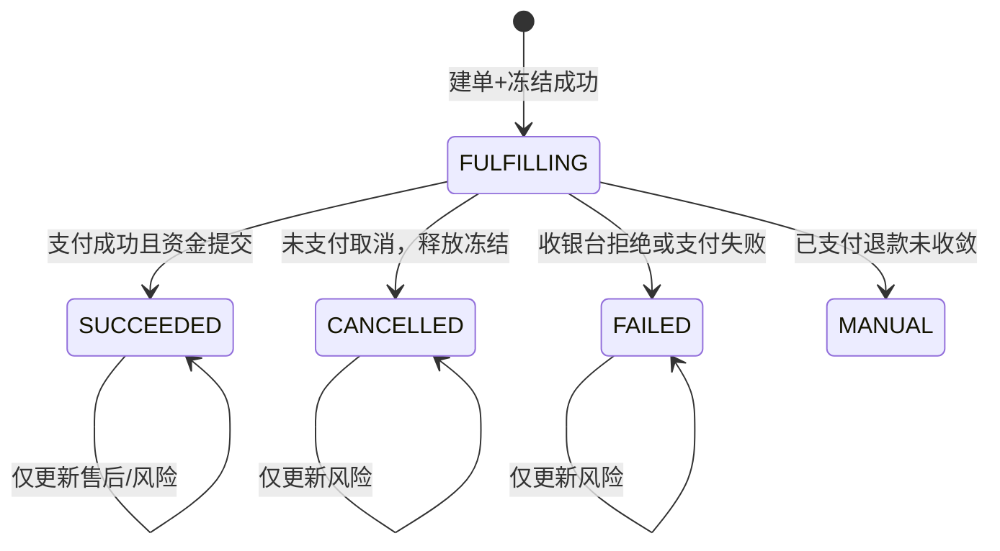

# 大润发到店购渠道分销接入设计

> 采购商项目化修订：到店购采购商侧接口、用户、订单、账户指派和集成档案必须归属项目；旅通渠道项目应用标识也唯一恢复项目。最新身份规则见[《供应链中台采购商主体与采购项目详细设计》](./2026-08-21-supply-chain-buyer-project-design.md)。本文中以 `(sourceSystem, externalTenantId)` 决定业务归属的表述只描述当前未改造实现；目标态由 `projectId` 决定归属，`sourceSystem/externalTenantId` 仍作为项目集成档案中的 SaaS 外呼路由坐标保留。

领域词汇见仓库根目录 `CONTEXT.md`（到店购交易、到店购授权凭证、列表展示态等）。决策记录见 `docs/adr/0001-instore-independent-of-o2o.md` 至 `docs/adr/0006-project-identity-separates-external-tenant-route.md`。

## 1. 背景与范围

本文档定义供应链中台接入「大润发到店扫码购」渠道的方案。渠道方为旅通（ltsw.cn）支付/POS 聚合中台，门店用户用扫码购 APP 扫实物商品 → 旅通 POS 收单 → 调「商户」（中台+采购商收银台）接口建单/查单/退款。接口契约见 `docs/大润发到店购渠道分销接口.docx`。

本设计与既有「淘宝闪购/盒马 O2O」（`orderType=O2O`）**平行、不硬合**：总表独立 `orderType`，独立场景详情模块、OrderSummaryPolicy 与渠道服务。共享 BuyerOrder 总表、trade-core 资金账本与 Outbox/Timer，不共享详情表、状态机、入站契约与渠道服务代码。独立成类的依据是履约完成点、渠道拉状态、取消已支付转退款，**不是**一单多流水。见 ADR-0001。

一期范围：先打通受控联调切片，生产发布门禁见第 9 节。**当前代码按第 4.4 节联调切片冻结，不当生产资金路径。** 第 10 节业务语义已确认；切片与目标态的差距只剩实现未跟上，不再等待旅通澄清。

## 2. 与 ele.me O2O 的异同

二者同属「采购方先在渠道侧发生交易、中台协调采购资金并生成固定商户供应商订单」，复用 `1 采购单 + 1 场景详情 + 0..1 固定商户 SupplierOrder`、不切商户、FundReservation、退款 Case 排队。不并表是因为下列差异，而不是基数不同。

| 维度 | ele.me（`O2O`） | 大润发/旅通（`INSTORE`） |
|---|---|---|
| 履约形态 | 配送/自提，需 225 或权威查单才到 SUCCEEDED | 到店即完成，支付成功即 SUCCEEDED，无配送、无 225 |
| 状态同步 | push：payCallback/refundCallback + 225 | pull：旅通主动查支付、查退款 |
| 会员/身份 | 中台生成匿名 channelUserId 交给 ele.me | `app_key` 唯一确定采购商租户；中台签发独立一次性授权凭证；旅通调会员接口①；`user_code`=`buyer_user_id`；手机号姓名只转发、不落库 |
| 建单入参 | channelCode/transactionId/channelUserId/payAmount/externalMerchantId | order_id/trade_id/user_code/total_amount/company_code/shop_code/shop_name |
| 取消 | 关单映射 FAILED，不自动退款 | 未支付→CANCELLED 并释放冻结；已支付→动账全额退款协同（尚无退款协同时） |
| 幂等键 | (channelCode,transactionId)、(channelCode,refundNo) | (channelCode,order_id)、(channelCode,trade_id)、(channelCode,refund_bn) |
| 订单:支付身份 | 1:1 | **1:1**（业务确认不会一单多流水；`trade_id` 是详情上的键，ADR-0002） |
| 协议/签名 | ele.me SDK + PaySignUtil RSA | RSA 双向验签 + hutool MapKeySort + JSON/HTTP |
| 渠道通知 | CHANNEL_NOTIFY Outbox | 无（pull） |
| 商户绑定 | 渠道商户号 → Supplier | `company_code` → 同一大润发 Supplier；`shop_code` 只是外部门店快照 |

列表分页只查 `sc_supply_chain_order`；外部门店、`trade_id`、旅通 `order_id` 不是统一列表的必筛字段。旅通 `order_id` 落在 INSTORE 的 `buyer_order_no` 上，精确查找可用现有 `pageOrders.buyerOrderNo`。

## 3. orderType 扩展与总表影响

新增 `orderType = INSTORE`。core-design / detailed-design 7.1 的 `orderType` 枚举扩展为 `CARD/O2O/INSTORE`。

### 3.1 DDL CHECK 扩展

`sc_supply_chain_order`：

- `order_type` 注释含 INSTORE 到店购渠道。
- `ck_sc_order_type CHECK (order_type IN ('CARD', 'O2O', 'INSTORE'))`。
- `ck_sc_order_card_fields`（实现名；勿再写 `ck_sc_order_type_fields`）增加 INSTORE 分支：`buyer_order_no` 必填（旅通 `order_id`）、`acceptance_receipt_id` 为空、不绑定 SKU、`buyer_settlement_amount>0`、`detail_type='INSTORE_CHANNEL'`、`display_supplier_id` 非空。

供应商订单用独立表 `sc_instore_supplier_order`（对标 `sc_o2o_supplier_order`），**不**在统一 `sc_supplier_order` 上加 `instore_channel_detail_id`。基数 0..1，支付成功且资金提交后创建，`fulfillment_status` 创建即成功（到店即完成）。

### 3.2 OrderSummaryPolicy 与列表展示态

`InstoreOrderSummaryPolicy` 按 `orderType=INSTORE` 唯一注册。Policy 只写入主状态与售后状态，不写入列表展示态。

- 主状态：建单冻结中 → 处理中；支付成功资金提交 → **成功**；未支付取消 → **取消**；收银台拒绝/支付失败 → 失败；退款无法收敛 → 人工。全额退款**不**把主状态改成取消或失败。
- 售后（生产）：无退款协同 → `NONE`；退款进行中 → `PROCESSING`；累计未满实付 → `PARTIALLY_REFUNDED`；退尽 → `FULLY_REFUNDED`。与 O2O 正交售后同一套。
- **列表展示态**（只读投影，供采购商 C 端列表，不落可写列）：待支付 / 已取消 / 支付失败 / 已完成 / 退款中 / 已完成·部分退款 / 已完成·已全额退款 / 处理中（人工）。全部退款文案不是「已取消」。

### 3.3 BusinessNoPrefixes 与 FundReferenceType

- 前缀：`ISC_` 渠道详情、`IOP_` 操作、`IRC_` 退款 Case、`IUB_` 用户绑定、`ISO_` 供应商订单。现有 `IPF_` 仅服务未合并的 1:1 卫星表，合并后冻结键改用详情号。
- `FundReferenceType.INSTORE_ORDER`：按**整笔到店购交易**冻结一次，`referenceNo` 为目标态的详情号（`ISC_`），不是第二笔流水号。

## 4. 中台侧场景详情模块

`border.instore` 与 `border.o2o` 平行。领域上不承认支付流水子实体；`order_id` 与 `trade_id` 都是到店购渠道详情上的外部键。

### 4.1 包结构

```text
aifuli-module-supply-chain-server/com.aifuli.module.supplychain.border.instore
├── application/
│   ├── InstoreChannelLifecycle
│   ├── InstoreChannelUserBindingResolver
│   ├── InstoreRefundSequencer
│   └── InstoreOperationRecoveryHandler
├── domain/          // 枚举与幂等键；无独立 PaymentFlow 聚合
├── dal/dataobject/
└── dal/mysql/
```

### 4.2 表结构（Liquibase `013-instore-channel.sql` + `014-instore-production-invariants.sql`）

**`sc_instore_channel_order`**（到店购渠道详情，1:1 BuyerOrder）：

- 旅通 `order_id` → `channel_order_id`，`uk(channel_code, channel_order_id)`。
- 领域上拥有 `trade_id`、`out_trade_no`、资金预留号与支付状态；本轮为避免双写，物理列仍只保留在下述 1:1 支付卫星，后续收表时再一次性迁入详情。
- 固化 `buyer_id/source_system/external_tenant_id/buyer_user_id`；建单必须与 `app_key` 映射出的采购商租户完全一致。
- `013` 的匿名快照 `channel_user_id` 由 `014` 改为可空；生产建单只固化稳定绑定及租户用户作用域。
- `company_code` 为 Binding 的 `external_merchant_id`；`external_store_id/name` 为 `shop_code/shop_name` 快照。
- `buyer_user_id` 即旅通 `user_code`。
- 退款累计挂在本表；`active_refund_case_id` 指向在途协同。

**`sc_instore_payment_flow`**（实现过渡）：

- 当前 DDL 仍按集合建模。`014-instore-production-invariants.sql` 增加 `UNIQUE(instore_order_id)` 锁死 1:1；禁止同一详情再挂第二笔 `trade_id`。本轮保留该表作为支付卫星，不同时做收表迁移；后续可将列上收到详情表后单独废弃。见 ADR-0002。

**`sc_instore_refund_case`**：

- 挂在到店购交易上（`instore_order_id`），不是独立流水聚合。
- ⑤：`channel_refund_no=refund_bn`，允许部分退，累计 ≤ 实付，按交易排队。
- ④ 已支付：仅当该交易尚无任何退款协同时，全额动账退款，`channel_refund_no=CANCEL:{trade_id}`。
- 已有 ⑤ 再 ④ → `INSTORE_CANCEL_REFUND_FAILED`。先全额取消再 ⑤：同金额回放，不同金额拒绝。

**`sc_instore_operation`**：无 `CHANNEL_NOTIFY`。类型含 PREORDER / PAYMENT_QUERY / CANCEL_PAY / BUYER_REFUND / REFUND_QUERY。

**`sc_instore_channel_user_binding`**：稳定身份键为 `(source_system, external_tenant_id, buyer_user_id, channel_code)`。`014` 增加租户快照，以新四元组唯一键替换旧 `(buyer_id, buyer_user_id, channel_code)` 唯一键，并把旧的 `channel_user_id/token/token_status/token_expires_at` 改为可空兼容列；生产代码不再依靠匿名渠道会员号解析归属。

**`sc_instore_entry_credential`**：每次首页或详情入口新建一条独立凭证，同一绑定可同时存在多枚未消费凭证。只保存 token 的 SHA-256 摘要；`purpose` 为 `HOME/DETAIL`，`DETAIL` 必须绑定 `instore_order_id`；默认十分钟过期且可配置。消费使用版本 CAS：先由唯一请求从 `ACTIVE` 抢占到 `PROCESSING`，会员资料查询成功后再推进 `USED`；明确失败时若仍未过期则释放回 `ACTIVE`，进程崩溃遗留的 `PROCESSING` 凭证到期后失效。并发抢占失败返回 `INSTORE_CONCURRENT_UPDATE`，不得重复转发会员查询。见 ADR-0005。

**`sc_instore_supplier_order`**：0..1，对标 O2O 固定商户供应商订单。

### 4.3 主状态机



### 4.4 一期联调切片约束

当前代码是受控联调骨架。第 9 节门禁未满足前禁止当生产资金链路。下表「切片」是现状；「目标态」是第 10 节已确认、实现必须追上的语义。**1:1 已是目标态，不再预留 1:N。**

| 不变量 | 切片（现状代码） | 目标态（已确认） |
|---|---|---|
| 提交身份 | 设计验证/受控联调 | 第 9 节门禁通过后放量 |
| 支付身份 | 同一 `order_id` 已有流水则拒绝新 `trade_id` | 一交易一 `trade_id`；流水表至多 1:1 卫星 |
| 冻结键 | `INSTORE_ORDER` + `paymentFlowNo` | `INSTORE_ORDER` + 详情号 |
| 已支付取消 | 只落 `CANCEL_REFUND` Case，**不动账本** | 无退款协同时动账全额退款 |
| token | 复用、不 mark used | ① 成功后作废；首页/详情均新签 |
| 售后 | Policy 恒 `NONE` | 按累计退款投影；列表用展示态 |
| 查询 | Lifecycle 只读，不上 HTTP | 渠道层映射旅通 0/1/2 |
| 入站 API / 渠道服务 | 未做 | 第 5、6、11 节 |

中台内部支付状态码与旅通接口③ 的 0/1/2 不同，映射在 `aifuli-channel-rtmart-server`。

### 4.5 生产事务与幂等不变量

1. 建单同时使用 `(channelCode, order_id)` 与 `(channelCode, trade_id)` 两组永久键。项目化目标态的请求摘要覆盖 `projectId/order_id/trade_id/user_code/company_code/total_amount/order_type/shop_code/shop_name`，并另行固化该操作使用的集成档案版本；过渡表中的 `sourceSystem/externalTenantId` 仅作外呼路由快照。同键同摘要回放，同键不同摘要返回 `INSTORE_IDEMPOTENCY_CONFLICT`。
2. 资金只按 `INSTORE_ORDER + instoreOrderNo` 冻结一次。支付卫星号不得成为资金引用键。
3. 所有 Mapper 条件更新必须检查影响行数。支付成功时“关联固定商户供应商订单 + 支付卫星推进 PAID”合并为一次 CAS，禁止连续使用同一旧版本执行两次更新。
4. 退款受理先锁定 INSTORE 详情，以成功、处理中和排队中的退款 Case 总额校验累计不超过实付金额；同一交易最多一个正在调用采购商收银台的退款，其余 Case 串行排队。
5. 已支付取消只有在从未存在退款协同时才能创建全额 `CANCEL_REFUND`；存在任何接口⑤退款 Case 时拒绝取消转退款。
6. `BuyerAccountReturnService` 是已扣采购资金返还的唯一入口，只拥有账户和账本，不依赖 INSTORE。INSTORE Lifecycle 在外层本地事务中调用它：服务以 `REFUND_RETURN:{refundCaseNo}` 为账户范围内永久幂等键，锁定账户、执行 `balance += amount` 并追加 `REFUND_RETURN` 账本；返回成功后由 Lifecycle 推进退款 Case、订单累计值和售后投影，任一步失败则整笔事务回滚。
7. 采购商退款成功时实际金额必须等于申请金额。缺失或不一致时不返还账户，退款协同与订单售后进入人工处理。
8. 外部收银台调用只在本地事务提交后执行。SaaS 收银台回调优先；回调未到或结果未知时，只能按原 `outTradeNo/refundCaseNo` 权威查单，不得重建支付号或退款号。回调、渠道查询触发的权威查单与 Timer 恢复必须共用同一条幂等收敛路径。

### 4.6 稳定错误语义

生产核心至少提供 `INSTORE_IDEMPOTENCY_CONFLICT`、`INSTORE_CREDENTIAL_INVALID`、`INSTORE_CREDENTIAL_EXPIRED`、`INSTORE_CREDENTIAL_ALREADY_USED`、`INSTORE_TENANT_SCOPE_CONFLICT`、`INSTORE_REFUND_AMOUNT_EXCEEDED`、`INSTORE_REFUND_AMOUNT_MISMATCH`、`INSTORE_CONCURRENT_UPDATE` 与 `INSTORE_ACCOUNT_RETURN_CONFLICT`。渠道服务负责将稳定错误映射为旅通协议响应；未知异常不得把 Java 异常消息返回外部，内部日志保留因果链并对 token、手机号等字段脱敏。

## 5. 入站契约（中台 API）

新建 `api/instore/`，不扩 `O2OChannelCommandApi`：

```text
InstoreChannelCommandApi
├── createPaymentOrder       // 旅通接口②
├── queryPaymentStatus       // 旅通接口③
├── cancelPaymentFlow        // 旅通接口④
├── acceptRefund             // 旅通接口⑤
└── queryRefundStatus        // 旅通接口⑥
InstoreChannelMemberApi
└── resolveMember            // 旅通接口①：验凭证 → 转发采购商会员 → 返回 user_code=buyer_user_id；不落手机号姓名
InstoreBuyerEntryApi
├── getInstoreEntry          // 采购商用户：getRtPosUrl/home，签发一次性凭证
└── getInstoreOrderDetail    // 采购商用户：校验交易属于当前用户后新签凭证，再 getRtPosUrl/detail
InstoreBuyerCashierCallbackApi
├── confirmPayment           // SaaS 收银台支付成功回调，按 outTradeNo 加载固化归属
└── reportRefundResult       // SaaS 收银台退款结果回调，按 refundCaseNo 加载固化归属
```

幂等：支付 `(channelCode, trade_id)`、退款 `(channelCode, refund_bn)`、订单头 `(channelCode, order_id)`。同键同完整摘要重放，同键不同摘要 `INSTORE_IDEMPOTENCY_CONFLICT`。

接口① 由中台转发采购商，渠道服务不直调采购商。目标态先用可信 `ProjectCallContext` 确定 `(projectId, buyerUserId)` 业务作用域，再由固化的 `MEMBER_PROFILE` 集成档案版本解析 `(sourceSystem, externalTenantId)`，通过 `BuyerMemberProfilePort` 获取资料。`buyerUserId` 是不透明字符串，禁止直接转换为 `Long`。没有这层转发，建单无法把凭证解析到要冻结的项目账户指派。

### 5.1 SaaS 商城收银台编排

供应链中台在领域上就是时序图中的“分销商”，具体 SaaS 商城是中台采购商租户，商城会员是该租户内的 `buyer_user_id`。旅通、大润发与 POS 对中台核心统一属于 `RT_MART` 外部渠道；它们之间的真实 HTTP 调用关系只留在渠道协议适配层，不进入核心模型。

`BuyerCashierPort` 负责 SaaS 商城收银台的四项能力：

1. 建单事务提交后，中台按订单固化的 `projectId + cashierProfileVersionId` 解析 `sourceSystem/externalTenantId`，再以 `projectId + sourceSystem + externalTenantId + buyerUserId` 调 `createCashierOrder`，使用已固化的 `outTradeNo` 创建会员支付单并取得 `cashierUrl/cashierOrderNo`。端口中的 `buyerUserId` 必须是原始不透明字符串，目标实现不得沿用或转换为 `Long`。`externalTenantId` 只能来自该固化档案版本，不得从渠道请求临时覆盖。
2. SaaS 收银台支付回调是首选收敛入口。回调只提交 `outTradeNo`、实际支付金额、收银台单号/交易号和观察时间；中台先按 `outTradeNo` 加载订单中固化的租户与用户，再核验已认证 SaaS 租户主体，禁止用回调参数改变归属。
3. 旅通接口③查询到本地非终态，或 PREORDER/PAYMENT_QUERY 恢复任务执行时，中台在事务外按原 `outTradeNo` 调 `queryPayment`，再将权威结果送入与回调相同的 Lifecycle 收敛方法。回调、查询和 Timer 并发时依靠同一状态 CAS 幂等，禁止各写一套状态逻辑。
4. 退款由中台在受理事务提交后，使用订单固化的同一项目和收银台档案版本，按原 `refundCaseNo` 调 `refund`；回调优先，接口⑥或恢复任务按同一 `refundCaseNo` 调 `queryRefund` 兜底。成功响应必须携带实际退款金额；缺失或不等于申请金额时转人工且不返还采购商账户。

接口③/⑥虽然可触发权威查单，但外呼与状态事务仍分离：先读取固化业务号并 CAS 抢占查询 Operation，事务提交后外调 SaaS，最后以新事务幂等收敛并返回最新本地投影。未抢到 Operation 的并发查询只返回当前投影，不重复外调。

## 6. 渠道服务 `aifuli-channel-rtmart-server`

独立 spring-boot 子模块，对标 `aifuli-channel-taobao-flash-server`。验签后 Feign 调中台 API；自有库不进中台 Liquibase。职责（协议适配、RSA、错误码映射）与原方案相同，此处不重复。项目化目标态为每个旅通渠道项目配置独立 `app_key`，渠道服务验签后将它映射为 `projectId`；SaaS `sourceSystem/externalTenantId` 由该项目集成档案另行解析，不使用旅通 `app_key` 的字面值推导。禁止同一渠道 `app_key` 跨项目共享；`company_code` 仍作为 `SupplierChannelBinding.external_merchant_id`，不承担采购商身份识别。供应链核心把旅通、大润发和 POS 视为同一个 `RT_MART` 渠道调用方，不为三者建立独立领域身份。

## 7. 身份与入口

旅通 `getRtPosUrl/home` 的 `token` 原文为「商户签发授权 token，大润发调用商户会员详情接口换取会员信息」。中台扮演商户：

1. 已登录采购商用户调入口；中台按 `(projectId, buyerUserId, channelCode)` 读取或创建稳定绑定，每次入口都新建一条独立凭证。已有 `(sourceSystem, externalTenantId, buyerUserId, channelCode)` 列和索引属于待前向迁移的过渡实现。
2. 凭证明文只返回一次，数据库保存 SHA-256 摘要；默认十分钟过期。同一用户允许并存多枚未消费凭证，某一凭证的消费不使其他凭证失效。
3. 旅通调① 持该凭证；中台以摘要定位凭证，CAS 将 `ACTIVE` 抢占为 `PROCESSING` 后，通过 `BuyerMemberProfilePort` 向采购商查询手机号/姓名。查询成功再置 `USED` 并转发；明确失败时若凭证未过期则释放为 `ACTIVE`，允许按同一凭证重试。中台不落会员资料；已使用、过期、用途不符或并发抢占失败均按稳定错误拒绝。
4. ① 返回的 `user_code` 等于不透明字符串 `buyer_user_id`。每项目独立渠道 `app_key` 恢复 `projectId`，建单使用项目作用域与 `user_code` 共同校验稳定绑定。`buyer_id/project_id` 都不给旅通；SaaS `externalTenantId` 只在中台出站 Adapter 路由中使用。见 ADR-0003/0006。
5. 详情页给采购商用户：先校验交易属于同一租户和用户，再签发绑定该 `instore_order_id` 的 `DETAIL` 凭证，并向旅通请求 `getRtPosUrl/detail`。POS 查单走接口③⑥，不走此入口。

联调切片仍可复用 token；生产语义是作废。

## 8. 与 ele.me 的边界与共享

| 复用 | 独立 |
|---|---|
| BuyerOrder 总表（INSTORE 分支） | `border.instore`、详情/绑定/退款/操作/供应商订单表 |
| trade-core 资金账本 | `InstoreOrderSummaryPolicy`、列表展示态投影 |
| Outbox/PersistentTimer | 入站 API 与 `aifuli-channel-rtmart-server` |
| Liquibase（`013-instore-channel.sql`） | 旅通验签与 E400x 映射 |
| `SupplierChannelBinding`（`company_code`） | 一次性授权凭证与会员转发 |

`border.o2o`、`O2OChannelCommandApi`、`O2OOrderSummaryPolicy`、淘宝闪购渠道服务一行不动。

## 9. 生产发布门禁

1. 旅通 `queryPay` / `queryRefund` ContractTest 覆盖创单/退款超时、重复查询、终态。
2. `013 + 014` 在真实 MySQL 从空库完整执行；INSTORE 总表插入满足 CHECK；数据库拒绝同一 `instore_order_id` 第二条支付卫星。
3. 支付确认的资金提交、支付 PAID、固定商户供应商订单与总订单成功在同一事务原子完成；任一 CAS 失败全部回滚。
4. 已支付取消转全额退款的账户返还与账本一致；重复回调只入账一次；并发部分退款累计不得超过实付金额；接口④与⑤互斥。
5. ① 转发会员且不落手机号；同一用户可并存多枚凭证，每枚凭证并发消费只有一次成功；`user_code` 与原始 `buyer_user_id` 一致。
6. ArchitectureTest 保证 `border.instore` 不依赖旅通协议类或 member Feign，账户返还只能经过 trade-core 服务。
7. 收银台 ContractTest 覆盖按租户三元组创单取得 URL、支付回调优先、接口③原号查单兜底、退款回调与接口⑥原退款号查单、实际退款金额缺失或不一致；回调与查单并发只收敛一次。

门禁未满足时仅联调，不生产上线。

## 10. 已确认的业务决策

原「待向旅通确认」六项已拍板（2026-08-19/20 领域质询）：

1. **支付基数**：不会出现一单多流水。`trade_id` 是详情键。ADR-0002。
2. **会员接口①**：中台验凭证后转发采购商，不落会员资料；渠道不直调采购商。
3. **已支付取消**：动账全额退款；仅当无退款协同。⑤ 允许部分退。
4. **授权凭证**：中台签发；① 成功后作废；详情入口新签。
5. **`getRtPosUrl/detail`**：采购商用户使用，进中台入口。
6. **商户与门店**：同一大润发 Supplier；Binding 键 `company_code`；`shop_code` 为外部门店快照。
7. **SaaS 收银台**：中台先固化 `outTradeNo`，再建会员支付单并取得 `cashierUrl/cashierOrderNo`；支付与退款均回调优先、原业务号权威查询兜底；退款成功返回实际退款金额。

另确认：`user_code`=`buyer_user_id`（ADR-0003）；项目化后每个采购项目独立渠道 `app_key`，业务作用域为 `(projectId, buyer_user_id)`；会员资料外呼按项目固化的档案版本解析 `(sourceSystem, externalTenantId, buyer_user_id)`（ADR-0006），禁止把 `buyer_user_id` 直接转为 `Long`；稳定绑定与可并存的一次性凭证分表（ADR-0005）；统一列表不按门店/流水号必筛；售后与列表展示态见第 3.2 节。

## 11. 落地顺序

1. 新增 `014-instore-production-invariants.sql`：租户作用域、独立凭证表、支付卫星 1:1 唯一约束及兼容列迁移；`013` 不原地修改。
2. 以 TDD 修复完整请求摘要、冻结键、所有 CAS 返回值、支付合并 CAS、退款排队、真实账户返还和售后投影。
3. 入站 Facade + `BuyerMemberProfilePort` + 收银台 Port；`InstoreBuyerEntryApi` 含详情入口。
4. `aifuli-channel-rtmart-server` 六端点、每租户 `app_key`、验签、防重放和稳定错误映射。
5. 第 9 节自动化门禁及 `docs/集成测试.md` 人工验收全部通过后放量。

## 12. 关联文档与影响清单

- `CONTEXT.md`：到店购词汇（已随质询写入）。
- `docs/adr/0001`～`0005`。
- `docs/superpowers/specs/2026-08-04-supply-chain-core-design.md`：`orderType` 含 INSTORE。
- `docs/superpowers/specs/2026-08-07-supply-chain-phase1-detailed-design.md` 7.1 / `FundReferenceType`。
- `docs/集成测试.md` 第 3 节：同时记录现状切片和生产门禁，自动化测试结果不能用人工联调替代。
- `docs/供应链中台多场景概要设计.md`：补充独立 INSTORE 时序、资金返还与一次性凭证边界。
