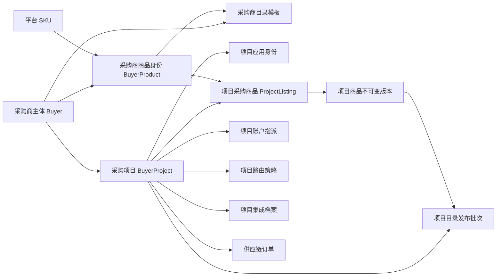

# 供应链中台采购商主体与采购项目详细设计

## 1. 文档定位

本文定义供应链中台的采购商主体、采购项目、项目应用认证、项目目录、项目结算价、项目账户指派、项目路由和项目集成边界。领域词汇以仓库根目录 `CONTEXT.md` 为准。

本文是采购商项目化的最新设计基线。与下列文档中“来源租户直接映射 Buyer”“Buyer 与商城租户一一对应”“BuyerListing 同时拥有商品身份和商业配置”“BuyerIntegrationProfile 每个 Buyer 唯一”等旧规则冲突时，以本文为准：

- `docs/superpowers/specs/2026-08-04-supply-chain-core-design.md`
- `docs/superpowers/specs/2026-08-07-supply-chain-phase1-detailed-design.md`
- `docs/superpowers/specs/2026-08-07-supply-chain-phase1-database-ddl.md`
- `docs/superpowers/specs/2026-08-11-saas-mall-supply-chain-integration-spec.md`
- `docs/superpowers/specs/2026-08-18-rtmart-instore-channel-design.md`

三级结算价、C 端销售价、平台售后与路由的**本期范围**以[《供应链中台 PRD 一期范围对齐》](./2026-09-12-supply-chain-prd-scope-alignment-design.md)为准；本文第 7 章与之冲突的旧口径，以及 08-28 对齐设计中的加价模板、四级路由配置组与 `PRICE_ASC`，均不作为本期实现或验收基线。

本文只规定目标模型，不承担历史业务数据迁移、旧调用方兼容或双写切换。数据库实现仍须使用可审计的 Liquibase 前向变更集，禁止静默修改已发布变更集校验和；具体发布步骤在实施计划中确定。

## 2. 背景与目标

现有 `Buyer` 同时承担组织主体、来源租户隔离、商品授权与价格、账户、路由、集成配置、订单幂等和用户作用域。该模型只能表达一个采购商对应一个接入项目，无法满足同一采购商主体下多个项目分别接入、分别配置商品、价格、账户和路由的业务要求。

目标模型必须同时满足：

1. 一个采购商主体维护一个稳定项目集，项目不能被伪装成第二个采购商。
2. 供应链中台只使用项目 `appId/appKey` 识别采购商侧调用，不使用 `sourceSystem + externalTenantId` 决定业务归属。`externalTenantId` 仍作为项目集成档案中的 SaaS 外部租户路由坐标保留。
3. RPC 与 HTTP 使用同一项目认证语义和同一业务幂等规则。
4. 采购商主体统一维护商品编码；项目独立发布可采购范围、展示名称和采购商结算价。
5. 项目可使用主体共享账户，也可使用项目专属账户；所有资金事实均可追溯到项目。
6. 标准商品供应商路由按项目配置和冻结，禁止跨项目回退。
7. 所有新订单、用户、事件和查询均按项目归属；O2O、到店购首期不增加项目商品、项目报价或项目路由。
8. 主体模板变化只有经过项目审批和发布才影响项目运行时目录。

## 3. 范围

### 3.1 本期范围

- 采购商主体与采购项目的 `1:N` 关系及生命周期。
- 项目应用身份、HMAC 签名、密钥轮换和防重放。
- 采购商商品身份、主体目录模板、项目目录模式、项目商品版本和原子发布批次。
- 项目结算单价和展示名称覆盖。
- 项目账户指派、项目资金归属和共享账户并发语义。
- 标准商品项目路由策略、候选冻结和审计。
- 标准商品、O2O、到店购的项目订单归属、项目用户作用域和项目集成档案。
- 项目级目录、订单、履约和资产查询隔离。
- 管理端启用门禁、配置发布、审计和自动化测试门禁。

### 3.2 明确不做

- 历史数据迁移、旧契约兼容、双读或双写。
- 项目预算、额度、虚拟子账户和项目余额。
- 财务账单、开票和项目对账。
- O2O、到店购项目级商品、报价或供应商路由。
- 跨项目用户合并或统一会员主键。
- RPC/HTTP 自动降级。
- 运行时动态合并主体模板与项目覆盖。
- 将项目转移到另一个采购商主体。

## 4. 统一领域模型



### 4.1 Buyer

`Buyer` 是稳定采购组织主体，拥有永久 `buyerCode` 和项目集合。Buyer 负责主体状态、主体级商品编码、主体目录模板、主体共享账户及统一管理视图，不直接作为采购商侧请求的认证身份。

Buyer 暂停时，其下所有项目停止新业务；历史查询、在途订单恢复、资金收敛和事件投递不停止。

### 4.2 BuyerProject

`BuyerProject` 是采购商下独立识别、接入和配置的采购单元，至少保存 `projectCode/projectName/buyerId/catalogMode/status/version`。`projectCode` 全局永久唯一，归档后不得复用；项目创建后不得修改 `buyerId`。

2026-09-27 起项目编号按所属分销商的三位内部短序号和该分销商内三位流水号生成；管理端草稿项目也不得更换归属。编码与存量兼容规则见[《供应链中台业务编码规范化设计》](./2026-09-27-supply-chain-business-code-design.md)。

项目状态为：

- `DRAFT`：配置中，不接受业务请求。
- `ACTIVE`：允许已开通能力的新业务。
- `SUSPENDED`：停止新业务，继续目录下架同步、历史查询、在途恢复和事件投递。
- `ARCHIVED`：永久停止新业务，历史事实和审计继续保留。

允许的状态转换为 `DRAFT→ACTIVE/ARCHIVED`、`ACTIVE↔SUSPENDED`、`SUSPENDED→ARCHIVED`；`ARCHIVED` 是终态。SUSPENDED 恢复 ACTIVE 时必须重新通过激活门禁。

项目可按场景开通 `STANDARD_PRODUCT/O2O/INSTORE` 能力。能力开通不改变公共订单模型，只决定项目激活门禁和允许调用的业务接口。

### 4.3 BuyerProduct

`BuyerProduct` 是采购商主体对一个 `PlatformSKU` 的稳定商品身份。它只保存主体统一的 `buyerSkuCode`、平台 SKU 关联和生命周期，不保存项目可采购状态、结算价、展示覆盖或供应商路由。

唯一约束为 `(buyerId, platformSkuId)` 与 `(buyerId, buyerSkuCode)`。同一 Buyer 下所有项目使用同一个 `buyerSkuCode`；不同项目不得为同一平台 SKU 创建别名编码。

### 4.4 ProjectListing

`ProjectListing` 表达项目是否获准采购一个 `BuyerProduct` 及其当前发布商业版本。唯一约束为 `(projectId, buyerProductId)`。

`ProjectListingVersion` 是发布时生成的不可变事实，固化：

- `buyerProductId/platformSkuId/buyerSkuCode` 快照；
- 最终可采购状态；
- 最终展示名称；
- `buyerSettlementUnitPrice/currency`；
- 来源模板版本；
- 商品授权来源：`INHERITED/PROJECT_OVERRIDE/PROJECT_EXCLUSION`；
- 价格和展示名称来源：`INHERITED/PROJECT_OVERRIDE`；
- 有效期、发布原因、审批人、发布时间和发布批次。

运行时只读取当前已发布 `ProjectListingVersion`，禁止在查询或下单时回退读取 Buyer 当前模板。

## 5. 项目应用身份与统一认证

### 5.1 身份解析

采购商侧请求的唯一业务身份解析链为：

```text
appId + keyVersion + request signature
→ ProjectApplicationIdentity
→ BuyerProject
→ Buyer
```

标准商品、O2O 和到店购的采购商侧接口均遵守该规则。ele.me、旅通等外部渠道调用中台时继续使用各自渠道协议身份；渠道身份不能冒充项目应用身份。

一个项目拥有一个稳定 `appId`。`appId` 全局唯一并永久绑定项目，不因密钥轮换而改变。`appKey` 是可轮换秘密材料，不是业务身份。

### 5.2 传输无关签名

RPC 元数据和 HTTP 请求头都必须传递：

```text
appId, keyVersion, contractVersion, operationCode,
timestamp, nonce, requestSha256, signature
```

HTTP path 和 RPC Interface 方法先映射为稳定 `operationCode`。每个 operationCode 定义一份封闭请求规范化器：HTTP path/query/body 与 RPC DTO 必须生成相同的 UTF-8 规范 JSON，`requestSha256` 是该字节序列的 SHA-256 小写十六进制值。签名串使用换行符依次连接上述字段，timestamp 使用 Unix 毫秒，nonce 使用 Base64URL；`signature` 是 HMAC-SHA256 结果的 Base64URL 值。业务 DTO 不参与选择项目。

业务 DTO 禁止出现可被调用方伪造的 `buyerId/projectId`。原 `sourceSystem/externalTenantId` 退出采购商侧业务身份契约，但不从集成模型中删除：它们由已认证项目的不可变 `BuyerIntegrationProfileVersion` 提供，只用于定位项目对应的 SaaS 商城租户和 Adapter，不能改变业务归属。

同一项目可以发布 RPC、HTTP 或两者；任一传输失败后中台不得自动切换另一传输。调用方跨传输重试必须复用原业务幂等键和相同请求正文。

### 5.3 密钥与防重放

- `appKey` 只保存 KMS/信封加密系统的秘密引用，不保存明文或可逆业务配置 JSON。
- 密钥版本状态为 `CURRENT/GRACE/REVOKED/EXPIRED`；一个应用最多一个 CURRENT 和一个短期 GRACE。
- 新密钥只在创建时显示一次；密钥轮换不改变 `appId`。
- 时间戳默认允许正负五分钟偏差，Nonce 在共享存储中按 `appId + nonce` 唯一。
- 防重放存储不可用时，RPC 与 HTTP 的读写请求全部失败关闭，禁止绕过 Nonce 校验继续处理。
- 未知 appId、错误 keyVersion、签名错误和重放对外统一返回认证失败，避免项目枚举。
- RPC 服务身份、mTLS 和 HTTP 网络层安全可以保留为纵深防御，但不能决定业务项目归属。

### 5.4 ProjectCallContext

验签 Adapter 构造可信 `ProjectCallContext`，至少包含：

```text
traceId, correlationId, causationId,
buyerId, buyerCode, projectId, projectCode,
appId, keyVersion, contractVersion, operationCode,
buyerUserId, orderNo
```

`buyerUserId/orderNo` 在不涉及用户或订单的调用中为空。应用层只消费该上下文，不重复解析认证字段。上下文在 RPC、HTTP、Outbox、Timer、采购商 Adapter 和供应商 Adapter 之间传播。

`ProjectCallContext` 不携带 `sourceSystem/externalTenantId`，避免把外部路由坐标再次升格为业务身份。当会员、收银台或事件 Adapter 需要外呼时，应用层按操作中固化的 `profileVersionId + capability` 解析可信 `BuyerIntegrationRoute`：

```text
projectId + profileVersionId + capability
→ sourceSystem + externalTenantId + adapter + contractVersion + credentialSetId
```

外呼 Port 命令同时携带 `projectId/profileVersionId` 和已解析的 `sourceSystem/externalTenantId`，便于校验、日志摘要与调用快照审计。Adapter 必须校验路由属于该项目和版本，不得接受调用方临时覆盖。

## 6. 主体目录模板与项目目录发布

### 6.1 目录模式

项目目录模式为：

- `MANAGED`：主体模板发布后，为项目生成待审批变更；未审批不生效。
- `INDEPENDENT`：项目从 BuyerProduct 集合中自行选择商品和商业配置，不接收主体模板变更。

目录模式变更只影响未来草稿来源，不修改当前已发布项目目录。模式切换必须形成审计记录；MANAGED 切换到 INDEPENDENT 后，当前发布结果作为项目初始独立配置保留。

### 6.2 主体模板

`BuyerCatalogTemplateItemVersion` 保存主体推荐的可采购状态、默认结算价、默认展示名称和有效期。主体模板发布不会修改 `ProjectListing.currentVersionId`，只为 MANAGED 项目生成 `ProjectCatalogRelease` 草稿。

项目可以对商品状态、价格和展示名称分别选择继承或覆盖，也可以显式排除商品。生成草稿时必须把模板与项目覆盖解析为完整、不可变的项目商品版本，不保留运行时动态表达式。

### 6.3 发布批次

`ProjectCatalogRelease` 状态为：

```text
DRAFT → PENDING_APPROVAL → PUBLISHED
                         ↘ REJECTED
DRAFT/PENDING_APPROVAL → CANCELLED
```

发布批次保存 `projectId/releaseNo/versionNo/baseCatalogVersion/targetCatalogVersion/origin/status`。`origin` 为 `TEMPLATE_PROPOSAL` 或 `PROJECT_MANUAL`。

一个批次可以包含多个 `ProjectCatalogReleaseItem`。DRAFT 项允许编辑解析后的建议值；进入 PENDING_APPROVAL 后，批次及全部 Item 冻结且不可修改。发布事务必须同时：

1. 校验项目未归档且处于 DRAFT、ACTIVE 或 SUSPENDED，且 `baseCatalogVersion` 未变化；SUSPENDED 发布只更新配置，不能恢复新业务。
2. 校验所有 BuyerProduct 属于项目的 Buyer，价格和有效期合法。
3. 写入不可变项目商品版本。
4. 更新相关 `ProjectListing.currentVersionId/status`。
5. 推进项目目录版本。
6. 追加每个商品的 `UPSERT/TOMBSTONE` 变更游标。
7. 创建项目目录 Outbox 事件。

任一步失败则整批回滚。基于旧目录版本的批次禁止发布，必须显式重新生成或解决冲突；主体再次发布不得静默覆盖既有项目草稿。

### 6.4 目录查询

项目目录查询由认证上下文决定 `projectId`。响应至少包含：

```text
buyerSkuCode, projectListingVersion, projectCatalogVersion,
platformSkuCode, displayName, fulfillmentType,
buyerSettlementUnitPrice, currency,
listingStatus, availabilityStatus, availabilityVersion
```

项目目录变更游标在项目范围内单调递增但允许有间隙。调用方持久化 `(appId, cursor)`，不得把一个项目的游标用于另一个项目。

供给可用性按 `ProjectListing + PlatformSKU + SupplierOffer + Connector + InventorySource` 计算。临时供给不可用只更新可重建投影，不修改项目人工发布状态。

项目从 ACTIVE 进入 SUSPENDED 或恢复 ACTIVE 时，追加一条 `PROJECT_STATUS_CHANGED` 项目目录游标并发送目录事件。采购商商城收到暂停事件后必须停止项目内所有新购买；暂停期间仍可拉取目录变化和历史结果。该事件不逐项改写 ProjectListing 人工发布状态。

## 7. 项目结算价与供应商路由

### 7.1 价格口径

`buyerSettlementUnitPrice` 表达项目成功采购一个计价单位后应向中台结算的 CNY 分值，不表达 C 端售价、采购商内部积分金额或供应商结算成本。标准商品的该值来自三级结算价解析结果（L3 > L2 > L1），必须写入已发布 `ProjectListingVersion`；来源层级与来源版本主键一并冻结。完整规则见[《供应链中台 PRD 对齐详细设计》](./2026-08-28-supply-chain-prd-alignment-design.md#5-三级-b-端结算价)。

项目结算单价必须大于等于零，币种一期固定为 CNY；负数、单位不明或未经项目发布的价格均不得受理。

标准商品受理时按已发布项目商品版本计算：

```text
buyerSettlementAmount = buyerSettlementUnitPrice × quantity
```

订单、资金预留和履约请求同时冻结项目商品版本、单价、数量和总金额。后续改价不能改变在途订单。

O2O、到店购首期不读取项目商品或项目报价，继续使用渠道金额规则：

```text
buyerSettlementAmount = channelPayAmount
```

C 端销售价本期来自平台 SKU `suggested_sale_price`（及商品行内调价），不建设加价模板或场景实时报价 API；不得写入上述冻结金额。范围口径见[《供应链中台 PRD 一期范围对齐》§5](./2026-09-12-supply-chain-prd-scope-alignment-design.md#5-销售价与分销价无模板)。

### 7.2 项目路由

标准商品 `SupplierRoutingPolicy` 以 `projectId` 为发布与冻结作用域。规则输入至少包含 `projectId/platformSkuId/quantity/occurredAt`，只能选择：

- 当前项目已发布且可采购的 ProjectListing；
- 有效 Supplier、SupplierOffer、Connector 和 InventorySource；
- 当前项目策略显式允许的候选。

四级配置组、综合排序与 `PRICE_ASC` 属于后续规划，本期不物化。标准商品继续使用现有静态优先级（`candidatePriority` → `supplierCode` → `offerId`，原因码 `SELECTED_BY_STABLE_PRIORITY`）；大润发与淘宝闪购不进入供应商路由，点餐模型本仓本期不实现。当前边界见[《供应链中台 PRD 一期范围对齐》§7](./2026-09-12-supply-chain-prd-scope-alignment-design.md#7-路由)。

同一 Buyer 的不同项目可对同一平台 SKU 发布不同供应商候选和优先级。无项目策略时不得回退读取其他项目策略；主体默认策略必须先物化并发布为项目自己的策略版本。

路由轮次冻结 `projectId/policyVersion/listingVersion/candidateOrder` 及所有供给快照。后续供应商失败只消费同一轮次中的下一候选，禁止跨项目回退、运行时重读策略或跨供应商拆量。

O2O 继续按渠道商户绑定固定 Supplier；到店购继续按 `company_code` 固定 Supplier。二者不读取项目路由策略。

## 8. 账户指派与资金边界

### 8.1 账户作用域

`BuyerAccount` 的账户作用域为：

- `BUYER_SHARED`：属于 Buyer，可被同一 Buyer 下多个项目共同指派。
- `PROJECT_EXCLUSIVE`：属于 Buyer，但唯一绑定一个项目。

共享账户只有一份真实余额和冻结金额，不为项目计算虚拟余额。需要严格资金隔离的项目必须使用专属账户。

一期继续允许透支：缺账户拒绝；可用余额不足不拒绝。项目预算、额度和余额门槛不在本文范围内。

### 8.2 ProjectAccountAssignment

项目按币种发布版本化账户指派。当前有效指派必须唯一，并满足：

- 项目与账户属于同一 Buyer；
- 共享账户可被同 Buyer 多项目使用；
- 专属账户只允许其唯一项目使用；
- 新指派只影响新订单；在途资金事实继续使用原账户与指派版本；
- 存在剩余冻结或在途恢复的旧账户不能因项目换账户而关闭。

账户指派版本发布后不可修改；变更账户只能创建并发布更高版本。订单和资金预留必须保存实际使用的指派版本主键，而不是运行时查询“当前账户”。

### 8.3 资金事实

标准商品、O2O 和到店购的 `FundReservation`、账户流水和资金审计都固化 `buyerId/projectId/accountId/accountAssignmentVersion`。标准商品额外固化 `projectListingVersion`。

使用共享账户时，并发 CAS 和唯一账本仍以真实 `accountId` 串行保证资金不变量；`projectId` 是归属与查询维度，不拆分余额写模型。

## 9. 订单、用户与幂等

### 9.1 订单归属

所有新 `SupplyChainOrder` 必须保存：

```text
buyerId, buyerCode/name snapshot,
projectId, projectCode/name snapshot,
buyerUserId, orderType,
buyerSettlementAmount, currency
```

标准商品订单额外保存 BuyerProduct、ProjectListing 及版本快照；O2O、到店购不保存项目商品价格或项目路由。

`buyerUserId` 的唯一解释范围是 `(projectId, buyerUserId)`。订单、履约资产、O2O 渠道用户绑定、到店购授权凭证和会员转发都必须同时验证 projectId。`externalTenantId` 不参与中台业务唯一键；对 SaaS 商城外呼时，中台通过已固化的项目集成档案把 `(projectId, buyerUserId)` 翻译为 `(sourceSystem, externalTenantId, buyerUserId)`。`buyerUserId` 全程为不透明字符串，禁止转换为 `Long`。

### 9.2 永久幂等

标准商品受理回执和订单永久幂等键为 `(projectId, buyerOrderNo)`。同一 `buyerOrderNo` 可存在于不同项目；同一项目内：

- 同键同请求摘要返回原回执和订单；
- 同键不同摘要返回 `IDEMPOTENCY_CONFLICT`；
- RPC 与 HTTP 重试命中同一幂等事实；
- 修正业务请求必须生成新的 `buyerOrderNo`。

O2O、到店购既有渠道级永久键保持不变，但订单归属和用户校验增加 projectId；同一渠道永久键若解析到不同项目必须失败关闭，不得产生第二张订单。

### 9.3 失败边界

- 未知 appId、签名错误或重放：认证拒绝，不创建订单。
- Buyer 非 ACTIVE、Project 非 ACTIVE 或场景能力未开通：新业务命令边界拒绝，不创建订单；SUSPENDED 项目的目录变化、历史订单、回执、履约结果和资产查询继续允许。
- 项目已解析且请求结构有效后，项目商品未授权、版本过期、价格非法、账户未配置或路由无候选：创建该项目下 FAILED 标准商品订单，不创建履约请求、SupplierOrder 或资金事实。
- 已受理订单不因项目暂停、密钥撤销、改价、换账户、改路由或修改集成档案而改变；恢复任务使用冻结快照继续收敛。

## 10. 接口与事件契约

### 10.1 采购商侧业务接口

业务 DTO 不传项目或主体身份。统一认证 Adapter 在调用 Facade 前构造 ProjectCallContext。

- `BuyerCatalogQueryApi`：按项目查询全量和增量目录。
- `BuyerFulfillmentCommandApi`：按项目受理标准商品履约。
- `BuyerFulfillmentQueryApi`：按项目查询回执、履约结果和资产。
- `BuyerSupplyChainOrderQueryApi`：按项目查询订单列表和详情。
- `BuyerO2OEntryApi`、`BuyerO2OPaymentCallbackApi`：按项目认证、建单和校验所有权。
- 到店购采购商侧入口、收银台回调和会员转发 Port：按项目认证和归属。

采购商管理后台的跨项目查询是独立管理能力，必须按内部管理权限校验 Buyer 范围，不能复用项目 OpenAPI 绕过隔离。

### 10.2 项目集成档案

每个 Project 唯一拥有一个 `BuyerIntegrationProfile`，通过不可变版本为 `MEMBER_PROFILE/CASHIER/ORDER_EVENT/FULFILLMENT_EVENT/CATALOG_EVENT` 等能力发布 RPC、HTTP 或两者的 Adapter 配置。

`MEMBER_PROFILE` 和 `CASHIER` 能力的发布版本必须显式保存 `sourceSystem/externalTenantId`。两个能力可以共用同一 SaaS 租户路由，但仍分别发布和固化，禁止从 `projectId` 字面值、`buyerUserId` 或请求 DTO 拼接/推导 `externalTenantId`。一个 SaaS 租户可以为多个项目提供能力，但外部租户相同不代表项目业务归属可合并。

业务操作或 Outbox 创建时冻结 `projectId/profileVersionId/capability/transport/adapter/contractVersion/credentialSetId`；调用快照额外记录脱敏的 `sourceSystem/externalTenantId` 摘要供排障审计。配置发布不得改变在途操作。一个项目投递失败不能阻塞同 Buyer 的其他项目。

### 10.3 事件

目录、订单和履约事件固化 `buyerId/projectId/projectCode/integrationProfileVersion`。对外事件包含稳定 `projectCode`，不暴露内部 projectId。目录事件携带项目目录版本和最新游标。

事件消费者必须按 `eventId` 去重，并验证事件 projectCode 与接收端项目一致。敏感履约资产不进入事件，继续通过项目所有权和独立权限保护的资产查询返回。

## 11. 主要业务流程

### 11.1 项目创建与激活

1. 在 ACTIVE Buyer 下创建 DRAFT Project，生成永久 projectCode。
2. 创建全局唯一 appId 和首个 CURRENT appKey 版本；appKey 只显示一次。
3. 发布项目集成档案和账户指派。
4. 按开通场景完成配置：标准商品需项目目录与路由；O2O 需收银台能力；到店购需收银台能力和渠道项目应用标识。
5. 执行激活校验，全部通过后将项目置 ACTIVE。
6. 记录配置摘要、操作者、原因和 traceId。

项目不能通过直接更新状态绕过激活校验。

### 11.2 标准商品受理

```text
RPC/HTTP Adapter 验签
→ appId 解析 Project 与 Buyer
→ 校验主体、项目和场景能力
→ 命中项目级永久幂等回执
→ 校验 ProjectListing 与版本
→ 解析 ProjectAccountAssignment
→ 执行项目路由并冻结候选
→ 短事务创建订单、履约请求、资金预留、路由事实和 Outbox
→ 异步执行供应商履约
```

任何网络库存、供应商余额或健康检查不得位于数据库事务内。短事务开始后必须重验静态版本和项目状态，避免使用过期配置。

### 11.3 主体模板变更

1. 主体发布 BuyerCatalogTemplateItemVersion。
2. 系统只为 MANAGED 项目生成 TEMPLATE_PROPOSAL 草稿。
3. 项目查看解析后的完整商品、价格和展示变化。
4. 项目批准后原子发布；拒绝或未处理不影响当前目录。
5. 每个成功发布的项目独立产生目录版本、游标和事件。

### 11.4 密钥轮换

1. 为同一 appId 创建新 keyVersion 和 appKey，置为 CURRENT。
2. 原 CURRENT 降为 GRACE，并设置明确到期时间。
3. 宽限期内两版本均可验签，认证审计记录实际 keyVersion。
4. 到期或人工撤销后旧版本立即拒绝；在途订单和事件不受影响。

## 12. 模块边界与目标数据模型

### 12.1 深模块职责

| 模块 | 核心职责 |
| --- | --- |
| `tradecore.buyer` | Buyer、BuyerProject、项目能力、项目应用身份和项目状态。 |
| `tradecore.catalog` | BuyerProduct、主体模板、ProjectListing、发布批次、目录游标和可用性。 |
| `tradecore.account` | BuyerAccount、项目账户指派和资金预留。 |
| `routing` | 项目路由策略、规则、路由轮次和候选审计。 |
| `integration.buyer` | 项目集成档案、Adapter 解析、调用快照和脱敏审计。 |
| `order` | 项目订单总表、受理回执、订单状态和公共查询。 |
| `border.o2o` / `border.instore` | 带项目归属的场景详情、用户绑定和退款协同。 |
| `infrastructure.security` | RPC/HTTP 统一验签、Nonce 防重放、凭证访问和认证限频审计。 |

模块只能通过公开的 Application/Domain Interface 协作，禁止跨模块访问 Mapper、DO 或内部实现。认证 Adapter 不得编排业务；order 不直接读取项目凭证、目录 Mapper、账户 Mapper或路由 Mapper。

### 12.2 目标表及主要约束

| 表 | 主要职责和硬约束 |
| --- | --- |
| `sc_buyer_project` | Buyer 项目集合；projectCode 全局唯一，buyerId 创建后不可变。 |
| `sc_project_capability` | 项目开通场景；`(projectId, capabilityCode)` 唯一。 |
| `sc_project_application` | 项目稳定 appId；projectId 与 appId 分别唯一。 |
| `sc_project_app_credential_version` | appKey 秘密引用和轮换状态；`(applicationId, keyVersion)` 唯一，最多一个 CURRENT 和一个 GRACE。 |
| `sc_buyer_product` | 主体统一商品身份；Buyer+PlatformSKU、Buyer+buyerSkuCode 分别唯一。 |
| `sc_buyer_catalog_template_item` | 主体模板稳定商品项；`(buyerId, buyerProductId)` 唯一。 |
| `sc_buyer_catalog_template_item_version` | 主体推荐商业配置不可变版本。 |
| `sc_project_listing` | 项目商品稳定身份；`(projectId, buyerProductId)` 唯一。 |
| `sc_project_listing_version` | 项目最终解析商业配置不可变版本。 |
| `sc_project_catalog_release` | 项目原子发布批次；`(projectId, versionNo)` 唯一。 |
| `sc_project_catalog_release_item` | 批次内解析后的项目商品建议值及来源；`(releaseId, projectListingId)` 唯一，不维护逐项审批结果。审批结论只属于整个发布批次。 |
| `sc_project_catalog_change` | 项目目录增量日志；按 `(projectId, id)` 查询游标。`PROJECT_STATUS_CHANGED` 记录的 listingId 为空。 |
| `sc_buyer_account` | 共享或项目专属真实资金账户；专属账户只能关联同 Buyer 的一个项目。 |
| `sc_project_account_assignment` | 项目账户指派版本；项目+币种当前有效指派唯一。 |
| 路由策略相关表 | 增加必填 projectId，发布和匹配范围均为项目。 |
| 项目集成档案相关表 | profile 改为 projectId 唯一，不再以 buyerId 唯一；能力发布版本保留 SaaS `sourceSystem/externalTenantId` 路由坐标。 |
| 订单、回执、资金和场景表 | 新业务全部增加必填 projectId，并校验 Buyer 归属一致。 |

金额继续使用 CNY 分和非负发生额；时间使用 `Asia/Shanghai` 语义的 `DATETIME(3)`；表间继续使用逻辑引用而非物理外键。统一时间约定见 [供应链数据库本地时间统一设计](2026-09-04-supply-chain-database-local-time-design.md)。

## 13. 错误、安全与日志

### 13.1 稳定错误分类

至少定义下列稳定分类，具体数值在实施计划中从供应链错误码段分配：

| 分类 | 是否创建订单 | 语义 |
| --- | --- | --- |
| `PROJECT_AUTHENTICATION_FAILED` | 否 | 未知 appId、签名/keyVersion/时间戳/Nonce 任一失败的统一外部结果。 |
| `BUYER_DISABLED` | 否 | 项目所属 Buyer 不允许新业务。 |
| `PROJECT_NOT_ACTIVE` | 否 | 项目未激活、暂停或归档，不能受理新业务；允许的历史和目录查询不返回此错误。 |
| `PROJECT_CAPABILITY_NOT_ENABLED` | 否 | 项目未开通当前场景。 |
| `PROJECT_LISTING_NOT_PURCHASABLE` | 是，标准商品 | 项目未授权或已下架商品。 |
| `PROJECT_LISTING_VERSION_CONFLICT` | 是，标准商品 | 调用方商品版本不是当前已发布版本。 |
| `PROJECT_ACCOUNT_NOT_ASSIGNED` | 是，标准商品 | 项目没有当前有效账户指派。 |
| `PROJECT_ROUTING_NOT_AVAILABLE` | 是，标准商品 | 项目策略未发布或无有效候选。 |
| `PROJECT_OWNERSHIP_CONFLICT` | 不新建订单；已有订单转人工 | 订单、用户、渠道永久键或事件归属到不同项目。 |

认证失败不得暴露 appId 是否存在。身份已解析后的所有权冲突必须记录安全事件；高频攻击和重放按 appId、来源和错误分类限频或聚合，避免日志风暴。

### 13.2 日志与秘密

- 采购商侧入口日志记录 `appId/projectCode/operationCode/buyerOrderNo/buyerSkuCode/traceId`。
- `buyerUserId`、履约目标、Nonce 全量、appKey、签名串、密钥引用和原始敏感报文禁止写日志。
- 第三方调用继续记录脱敏请求摘要、响应分类、错误码和耗时，不记录完整凭证或资产。
- 密钥创建、轮换、撤销、项目状态、目录发布、账户指派、路由和集成发布都写不可变审计。

## 14. 管理端门禁

管理端按职责拆分为：项目管理、项目能力、应用凭证、主体商品与模板、项目目录审批、账户指派、项目路由、项目集成发布。禁止用一个任意 JSON 的“采购商配置”接口覆盖全部领域。

项目激活至少检查：

- Buyer 为 ACTIVE；
- appId 唯一且存在 CURRENT 凭证；
- 存在有效账户指派；
- 项目集成档案已发布；
- STANDARD_PRODUCT：至少一个已发布 ProjectListing 和有效项目路由策略；
- O2O：收银台能力已发布；
- INSTORE：收银台能力及渠道项目应用标识已发布。

激活校验返回封闭检查项和稳定原因码，不允许通过直接更新数据库绕过。

## 15. 测试与发版门禁

### 15.1 `*Test`

- BuyerProject 状态机和主体暂停传播规则。
- MANAGED/INDEPENDENT 目录模式、继承、覆盖、排除和模式切换。
- ProjectCatalogRelease 状态机、基线版本冲突和完整解析。
- HMAC 规范串、RPC/HTTP operationCode 一致性、密钥轮换状态。
- 项目账户选择、金额乘法和 FundReservation 不变量。
- 项目路由规则匹配、稳定排序和禁止跨项目回退。

### 15.2 `*IntegrationTest`

使用真实 MySQL、Liquibase、Mapper、事务和锁验证：

- appId、projectCode、BuyerProduct、ProjectListing 和当前版本唯一约束；
- 项目目录批次多商品原子发布、游标和 Outbox 同事务；
- 同 Buyer 两项目使用不同价格、路由和账户；
- 共享账户多项目并发冻结和项目流水归属；
- 项目换账户后新旧订单分别使用正确指派版本；
- 同项目同 buyerOrderNo 并发只产生一份事实，不同项目相同业务号互不冲突；
- 相同 buyerUserId 在不同项目的订单、资产和渠道绑定完全隔离；
- 两个项目共用同一 `externalTenantId` 时，会员、订单、幂等和资金事实仍按 projectId 隔离；
- 集成档案发布新 `externalTenantId` 后，新操作使用新版本，在途支付、退款和 Timer 恢复仍按已固化旧版本外呼；
- 项目暂停不影响其他项目，在途 Timer/Outbox 继续收敛；
- 密钥 CURRENT/GRACE/REVOKED 与 Nonce 并发防重放。

### 15.3 `*ContractTest`

- HTTP 与 RPC 使用同一规范认证字段、operationCode 和错误映射。
- 跨传输同业务键重试返回同一回执。
- 采购商侧业务 DTO 不再携带 `sourceSystem/externalTenantId/buyerId/projectId`。
- 出站会员与收银台 Port 合同同时携带已认证 `projectId/profileVersionId` 与档案解析出的 `sourceSystem/externalTenantId`，且 `buyerUserId` 为不透明字符串。
- 目录、订单、履约和资产响应不泄漏其他项目数据。
- O2O、到店购采购商侧接口使用项目身份，但不读取项目商品、价格或路由。

### 15.4 `*ArchitectureTest`

- `tradecore.catalog/account`、`routing`、`order`、`integration.buyer` 和场景模块不跨模块访问 Mapper。
- RPC/HTTP Adapter 只完成传输、验签、DTO 映射和上下文构造，不编排业务。
- order 模块不读取项目凭证和账户表，routing 不访问数据库，场景模块不写订单总表 Mapper。

### 15.5 人工联调

联调前置条件、RPC/HTTP 签名、项目创建、密钥发放、目录审批、账户指派、项目路由及跨项目隔离步骤维护在 `docs/集成测试.md`，不替代自动化门禁。

## 16. 关键验收场景

1. Buyer A 下 P1、P2 采购同一 buyerSkuCode，分别使用不同项目结算价、路由和账户。
2. P1、P2 使用相同 buyerOrderNo 分别成功创建订单；P1 内跨 RPC/HTTP 重试只回放原订单。
3. 相同 buyerUserId 在 P1、P2 表示不同用户，订单、履约资产、O2O 绑定和到店购凭证不能互查。
4. 主体模板改价后，P1 批准、P2 未批准，只有 P1 的目录版本、游标和价格变化。
5. 多商品目录批次任一项冲突时全部不发布，不产生半批目录事件。
6. P1 暂停后拒绝新标准商品、O2O 和到店购业务；P2 不受影响，P1 在途订单继续恢复。
7. P1、P2 共享账户并发冻结时唯一账本保持原子一致，每笔资金事实保存正确 projectId。
8. 项目切换到账户 B 后，新订单使用 B，旧订单的提交、释放和退款仍使用账户 A。
9. 密钥轮换宽限期内新旧 keyVersion 均可验签；撤销后旧版本失败且不能枚举 appId。
10. O2O、到店购使用项目认证和账户指派，但金额仍来自渠道，Supplier 仍由渠道绑定确定。

## 17. 已确认决策摘要

- Buyer 是采购商主体并维护项目集，BuyerProject 是完整接入和采购边界。
- 供应链中台对采购商侧只认项目 appId/appKey；RPC 与 HTTP 统一认证。
- BuyerProduct 统一商品编码，ProjectListing 拥有项目可采购范围、展示名称和结算价。
- 支持 MANAGED 与 INDEPENDENT 项目目录；主体模板变化须经项目审批。
- 项目可使用主体共享账户或项目专属账户，首期不做预算、额度和对账。
- 标准商品路由按项目配置；O2O、到店购首期不做项目商品、价格和路由。
- 所有新订单、用户、资金事实、事件和查询都固化项目归属。
- `projectId` 决定业务归属；`externalTenantId` 保留为项目集成档案中的 SaaS 路由坐标，只能由已固化档案版本解析。
- 会员业务作用域为 `(projectId, buyerUserId)`；外呼 SaaS 时转换为 `(sourceSystem, externalTenantId, buyerUserId)`，`buyerUserId` 禁止转 `Long`。
- 本次不考虑历史数据迁移和旧调用方兼容。
