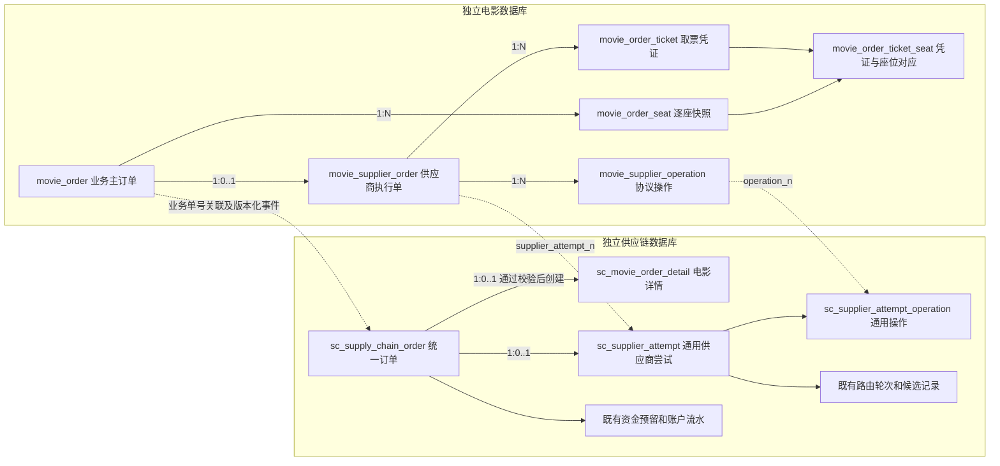

# 电影订单双端落库与独立表结构设计

> 日期：2026-09-17。状态：订单与履约结构设计；尚未实施数据库迁移或订单代码。
> 依据：用户要求电影子系统与中台均落订单，电影订单不得使用 `trade_order` 及商城关联表；参考 [履约时序图](../../images/movie_fulfillment_sequence_diagram.png)。
> 本文取代 [原详细设计](../../电影子系统与中台履约详细设计.md) 中商城承载电影订单、`trade_order_movie`、`mallOrderNo` 和商城订单处理器的方案。供给六表、排期同步及物理验座规则继续有效。订单每单只路由一次，明确失败直接终结，不做失败补偿或换供应商。

## 1. 设计结论与边界

1. **电影库必须有独立的 `movie_order`**：保存业务订单身份、用户、影片/影院/场次快照、购票数量、金额和中台状态投影。不能只有供给数据或供应商接口日志。
2. **中台必须有对应的 `sc_supply_chain_order`**：保持全场景统一订单入口，新增 `MOVIE` 类型；通过业务校验进入履约后创建一对一 `sc_movie_order_detail`，前置业务失败按既有内核保留失败总单。不能另建绕过总表的电影采购总订单。
3. 两边通过 `movie_order_no` 和 `middle_order_no` 关联；一张电影单最多对应一张中台总单。中台暂未受理或边界最终拒绝时允许电影订单单独存在，不能因此再生成一个订单号。可信项目身份已解析后的业务失败仍返回失败中台总单及原回执。
4. JC/JY 是实际供应商。电影子系统保存本地供应商执行单，中台保存供应商尝试及资金事实，两者职责不同；供应商尝试必须在外呼前落库，不能成功出票后才补单。
5. 电影库的 `order_status` 是业务展示状态，其中履约部分来自中台裁决；电影协议结果是执行事实，不能绕过中台自行认定整体成功、采购资金释放或换渠道。
6. 不创建、不读写、不外键关联 `trade_order`、`trade_order_item`、`trade_order_movie`、商城售后表，也不引入已删除的 mall/trade/promotion/pay 模块。

### 1.1 已确认的系统资金边界

**用户支付、积分扣减及面向用户的原路退款不在整个 supply-hub 系统内实施**，不是电影子系统与中台之间待分配的职责。电影订单不等待用户支付通知，不建支付单、积分流水、用户退款单，不设置待支付状态、支付截止、支付对账窗口或迟到支付补偿。

本设计按以下中台文档对齐：

- [多场景概要设计第 3 节](../../供应链中台多场景概要设计.md#3-调用关系与时序)：中台管采购订单、采购资金、供应商和统一状态，用户收款在采购方系统。
- [一期详细设计第 3.5、6 章](2026-08-07-supply-chain-phase1-detailed-design.md)：受理即进入 B 端履约，订单、资金预留、尝试和事件在本地事务提交；trade-core 是采购账户唯一写入者。
- [一期账户透支规则](2026-08-17-supply-chain-phase1-buyer-account-overdraft.md)：缺账户拒绝，可用余额不足不拒绝，允许透支冻结与扣减。
- [采购商主体与采购项目设计](2026-08-21-supply-chain-buyer-project-design.md)：按项目认证、订单及用户归属、账户指派处理，不能把 Buyer 与项目混为一体。
- [PRD 一期范围](2026-09-12-supply-chain-prd-scope-alignment-design.md)：没有电影定价模板；本次为用户指定的电影订单增量设计，不顺带实现已裁掉的模板或改变 CARD/O2O/INSTORE 流程。

电影提单表示采购方发起履约指令；其用户收款前置如何完成由采购方自行负责，本系统不接收支付事实作为出票门槛。中台受理并冻结采购资金后，下发锁座；锁座权威成功后，立即安排同一供应商的确认出票。采购冻结额是采购商结算额，不能用用户售价或供应商成本直接替代。

成功 COMMIT、权威明确失败直接 FAILED 并 RELEASE、未知结果保留预留并查单。失败不触发主动解锁、重新下单、补发、重试供应商或重新路由。这里的 RELEASE 是采购资金释放，不是用户退款。既有 O2O/INSTORE 的外部收银通知和退款协同只协调外部事实，本次不删除这些已有能力，也不把它们复制到电影流程。

## 2. 数据关系与落库时点

跨库线全部是逻辑关联，禁止跨库 JOIN、数据库外键、共享事务或扫描另一进程实现包。电影子系统不能读取中台资金表，中台不能读取电影表。

| 时点 | 电影库本地事务 | 中台库本地事务 |
| --- | --- | --- |
| 验座报价 | 保存不可变报价批次、候选及提交 Outbox | 幂等接收报价回执及候选；不冻结资金、不创建供应商尝试 |
| 采购方确认提单 | 创建 `movie_order`、全部 `movie_order_seat`、提交命令 Outbox，状态 `SUBMITTING` | 尚未受理时允许暂时无中台订单 |
| 中台受理 | 根据回执回填中台单号；响应丢失按电影单号查询 | 同一事务写受理回执、总单、电影详情、冻结路由、首个尝试、锁座操作、资金预留及 Outbox |
| 供应商外呼前 | 命令 Inbox、供应商执行单及协议操作先提交 | 中台已存在订单、尝试、操作和资金预留 |
| 锁座成功 | 保存权威锁座事实并投递结果 | 消费结果后以 CAS 推进 ISSUING，创建 CONFIRM_ISSUE 和 Outbox，不等待用户支付 |
| 出票结果 | 结果/凭证/操作版本与结果 Outbox 同事务提交 | 消费结果 Inbox，更新尝试、详情、总单、采购账本和通知 Outbox |
| 对用户展示结果 | 按中台版本更新投影，成功且凭证齐备后展示取票信息 | 保留采购结算、失败证据及唯一履约裁决 |

表中所有 HTTP/RPC/供应商调用均在事务外；Outbox 允许可靠投递重试。接收方先查原操作记录，已失败仅返回原失败，已调用但结果未知只查供应商原单，不能把消息重投变成重复锁座或出票。

## 3. 字段与约束的统一约定

- 以下为物理字段设计；表格中 `?` 表示允许 NULL，未标 `?` 的字段非空。`UK` 为唯一索引，`IDX` 为普通索引。未列默认值的业务字段必须显式写入，不能默认为成功或零成本。
- 新表统一 `id BIGINT` 自增主键。除明确追加式快照/关联表外，统一 `created_at DATETIME(3)`、`updated_at DATETIME(3)`、`version BIGINT DEFAULT 0`。时间存储使用 `Asia/Shanghai`，与中台已执行的 `022-database-local-time.sql` 一致；RPC 使用带偏移的 ISO 8601，Mongo Instant 保持其现有语义，禁止裸时间混用。
- 业务编码、外部单号、幂等号使用区分大小写的二进制排序规则；所有永久唯一键不含逻辑删除列。交易表不物理删除，不复用订单号；归档后仍保留幂等身份。
- `buyer_id BIGINT` 是采购商主体，`project_id BIGINT` 是采购项目；二者按已认证的项目 appId/appKey 恢复，不由前端指定。`buyer_user_id VARCHAR(128)` 是项目范围内用户的不透明标识，不能转 Long 或当 `member_user.id` 联表。订单、报价、用户查询均核对 project_id；项目指派的共享或专属采购账户由中台解析并冻结引用。
- `source_system VARCHAR(32)` 只作接入来源审计，不参与认证或替代项目身份；`source_order_no VARCHAR(128)` 是项目范围内永久幂等号。同项目更换接入应用或 RPC/HTTP 仍命中原单，相同幂等键且摘要不同返回冲突。
- 电影金额存 `DECIMAL(18,2)`，单位人民币元，Java 使用 `BigDecimal`；中台金额存 `BIGINT`，单位人民币分，精确换算并校验非负及溢出。已确认成本允许 NULL 表示未知，禁止用 0 冒充未知。不能用供应商总成本除票数伪造逐座价格。
- 快照不跟随影片改名、影院停用、排期 TTL、接入配置更新而改变。供应商私有 ID、连接账号和恢复参数固化在执行上下文中，不依赖 Mongo 排期长期存活。
- 手机号及取票码采用密文、密钥版本和脱敏值；检索使用 HMAC 指纹，不能对低熵手机号直接做普通 SHA-256。中台只保留完成编排必要的受控引用，业务日志禁止明文凭证。
- 状态、错误码、场景、操作类型统一封闭枚举，DDL COMMENT 与后续 DTO 字段中文注释保持一致；关键方法链接本文对应章节。

## 4. 电影库订单表

### 4.1 `movie_order`：电影业务主订单

一单对应一个确定场次和一组确定座位。修改场次或座位属于重新报价和新业务提交，不允许覆盖原订单快照。

| 字段 | 类型 | 语义 |
| --- | --- | --- |
| movie_order_no | VARCHAR(64) | 电影业务订单号，全局唯一 |
| buyer_id / project_id / buyer_user_id | BIGINT / BIGINT / VARCHAR(128) | 采购商主体 / 采购项目 / 项目范围内用户标识 |
| source_system / source_order_no | VARCHAR(32) / VARCHAR(128) | 接入应用编码 / 接入方永久幂等订单号 |
| request_digest | BINARY(32) | 提单不可变字段规范化摘要 |
| quote_batch_no | VARCHAR(64) | 本单消费的不可变报价批次号 |
| middle_order_no | VARCHAR(32)? | 中台总订单号，受理前为空 |
| middle_version | BIGINT DEFAULT 0 | 已应用的中台订单事件版本 |
| middle_snapshot_digest | BINARY(32)? | 已应用中台快照摘要，用于识别同版本异内容 |
| order_status | VARCHAR(32) | 业务展示状态，见第 7 节 |
| ticket_delivery_status | VARCHAR(32) | NONE 无交付、PENDING 凭证待齐、READY 可取票、MANUAL_REQUIRED 待人工核实 |
| submission_status | VARCHAR(32) | SUBMITTING 待受理回执、ORDER_CREATED 中台已建单、REJECTED_FINAL 边界最终拒绝；超时保持 SUBMITTING |
| film_id / film_code / film_name | BIGINT / VARCHAR(32) / VARCHAR(128) | 影片 ID、标准编码和名称快照 |
| poster_url / film_type | VARCHAR(512)? / VARCHAR(64)? | 海报及语言制式快照 |
| cinema_id / cinema_code / cinema_name | BIGINT / VARCHAR(32) / VARCHAR(128) | 影院 ID、标准编码和名称快照 |
| cinema_address / hall_name | VARCHAR(256)? / VARCHAR(128) | 影院地址和影厅名称快照 |
| show_group_id | VARCHAR(64) | 逻辑场次聚合标识，不作为物理座位一致性证明 |
| show_time / close_time | DATETIME(3) / DATETIME(3)? | 开场时间 / 散场时间快照 |
| ticket_count | INT | 购票座位数，必须大于零 |
| standard_sale_amount_yuan | DECIMAL(18,2) | 提单时电影标准人民币总价快照 |
| buyer_settlement_amount_yuan | DECIMAL(18,2)? | 中台确认的采购商结算总额投影，受理前可为空 |
| currency | CHAR(3) | CNY |
| mobile_ciphertext / mobile_key_version | VARBINARY(512) / VARCHAR(64) | 取票手机号密文 / 密钥版本 |
| mobile_hmac / mobile_masked | BINARY(32) / VARCHAR(32) | 取票手机号检索指纹 / 脱敏展示值 |
| current_supplier_attempt_no | VARCHAR(32)? | 当前中台供应商尝试编号投影 |
| lock_expires_at | DATETIME(3)? | 外部锁座截止的中台投影，非用户支付截止 |
| failure_code / failure_message | VARCHAR(64)? / VARCHAR(512)? | 稳定失败码 / 脱敏失败说明 |
| completed_at | DATETIME(3)? | 业务进入终态时间 |

索引：`UK(movie_order_no)`、`UK(project_id, source_order_no)`、`UK(quote_batch_no)`、`UK(middle_order_no)`；`IDX(project_id, buyer_user_id, created_at, id)`、`IDX(project_id, order_status, created_at, id)`、`IDX(submission_status, updated_at, id)`、`IDX(project_id, mobile_hmac)`。

约束：金额非负；`middle_version >= 0`；ORDER_CREATED 必须有中台单号，既可对应处理中，也可对应业务失败的总单；REJECTED_FINAL 必须有拒绝原因且无中台单号；只有中台已裁决 ISSUED 且全部座位有有效凭证覆盖时才能置 ticket_delivery_status=READY。报价只可绑定一张本地业务订单，失败后重新选座产生新报价批次。用户实际支付金额、积分数量不进入本系统表结构，不能写入标准价或采购结算额。

### 4.2 `movie_order_seat`：逐座不可变快照

字段：`movie_order_id BIGINT`、`seat_sequence INT`、`physical_seat_key VARCHAR(128)`、`physical_row VARCHAR(32)`、`physical_column VARCHAR(32)`、`seat_name VARCHAR(64)`、`area_name VARCHAR(64)?`、`standard_sale_amount_yuan DECIMAL(18,2)?`、`created_at DATETIME(3)`，加统一主键；不设可变状态或 version。

`physical_seat_key` 由报价时的物理座位映射生成；保留原始行列文本，不能把“5排8座”显示文字直接当供应商 seatId。逐座标准价仅在报价提供真实分项时保存，否则为空，主单总价仍必须确定。

索引：`UK(movie_order_id, seat_sequence)`、`UK(movie_order_id, physical_seat_key)`。行数等于主单 `ticket_count`，同一事务校验。**不建立跨订单的场次+座位唯一键**：失败后允许重新购票，实际占座由供应商及锁座恢复机制判断。

### 4.3 `movie_supplier_order`：供应商执行单

| 字段 | 类型 | 语义 |
| --- | --- | --- |
| movie_order_id / middle_order_no | BIGINT / VARCHAR(32) | 本地订单主键 / 中台总订单号 |
| supplier_attempt_no / attempt_sequence | VARCHAR(32) / INT | 中台供应商尝试编号 / 尝试顺序 |
| supplier_code | VARCHAR(32) | 中台指定的实际供应商编码，例如 JC、JY |
| connector_account_ref / config_version | VARCHAR(64) / VARCHAR(64) | 报价时冻结的供应商账号引用 / 配置版本 |
| supplier_request_no | VARCHAR(64) | 本次尝试发给供应商的稳定请求号 |
| external_order_no | VARCHAR(128)? | 供应商外部订单号，受理前可为空 |
| quote_candidate_no | VARCHAR(64) | 本次尝试使用的报价候选编号 |
| execution_context_ciphertext / context_key_version | LONGBLOB / VARCHAR(64) | 原始场次、影院、逐座映射、票种及恢复上下文密文 / 密钥版本 |
| context_schema_version / context_digest | INT / BINARY(32) | 执行上下文版本 / 摘要 |
| expected_cost_yuan / reported_cost_yuan | DECIMAL(18,2) / DECIMAL(18,2)? | 报价预计总成本 / 供应商报告总成本 |
| execution_status | VARCHAR(32) | ACCEPTED、LOCKING、LOCKED、ISSUING、ISSUED、FAILED、RESULT_UNKNOWN、MANUAL_REQUIRED |
| lock_expires_at / issued_at | DATETIME(3)? / DATETIME(3)? | 权威锁座截止时间 / 出票时间 |
| outcome_code / failure_code | VARCHAR(64)? / VARCHAR(64)? | 标准执行事实 / 稳定失败码 |

索引：`UK(supplier_attempt_no)`、`UK(movie_order_id)`、`UK(supplier_code, connector_account_ref, supplier_request_no)`、`UK(supplier_code, connector_account_ref, external_order_no)`、`IDX(execution_status, updated_at, id)`。外部单号禁止空字符串，NULL 表示未知。

供应商凭证不能复制到订单上下文；只保存可恢复的版本引用，历史配置按订单保留策略可解析。一个电影订单最多一张供应商执行单，attempt_sequence 固定 1；只对应一个供应商账号和一组座位，不能修改供应商、删除重建或追加第二张执行单。

### 4.4 `movie_supplier_operation`：操作幂等与恢复

字段：`supplier_order_id BIGINT`、`operation_no VARCHAR(32)`、`operation_type VARCHAR(32)`、`request_digest BINARY(32)`、`status VARCHAR(32)`、`operation_request_no VARCHAR(64)`、`result_code VARCHAR(64)?`、`result_digest BINARY(32)?`、`result_version BIGINT DEFAULT 0`、`checkpoint_ciphertext LONGBLOB?`、`checkpoint_key_version VARCHAR(64)?`、`checkpoint_schema_version INT?`、`evidence_ref VARCHAR(512)?`、`attempt_count INT DEFAULT 0`、`next_recover_at DATETIME(3)?`、`lease_owner VARCHAR(128)?`、`lease_until DATETIME(3)?`、`fencing_token BIGINT DEFAULT 0`、`last_error_code VARCHAR(64)?`、`started_at DATETIME(3)?`、`completed_at DATETIME(3)?`，加统一可变字段。

类型：`LOCK_SEAT`、`CONFIRM_ISSUE`；状态：`ACCEPTED`、`PROCESSING`、`SUCCEEDED`、`FAILED`、`RESULT_UNKNOWN`、`MANUAL_REQUIRED`。查单是原操作恢复步骤，递增网络尝试次数，不生成新供应商单号。接口有独立请求号时使用稳定 `operation_request_no`，不能把锁座号误用为出票请求幂等号。

索引：`UK(operation_no)`、`UK(supplier_order_id, operation_type)`、`IDX(status, next_recover_at, lease_until, id)`。同操作号同摘要返回原结果，异摘要冲突。租约和 fencing_token 防本地旧工作者覆盖结果；它们不能取消已经发出的 HTTP，外部防重必须依靠供应商稳定请求号及查单。操作一旦已外呼或是否外呼无法确定，超时后只查原单或转人工核实；即使供应商支持幂等下单，也不把已 FAILED 操作重新执行。

### 4.5 `movie_order_ticket` 与 `movie_order_ticket_seat`：取票凭证

`movie_order_ticket` 字段：`movie_order_id BIGINT`、`supplier_order_id BIGINT`、`issue_operation_no VARCHAR(32)`、`ticket_no VARCHAR(64)`、`external_ticket_id VARCHAR(128)?`、`credential_ciphertext LONGBLOB`、`credential_key_version VARCHAR(64)`、`credential_schema_version INT`、`credential_hmac BINARY(32)`、`credential_masked VARCHAR(128)`、`covered_seat_count INT`、`ticket_status VARCHAR(32)`、`print_status VARCHAR(32)`、`issued_at DATETIME(3)`、`valid_until DATETIME(3)?`，加统一可变字段。

密文保存取票码、验证码、二维码内容/地址及必要短信文案。凭证可能“一单一码”或“一座一码”，因此**凭证数量不等于票数**。`ticket_status` 为 `VALID/VOID/UNKNOWN`；`print_status` 为 `UNKNOWN/UNPRINTED/PRINTED`，无上游事实时默认 UNKNOWN，不能把缺失状态当未取票。

索引：`UK(ticket_no)`、`UK(supplier_order_id, credential_hmac)`、`UK(supplier_order_id, external_ticket_id)`、`IDX(movie_order_id, ticket_status)`。凭证仅在受控鉴权查询中解密，不通过普通订单列表或消息明文传输。

`movie_order_ticket_seat` 字段：`movie_order_id BIGINT`、`ticket_id BIGINT`、`order_seat_id BIGINT`、`created_at DATETIME(3)`，加统一主键。索引 `UK(ticket_id, order_seat_id)`、`IDX(movie_order_id, order_seat_id)`。服务校验三者属于同一订单，同一供应商执行单的有效凭证覆盖全部已交付座位；重复响应不得重复建凭证。保留历史凭证关联，不用跨历史唯一键阻断后续经审核的凭证更正。

## 5. 报价及可靠消息配套存储

这些表支持订单可恢复，不是主数据表，也不能只存在 Redis 或 TTL 排期集合中。

### 5.1 电影报价

- `movie_quote_batch`：`quote_batch_no VARCHAR(64)`、`buyer_id BIGINT`、`project_id BIGINT`、`buyer_user_id VARCHAR(128)`、`source_system VARCHAR(32)`、`quote_request_no VARCHAR(128)`、`request_digest BINARY(32)`、`quote_digest BINARY(32)`、`show_snapshot_json JSON`、`seat_snapshot_json JSON`、`standard_sale_amount_yuan DECIMAL(18,2)`、`expires_at DATETIME(3)`、`schema_version INT`、`middle_receipt_no VARCHAR(64)?`、`submission_status VARCHAR(32)`、`consumed_movie_order_id BIGINT?`，加统一可变字段。`UK(quote_batch_no)`、`UK(project_id, quote_request_no)`、`UK(consumed_movie_order_id)`；CAS 消费报价与创建主单同事务完成。报价内容不可变，仅提交状态和消费标记可变。
- `movie_quote_candidate`：`quote_batch_id BIGINT`、`candidate_no VARCHAR(64)`、`supplier_code VARCHAR(32)`、`connector_account_ref VARCHAR(64)`、`config_version VARCHAR(64)`、`supplier_cost_amount_yuan DECIMAL(18,2)`、`supplier_quote_token_ciphertext LONGBLOB`、`context_ciphertext LONGBLOB`、`key_version VARCHAR(64)`、`context_schema_version INT`、`context_digest BINARY(32)`、`expires_at DATETIME(3)`、`created_at DATETIME(3)`，加统一主键。`UK(candidate_no)`、`UK(quote_batch_id, supplier_code)`。沿用原设计一批次每供应商一个有效候选，账号在报价前按已配置绑定确定；不擅自扩展为同一供应商多账号竞价。

已消费批次及私有执行快照按订单保留，不随报价过期删除；过期只阻止首次受理新的锁座。中台回传的 opaque token 由电影解析，客户端不得篡改候选成本和排序。

### 5.2 电影 Inbox / Outbox

- `movie_inbox_event`：`producer VARCHAR(64)`、`consumer VARCHAR(64)`、`event_no VARCHAR(64)`、`aggregate_no VARCHAR(64)`、`aggregate_version BIGINT`、`payload_digest BINARY(32)`、`payload_ciphertext LONGBLOB`、`payload_key_version VARCHAR(64)`、`payload_schema_version INT`、`status VARCHAR(32)`、`processed_at DATETIME(3)?`、`last_error_code VARCHAR(64)?`，加统一可变字段。`UK(producer, consumer, event_no)`、`IDX(status, updated_at, id)`。状态 RECEIVED/PROCESSED/RETRY/MANUAL_REQUIRED；业务更新和 PROCESSED 在同一事务提交。
- `movie_outbox_event`：`event_no VARCHAR(64)`、`aggregate_type VARCHAR(32)`、`aggregate_no VARCHAR(64)`、`aggregate_version BIGINT`、`event_type VARCHAR(64)`、`target VARCHAR(64)`、`payload_ciphertext LONGBLOB`、`payload_key_version VARCHAR(64)`、`payload_schema_version INT`、`payload_digest BINARY(32)`、`status VARCHAR(32)`、`attempt_count INT DEFAULT 0`、`next_retry_at DATETIME(3)`、`lease_owner VARCHAR(128)?`、`lease_until DATETIME(3)?`、`fencing_token BIGINT DEFAULT 0`、`last_error_code VARCHAR(64)?`、`published_at DATETIME(3)?`，加统一可变字段。`UK(event_no)`、`UK(aggregate_type, aggregate_no, aggregate_version, event_type, target)`、`IDX(status, next_retry_at, lease_until, id)`。状态 PENDING/SENDING/RETRY/PUBLISHED/MANUAL_REQUIRED。

消息投递重试与未知结果查单采用退避、有界并发；达到核实阈值转人工且保留记录；记录脱敏错误码、耗时与关联单号，不能吞异常或无限刷日志。电影协议操作表承担供应商恢复调度，中台既有 `sc_timer_task` 承担操作恢复及锁座临期核实，不运行用户支付超时任务。

## 6. 中台订单表及现有模型调整

### 6.1 扩展 `sc_supply_chain_order`，不复制统一订单表

| 现有字段 | MOVIE 分支写入值 |
| --- | --- |
| order_type / detail_type | MOVIE / MOVIE_ORDER |
| buyer_order_no | 电影生成的全局 `movie_order_no`，不是接入方原始单号 |
| buyer_id / project_id / buyer_user_id | 与电影单及报价归属一致的采购商、项目和项目用户身份 |
| acceptance_receipt_id | NULL，该列仍专属 CARD；电影回执放独立表 |
| platform_sku_id / sku_code_snapshot / sku_name_snapshot / quantity | 全部 NULL；电影不伪造 SKU 或商品数量，票数在电影详情保存 |
| buyer_settlement_amount / currency | 中台规则确认的人民币分总额 / CNY |
| detail_id / detail_version | 电影详情主键 / 已投影的详情版本 |
| display_supplier_* | 实际 JC/JY 的展示投影，不能写 movie-server |
| order_status / business_stage | 既有公共状态 / 电影履约阶段 |

按中台项目化目标模型使用 `UK(project_id, buyer_order_no)`。原始接入方号在电影库按项目隔离；项目化物理迁移尚未覆盖的环境必须先核验并补齐 project_id 和索引，不声称初始 004 DDL 已具有项目字段，也不为电影单独恢复旧 Buyer 级身份模型。

迁移须从 **013 等已发布变更之后的真实结构** 扩展 `ck_sc_order_type` 和 `ck_sc_order_card_fields`，保留 CARD/O2O/INSTORE 全部分支，再新增 MOVIE 分支；不能只按初始 004 中的 CARD/O2O 生成迁移。MOVIE 分支要求 buyer_order_no 非空、acceptance_receipt_id/SKU/quantity 为空；detail_type 固定 MOVIE_ORDER，金额非负。更新相关 COMMENT、枚举、列表详情分派及受控查询。

上表为通过校验进入履约时的写入要求。项目已识别后的前置业务失败沿用中台 FAILED BuyerOrder 语义：允许无 detail_id、供应商和资金事实，尚未确定的采购结算额为 NULL，不能编造零金额。与现有统一订单失败分支的可空约束同步核对，禁止为电影收紧其它场景的失败留痕能力。

### 6.2 `sc_movie_order_detail`：中台电影履约聚合

| 字段 | 类型 | 语义 |
| --- | --- | --- |
| order_id / movie_order_no | BIGINT / VARCHAR(64) | 中台总订单主键 / 电影业务订单号 |
| project_id / account_id | BIGINT / BIGINT | 已认证采购项目 / 受理时解析的采购资金账户引用 |
| quote_batch_no / quote_digest | VARCHAR(64) / BINARY(32) | 已消费报价批次 / 不可变摘要 |
| film_code / film_name | VARCHAR(32) / VARCHAR(128) | 影片编码 / 名称快照 |
| cinema_code / cinema_name / hall_name | VARCHAR(32) / VARCHAR(128) / VARCHAR(128) | 影院与影厅快照 |
| show_group_id / show_time | VARCHAR(64) / DATETIME(3) | 场次聚合标识 / 开场时间 |
| ticket_count / seat_snapshot_json | INT / JSON | 购票座位数 / 标准物理座位快照，禁止私有供应商 ID |
| snapshot_schema_version | INT | 场次和座位快照 Schema 版本 |
| standard_sale_amount_cent | BIGINT | 电影标准人民币总价分值快照，非用户实际支付额 |
| settlement_rule_ref / settlement_rule_snapshot_json | VARCHAR(128) / JSON | 采购商结算规则版本引用 / 必要金额计算快照 |
| routing_round_id | BIGINT | 冻结路由轮次主键 |
| active_supplier_attempt_id / successful_supplier_attempt_id | BIGINT? / BIGINT? | 当前活动 / 唯一有效成功尝试 |
| fulfillment_stage / fulfillment_need | VARCHAR(32) / VARCHAR(32) | 中台裁决的履约阶段 / 履约需求 |
| stage_version | BIGINT DEFAULT 0 | 状态转换 CAS 版本及对外事件版本来源 |
| lock_expires_at | DATETIME(3)? | 原供应商权威锁座截止时间 |
| recovery_policy_ref | VARCHAR(128) | 冻结的锁座临期、查单与人工处置策略版本 |
| ticket_manifest_ref / ticket_manifest_digest | VARCHAR(128)? / BINARY(32)? | 电影取票凭证清单受控引用 / 标准清单摘要 |
| delivered_ticket_count | INT DEFAULT 0 | 已被权威结果确认交付的座位数 |
| failure_code / completed_at | VARCHAR(64)? / DATETIME(3)? | 稳定失败码 / 终态时间 |

加 `id/created_at/updated_at`；本表只用 `stage_version`，不再叠加含义相同的 version。索引 `UK(order_id)`、`UK(movie_order_no)`、`UK(quote_batch_no)`、`IDX(fulfillment_stage, lock_expires_at, id)`、`IDX(project_id, created_at, id)`。

中台允许以受控、版本化 JSON 保存逐座标准快照，因为座位明细的业务写入者在电影库；票数、阶段、截止、版本及金额必须为可索引强类型列。中台凭证引用在排期过期后仍可查询，不能指向临时缓存。成功必须全部座位交付且凭证清单齐备；部分出票进入人工处理，不当作明确失败自动释放全额资金。

### 6.3 `sc_supplier_attempt`：新增通用供应商尝试

现有 `sc_b_order` 的 `fulfillment_request_id/offer_id/offer_version_id/inventory_source_id` 非空且数量固定 1，属于 CARD 模型。本次选择**新增通用尝试表供 MOVIE 及后续场景使用**；CARD 继续使用旧表，不在电影改造中迁移所有卡券历史。

字段：`attempt_no VARCHAR(32)`、`order_id BIGINT`、`fulfillment_subject_type VARCHAR(32)`、`fulfillment_subject_id BIGINT`、`attempt_sequence INT`、`routing_round_id BIGINT`、`routing_record_id BIGINT`、`quote_candidate_no VARCHAR(64)`、`supplier_id BIGINT`、`supplier_code_snapshot VARCHAR(32)`、`executor_service VARCHAR(64)`、`connector_account_ref VARCHAR(64)`、`config_version VARCHAR(64)`、`supplier_request_no VARCHAR(64)`、`external_order_no VARCHAR(128)?`、`requested_quantity INT`、`delivered_quantity INT DEFAULT 0`、`expected_supplier_amount_cent BIGINT`、`reported_supplier_amount_cent BIGINT?`、`confirmed_supplier_amount_cent BIGINT?`、`currency CHAR(3)`、`attempt_status VARCHAR(32)`、`settlement_status VARCHAR(32)`、`terminal_reason VARCHAR(64)?`、`active_flag TINYINT?`、`success_flag TINYINT?`、`started_at DATETIME(3)?`、`completed_at DATETIME(3)?`，加统一可变字段。

MOVIE 的 subject_type 为 MOVIE_ORDER，subject_id 指向电影详情，executor_service 为 movie-server；数量为座位数。`attempt_status` 使用 CREATED/PROCESSING/RESULT_UNKNOWN/SUCCEEDED/FAILED/MANUAL_REQUIRED；`settlement_status` 使用 PENDING/MATCHED/DIFFERENT/MANUAL_REQUIRED。

索引：`UK(attempt_no)`、`UK(order_id, attempt_sequence)`、`UK(order_id, active_flag)`、`UK(order_id, success_flag)`、`UK(supplier_id, connector_account_ref, supplier_request_no)`、`UK(supplier_id, connector_account_ref, external_order_no)`、`IDX(routing_record_id)`、`IDX(attempt_status, updated_at, id)`。

`active_flag` 只取 1 或 NULL：CREATED/PROCESSING/RESULT_UNKNOWN/MANUAL_REQUIRED 为 1，确定终态为 NULL；`success_flag` 只在 SUCCEEDED 时为 1，其余 NULL。由 CHECK 固定标记与状态关系，防止调用方绕开唯一约束。部分结果人工处理时仍占用活动槽位。成功要求 delivered_quantity=requested_quantity，0≤delivered_quantity≤requested_quantity；所有金额非负，确认成本可空表示未对账。`terminal_reason` 区分锁座明确失败、出票明确失败、未发起出票即失去有效锁和人工终结，不包含用户支付、用户取消或补偿原因。MOVIE 分支增加 CHECK：attempt_sequence=1；与 UK(order_id, attempt_sequence) 一起约束每个电影订单最多一张供应商尝试。通用表其它场景不受该固定次数限制。

### 6.4 `sc_supplier_attempt_operation`：通用尝试操作

新增表避免强行往只接受 `b_order_id` 的旧 `sc_fulfillment_operation` 塞电影 ID。字段：`supplier_attempt_id BIGINT`、`operation_no VARCHAR(32)`、`operation_type VARCHAR(32)`、`request_digest BINARY(32)`、`decision_stage_version BIGINT`、`status VARCHAR(32)`、`result_code VARCHAR(64)?`、`executor_result_version BIGINT DEFAULT 0`、`result_digest BINARY(32)?`、`reroute_safety VARCHAR(32)?`、`evidence_ref VARCHAR(512)?`、`dispatch_count INT DEFAULT 0`、`next_recover_at DATETIME(3)?`、`completed_at DATETIME(3)?`，加统一可变字段。

索引 `UK(operation_no)`、`UK(supplier_attempt_id, operation_type)`、`IDX(status, next_recover_at, id)`；类型和状态同第 4.4 节。消息投递重试和结果查单都使用同一操作号，不重发已失败的供应商请求。中台只在锁座成功的详情 CAS 事务中创建 CONFIRM_ISSUE。没有解锁补偿类型或失败重试操作；已 FAILED 的操作同号重放只返回原失败，不再次外呼。

中台只保存标准结果和引用，原始协议报文及恢复检查点在电影库；旧 `sc_fulfillment_asset/sc_raw_status_observation` 同样带 CARD 强依赖，本次不把电影资产/观察记录硬塞进去。

### 6.5 中台报价与永久受理回执

- `sc_movie_quote_batch`：`quote_batch_no VARCHAR(64)`、`receipt_no VARCHAR(64)`、`buyer_id BIGINT`、`project_id BIGINT`、`buyer_user_id VARCHAR(128)`、`quote_digest BINARY(32)`、`snapshot_schema_version INT`、`standard_snapshot_json JSON`、`standard_sale_amount_cent BIGINT`、`expires_at DATETIME(3)`、`consumed_order_id BIGINT?`，加统一可变字段。`UK(quote_batch_no)`、`UK(receipt_no)`、`UK(consumed_order_id)`；受理时 CAS 消费，禁止一批报价创建多单。
- `sc_movie_quote_candidate`：`quote_batch_id BIGINT`、`candidate_no VARCHAR(64)`、`supplier_id BIGINT`、`supplier_code_snapshot VARCHAR(32)`、`supplier_cost_amount_cent BIGINT`、`connector_account_ref VARCHAR(64)`、`config_version VARCHAR(64)`、`supplier_quote_token_ciphertext LONGBLOB`、`token_key_version VARCHAR(64)`、`candidate_digest BINARY(32)`、`expires_at DATETIME(3)`、`created_at DATETIME(3)`，加主键。`UK(candidate_no)`、`UK(quote_batch_id, supplier_id)`；不保存上游原始场次/座位 ID 或密钥。
- `sc_movie_order_acceptance`：`receipt_no VARCHAR(64)`、`buyer_id BIGINT`、`project_id BIGINT`、`movie_order_no VARCHAR(64)`、`request_digest BINARY(32)`、`status VARCHAR(32)`、`order_id BIGINT?`、`failure_code VARCHAR(64)?`、`initial_result_json JSON?`，加统一可变字段。`UK(receipt_no)`、`UK(project_id, movie_order_no)`、`UK(order_id)`；状态 PROCESSING/ORDER_CREATED/REJECTED_FINAL。ORDER_CREATED 必须有总单及首次结果快照，包含业务校验失败形成的 FAILED 总单；REJECTED_FINAL 仅为未建单的边界拒绝。超时保持处理中，重复受理返回首次结果快照，当前状态另行查单。

消费相同请求先查询永久回执再验证“当前报价是否过期”。已受理重试必须返回原单，不能因报价过期变成拒绝。并发首次提交通过项目业务唯一键串行；缺账户或账户不可用时不创建资金预留/供应商尝试，明确记录受理结果。**可用余额不足不拒单**，沿用一期透支冻结；账户、预留、账本、订单及 Outbox 同事务提交。发生额非负，但账户 balance/available 可为负。

### 6.6 复用路由、资金和可靠事件

- `sc_supplier_routing_round` 使用 SCENARIO/SCENARIO_REQUEST，主体键明确为 `MOVIE:{movie_order_no}`，电影 round_sequence 固定为 1；不依赖 CARD fulfillment_request_id。沿用项目化路由归属，固化 project_id 并按项目隔离轮次唯一键；旧环境需前向补齐而非跨项目回退。
- `sc_supplier_routing_record` 保留完整排序及淘汰原因，标准商品 offer 字段为空。新增 `quote_candidate_no VARCHAR(64)?`、`quoted_total_amount_cent BIGINT?` 及对应非负 CHECK/索引用于电影总成本；不能把整单成本写入旧 `supplier_settlement_unit_price`。`attempt_b_order_id` 仍只属于 CARD，电影从新尝试表的 routing_record_id 反查。
- 路由 `selected_flag` 记录唯一一次决策，候选列表仅供审计；不重新排序、不消费下一候选。电影不设计二期换路开关或可变 max_supplier_attempts，重复提单读取原轮次和原供应商。
- 复用 `sc_buyer_account/sc_fund_reservation/sc_account_ledger`，业务引用新增 `MOVIE_ORDER + middle_order_no`。按项目指派冻结采购商结算额，预留和流水固化 project_id、buyer_id 及 account_id，共享账户仍按同一账户锁串行；供应商预期/报告/确认成本单独保存；成功只 COMMIT 一次，权威明确失败只 RELEASE 一次，未知结果保持冻结。
- 复用 `sc_inbox_event/sc_outbox_event/sc_timer_task/sc_order_status_log`。中台事件号遵守其现有 VARCHAR(32) 限制；电影事件号生成同样限制到 32 字符，虽然电影表预留 64。包含敏感值的消息只带受控引用或密文。
- 中台资金动作通过 tradecore 的账户应用服务参与本地事务，border 不访问账本 DAL；Facade 不访问 DAL，routing.domain 不引入 Spring/MyBatis。新 RPC 只依赖 API，必须显式注册 Feign。

## 7. 状态、并发与一致性

### 7.1 三种状态分别保存

| 状态归属 | 保存位置 | 转换依据 |
| --- | --- | --- |
| 电影业务展示 | movie_order.order_status | 本地提交结果及中台版本化状态投影 |
| 中台履约裁决 | sc_movie_order_detail.fulfillment_stage | 采购履约指令、供应商执行事实及资金预留状态 |
| 协议执行状态 | movie_supplier_order / movie_supplier_operation | 指定供应商的响应、回调、查单结果 |

中台阶段为 LOCKING/ISSUING/ISSUED/FAILED/MANUAL_REQUIRED；履约需求为 NEED_FULFILLMENT/NO_FULFILLMENT/FULFILLED/MANUAL_REQUIRED。电影展示另加 SUBMITTING；边界拒绝映射 FAILED 且 submission_status=REJECTED_FINAL；业务失败已建中台总单则为 FAILED 且 submission_status=ORDER_CREATED。没有待支付、解锁中、失败补偿或换路中的阶段。

LOCKING、ISSUING 投影公共 order_status=10；ISSUED→30、FAILED→40、MANUAL_REQUIRED→90。已明确失败的订单直接终结，不以待补偿状态挂起，不等待上游锁座释放。残余锁由供应商自身有效期机制管理，本系统不主动发解锁请求，也不把本地失败当作锁已释放的证明。

| 当前阶段 | 权威事实 | 原子转换及动作 |
| --- | --- | --- |
| LOCKING | 锁座成功，锁有效且足够执行出票 | ISSUING；同一事务创建唯一 CONFIRM_ISSUE 与 Outbox |
| LOCKING | 明确锁座失败 | FAILED；RELEASE 采购资金并通知失败，不重试/补偿/换供 |
| LOCKING / ISSUING | 超时或结果未知 | 保持阶段、原操作转 RESULT_UNKNOWN；只查询原供应商，不重复发起锁座或出票 |
| ISSUING | 全部出票且凭证齐备 | ISSUED；同一事务 COMMIT 采购资金并投影总单 |
| ISSUING | 明确出票失败 | FAILED；RELEASE 一次，不追加解锁、补发或第二次尝试 |
| LOCKING | 已确认锁座但在首次出票派发前失去有效锁，且可证明未发起出票 | FAILED；RELEASE 一次，不主动解锁、不重新锁座 |
| 任一非终态 | 部分出票、矛盾结果或无法判定 | MANUAL_REQUIRED；保留资金及原尝试，仅核实证据，不自动补偿 |

### 7.2 不变量

1. 两端请求幂等采用“项目范围+永久请求号+不可变摘要”；同摘要返回原结果，异摘要冲突。已失败键不能重新开始履约。
2. 一笔电影单最多一个路由轮次、一张供应商尝试和一张电影执行单。所有候选可以保存供审计，但只有选中的一家会收到锁座/出票调用。
3. 中台详情、尝试、资金、总单投影和结果 Outbox 同事务更新；电影结果、凭证及结果 Outbox 同电影事务更新。中台使用 stage_version CAS/行锁串行裁决，失败终态不再产生履约命令。
4. 中台事件带完整展示快照及单调版本；低版本不回退、同版本异摘要拒绝，缺口按原单号回查。结果通知可以重投以完成双端落库，但不能重新执行已经失败的供应商操作。
5. 首次出票须在原锁有效时派发；已经派发后超时或锁到期不能证明未出票。未知仅查原单，查不到也不能盲目重发或直接判失败；超出核实窗口转人工，不能形成补偿执行队列。
6. 锁座或出票权威明确失败，原单直接 FAILED 并释放未提交的采购资金。局部已出票、矛盾事实或可能已交付不算明确失败，进入人工核实；已终态后收到矛盾成功只保留审计/风险，不自动补扣、补偿或改换供应商。
7. ISSUED 要求全部座位交付及凭证齐备，中台 COMMIT 仅一次。标准价、供应商成本和采购结算额分开，用户收款与积分处理不参与判断。
8. 采购方自动撤单继续返回 CANCEL_NOT_SUPPORTED_AFTER_ACCEPTANCE。明确失败结果的通知、查询和幂等重放属于原订单状态同步，不是失败后的再次履约。用户重新选座下单必须形成新的报价和新请求号，不能由系统自动替用户重下。

## 8. 接口调整与分阶段落地

- 创建电影业务单入口由 movie-server 的订单应用服务承接，外部应用只提交身份上下文、接入方幂等号及可信报价引用。REST/RPC 的最终暴露形式在鉴权契约明确后实现。
- `acceptMovieOrder`（替代旧预订单名）调用方向为 **movie-server → supply-chain-server**；原 `mallOrderNo` 改为 `movieOrderNo`。中台下发操作和结果事件必须同时携带 movieOrderNo、middleOrderNo、supplierAttemptNo、operationNo、版本/摘要。
- 增加按 `(projectId, movieOrderNo)` 查询中台受理回执/订单快照；供应商查询按原 attempt/operation；凭证查询必须验证 project/user/order 归属。
- 标准价、采购结算价、供应商成本各自保存。删除用户支付确认、支付查询、积分扣减、迟到支付补偿及用户退款接口；电影出票只受采购履约和供应商事实驱动。

实施顺序：按项目身份、账户指派和两库目标字段核验真实结构，生成各自前向 Liquibase 变更；实现电影订单提交、中台受理及可靠事件；再实现指定供应商锁座、立即出票、失败直接终结、未知结果查询与凭证展示。用户收款能力不是本系统建设项或实施前置。

`sql/mysql/movie/mall/` 是已废弃的历史商城扩展方案，不得用于本次电影订单部署；不修改已发布 SQL/checksum，不自动删历史表、不自动迁移历史订单。若已有真实电影交易，需先清点订单来源、供应商执行事实、采购资金及中台映射，再另作迁移设计。

本次只修改设计及验收说明。电影主数据六个 changeset、运行配置、Java 实现、中台现有表均不变；新增模型未接入任何可执行 changelog，不声称现有应用已经能双端落单。

## 9. 验证门禁

联调清单见 [集成测试文档](../../集成测试.md)「电影订单独立双端落库设计验收（2026-09-17）」。实现时必须覆盖供应链纯逻辑 Test、真实 MySQL/Liquibase/并发 IntegrationTest、RPC ContractTest 和 ArchitectureTest；人工步骤不替代自动化测试。

需验证：项目级重复提交及异摘要、跨项目越权、缺账户拒绝与低余额透支、资金冻结与建单回滚、锁座成功无需用户支付通知即安排出票、受理响应丢失、操作外呼前后宕机、同凭证重复响应、乱序版本、单次路由不换供、未知结果不释放资金、失败后无补偿/解锁/重发/换路、部分出票人工处理、多账号相同外部单号、Mongo TTL 后可查历史订单。门禁同时断言不存在用户支付状态、积分流水或用户退款依赖。
