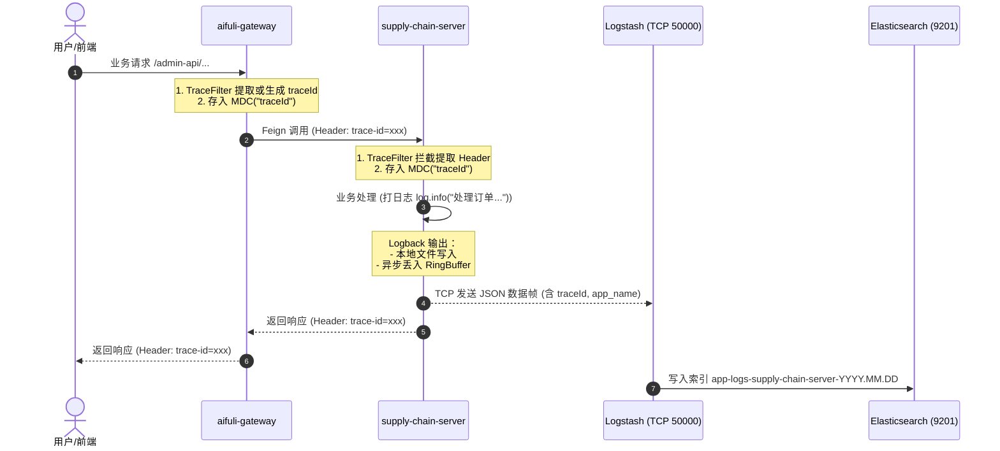

# 微服务日志与 ELK 集成详细设计

> 日期：2026-10-04  
> 状态：阶段一至阶段三已实施完成 / 验证通过  
> 依赖前置：`docs/superpowers/specs/2026-10-01-pro143-elk-docker-compose-deployment-design.md`  
> 目标环境：`pro143` 测试集群（`8.133.164.143` / `172.19.64.105`）及后续生产环境

---

## 1. 背景与核心决策 (ADR)

### 1.1 背景
当前平台已按微服务架构解耦为 8 个独立服务进程（`gateway`、`supply-chain-server`、`member-server`、`system-server`、`infra-server`、`movie-server`、`taobao-flash-server`、`aifuli-server`）。在多进程分布式拓扑下，排查跨服务请求、排查异步事件与定位线上偶发异常亟需统一的集中式日志检索平台。  
`pro143` 测试环境已于 2026-10-01 完成 ELK 8.17.0 基础环境搭建（ES 监听 9201，Kibana 监听 5601，Logstash 监听 5044 及 50000），现需制定应用日志与 ELK 栈对接的完整技术标准与集成规范。

### 1.2 核心决策矩阵

基于系统调研与多轮技术推演，确定以下架构决策：

| 决策编号 | 决策项 | 选定方案 | 决策依据与取舍说明 |
| :--- | :--- | :--- | :--- |
| **d1** | **日志采集架构** | **Logback TCP 异步直连 Logstash (50000 端口)** | 采用 `logstash-logback-encoder`。免除在每台宿主机部署维护 Filebeat 代理的运维成本，轻量高效，满足当前演进阶段的快速集中化需求。 |
| **d2** | **组件沉淀与配置** | **框架层统一沉淀至 `aifuli-spring-boot-starter-monitor`** | 在通用监控 Starter 中统一定义依赖与共享 Logback 模版。通过 `application.yaml` / 环境变量控制开关与连接端点，所有微服务独立进程一致复用。 |
| **d3** | **链路追踪与 MDC 治理** | **增强型 MDC 注入 (SkyWalking 优先 + 兜底生成 + Feign 透传)** | 优先读取 SkyWalking Agent 的 TraceId；在无 Agent 环境自动生成全局唯一 ID 写入 MDC；通过 Feign 拦截器和网关响应头透明传递 `trace-id`，确保离线开发/单机测试与线上均具备端到端追踪能力。 |
| **d4** | **背压保护与容灾策略** | **非阻塞丢弃 + 本地文件双写 + 本地测试默认静默** | TCP 采用有界 RingBuffer 异步环形队列。在 ELK 宕机或网络中断时**坚决直接丢弃，严禁阻塞业务主线程**；本地磁盘保留 `RollingFileAppender` 双写作为最终排障防线；本地与单元测试环境默认关闭 TCP 发送。 |
| **d5** | **ES 索引组织规则** | **按应用维度分流 (`app-logs-%{[app_name]}-%{+YYYY.MM.dd}`)** | Logstash 根据元数据 `app_name` 动态分流。Kibana 中支持以 `app-logs-*` 宽索引通配检索全链路，也支持按单一微服务隔离生命周期（如高频网关 vs 核心供链）。 |
| **d6** | **敏感数据脱敏约定** | **依赖业务层现有脱敏，传输层保持高吞吐** | 遵循既有 API 日志脱敏与敏感凭证防护规范，不在 Logback 传输层加装全局正则过滤，避免高频日志序列化阶段产生额外 CPU 开销。 |

---

## 2. 总体架构拓扑与数据流

### 2.1 端到端拓扑架构

```
 [客户端 / 前端]
        │
        │ HTTP 请求 (带或不带 trace-id)
        ▼
┌──────────────────┐
│  aifuli-gateway   │ ──(生成/透传 traceId, 写入 MDC)
└────────┬─────────┘
         │
         │ Feign / HTTP RPC (Header: trace-id)
         ▼
┌──────────────────────────────┐
│ aifuli-module-supply-chain   │ (TraceFilter / Feign 拦截器继承 traceId)
│ (及其他 7 个微服务进程)       │ 
└────────┬─────────────────────┘
         │
         ├─────────────────────────────────────────┐
         │ 1. 本地落盘 (RollingFileAppender)       │ 2. 异步网络传输 (LogstashTcpSocketAppender)
         ▼                                         ▼
   /data/logs/{app}.log                      [有界环形缓冲 RingBuffer: 8192]
  (故障兜底排查/本地持久化)                                 │
                                                   │ TCP 50000 (JSON Lines)
                                                   ▼
                                       ┌───────────────────────┐
                                       │   Logstash 8.17.0     │
                                       │ (动态解析 app_name /  │
                                       │  @timestamp 统一转换) │
                                       └───────────┬───────────┘
                                                   │
                                                   │ HTTP 9200
                                                   ▼
                                       ┌───────────────────────┐
                                       │ Elasticsearch 8.17.0  │
                                       │ app-logs-{app}-YYYY.MM│
                                       └───────────┬───────────┘
                                                   │
                                                   │ 检索查询 (5601)
                                                   ▼
                                       ┌───────────────────────┐
                                       │     Kibana 控制台     │
                                       │ (Index: app-logs-*)   │
                                       └───────────────────────┘
```

### 2.2 链路交互时序



---

## 3. 公共 Starter 模块设计 (`aifuli-spring-boot-starter-monitor`)

### 3.1 Maven 依赖引入
在 `aifuli-framework/aifuli-spring-boot-starter-monitor/pom.xml` 中引入 `logstash-logback-encoder`：

```xml
<!-- Logstash Logback 结构化日志编码器 -->
<dependency>
    <groupId>net.logstash.logback</groupId>
    <artifactId>logstash-logback-encoder</artifactId>
    <version>8.0</version>
</dependency>
```

> **版本兼容性说明**：  
> 本工程基于 JDK 21 和 Spring Boot 3.5.x，Logback 版本为 1.5.x。`logstash-logback-encoder` 8.0 官方原生支持 Logback 1.5.x 与 Jackson 2.17+，无兼容性冲突。

### 3.2 配置属性定义 (`LoggingElkProperties`)

在 `aifuli-spring-boot-starter-monitor` 中增加配置绑定类：

```java
package com.aifuli.framework.tracer.config;

import lombok.Data;
import org.springframework.boot.context.properties.ConfigurationProperties;

@Data
@ConfigurationProperties(prefix = "aifuli.logging.elk")
public class LoggingElkProperties {

    /**
     * 是否开启 ELK Logstash TCP 日志推送
     */
    private boolean enabled = false;

    /**
     * Logstash TCP 主机地址
     */
    private String host = "127.0.0.1";

    /**
     * Logstash TCP 端口号
     */
    private int port = 50000;

    /**
     * 队列缓冲大小 (默认 8192)
     */
    private int ringBufferSize = 8192;

    /**
     * 重连延迟时间 (毫秒，默认 5000)
     */
    private int reconnectionDelay = 5000;
}
```

---

## 4. 全链路 TraceId 与 MDC 治理

### 4.1 TraceFilter 改造与 MDC 注入规范

当前 `TraceFilter`（位于 `aifuli-framework/aifuli-spring-boot-starter-monitor`）仅向响应头添加了 SkyWalking 的 `traceId`，没有写入 MDC，且无 JavaAgent 时为空。改造如下：

```java
package com.aifuli.framework.tracer.core.filter;

import cn.hutool.core.util.IdUtil;
import cn.hutool.core.util.StrUtil;
import com.aifuli.framework.common.util.monitor.TracerUtils;
import jakarta.servlet.FilterChain;
import jakarta.servlet.ServletException;
import jakarta.servlet.http.HttpServletRequest;
import jakarta.servlet.http.HttpServletResponse;
import org.slf4j.MDC;
import org.springframework.web.filter.OncePerRequestFilter;

import java.io.IOException;

/**
 * 增强型 Trace 过滤器：
 * 1. 优先提取请求头中的 trace-id
 * 2. 其次获取 SkyWalking traceId
 * 3. 兜底自动生成 UUID (去横线)
 * 4. 存入 MDC 及响应 Header，并在请求结束时清理 MDC
 */
public class TraceFilter extends OncePerRequestFilter {

    public static final String HEADER_NAME_TRACE_ID = "trace-id";
    public static final String MDC_KEY_TRACE_ID = "traceId";

    @Override
    protected void doFilterInternal(HttpServletRequest request, HttpServletResponse response, FilterChain chain)
            throws IOException, ServletException {
        String traceId = request.getHeader(HEADER_NAME_TRACE_ID);
        if (StrUtil.isBlank(traceId)) {
            traceId = TracerUtils.getTraceId();
        }
        if (StrUtil.isBlank(traceId) || "[TID: N/A]".equalsIgnoreCase(traceId)) {
            traceId = IdUtil.fastSimpleUUID();
        }

        MDC.put(MDC_KEY_TRACE_ID, traceId);
        response.addHeader(HEADER_NAME_TRACE_ID, traceId);
        try {
            chain.doFilter(request, response);
        } finally {
            MDC.remove(MDC_KEY_TRACE_ID);
        }
    }
}
```

### 4.2 Feign 跨微服务链路透传

在 `aifuli-framework/aifuli-spring-boot-starter-rpc` 中配置 Feign 请求拦截器 `TraceRequestInterceptor`：

```java
package com.aifuli.framework.rpc.core.interceptor;

import cn.hutool.core.util.StrUtil;
import feign.RequestInterceptor;
import feign.RequestTemplate;
import org.slf4j.MDC;

public class TraceRequestInterceptor implements RequestInterceptor {

    private static final String HEADER_NAME_TRACE_ID = "trace-id";
    private static final String MDC_KEY_TRACE_ID = "traceId";

    @Override
    public void apply(RequestTemplate template) {
        String traceId = MDC.get(MDC_KEY_TRACE_ID);
        if (StrUtil.isNotBlank(traceId)) {
            template.header(HEADER_NAME_TRACE_ID, traceId);
        }
    }
}
```

---

## 5. Logback 配置模板与 Appender 规格

### 5.1 可复用 Logback 片段设计 (`logback-elk-appender.xml`)

在 `aifuli-spring-boot-starter-monitor` 的 `src/main/resources/` 中沉淀 `logback-elk-appender.xml`：

```xml
<included>
    <springProperty scope="context" name="APP_NAME" source="spring.application.name" defaultValue="unknown-service"/>
    <springProperty scope="context" name="ACTIVE_PROFILE" source="spring.profiles.active" defaultValue="default"/>
    <springProperty scope="context" name="ELK_ENABLED" source="aifuli.logging.elk.enabled" defaultValue="false"/>
    <springProperty scope="context" name="ELK_HOST" source="aifuli.logging.elk.host" defaultValue="127.0.0.1"/>
    <springProperty scope="context" name="ELK_PORT" source="aifuli.logging.elk.port" defaultValue="50000"/>

    <appender name="LOGSTASH_TCP" class="net.logstash.logback.appender.LogstashTcpSocketAppender">
        <destination>${ELK_HOST}:${ELK_PORT}</destination>
        
        <!-- 有界队列与背压保护 -->
        <ringBufferSize>8192</ringBufferSize>
        <writeBufferSize>16384</writeBufferSize>
        <reconnectionDelay>5000</reconnectionDelay>
        
        <!-- 异步非阻塞：队列满时丢弃而不是阻塞主线程 -->
        <neverBlock>true</neverBlock>
        
        <encoder class="net.logstash.logback.encoder.LoggingEventCompositeJsonEncoder">
            <providers>
                <timestamp>
                    <timeZone>Asia/Shanghai</timeZone>
                </timestamp>
                <pattern>
                    <pattern>
                        {
                            "app_name": "${APP_NAME}",
                            "env": "${ACTIVE_PROFILE}",
                            "level": "%level",
                            "thread": "%thread",
                            "logger": "%logger{40}",
                            "line": "%line",
                            "traceId": "%mdc{traceId}",
                            "message": "%msg",
                            "stack_trace": "%throwable"
                        }
                    </pattern>
                </pattern>
            </providers>
        </encoder>
    </appender>
</included>
```

### 5.2 微服务根 Logback 整合 (`logback-spring.xml`)

各微服务进程（例如 `supply-chain-server`、`gateway`、`system-server` 等）的 `logback-spring.xml` 统一按以下结构引入：

```xml
<configuration>
    <!-- 控制台与文件基础定义 -->
    <property name="CONSOLE_LOG_PATTERN" value="%d{yyyy-MM-dd HH:mm:ss.SSS} [%thread] %highlight(%-5level) %cyan(%logger{50}:%L) - %msg%n"/>
    <property name="FILE_LOG_PATTERN" value="%d{yyyy-MM-dd HH:mm:ss.SSS} [%thread] %-5level %logger{50}:%L - [%X{traceId}] %msg%n"/>

    <!-- 本地控制台与滚动文件 Appender -->
    <include resource="org/springframework/boot/logging/logback/defaults.xml" />
    <include resource="logback-elk-appender.xml"/>

    <root level="INFO">
        <appender-ref ref="STDOUT"/>
        <appender-ref ref="ASYNC_FILE"/>
        <!-- 仅在非本地环境且显式开启时加载 TCP Appender -->
        <springProfile name="dev,test,prod">
            <if condition='property("ELK_ENABLED").equalsIgnoreCase("true")'>
                <then>
                    <appender-ref ref="LOGSTASH_TCP"/>
                </then>
            </if>
        </springProfile>
    </root>
</configuration>
```

---

## 6. Logstash 管道配置 (`script/deploy/elk/logstash/pipeline/logstash.conf`)

Logstash 管道将接收到的 TCP JSON 数据帧提取 `app_name`，并路由写入对应的 Elasticsearch 索引：

```text
input {
  beats {
    port => 5044
  }
  tcp {
    port => 50000
    codec => json_lines
  }
}

filter {
  # 统一处理时间戳
  if [timestamp] {
    date {
      match => [ "timestamp", "ISO8601", "yyyy-MM-dd HH:mm:ss.SSS" ]
      target => "@timestamp"
    }
  }

  # 兜底默认 app_name，防止字段缺失导致索引语法错误
  if ![app_name] {
    if [@metadata][beat] {
      mutate {
        add_field => { "app_name" => "%{[@metadata][beat]}" }
      }
    } else {
      mutate {
        add_field => { "app_name" => "default" }
      }
    }
  }

  # 强制转换为小写，确保符合 Elasticsearch 索引命名规范
  mutate {
    lowercase => [ "app_name" ]
  }
}

output {
  elasticsearch {
    hosts => ["http://elasticsearch:9200"]
    index => "app-logs-%{[app_name]}-%{+YYYY.MM.dd}"
  }
}
```

---

## 6.1 Elasticsearch 索引生命周期 (ILM) 与模板设计

为防止测试机 `pro143` 磁盘被持续生成的按天索引写满，在 Elasticsearch 中配置专用 ILM 策略与全局 Composable 模板：

1. **生命周期策略 (`app-logs-ilm-policy`)**：
   - **Hot 阶段**：`min_age: 0ms`，设置主分片调度优先级 `priority: 100`；
   - **Delete 阶段**：`min_age: 30d`，超过 30 天的历史日志索引自动触发物理删除，释放磁盘；
2. **索引模版 (`app-logs-template`)**：
   - 匹配模式：`app-logs-*`，优先级：`200`；
   - 参数配置：
     - `number_of_shards: 1`（单主分片）；
     - `number_of_replicas: 0`（单节点测试环境禁用副本，索引健康度由 Yellow 优化为 Green）；
     - `index.lifecycle.name: "app-logs-ilm-policy"`（新建索引自动挂载生命周期策略）。
3. **运维脚本**：
   - 配置文件沉淀于 `script/deploy/elk/elasticsearch/ilm/`；
   - 一键初始化脚本：`script/deploy/elk/init-elk-ilm.sh`。

---

## 7. 容灾、性能与防风暴规范

1. **绝对零阻塞原则（Never Block）**：
   `LogstashTcpSocketAppender` 设置 `<neverBlock>true</neverBlock>`。当网络断开、ELK 实例重启或突发流量冲垮 RingBuffer 时，超出的日志事件直接就地丢弃，绝对不允许向调用方线程施加背压或反向卡死接口。
2. **磁盘文件双写防线**：
   本地磁盘保留 `RollingFileAppender`（10MB 切分、保留 30 天）。即使整个网络或 ELK 基础设施全量宕机，服务器本地日志仍然完备无损。
3. **环境物理隔离与本地静默**：
   `local` profile 与 Maven Surefire 单测运行环境默认禁用 ELK TCP 推送。避免开发人员断网离线编码或自动化测试执行时持续向 50000 端口重连报错。
4. **日志防风暴机制**：
   高频路径（如定时任务轮询、消息消费重试）遵循工程规范第 6 条，采用按错误码聚合与抽样打印策略，避免大批量无意义刷屏造成 TCP 缓冲积压。

---

## 8. 实施路径与验证验收步骤

### 阶段一：框架层能力沉淀
1. 在 `aifuli-framework/aifuli-spring-boot-starter-monitor` 中引入 `logstash-logback-encoder:8.0`；
2. 升级 `TraceFilter`：增强 MDC 注入与 UUID 兜底生成逻辑；
3. 增加 `logback-elk-appender.xml` 共享配置模版；
4. 在 `aifuli-spring-boot-starter-rpc` 注入 `TraceRequestInterceptor` 实现 Feign 透传。

### 阶段二：Logstash 配置与管道升级
1. 更新 `script/deploy/elk/logstash/pipeline/logstash.conf`；
2. 在 `pro143` 执行热重载或重启 Logstash 容器：`docker compose restart logstash`；
3. 使用 `nc -vz 127.0.0.1 50000` 验证 TCP 监听就绪。

### 阶段三：微服务试点接入与验证
1. 优先在 `aifuli-gateway` 与 `aifuli-module-supply-chain-server` 引入配置；
2. 在 `application-dev.yaml` 中配置：
   ```yaml
   aifuli:
     logging:
       elk:
         enabled: true
         host: 172.19.64.105
         port: 50000
   ```
3. 发起端到端跨服务请求，在 Kibana (`http://8.133.164.143:5601`) 建立 `app-logs-*` 索引模式；
4. 检索特定 `traceId`，验证网关和供应链服务的日志能在同一时间线完整呈现。

### 阶段四：Elasticsearch 索引生命周期 (ILM) 策略上线与防爆盘保护
1. 在 ES 创建 `app-logs-ilm-policy`（30 天自动删除）；
2. 创建 `app-logs-template` 索引模版（单分片、零副本、自动挂载 ILM）；
3. 存量索引追溯绑定并验证健康度恢复为 Green；
4. 验证新建索引自动挂载 ILM 策略。

### 阶段五：文档归档
1. 同步更新 `docs/集成测试.md` 第 8 章节，追加端到端联调测试用例、ILM 运维命令与验证证据。
