# 供应链中台多场景概要设计

> PRD 对齐：三级 B 端结算价、加价模板与 C 端销售价、标准商品仅退款、路由四级配置组，以[《供应链中台 PRD 对齐详细设计》](./superpowers/specs/2026-08-28-supply-chain-prd-alignment-design.md)为准。本文未展开的管理端字段以该设计与 PRD 为准。

---

## 1. 主数据同步：中台统一管货，商城订阅

**业务原则**：品牌、平台商品（SPU/SKU）、采购商（管理端称分销商）、供应商、采购商上架商品（含采购结算价与标准商品销售价）、供应商供货关系（含结算价）**全部由中台维护，中台是唯一权威来源**。商城只保存一份数据用于展示和下单。

### 同步方式：事件 + 数据拉取

- 中台发布或变更商品（上架、下架、调价、供应商断货等）后，给商城发一条**变更提醒**；提醒本身不带商品内容，丢了、重了都不影响数据正确。
- 商城收到提醒后，向中台**拉取最新商品快照**。
- 商城拿到的数据只有：品牌、商品展示信息、履约类型、采购结算价、**标准商品销售价**、**当前是否可买**；看不到供应商是谁、供应商货号、供货价、供应商库存。
- 电影/点餐/外卖生活服务/商超等场景销售价不随目录静态推送，商城调用中台**实时报价**；报价不改变 B 端冻结金额。
- 商品“可买/不可买”由中台实时计算（供应商停用、渠道不可用、库存未知等都会变不可买）并推送给商城；但商城页面状态**不能作为下单依据**，中台受理订单时会重新校验。
- **商品池区分**：
  - 卡券/直充、点餐（如肯德基/麦当劳标准券）等标准商品进入中台商品池，由中台统一维护商品信息和供应商路由规则。
  - **电影票务商品不进入中台静态商品池**：电影具有全国上万家影院、数十万场次的高频动态特性，其场次排期由电影子系统基于 **MongoDB** 独立存储并管理生命周期。提单时由电影子系统动态完成多源比价后，向中台输出实时的候选供给快照。
  - 淘宝闪购/盒马 H5 的商品不进中台商品池；中台只管渠道商户映射、订单协调和资金对账。

### 主数据同步时序

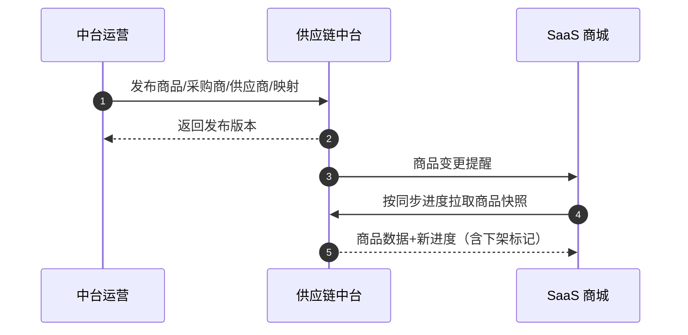

---

## 2. 卡券/直充主数据：与原卡管系统的区别

本节只谈进入中台标准商品池的卡券/直充（以及同样走标准商品池的点餐）。电影票务走独立的动态供给发现与比价模型（见 4.e 节），淘宝闪购/盒马 H5 内商品仍不进商品池，见第 1 节。

原卡管把「这是什么货」和「向谁买、怎么接入」揉在商品模型里。中台拆成互不混用的模型：品牌、品类、平台商品只描述货；采购商上架和供应商供货是两条独立关系；下单时才由路由把两边接上。

### 2.1 模型关系

**原卡管**：品类 → 品牌（权益）→ 父商品 → 子商品；子商品直接绑定供应商。换一家供应商，往往要再复制一条子商品。

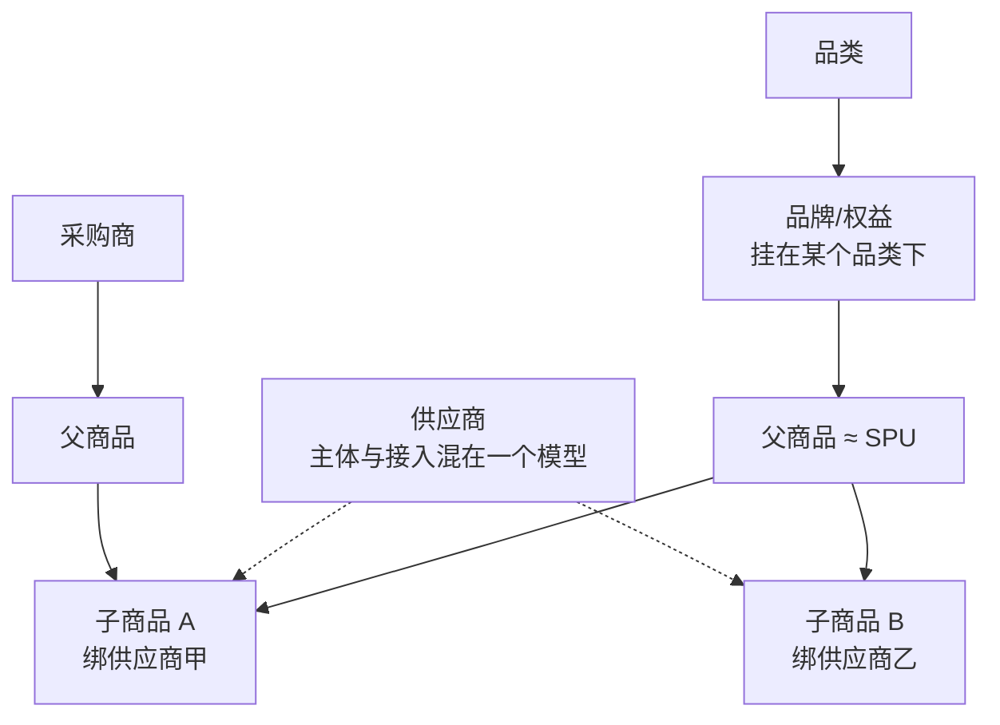

**中台**：品牌与品类彼此独立，都挂到平台 SPU；一个平台 SKU 可被多家采购商上架、也可由多家供应商供货。采购商上架不绑定供应商；供应商供货不绑定采购商。

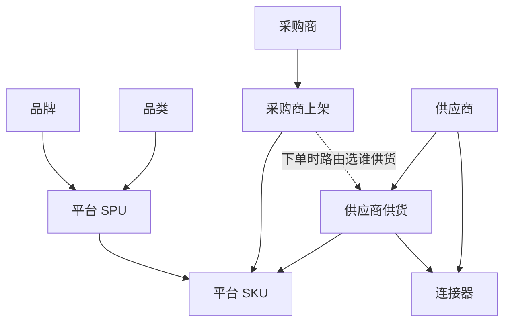

一句话：**卡管的一条子商品 ≈ 中台的「平台 SKU + 一家供应商供货」；中台不允许再揉成一个模型。**

### 2.2 各模型对照

| 模型 | 原卡管 | 中台 |
|---|---|---|
| **品牌** | 品牌/权益挂在品类下，目录是「品类 → 品牌 → 商品」；常与「谁在供这个牌子」缠在一起 | 独立品牌，不隶属品类，也不是供应商或供货关系；同一品牌可出现在不同品类 |
| **品类** | 品牌的父级，也是商品分类 | 只作为平台 SPU 的类目；品牌与品类无父子关系 |
| **商品** | 父/子商品是一个模型；子商品同时承载货、供应商、价格、库存 | 拆成平台 SPU/SKU、采购商上架、供应商供货。SKU 只表示货；相同品牌和面值、履约方式不同，是不同 SKU。一个 SKU 可多家上架、多家供货 |
| **供应商** | 主体、接入、额度混在一个模型；子商品写死一家供应商 | 拆成供应商主体、连接器、供货关系。主体不含接入配置；同一 SKU 可有多个供货候选，失败后按路由换下一家。卡券场景不再把供应商叫「渠道」（渠道只用于 O2O） |

---

## 3. 调用关系与时序

**总体分工**：

- **商城**：管 C 端体验和收款
- **中台**：管采购订单、采购资金（账本）、选供应商、统一状态
- **供应商/子系统**：管实际履约

> 用户的支付永远发生在商城侧，中台不碰 C 端收银。

### 总体调用关系

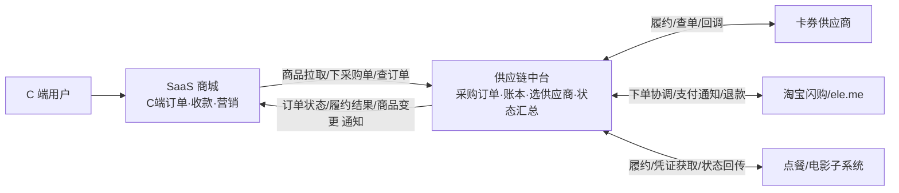

---

## 4. 三类业务场景的协作时序

### a) 卡券/直充：商城先收款，再向中台“下采购单”

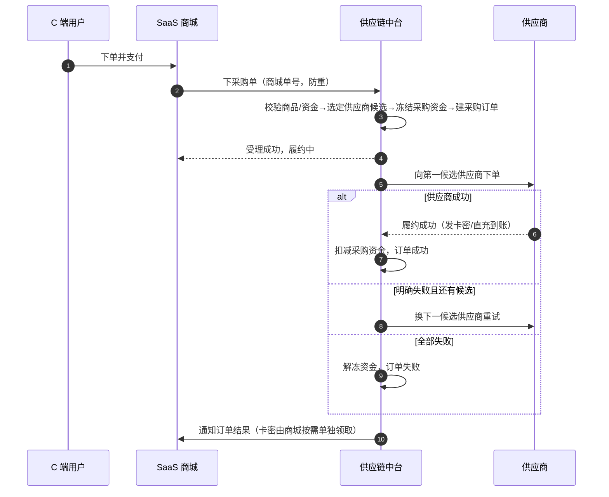

**要点**：
- 商城单号是防重复的永久钥匙，重复提交返回原结果
- 中台一旦受理，商城不能撤单/取消
- 供应商超时没回音时只能查单，不能换单号重发

---

### b) O2O（淘宝闪购/盒马）：用户在 H5 下单，中台协调 + 同步数据

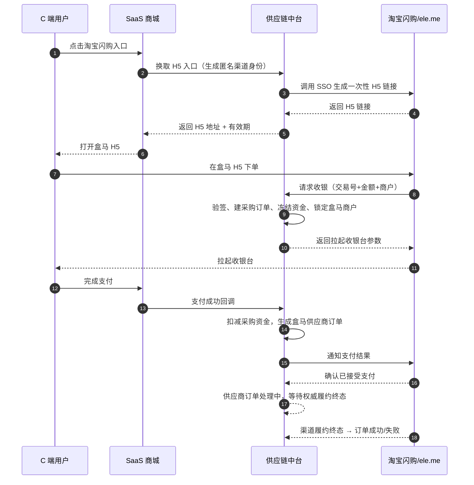

**要点**：
- 支付前只冻结、确认收款后才真正扣减
- 盒马是固定商户，不自动更换
- 退款由 ele.me 发起，**先退给用户、确认成功后才回补采购商账户**，杜绝“用户没收到退款、采购资金已退”的漏洞

---

### c) INSTORE（大润发到店购）：门店扫码，支付成功即履约完成

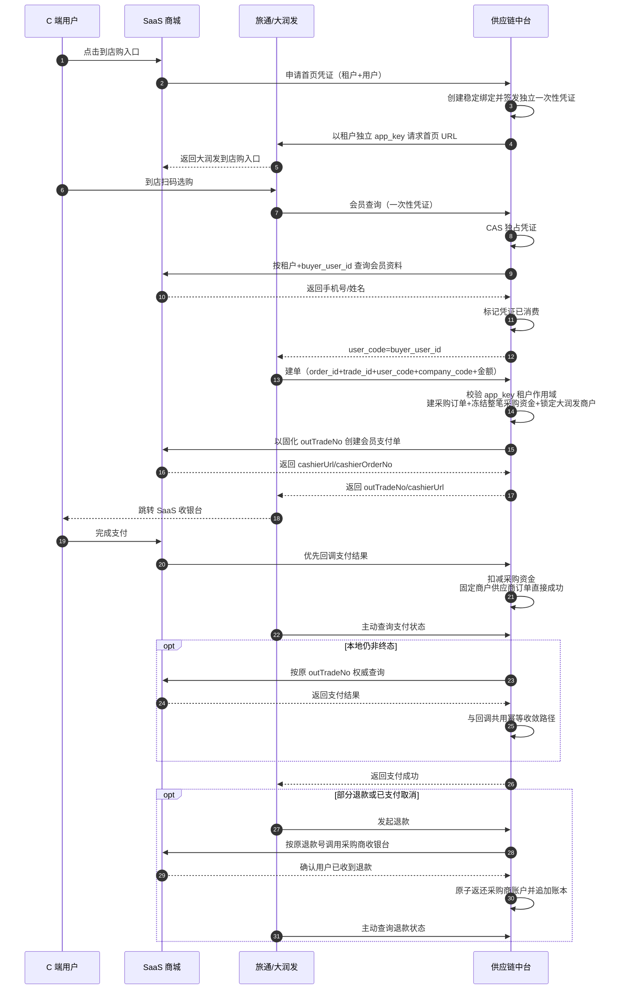

**要点**：
- `INSTORE` 与 O2O 平行，不共享详情表和状态机；支付成功就是履约成功，不等待配送或 225 状态。
- 每个采购商租户独立 `app_key`；`user_code` 是租户内不透明的 `buyer_user_id`，会员资料按 `(sourceSystem, externalTenantId, buyer_user_id)` 解析。
- 同一 `order_id` 只有一个 `trade_id`，资金按整笔到店购详情冻结一次；大润发是固定商户，不走供应商路由。
- 首页和详情入口各自签发短期一次性凭证；同一用户可并存多枚，单枚凭证只消费一次。
- 中台先固化 `outTradeNo` 再调用 SaaS 收银台取得 `cashierUrl`；支付回调优先，渠道查询和 Timer 按原号权威查单兜底。
- 退款必须先由采购商收银台确认用户退款成功，再原子回补采购商账户；退款只改变售后状态，不回退成功主状态。

---

### d) 点餐场景：标准商品 + H5 凭证履约

点餐商品（如肯德基、麦当劳电子券码）作为**标准商品**进入中台商品池，由中台统一维护商品信息和供应商路由规则。流程与卡券/直充类似，但履约结果返回的是 **H5 消费链接或兑换码**。

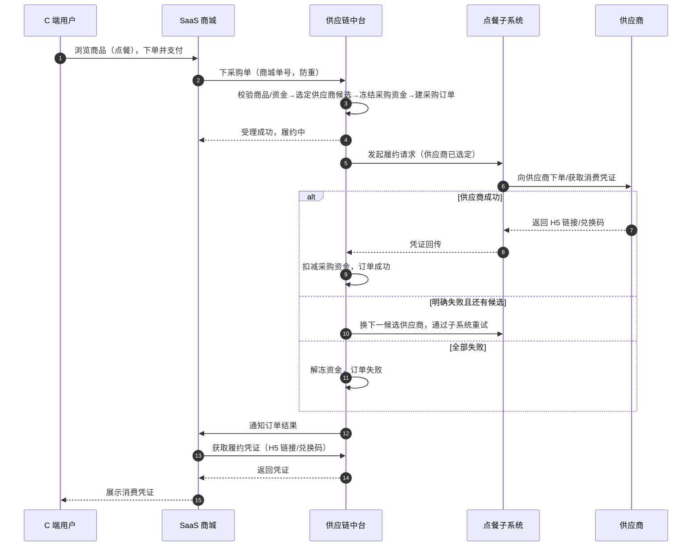

---

### e) 电影场景：动态供给发现 + 中台主控 + 子系统执行

电影票务不同于静态标品，全国上万家影院每日产生数十万场次，且座位状态与供应商成本秒级浮动。JC、JY 是中台统一管理和路由的实际 Supplier；电影子系统不是 Supplier，而是负责场次/座位映射及供应商私有协议的专业执行子系统。本场景采用**“电影子系统发现供给并执行协议 + 中台统一订单、路由、尝试和资金”**的职责划分。完整落地表结构、RPC 契约、金额适配及一期/二期状态机见 [电影子系统与中台履约详细设计.md](电影子系统与中台履约详细设计.md)。

#### 1. 核心架构与数据存储分层（全面引入 MongoDB）

| 数据层级 | 存储载体 | 技术选型与机制 | 核心设计意图 |
| :--- | :--- | :--- | :--- |
| **基础静态主数据** | MySQL | 存储城市字典、影院基础资料、影片库（`jy_cinema_info`, `jy_movie_info` 等） | 数据量小、变更频率低，强约束持久化。 |
| **动态排期数据** | **MongoDB** | **独立 movie-server 集合 `cinema_schedule`**： 1. 在 `stopSellTime` 建 TTL 异步清理索引，查询仍显式过滤已停售场次； 2. 通过 BulkWrite 增量 Upsert； 3. 反范式冗余片名、海报、影院名和 Decimal128 价格。 | 排期时效性强（仅售 3~5 天），不占用商城 MySQL；通过 movie-api RPC 提供查询。 |
| **实时座位与动态底价** | 内存 / 不落库 | 用户进入选座图与提交订单前，实时并发调用第三方接口获取座位图与底价 | 座位状态为秒级变化强时效资产，本地不存脏数据。 |

#### 2. 系统输出形态分期演进

- **一期**：根目录 `movie-api/movie-server` 作为独立 RPC 服务；商城前端只访问商城 BFF，由商城调用电影 RPC，并在商城内部完成租户售价和积分适配；
- **二期（节后扩展）**：电影子系统建设独立 H5 应用容器，具备独立运营能力，可直接对外输出嵌入外部银行、企微等异业合作渠道。

#### 3. 履约策略（一期核心原则：一次路由，不切渠道）

- **动态报价**：商城以主展示渠道底图选座；电影子系统并发拉取双商最新座位和成本，按物理坐标 `(row, column)` 形成带有效期的报价批次并直接提交中台；
- **一次路由决策**：中台核验报价批次，按已发布的价格/优先级/健康度规则冻结候选顺序；一次路由保存完整有序候选，不代表由电影子系统自行循环；
- **受控协议执行**：中台在外呼前创建 JC/JY SupplierAttempt 和 Operation，再指定单个供应商调用电影子系统；电影子系统负责锁座、确认出票、查单、解锁，不得自行选择下一供应商；
- **一期不切渠道安全闭环**：
  - **履约成功**：电影子系统使用中台指定的供应商完成“锁座 → 用户支付 → 确认出票”，中台提交采购资金并汇总订单成功；
  - **履约失败**：首选明确失败后保留该供应商尝试及外部单号（供应商未生成时允许为空），一期不消费下一候选；结果未知时固定原供应商查单，不退款、不换路；
  - **二期串行换路**：只有上一尝试被权威证明无履约副作用或锁座已释放后，中台才先创建下一 SupplierAttempt，再命令电影子系统执行下一指定供应商。所有失败尝试永久保留。

#### 4. 电影业务路由主控与受控执行时序图

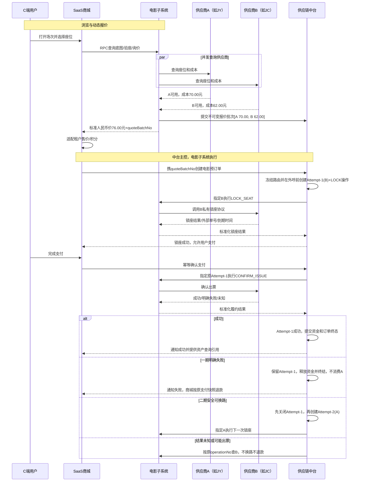

## 5. 订单同步

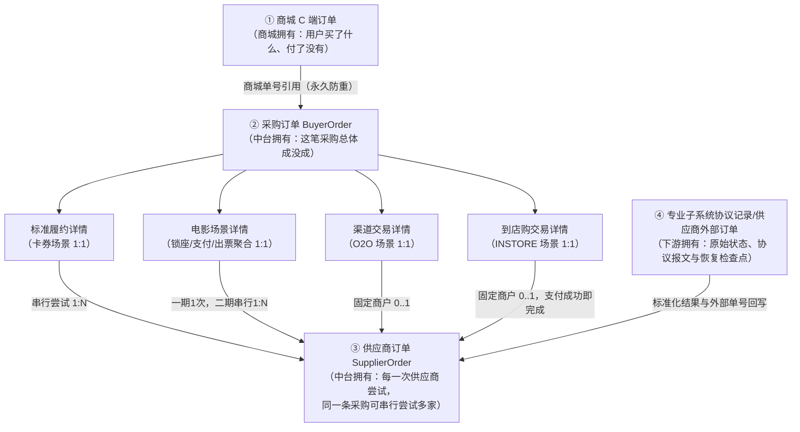

### 同步的三个方向

#### 下行：商城 → 中台
- 卡券/直充等标准履约在商城支付成功后下采购单；电影是明确例外，商城先携报价批次创建中台预订单并锁座，支付成功后再通知中台确认出票
- 中台不读商城订单表
- 同一单号重复提交得到同一结果，内容变了直接拒绝
- 就算校验不过，中台也会返回一张“失败”的采购订单，商城照单展示，而不是当作“没下到”

#### 上行：子系统/供应商 → 中台
- 下游的原始状态（待支付、制作中、待取餐、出票中、已完成、已退款……）**不直接改动中台订单**
- 先作为“原始观察”留痕，再按版本化的映射表翻译成标准业务进度和事实
- 履约终态按场景交付证据确定：标准电商/点餐以核销或已完成算成功，“待取餐”仍是进行中；电影场景以供应商返回有效出票凭证（`ISSUED`）即为履约成功终态（代表中台订单完成并提交采购资金），纸质票打印与实际观影仅为后续业务进度，不影响订单终态
- “退款”只推进售后进度，绝不动主状态
- 翻译后的状态统一由采购订单唯一的订单状态汇总策略计算，**终态不可逆**
- 成功后又收到矛盾消息，只记风险告警，不改单、不重扣

#### 回传：中台 → 商城
- 采购订单的每次公共状态变化都会通知商城；内部换路只投影为通用“履约重试中”，不下发供应商身份、成本或失败单号
- 商城先登记防重、再更新自己的 C 端订单展示
- 通知可能重复送达，商城按版本号忽略旧消息
- 万一漏了，商城可主动向中台查询补偿
- 卡密、券码等敏感资产**不进通知**，商城在需要展示时凭用户身份单独向中台领取
- 目标边界是供应商历史、供货成本和内部风险不对商城/C 端开放；电影现有兼容返回的收口计划见详细设计，且不得作为中台可信输入

---

## 6. 供应商路由

路由只做一件事：**回答“这单该找谁买”，不做四件事——不调供应商、不改订单、不动账本、不查库存**（库存等事实由调用方采集后传入）。这条边界让路由内核成为纯计算：同样的输入 + 同样的配置 + 同样的事实快照，必须得出同样结果，可离线复现任一订单的决策。

### 四级配置组（项目内物化）

运行时匹配见[PRD 对齐设计 §8](./superpowers/specs/2026-08-28-supply-chain-prd-alignment-design.md#8-路由扩展)。配置组优先级为 **分销商+品类 > 分销商 > 品类 > 全局**，并复制进当前项目策略版本后才生效。排序为手动优先级或供应价升序。SKU 专属规则特异性更高。项目之间禁止互相回退。

### 决策链

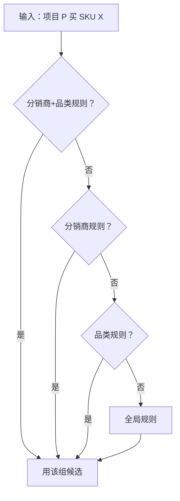

### 履约时序
下图为标准商品（卡券/直充、点餐）的概要履约时序。电影采用“中台主控、电影子系统受控执行”的锁座后履约流程（详见 4.e 节）；O2O 场景不走此流程。

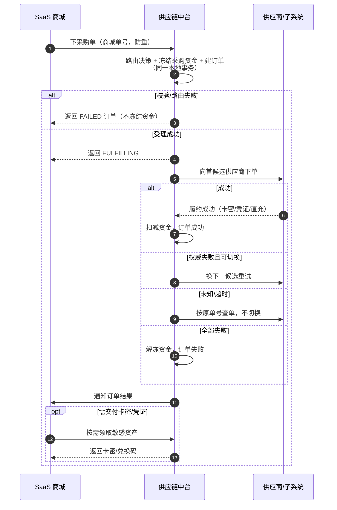

要点：资金冻结与订单创建在同一本地事务；所有外部供应商调用均在事务提交后发生；终态不可逆，迟到/重复成功只记风险不改动有效结果。

---

## 7. 两套订单体系：采购商订单与供应商订单

这两套订单不是同一张单存两份，而是**两个不同业务视角的事实**：采购商订单回答“这笔采购总体成没成”，供应商订单回答“这一次找某家供应商履约的结果”。它们靠引用串起来，各管各的状态。

### 采购商订单（BuyerOrder）

- **定位**：采购方视角的订单聚合，是订单列表和公共查询的唯一入口；一个采购商业务键一条。
- **归属**：中台 `order-core/BuyerOrder` 模块唯一写入公共状态；其他模块只能提交类型化事实，不能直接改总表。
- **两类状态（正交维度）**：
  - 主状态 `FULFILLING / SUCCEEDED / FAILED / MANUAL` —— 业务终态不可逆
  - 售后状态 `NONE / PROCESSING / PARTIALLY_REFUNDED / FULLY_REFUNDED / MANUAL` —— 退款只动这里，绝不覆盖主状态
- **展示供应商规则**（总表只存一个展示用 Supplier 快照）：处理中→当前正在试的那家；成功→唯一有效成功的那家；全部失败→冻结路由的第一候选；零尝试失败→空；O2O/INSTORE→建单起即显示固定商户。
- **业务键**：`(采购商, 商城单号)` 永久幂等。同键同摘要返回原结果，同键不同摘要永久冲突；修正请求必须换新单号。

### 供应商订单（SupplierOrder）

- **定位**：每一次对具体供应商的履约尝试。同一条采购订单可串行尝试多家。
- **三个编号（语义固定，不可混用）**：
  - `supplierOrderNo` —— 中台内部订单编号
  - `supplierRequestNo` —— 稳定出站编号，**网络重试和查单始终复用它**（供应商认得它才能防重复履约、才能查单）
  - `externalSupplierOrderNo` —— 供应商返回的单号
- **切换候选才建新单**：换一家供应商 = 新建一张 SupplierOrder + 新的 supplierRequestNo；同一家供应商的网络重试 = 复用同一张 SupplierOrder、同一 supplierRequestNo，只新增调用记录。
- **两条铁律**：任一时刻**最多一张活动 SupplierOrder**（`(采购单, activeFlag)` 保证）；任一时刻**最多一张有效成功 SupplierOrder**（`(采购单, effectiveSuccessFlag)` 保证）。

### 两者关系与基数

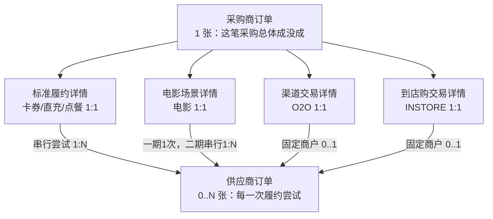

- **标准商品**（卡券/直充/点餐）：`1 采购单 + 1 履约详情 + N 供应商订单`。三个候选都失败就是 1+1+3。
- **电影场景**：路由成功后为 `1 采购单 + 1 电影详情 + N 供应商尝试单`。供应商尝试必须在锁座外呼前创建，因此一期路由成功后 `N=1`，即使锁座失败也保留该尝试；二期明确安全失败时按冻结顺序追加下一尝试。
- **O2O**（淘宝闪购/盒马）：`1 采购单 + 1 渠道详情 + 0..1 固定商户供应商订单`。商户是用户选的，不切换，至多一张。
- **INSTORE**（大润发到店购）：`1 采购单 + 1 到店购详情 + 1:1 支付身份 + 0..1 固定商户供应商订单`。支付成功时供应商订单直接成功；退款 Case 可多笔但按交易串行协同。

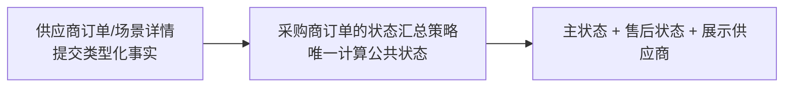

---
