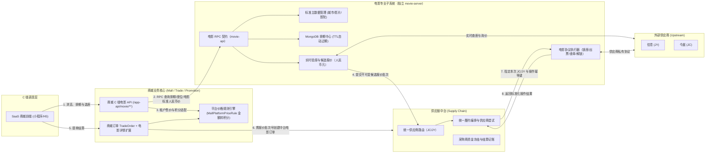
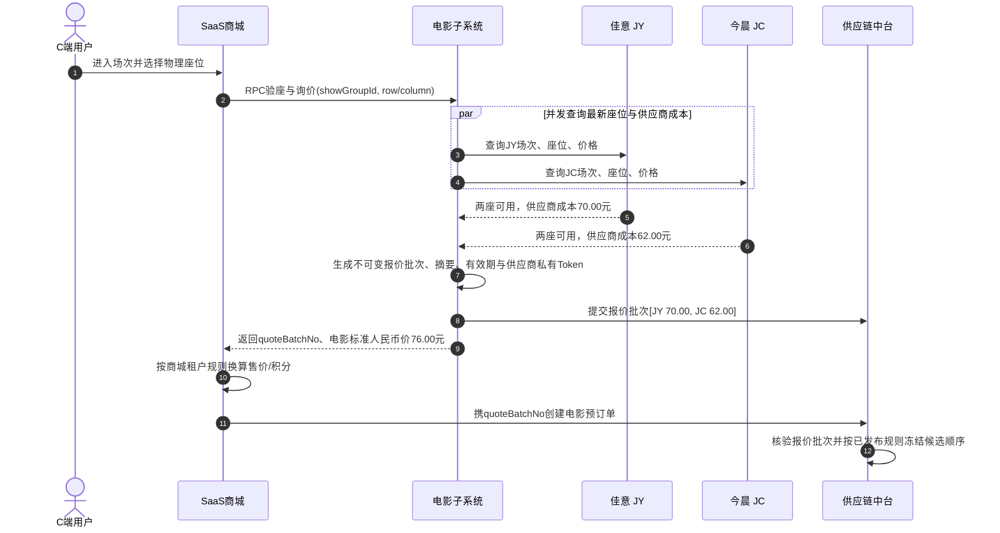
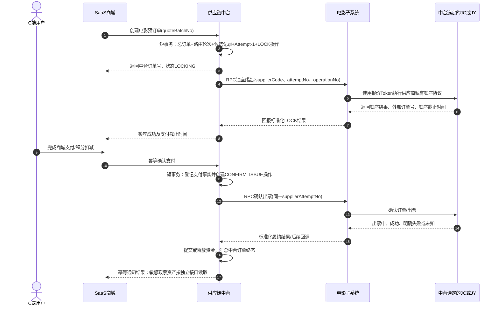

# 电影子系统与中台电影履约详细开发设计规范

> **版本**：v1.2.0（补充支付/取消并发裁决，收紧二期换路条件）  
> **创建日期**：2026-09-03  
> **修订日期**：2026-09-07  
> **面向对象**：后端、前端、测试


---

## 1. 业务背景与架构定位

### 1.0 术语约定

- **供应链中台**：统一管理全部场景订单、采购商资金、实际 Supplier、路由轮次、供应商尝试和公共履约终态；
- **供应链中台子系统**：承接中台通用模型不适合直接实现的垂直业务能力，电影、后续点餐等均属于此类专业子系统；
- **电影子系统**：供应链中台子系统体系下的电影专业子系统，对应独立 `movie-server`；它是中台的执行协作者，不是 Supplier；
- **电影供应商**：实际提供电影供给并被中台路由、结算和审计的 JC、JY 等 Supplier。

### 1.1 核心业务背景
电影票务不同于传统实物或静态卡券，具有以下强时效、高并发特征：
1. **多源多渠道供货**：对接今晨（JC）、佳意（JY）等多家供应商，不同供应商的影院 ID、影片 ID、场次 ID 各自独立；
2. **海量高频时效排期**：全国上万家影院每日产生数十万场次排期，售卖周期通常仅 3~5 天；
3. **秒级价格与座位浮动**：座位销售状态与成本底价秒级变化，提单前必须实时并发验座与比价；
4. **锁座后履约**：电影订单先产生外部锁座副作用，用户支付后再确认出票；锁座、出票、解锁和查单必须作为同一次供应商尝试下可恢复、可审计的独立操作；
5. **中台统一路由与订单**：JC、JY 是供应链中台统一管理的实际供应商，电影子系统负责执行中台不适合直接承载的电影专业协议；
6. **企业福利积分支付**：电影子系统对外金额统一使用人民币元，SaaS 商城再通过既有 `MallPlatformPriceRule` 完成租户售价与积分适配。

### 1.2 系统边界与分工


- **商城业务系统（Mall / Trade / Promotion）职责**：
  - **C 端接口暴露主体**：统一对商城前端（小程序 / H5）暴露 `/app-api/movie/**` 系列接口（城市、影片、影院、排期、选座底图、核验比价）；
  - **金额适配**：获取当前登录用户与企业租户（TenantId），通过 RPC 调用电影子系统取得人民币元价格（`standardSaleAmountYuan`），再由 `aifuli-module-promotion` 的 `MallPlatformPriceRule` 计算租户售价或福利积分；
  - **商城交易**：维护 `trade_order`（主订单）及 `trade_order_movie`（电影扩展快照），记录 C 端支付事实、提交用户取消意图并执行中台裁决后的积分退款；商城不得独立关闭中台履约订单、判断供应商锁座是否已释放或直接决定是否换路；
  - 商城不得把前端回传的供应商、供应商成本或候选顺序作为中台路由依据，只允许传递电影子系统签发且中台可核验的 `quoteBatchNo/verifyToken`。
- **电影专业子系统（Movie Subsystem）职责**：
  - 电影子系统是供应链中台的专业业务执行子系统，**不是中台供应商**；中台供应商仍为 JC、JY；
  - 以独立 `movie-server` 进程运行，通过根目录 `movie-api` 发布 RPC 契约，不与商城或供应链中台共用 Spring 容器、数据库事务或本地 Bean；
  - **垂直行业供给与报价底座**：只输出电影标准领域模型和人民币元 `BigDecimal`，不感知商城租户的营销、积分及价格单位；
  - 管理城市、影片、影院等标准主数据及其渠道映射关系；
  - 基于 MongoDB 维护近 3~5 天的动态排期与 TTL 过期索引；
  - 并发拉取多供应商座位与采购成本，形成带有效期、摘要和供应商私有引用的不可变报价批次，并提交供应链中台；
  - 接受中台明确指定的单个供应商和操作幂等键，执行锁座、确认出票、查单、解锁与退款等电影协议；可以恢复同一供应商同一尝试，但不得自行改选下一供应商；
  - 保存供应商凭证、原始协议报文、座位/场次私有 ID 和恢复检查点，对中台只返回标准化结果与必要快照。
- **供应链中台（Supply Chain）职责**：
  - 统一登记 JC、JY 等实际供应商，接收电影子系统提交的候选报价批次，按已发布路由规则计算并冻结候选顺序；路由可以按价格、人工优先级、健康度等规则排序，不固定等同于最低价；
  - 在任何外部锁座副作用发生前，原子创建中台总订单、路由记录、当前供应商尝试单和待执行操作；
  - 作为电影履约订单的唯一状态写入者，逐次向电影子系统下发“指定供应商 + 指定操作”命令，维护锁座、支付确认、出票、解锁、查单、资金和最终状态；中台不直接集成 JC/JY 私有协议；
  - **一期**最多消费首个候选，明确失败后终结订单；**二期**仅在上一尝试被权威证明无履约副作用或锁座已释放后，才由中台创建下一张供应商尝试单并继续同一冻结路由轮次；
  - 网络超时和结果未知必须停留在原供应商查单，禁止切换；任何可能已经出票的情况进入人工处理。

---

## 2. 数据库表结构设计 (DDL)

### 2.0 数据所有权、建表与多租户约束

- `movie_city`、渠道映射、供应商接入配置及 MongoDB 排期属于独立 `movie-server`，是平台级电影供给数据，不按商城 `tenant_id` 隔离，也不得与商城库共表；
- `movie-server` 应使用独立 MySQL/MongoDB 数据源和独立 Liquibase 变更集。其应用不启用商城多租户拦截；如果因框架装配无法整体关闭，必须把电影平台表显式加入 `aifuli.tenant.ignore-tables`，并以架构测试证明查询不会被自动追加不存在的 `tenant_id`；
- `trade_order_movie` 属于 SaaS 商城，必须继承商城租户语义，包含 `tenant_id`、审计字段和逻辑删除字段，所有唯一键及订单查询必须包含租户边界；
- 供应链中台的总订单、路由、供应商尝试和资金记录继续由中台独立库及其中台业务身份隔离规则管理，电影子系统不得直连或修改中台表；
- 本章 SQL 是目标结构说明，正式落地必须使用可审计的 Liquibase 前向变更集，禁止在应用启动时自动修改生产表。

### 2.1 MySQL 标准主数据与渠道映射表

#### (1) 平台标准城市表：`movie_city`
```sql
CREATE TABLE `movie_city` (
  `id` bigint NOT NULL AUTO_INCREMENT COMMENT '城市主键ID',
  `city_code` varchar(32) NOT NULL COMMENT '行政区划统一代码 (如 110100)',
  `city_name` varchar(64) NOT NULL COMMENT '城市标准名称 (如 北京市)',
  `pin_yin` varchar(64) DEFAULT NULL COMMENT '拼音全拼 (beijing)',
  `first_letter` char(1) DEFAULT NULL COMMENT '首字母索引 (B)',
  `is_hot` tinyint(1) DEFAULT '0' COMMENT '是否热门城市 0-否 1-是',
  `status` tinyint DEFAULT '1' COMMENT '状态 1-启用 0-禁用',
  `create_time` datetime DEFAULT CURRENT_TIMESTAMP COMMENT '创建时间',
  `update_time` datetime DEFAULT CURRENT_TIMESTAMP ON UPDATE CURRENT_TIMESTAMP COMMENT '更新时间',
  PRIMARY KEY (`id`),
  UNIQUE KEY `uk_city_code` (`city_code`),
  KEY `idx_letter_hot` (`first_letter`, `is_hot`)
) ENGINE=InnoDB DEFAULT CHARSET=utf8mb4 COMMENT='电影平台标准城市表';
```

#### (2) 渠道城市映射表：`movie_city_mapping`
```sql
CREATE TABLE `movie_city_mapping` (
  `id` bigint NOT NULL AUTO_INCREMENT COMMENT '主键ID',
  `channel` varchar(32) NOT NULL COMMENT '供应商渠道编码 (jy, jc)',
  `supplier_city_id` varchar(64) NOT NULL COMMENT '供应商原始城市ID',
  `supplier_city_name` varchar(64) DEFAULT NULL COMMENT '供应商原始城市名',
  `standard_city_id` bigint NOT NULL COMMENT '绑定的标准城市ID (关联 movie_city.id)',
  `create_time` datetime DEFAULT CURRENT_TIMESTAMP COMMENT '创建时间',
  PRIMARY KEY (`id`),
  UNIQUE KEY `uk_channel_supplier_city` (`channel`, `supplier_city_id`),
  KEY `idx_standard_city` (`standard_city_id`)
) ENGINE=InnoDB DEFAULT CHARSET=utf8mb4 COMMENT='供应商城市映射表';
```

#### (3) 平台标准影片库：`movie_film`
```sql
CREATE TABLE `movie_film` (
  `id` bigint NOT NULL AUTO_INCREMENT COMMENT '影片主键ID',
  `film_code` varchar(32) NOT NULL COMMENT '国家专资影片编码 (12位唯一业务键)',
  `film_name` varchar(128) NOT NULL COMMENT '影片标准中文名',
  `poster_url` varchar(512) DEFAULT NULL COMMENT '海报封面图URL',
  `duration` int DEFAULT NULL COMMENT '影片时长 (分钟)',
  `publish_date` date DEFAULT NULL COMMENT '公映日期',
  `director` varchar(128) DEFAULT NULL COMMENT '导演姓名',
  `cast_actors` varchar(512) DEFAULT NULL COMMENT '主要演职员表',
  `intro` text COMMENT '影片剧情简介',
  `film_type` varchar(64) DEFAULT NULL COMMENT '类型标签 (科幻/动作/剧情)',
  `score` decimal(3,1) DEFAULT '0.0' COMMENT '大众评分 (如 9.3)',
  `is_presell` tinyint(1) DEFAULT '0' COMMENT '是否预售 0-热映中 1-预售待映',
  `status` tinyint DEFAULT '1' COMMENT '状态 1-上架 0-下架',
  `create_time` datetime DEFAULT CURRENT_TIMESTAMP COMMENT '创建时间',
  `update_time` datetime DEFAULT CURRENT_TIMESTAMP ON UPDATE CURRENT_TIMESTAMP COMMENT '更新时间',
  PRIMARY KEY (`id`),
  UNIQUE KEY `uk_film_code` (`film_code`),
  KEY `idx_publish_presell` (`publish_date`, `is_presell`, `status`)
) ENGINE=InnoDB DEFAULT CHARSET=utf8mb4 COMMENT='电影平台标准影片库';
```

#### (4) 渠道影片映射表：`movie_film_mapping`
```sql
CREATE TABLE `movie_film_mapping` (
  `id` bigint NOT NULL AUTO_INCREMENT COMMENT '主键ID',
  `channel` varchar(32) NOT NULL COMMENT '供应商渠道 (jy, jc)',
  `supplier_film_id` varchar(64) NOT NULL COMMENT '供应商原始影片ID',
  `standard_film_id` bigint NOT NULL COMMENT '关联的标准影片ID',
  `film_code` varchar(32) NOT NULL COMMENT '专资编码快照',
  `create_time` datetime DEFAULT CURRENT_TIMESTAMP COMMENT '创建时间',
  PRIMARY KEY (`id`),
  UNIQUE KEY `uk_channel_supplier_film` (`channel`, `supplier_film_id`),
  KEY `idx_standard_film` (`standard_film_id`)
) ENGINE=InnoDB DEFAULT CHARSET=utf8mb4 COMMENT='供应商影片映射表';
```

#### (5) 平台标准影院库：`movie_cinema`
```sql
CREATE TABLE `movie_cinema` (
  `id` bigint NOT NULL AUTO_INCREMENT COMMENT '影院主键ID',
  `cinema_code` varchar(32) NOT NULL COMMENT '国家专资办影院编码 (8位唯一业务键)',
  `cinema_name` varchar(128) NOT NULL COMMENT '影院标准名称',
  `standard_city_id` bigint NOT NULL COMMENT '所属标准城市ID',
  `city_name` varchar(64) DEFAULT NULL COMMENT '城市名称冗余',
  `region_name` varchar(64) DEFAULT NULL COMMENT '行政区名称 (如 朝阳区)',
  `address` varchar(256) NOT NULL COMMENT '影院详细物理地址',
  `longitude` decimal(10,6) DEFAULT NULL COMMENT '百度/高德经度',
  `latitude` decimal(10,6) DEFAULT NULL COMMENT '百度/高德纬度',
  `phone` varchar(64) DEFAULT NULL COMMENT '影院联系电话',
  `status` tinyint DEFAULT '1' COMMENT '状态 1-正常营业 0-停业下架',
  `create_time` datetime DEFAULT CURRENT_TIMESTAMP COMMENT '创建时间',
  `update_time` datetime DEFAULT CURRENT_TIMESTAMP ON UPDATE CURRENT_TIMESTAMP COMMENT '更新时间',
  PRIMARY KEY (`id`),
  UNIQUE KEY `uk_cinema_code` (`cinema_code`),
  KEY `idx_city_status` (`standard_city_id`, `status`),
  KEY `idx_location` (`latitude`, `longitude`)
) ENGINE=InnoDB DEFAULT CHARSET=utf8mb4 COMMENT='电影平台标准影院库';
```

#### (6) 渠道影院映射表：`movie_cinema_mapping`
```sql
CREATE TABLE `movie_cinema_mapping` (
  `id` bigint NOT NULL AUTO_INCREMENT COMMENT '主键ID',
  `channel` varchar(32) NOT NULL COMMENT '供应商渠道编码 (jy, jc)',
  `supplier_cinema_id` varchar(64) NOT NULL COMMENT '供应商原始影院ID',
  `supplier_cinema_name` varchar(128) DEFAULT NULL COMMENT '供应商原始影院名',
  `standard_cinema_id` bigint NOT NULL COMMENT '标准影院ID (关联 movie_cinema.id)',
  `cinema_code` varchar(32) NOT NULL COMMENT '专资编码快照',
  `status` tinyint DEFAULT '1' COMMENT '该渠道该影院状态 1-可售 0-不可售',
  `create_time` datetime DEFAULT CURRENT_TIMESTAMP COMMENT '创建时间',
  PRIMARY KEY (`id`),
  UNIQUE KEY `uk_channel_supplier_cinema` (`channel`, `supplier_cinema_id`),
  KEY `idx_standard_cinema` (`standard_cinema_id`)
) ENGINE=InnoDB DEFAULT CHARSET=utf8mb4 COMMENT='供应商影院映射表';
```

#### (7) 商城电影订单扩展详情表：`trade_order_movie`
与商城主订单 `trade_order` 呈 1:1 结构扩展，支撑线下取票与售后检索：
```sql
CREATE TABLE `trade_order_movie` (
  `id` bigint NOT NULL AUTO_INCREMENT COMMENT '主键ID',
  `tenant_id` bigint NOT NULL DEFAULT '0' COMMENT '商城租户编号',
  `order_id` bigint NOT NULL COMMENT '商城主订单ID (关联 trade_order.id)',
  `order_no` varchar(64) NOT NULL COMMENT '商城全局唯一订单号',
  `user_id` bigint NOT NULL COMMENT '买家用户ID',
  `mobile` varchar(20) NOT NULL COMMENT '取票手机号 (接收短信/自助机取票)',
  
  -- 影片与影院快照 (不可变)
  `film_id` bigint NOT NULL COMMENT '标准影片ID',
  `film_code` varchar(32) NOT NULL COMMENT '影片专资编码',
  `film_name` varchar(128) NOT NULL COMMENT '影片名称',
  `poster_url` varchar(512) DEFAULT NULL COMMENT '海报封面',
  `film_type` varchar(64) DEFAULT NULL COMMENT '语言与制式版本 (如 国语 2D)',
  `cinema_id` bigint NOT NULL COMMENT '标准影院ID',
  `cinema_code` varchar(32) NOT NULL COMMENT '影院专资编码',
  `cinema_name` varchar(128) NOT NULL COMMENT '影院名称',
  `cinema_address` varchar(256) DEFAULT NULL COMMENT '影院详细地址',
  `hall_name` varchar(64) NOT NULL COMMENT '放映厅名称',
  
  -- 场次与座位详情
  `show_group_id` varchar(64) NOT NULL COMMENT '逻辑场次聚合键 (MD5)',
  `show_date` date NOT NULL COMMENT '放映日期',
  `show_time` datetime NOT NULL COMMENT '开场放映时间',
  `close_time` datetime DEFAULT NULL COMMENT '散场结束时间',
  `ticket_count` int NOT NULL DEFAULT '1' COMMENT '购票总张数',
  `seat_names` varchar(256) NOT NULL COMMENT '物理座位名称 (如 5排8座,5排9座)',
  `seat_details` text NOT NULL COMMENT '结构化座位坐标明细 JSON',
  
  -- 线下履约取票凭证
  `ticket_code` varchar(64) DEFAULT NULL COMMENT '线下自助取票机换票码/取票码',
  `ticket_qr_code` varchar(512) DEFAULT NULL COMMENT '取票二维码URL或内容',
  `ticket_sms_content` text DEFAULT NULL COMMENT '出票短信原始通知文案',
  `print_status` varchar(32) DEFAULT 'UNPRINTED' COMMENT '线下出纸质票状态 UNPRINTED/PRINTED',
  
  -- 供应链后台财务与对账 (对 C 端脱敏)
  `buyer_order_no` varchar(64) DEFAULT NULL COMMENT '供应链中台采购单号',
  `supplier_id` varchar(32) DEFAULT NULL COMMENT '中台当前或最终成功供应商编码投影 (如 JC, JY)',
  `external_order_no` varchar(128) DEFAULT NULL COMMENT '当前或最终成功供应商外部订单号投影',
  `cost_price` int NOT NULL DEFAULT '0' COMMENT '最终成功供应商总成本投影 (单位: 分，非中台权威事实)',
  `profit_price` int NOT NULL DEFAULT '0' COMMENT '商城内部毛利投影 (单位: 分，须按商城已发布口径计算)',
  
  `creator` varchar(64) NOT NULL DEFAULT '' COMMENT '创建者',
  `create_time` datetime DEFAULT CURRENT_TIMESTAMP COMMENT '创建时间',
  `updater` varchar(64) NOT NULL DEFAULT '' COMMENT '更新者',
  `update_time` datetime DEFAULT CURRENT_TIMESTAMP ON UPDATE CURRENT_TIMESTAMP COMMENT '更新时间',
  `deleted` bit(1) NOT NULL DEFAULT b'0' COMMENT '是否删除',
  PRIMARY KEY (`id`),
  UNIQUE KEY `uk_tenant_order_id` (`tenant_id`, `order_id`),
  UNIQUE KEY `uk_tenant_order_no` (`tenant_id`, `order_no`),
  KEY `idx_tenant_user_id` (`tenant_id`, `user_id`),
  KEY `idx_tenant_mobile` (`tenant_id`, `mobile`),
  KEY `idx_tenant_ticket_code` (`tenant_id`, `ticket_code`),
  KEY `idx_tenant_show_time` (`tenant_id`, `show_time`)
) ENGINE=InnoDB DEFAULT CHARSET=utf8mb4 COMMENT='商城电影订单扩展详情表';
```

`supplier_id/external_order_no/cost_price` 仅作为商城查询便利投影，不承担履约权威事实，也不能覆盖供应商失败历史。中台二期发生 `JC → JY` 串行换路时，中台必须保留两张供应商尝试单；商城表只投影当前活动供应商或最终有效成功供应商。C 端供应商及采购成本脱敏列为后续兼容优化项，在移除前不得把这些字段作为创建订单或中台路由的可信输入。

---

### 2.2 MongoDB 动态排期数据集合设计

- **Database**：`aifuli_movie`（独立于商城库与供应链中台库）
- **Collection**：`cinema_schedule`

#### (1) 文档结构定义（Mongo Shell 风格 BSON 示例）
```javascript
{
  "_id": "jc_88998822",                     // 主键格式: {channel}_{supplierShowId}
  "showGroupId": "c4ca4238a0b923820dcc509a6f75849b", // 跨渠道物理场次逻辑聚合键
  "channel": "jc",                          // 供货渠道 (jy / jc)
  "supplierShowId": "88998822",             // 供应商原始排期ID
  "cityCode": "110100",                     // ★ 平台标准城市编码 (关联 movie_city.city_code，C端城市排期过滤)
  "cityName": "北京市",                     // 冗余城市名 (免跨库JOIN)
  "standardCinemaId": 1001,                 // 平台标准影院ID
  "cinemaCode": "11010101",                 // 影院专资编码
  "cinemaName": "万达影城(CBD万达广场店)",   // 冗余影院名 (C端免JOIN)
  "standardFilmId": 501,                    // 平台标准影片ID
  "filmCode": "001100012023",               // 影片专资编码
  "filmName": "流浪地球3",                  // 冗余片名 (C端免JOIN)
  "posterUrl": "https://img.xxx.com/p.jpg", // 冗余封面 (C端免JOIN)
  "hallName": "8号激光巨幕厅",              // 影厅名称
  "versionType": "国语 2D",                 // 语言制式
  "showDate": "2026-09-20",                 // 放映日期
  "showTime": ISODate("2026-09-20T14:30:00Z"), // 开场时间
  "closeTime": ISODate("2026-09-20T16:55:00Z"),// 散场时间
  "stopSellTime": ISODate("2026-09-20T14:00:00Z"), // ★ 停售时间 (TTL 自动销毁字段)
  "netPrice": NumberDecimal("38.00"),       // 电影标准人民币基准价 (元)
  "minSettlementPrice": NumberDecimal("31.00"), // 本渠道该场次起步结算成本 (元)
  "areas": [                                // 原生内嵌分区价
    { "areaId": "1", "areaName": "普通区", "settlePrice": NumberDecimal("31.00") },
    { "areaId": "2", "areaName": "黄金座", "settlePrice": NumberDecimal("35.00") }
  ],
  "priceOption": {                          // 今晨快票价格选项
    "settle_8": NumberDecimal("30.00"),
    "settle_15": NumberDecimal("28.00")
  },
  "createTime": ISODate("2026-09-18T08:00:00Z"),
  "updateTime": ISODate("2026-09-18T08:00:00Z")
}
```

所有电影子系统金额字段在 Java 中使用 `BigDecimal` 并固定人民币元两位小数，在 MongoDB 中显式映射为 BSON `Decimal128`；禁止将 `38.00` 之类字面量按 BSON `Double` 落库。该要求只约束电影子系统自身的人民币金额精度，不代表电影子系统改用商城积分或中台整数分模型。

#### (2) 必须建立的索引
```javascript
// 1. 核心业务复合索引：C端按影院+日期毫秒级拉取排期列表
db.cinema_schedule.createIndex({ "cinemaCode": 1, "showDate": 1, "stopSellTime": 1 });

// 2. 逻辑场次聚合索引：提单前根据聚合键拉取多商排期底价
db.cinema_schedule.createIndex({ "showGroupId": 1, "channel": 1 });

// 3. ★ TTL 异步物理过期索引：过期清理由 MongoDB 后台任务完成，不保证到点立即删除
db.cinema_schedule.createIndex({ "stopSellTime": 1 }, { expireAfterSeconds: 0 });

// 4. ★ 城市在映影片快速检索复合索引：按城市+未停售快速 distinct filmCode，末期无排期影片自动过滤
db.cinema_schedule.createIndex({ "cityCode": 1, "stopSellTime": 1, "filmCode": 1 });
```

TTL 仅负责容量回收，不能作为停售判断的唯一依据；所有在售查询仍必须显式包含 `stopSellTime > now`，避免 TTL 后台清理延迟期间返回已停售场次。

### 2.3 供应商接入配置与现有 qihaofu 兼容边界

- 业务供应商编码统一为 `JY`、`JC`；现有 qihaofu 中用于区分配置记录的 `jyMovie/jcMovie` 只是接入配置分类值，不得当作路由供应商编码；
- JY/JC 的接口地址、应用标识、密钥、启停、排序、超时和协议版本全部归 `movie-server` 管理，中台只维护逻辑 Supplier、路由规则和脱敏配置版本引用；
- 为兼容现有 qihaofu 的 JY 多账号、企业绑定能力，电影子系统的连接器模型必须允许“同一供应商多接入账号 + 项目/采购商绑定”；JC 当前即使只使用一套共享配置，也复用同一模型，不写死为单例；
- 电影报价批次冻结产生报价时使用的 `connectorAccountRef/configVersion`。中台仅保存不可反推凭证的摘要或引用，后续锁座必须将原 `supplierQuoteToken` 原样交回电影子系统，禁止运行时重新选择另一套账号；
- 接入密钥必须使用密钥系统引用或加密存储。请求、响应和配置日志均需脱敏，禁止打印包含 `appKey/appSecret` 的完整配置对象。

### 2.4 中台电影订单、路由与供应商尝试模型

电影场景不进入中台静态商品池，但必须进入中台统一订单和供应商尝试模型。目标数据关系为：

```text
1 SupplyChainOrder
└── 1 MovieOrderDetail
    ├── 1 SupplierRoutingRound
    │   └── 1..N SupplierRoutingRecord（冻结全部候选）
    └── 1..N SupplierAttempt（一期最多1张，二期串行多张）
        └── 1..N FulfillmentOperation（锁座/确认出票/解锁/查单恢复）
```

| 中台事实 | 核心字段/约束 | 说明 |
| :--- | :--- | :--- |
| 电影报价回执 | `quoteBatchNo`、Buyer/Project、摘要、过期时间、状态 | 电影子系统先提交，中台预订单按批次号消费；同号不同摘要冲突 |
| 电影报价候选 | Supplier、成本分值、加密 `supplierQuoteToken`、配置摘要 | 报价批次内供应商唯一；不存供应商密钥 |
| 电影场景详情 | 中台订单、场次/座位快照、`paymentDeadlineAt`、`paymentReconcileUntilAt`、`lockExpiresAt`、履约阶段、履约需求、支付处置、取消事实、状态版本 | 中台电影状态聚合，不保存 JY/JC 原始报文 |
| 路由轮次/记录 | 规则版本、完整候选顺序、选择原因、事实快照 | 一次计算后冻结；二期继续消费同一轮次的下一候选 |
| SupplierAttempt | `attemptNo`、Supplier、`supplierRequestNo`、可空外部单号、预计/报告/确认成本、活动/有效成功标记、终结原因 | 外呼前创建；上一尝试永久保留，任一时刻最多一张活动单和一张有效成功单 |
| FulfillmentOperation | `operationNo`、类型、状态、次数、恢复时间、加密检查点 | 每个外部副作用独立幂等和恢复；查单不创建新 SupplierAttempt |

现有中台物理表 `sc_supplier_routing_round/sc_supplier_routing_record` 可以复用路由审计思路，但当前 `sc_b_order` 及 `attempt_b_order_id` 约束偏向 CARD 标准履约，不能原样套用电影场景。实施前必须先通过 Liquibase 前向变更把 B 端订单抽象为通用 SupplierAttempt（或提供语义等价的通用尝试表），支持以 `fulfillmentSubjectType + fulfillmentSubjectId` 关联电影详情；禁止另建一套只对电影有效、未来点餐无法复用的路由和尝试总模型。

#### 2.4.1 中台单点裁决字段与跨系统事实

商城与供应链中台是独立系统，不共享数据库事务，也不在两边争抢同一把分布式锁。电影订单的履约阶段、履约需求、当前供应商尝试和 `CONFIRM_ISSUE/UNLOCK_SEAT` 操作只由供应链中台写入；商城只提交支付事实、用户取消意图和退款结果，并通过幂等事件等待中台裁决。

中台电影场景详情至少需要保存以下强类型字段：

- `fulfillmentStage`：`LOCKING`、`PAYMENT_PENDING`、`PAYMENT_RECONCILING`、`ISSUING`、`UNLOCKING`、`ISSUED`、`CANCELLED`、`MANUAL_REQUIRED`；
- `fulfillmentNeed`：`NEED_FULFILLMENT`、`CANCEL_REQUESTED`、`NO_FULFILLMENT`、`FULFILLED`、`MANUAL_REQUIRED`；它是二期是否允许创建下一供应商尝试的权威业务条件；
- `stageVersion`：中台本地状态版本号，每次状态转换与版本号递增必须在同一本地事务中完成；
- `paymentDeadlineAt`：对商城展示的支付截止时间；
- `paymentReconcileUntilAt`：支付截止后的支付事实对账窗口结束时间；
- `lockExpiresAt`：供应商确认锁座后返回的外部锁座截止时间；
- `paymentNo/paidAt`：已经核验的支付事实；支付流水号按订单范围唯一；
- `paymentDisposition`：`NONE`、`PAYMENT_ACCEPTED`、`REFUND_REQUIRED`、`REFUNDING`、`REFUNDED`，记录商城支付事实的当前处置结果，不替代履约阶段；
- `cancelRequestNo/cancelReason/cancelRequestedAt`：取消意图及其来源，`cancelReason` 至少区分 `BUYER_CANCEL` 与 `PAYMENT_TIMEOUT`；
- `attemptTerminalReason`：当前尝试的终结原因，至少区分 `SUPPLIER_NO_SIDE_EFFECT_FAILURE`、`BUYER_CANCEL`、`PAYMENT_TIMEOUT`、`MANUAL_ABORT`。

支付事实和取消意图必须先进入供应链中台 Inbox：

- 支付事实以 `paymentEventNo` 作为事件幂等键，`paymentNo` 在订单范围内建立唯一约束；同一订单不同支付流水号不得被当作两次有效支付；
- 取消意图以 `cancelRequestNo` 作为幂等键；用户取消由商城提交，支付超时由中台自己的定时器根据 `paymentDeadlineAt` 产生，商城的超时通知只能作为补偿输入；
- 中台对同一订单的支付事实、取消意图、超时任务和电影子系统回调统一在本地状态机内裁决，不以跨系统到达顺序直接决定结果。

---

## 3. 核心业务流程与算法规范

### 3.1 跨渠道逻辑场次归一算法 (`showGroupId`)
为了将今晨、佳意等多家渠道的相同场次聚合为同一条货架记录，系统在排期入库时统一计算 MD5 散列值：
```
showGroupId = MD5(cinemaCode + "_" + filmCode + "_" + normalizeHall(hallName) + "_" + format(showTime))
```
- **影厅名归一化清洗规则（`normalizeHall`）**：
  1. 剔除所有特殊标点符号（如 `%`、`-`、`_`、空格、括号）；
  2. 统一全角半角；
  3. 例如 `3号厅%` 与 `3号厅` 经清洗后均归一为 `3号厅`。

### 3.2 动态验座、报价批次与可信提交



报价批次必须满足以下约束：

1. `quoteBatchNo` 全局唯一，绑定采购商项目、逻辑场次、座位坐标、票数、候选供应商、价格、配置版本和过期时间；
2. 电影子系统向中台提交报价事实，商城只传递 `quoteBatchNo/verifyToken`，不得让 C 端修改候选供应商、成本或顺序；
3. `supplierQuoteToken` 是电影子系统可解析的供应商私有引用，中台不得解析或拼接 JY/JC 场次、座位和接入账号；
4. 中台负责按价格、配置优先级、供应商健康度等已发布规则排序，电影子系统不得预先替中台决定最终供应商；
5. 对尚未受理的首次 `LOCK_SEAT`，报价过期、金额变化或座位状态变化时，电影子系统返回 `REQUOTE_REQUIRED`，中台不得使用旧报价强行锁座。
6. 报价、支付和锁座有效期是三个独立时钟：报价有效期只约束首次或新的锁座受理；`paymentDeadlineAt` 约束商城正常支付，`lockExpiresAt` 约束已受理锁座的最终出票/解锁窗口。已受理的锁座操作及其后续出票、解锁和幂等恢复，不得仅因报价过期而拒绝。

### 3.3 金额语义、单位与商城适配

同一电影订单至少包含三类互不替代的金额：

| 金额 | 示例 | 权威系统 | 语义 |
| :--- | :--- | :--- | :--- |
| `standardSaleAmountYuan` | `76.00` 元 | 电影子系统 | 电影标准人民币基准价，供商城做租户售价/积分适配；示例为两张票各 `38.00` 元 |
| `supplierCostAmountYuan` | JC `62.00` 元、JY `70.00` 元 | 电影报价事实；中台冻结路由快照 | 各实际供应商完成本次履约的采购结算成本，用于中台路由、供应商订单与对账 |
| `buyerSettlementAmountCent` | 按中台已发布结算规则确定 | 供应链中台 | 商城采购项目应向中台结算的 CNY 分值，不等同于 C 端积分，也不得直接假定等于中标供应商成本 |

`62.00/70.00` 与 `76.00` 没有“成本自动加价得到售价”的关系；前者是供应商候选成本，后者是电影标准人民币基准价。若业务需要从成本推导标准价或中台采购商结算价，必须另行发布明确、可版本化的价格规则，本设计不作隐含推导。

系统边界金额规则如下：

1. 电影子系统所有 RPC 金额统一使用人民币元 `BigDecimal`，固定两位小数；
2. 中台落单前执行 `yuan.setScale(2).movePointRight(2).longValueExact()`，转换为 CNY 分整数后入账；禁止 `double/float` 参与比较、计算或序列化；
3. 商城先把 `standardSaleAmountYuan` 精确转换为人民币分，再调用 `MallPlatformPriceCalculateUtils.calculate(sourceCnyCent, rateNumerator, rateDenominator, targetScale, roundingMode)`；
4. 示例规则“1 元 = 100 积分”在来源单位为 `CNY_CENT` 时等价于“1 分 = 1 积分”，因此规则快照为分子 `1`、分母 `1`：`7600 × 1 ÷ 1 = 7600` 积分，而不是分子 `100`；
5. 商城订单必须固化人民币来源金额、`rateNumeratorSnapshot`、`rateDenominatorSnapshot`、`roundingModeSnapshot`、目标精度及 `priceRuleId`，退款严格使用原快照，不读取当前规则重算。

### 3.4 中台主控、电影子系统执行的两段式履约

本设计沿用电影“先锁座、后确认出票”的业务模型。**从业务所有权看，履约属于供应链中台；从协议执行位置看，锁座、出票、查单和解锁由电影子系统完成。**



外部 RPC/HTTP 调用不得放在数据库事务中。中台必须先以短事务持久化订单、供应商尝试、操作和 Outbox，事务提交后再调用电影子系统；电影子系统同样先登记 Inbox/操作记录再调用供应商。任何超时均通过原 `operationNo/supplierRequestNo` 查询恢复，禁止在异常分支直接创建新单号。

报价有效期与锁座有效期必须分开判定：

- 报价批次或候选报价的 `expiresAt`（报价失效时间）只决定新的 `LOCK_SEAT` 是否可以受理。报价过期且尚未受理锁座时，必须返回 `REQUOTE_REQUIRED`。
- `paymentDeadlineAt` 是商城允许用户完成正常支付的业务截止时间，必须早于 `lockExpiresAt`；支付事实在接受截止前被中台核验后，只要当前锁座事实仍未超过 `lockExpiresAt`，即可创建 `CONFIRM_ISSUE`，不得因为原报价已经过期而拒绝出票。
- 用户取消或支付超时后，即使原报价已经过期，也必须针对原 `SupplierAttempt` 执行 `UNLOCK_SEAT`。锁座或解锁结果未知时，继续使用原 `operationNo/supplierRequestNo` 恢复，不得用报价过期替代外部锁座事实判断。

### 3.5 一期定渠道与二期串行换路

“一次路由”指一次计算并冻结有序候选集，不等于只保存一个供应商。产品能力按以下方式分期：

- **一期**：`maxSupplierAttempts = 1`。中台只消费冻结候选中的第一名；首选明确失败后关闭其供应商尝试、释放对应资金并终结订单，不调用下一候选；
- **二期**：在同一个中台总订单、履约请求和冻结路由轮次内串行消费下一候选。每个供应商对应一张独立尝试单，上一张不得删除、覆盖或改写为下一供应商；
- 无论一期是否启用换路，数据库与 RPC 从首版就必须保存 `attemptNo`、`supplierRequestNo`、可空的 `externalSupplierOrderNo`、失败码、失败摘要和每个操作记录，避免二期重构历史模型；
- `supplierRequestNo` 由中台在外呼前生成，因此每次尝试必有；供应商在受理前明确拒绝时可能不会生成 `externalSupplierOrderNo`，该字段允许为空。

二期只有下列权威结果允许中台消费下一候选：

| 电影子系统标准结果 | 是否允许下一候选 | 中台动作 |
| :--- | :--- | :--- |
| `DEFINITELY_FAILED_NO_SIDE_EFFECT` | 仅订单仍需履约时允许 | 关闭当前尝试，记录失败；在同一事务内核验履约需求后再创建下一尝试 |
| `LOCK_RELEASED_CONFIRMED` | 仅订单仍需履约且释放原因为供应商失败时允许 | 确认原锁已释放后，在同一事务内核验履约需求、支付事实和取消意图，再创建下一尝试 |
| `LOCKED` / `FULFILLING` | 不允许 | 继续当前供应商，必要时查单 |
| `RESULT_UNKNOWN` | 不允许 | 保持资金与活动尝试，按原单号查询，禁止换路 |
| `ISSUED` | 不允许 | 当前尝试成为唯一有效成功 |
| `POSSIBLE_DELIVERY` / `MANUAL_REQUIRED` | 不允许 | 转人工处理，不自动退款、不自动换路 |

电影子系统可以对同一供应商、同一幂等键进行安全重放或查单，但每次只能执行中台明确指定的一个供应商。禁止中台只返回 `[JC, JY]` 后由电影子系统自行循环；下一供应商的尝试单必须由中台先落库并授权执行。

`LOCK_RELEASED_CONFIRMED` 不是单独的换路授权。用户主动取消或支付超时触发的 `UNLOCK_SEAT` 即使最终确认释放，也必须将 `fulfillmentNeed` 置为 `NO_FULFILLMENT`，当前尝试的 `attemptTerminalReason` 记录为 `BUYER_CANCEL` 或 `PAYMENT_TIMEOUT`，并将中台侧路由安全性裁决为 `STAY_ON_CURRENT`；不得因为锁座释放而重新锁定下一家供应商。电影子系统返回的 `rerouteSafety` 只能表达执行风险，不能覆盖中台已确定的取消/超时业务意图。

中台只有在以下条件全部满足时，才可以创建下一张 `SupplierAttempt`：

1. 当前尝试的权威结果为 `DEFINITELY_FAILED_NO_SIDE_EFFECT`，或为供应商失败场景下的 `LOCK_RELEASED_CONFIRMED`；
2. 当前订单 `fulfillmentNeed = NEED_FULFILLMENT`，且当前履约阶段仍允许继续履约；
3. 没有已核验的有效支付事实，没有用户取消意图，没有支付超时终结意图，也没有已提交或已确认的退款；
4. 当前尝试已关闭，且订单版本号、活动尝试唯一性和下一候选位置在同一本地事务中通过条件更新；
5. 任何一项条件不满足，都只能终结订单、继续原供应商恢复或转人工，禁止自动换路。

### 3.6 支付确认与取消解锁的跨系统并发裁决

商城与供应链中台之间不使用共享锁或跨系统分布式锁。商城支付成功后只提交不可变的 `PaymentFact`，用户取消只提交不可变的 `CancelIntent`；支付超时由中台定时器根据自己的截止时间生成同样的取消意图。两类输入均先写入中台 Inbox，再由中台订单状态机在本地事务内裁决。

#### (1) 两个时间边界

- `paymentDeadlineAt` 是商城对用户展示的支付截止时间，也是正常支付事实的业务截止点；
- `paymentReconcileUntilAt` 是支付截止后的短暂对账窗口，用于接收延迟支付通知或查询支付渠道最终状态；
- `lockExpiresAt` 是供应商锁座截止时间，权威来源是电影子系统的锁座结果；
- 只有电影子系统返回权威锁座成功并提供 `lockExpiresAt` 后，中台才能进入 `PAYMENT_PENDING` 并计算后续两个支付时间；`RESULT_UNKNOWN`、`PROCESSING` 或缺少锁座截止时间时不得向商城宣称已锁座或开始支付超时解锁；
- 必须满足 `paymentDeadlineAt < paymentReconcileUntilAt < lockExpiresAt`，并且 `paymentReconcileUntilAt + unlockDispatchSafetyWindow <= lockExpiresAt`；支付截止和对账窗口必须为锁座确认出票、发送解锁及恢复未知结果预留安全时间；
- 支付确认的有效条件为：支付流水已核验、`paidAt <= paymentAcceptanceCutoffAt` 且当前时间仍小于 `lockExpiresAt`。正常等待支付时 `paymentAcceptanceCutoffAt = paymentDeadlineAt`；用户取消后取 `min(paymentDeadlineAt, cancelRequestedAt)`，防止取消请求之后新发生的支付重新获得出票权。

`paymentAcceptanceCutoffAt` 是本次状态裁决的派生截止时间，不要求单独落库；`unlockDispatchSafetyWindow` 是中台配置项，不能使用散落在代码中的业务魔法值。

#### (2) 状态转换与执行权

| 中台当前履约阶段 | 输入事实/意图 | 原子裁决条件 | 状态转换 | 允许创建的操作或结果 |
| :--- | :--- | :--- | :--- | :--- |
| `PAYMENT_PENDING` | 有效 `PaymentFact` | 支付条件满足、订单仍为 `NEED_FULFILLMENT`，且当前版本未被取消转换 | `ISSUING`，履约需求保持 `NEED_FULFILLMENT` | 将 `paymentDisposition` 置为 `PAYMENT_ACCEPTED`，创建唯一 `CONFIRM_ISSUE`；支付方收到受理结果 |
| `PAYMENT_PENDING` | 用户取消或支付截止到达 | 订单版本匹配；先保存取消意图，不直接关闭订单 | `PAYMENT_RECONCILING`，履约需求为 `CANCEL_REQUESTED` | 等待对账窗口，不立即创建下一供应商尝试 |
| `PAYMENT_RECONCILING` | 在截止边界前的有效 `PaymentFact` | `paidAt <= paymentAcceptanceCutoffAt` 且 `now < lockExpiresAt` | `ISSUING`，履约需求恢复为 `NEED_FULFILLMENT` | 将取消意图标记为被有效支付取代，创建唯一 `CONFIRM_ISSUE`；取消不再创建 `UNLOCK_SEAT` |
| `PAYMENT_RECONCILING` | 对账窗口结束且没有有效支付 | 订单版本匹配，仍无可出票支付事实 | `UNLOCKING`，履约需求为 `NO_FULFILLMENT` | 创建唯一 `UNLOCK_SEAT`；不得换路 |
| `ISSUING` | 用户取消或重复支付 | 出票操作已经受理 | 保持 `ISSUING`，履约需求保持 `NEED_FULFILLMENT` | 不创建 `UNLOCK_SEAT`；取消返回出票处理中，支付重复幂等 |
| `UNLOCKING` | `LOCK_RELEASED_CONFIRMED` | 原 `UNLOCK_SEAT` 操作权威确认释放 | `CANCELLED`，履约需求保持 `NO_FULFILLMENT` | 释放资金并关闭订单；不得创建下一供应商尝试 |
| `UNLOCKING` | `RESULT_UNKNOWN` | 原解锁操作结果未知 | 保持 `UNLOCKING` | 复用原操作查单；不得关闭、退款终结或换路 |
| `UNLOCKING` / `CANCELLED` | 迟到 `PaymentFact` | 解锁已经受理或完成 | 保持原状态 | 将 `paymentDisposition` 置为 `REFUND_REQUIRED`，记录 `LATE_PAYMENT_REFUND_REQUIRED`；商城按原支付流水幂等退款，不创建出票 |
| `ISSUED` | 用户取消或重复支付 | 已存在有效出票事实 | 保持 `ISSUED` | 不解锁；按售后规则处理，支付重复幂等 |

因此，支付和取消的“执行权”不是由商城与中台抢锁决定，而是由中台本地状态转换决定：在 `PAYMENT_PENDING/PAYMENT_RECONCILING` 阶段，先通过条件更新成功进入 `ISSUING` 的支付事实取得出票权；先通过条件更新进入 `UNLOCKING` 的取消/超时意图取得解锁权。状态一旦进入 `ISSUING` 或 `UNLOCKING`，另一条路径只能得到幂等结果或退款/人工处理结果。

#### (3) 中台本地原子更新与幂等操作

支付事实、取消意图、超时任务和电影子系统回调均必须执行以下本地事务步骤：

1. 以事件号写入 Inbox；同一 `paymentEventNo` 或 `cancelRequestNo` 已处理时直接返回原裁决结果，并再次校验同一订单不得出现第二个有效 `paymentNo`；
2. 按中台订单号读取权威电影场景详情，使用 `stageVersion` 做行锁或乐观锁条件；
3. 依据上表判断是否允许转换，并以 `stageVersion = expectedVersion` 更新状态、履约需求、支付/取消事实和版本号；
4. 只有条件更新成功的事务才能创建 `CONFIRM_ISSUE` 或 `UNLOCK_SEAT` Operation，并在同一事务写入 Outbox；Operation 必须有唯一幂等键，不能由重试重新生成另一张有效操作；
5. 事务提交后才向电影子系统外呼。外呼超时只恢复原 `operationNo/supplierRequestNo`，不重新裁决为另一种操作。

概念 SQL 如下，实际表名以中台通用订单模型为准：

```sql
UPDATE sc_movie_order_detail
SET fulfillment_stage = :nextStage,
    fulfillment_need = :nextNeed,
    stage_version = stage_version + 1,
    payment_no = :paymentNo,
    paid_at = :paidAt,
    payment_disposition = :paymentDisposition,
    cancel_request_no = :cancelRequestNo,
    cancel_reason = :cancelReason,
    cancel_requested_at = :cancelRequestedAt,
    update_time = CURRENT_TIMESTAMP
WHERE middle_order_no = :middleOrderNo
  AND stage_version = :expectedVersion
  AND fulfillment_stage IN (:paymentPendingStage, :paymentReconcilingStage);
```

示例中的阶段值代表强类型枚举参数，实际实现不得在代码中散落业务状态字面量。受影响行数必须为 `1` 才能继续创建履约 Operation；为 `0` 时重新读取订单，按已经提交的 `ISSUING/UNLOCKING/CANCELLED` 等状态返回，禁止盲目重试另一条路径。

#### (4) 迟到支付与商城退款

中台不直接操作商城积分账户。进入 `UNLOCKING` 或 `CANCELLED` 后到达的支付事实必须持久化，但返回并通过 Outbox 通知商城 `LATE_PAYMENT_REFUND_REQUIRED`，携带原 `paymentNo`、退款幂等号和退款原因。商城以原支付流水执行积分原路退回，并按退款幂等号重试；退款结果再回传或由中台查询收敛。迟到支付不得重新创建 `CONFIRM_ISSUE`，也不得触发下一供应商尝试。

---

## 4. 接口契约规范（商城 REST + 系统间 RPC）

### 4.1 商城 C 端电影业务接口 (Mall Movie App API - 面向前端)

> **归属模块**：`aifuli-module-mall` / `aifuli-module-trade-server` 的 `controller/app/movie`  
> **设计职责**：直接面向商城小程序 / H5 表现层。商城作为 BFF / 聚合层，通过 `movie-api` RPC 调用独立 `movie-server` 获取标准排期、底图与人民币元价格，再使用 `MallPlatformPriceRule` 完成当前租户的售价/积分适配。电影子系统 RPC DTO 不出现积分字段，中台也不接收积分金额。

#### (1) 获取城市列表
- **Endpoint**：`GET /app-api/movie/city/list`
- **Response**：
```json
{
  "code": 0,
  "data": [
    {
      "id": 110100,
      "cityCode": "110100",
      "cityName": "北京市",
      "pinYin": "beijing",
      "firstLetter": "B",
      "isHot": true
    }
  ]
}
```

#### (2) 获取当前热映/预售影片列表
- **Endpoint**：`GET /app-api/movie/film/page`
- **Request Parameters**：
  - `cityCode` (string, required): 城市代码 (如 `110100`)
  - `isPresell` (boolean, required): `false`-热映, `true`-待映预售
  - `pageNo` / `pageSize` (integer)
- **Response**：
```json
{
  "code": 0,
  "data": {
    "list": [
      {
        "filmId": 501,
        "filmCode": "001100012023",
        "filmName": "流浪地球3",
        "posterUrl": "https://img.xxx.com/p.jpg",
        "duration": 145,
        "publishDate": "2026-09-20",
        "score": 9.3,
        "filmType": "科幻 / 冒险",
        "castActors": "吴京 / 刘德华"
      }
    ],
    "total": 35
  }
}
```

- **★ 业务过滤规则与高并发三级检索机制（核心实现规范）**：
  1. **热映末期无排期自动剔除规则 (`isPresell = false`)**：
     - **业务痛点**：上映末期的影片在全国绝大多数城市已下架，仅个别城市有零星场次。若用户在当前城市看不到该影片任何排期，该影片必须从列表中剔除，严禁下发“空排期影片”。
     - **判定标准**：当前城市必须存在至少一条 `stopSellTime > NOW()` 的未停售排期，方可认定为本城市正在热映。
  2. **待映预售影片规则 (`isPresell = true`)**：
     - 面向未到公映日（`publish_date > TODAY`）但已上架（`status = 1`）的宣发影片。
     - 若当前城市已开启点映/预售排期则优先排在靠前，未出排期但全国宣发的影片仍可正常展示（前端标记为“预售”或“待开售”）。
  3. **“Redis 城市级缓存 + MongoDB 索引剔除 + MySQL 聚合补全” 三级执行链路**：
     - **第 1 级（Redis 城市缓存）**：
       - Key：`movie:city:films:showing:{cityCode}`（读多写少，同城用户共享）。
       - TTL：5 ~ 10 分钟。直接拦截 95%+ 首页流量。
     - **第 2 级（MongoDB 毫秒级提取有效 filmCode）**：
       - 缓存未命中时（通过本地互斥锁防击穿），在 MongoDB 中执行覆盖索引快速查询：
         ```javascript
         // 利用 { cityCode: 1, stopSellTime: 1, filmCode: 1 } 复合索引极速提取
         List<String> activeFilmCodes = mongoTemplate.getCollection("cinema_schedule")
             .distinct("filmCode", 
                 new Document("cityCode", cityCode)
                     .append("stopSellTime", new Document("$gt", new Date())), 
                 String.class);
         ```
       - 此时若影片在当前城市末期场次全部停售，`activeFilmCodes` 将自动不再包含该影片，实现秒级自动剔除。
     - **第 3 级（MySQL 补全主数据与分页排序）**：
       - 根据获取到的 `activeFilmCodes`，回查 MySQL `movie_film` 表补全海报、演职员、简介等结构化信息：
         ```sql
         SELECT * FROM movie_film 
         WHERE film_code IN (:activeFilmCodes) 
           AND status = 1 
           AND is_presell = 0
         ORDER BY score DESC, publish_date DESC;
         ```
       - 将最终分页结果写入 Redis 缓存后返回 C 端。
     - **事件驱动缓存失效**：
       - 当排期定时同步任务（今晨/佳意）完成某城市的排期增量入库后，主动驱逐或异步预热该城市的 Redis Key。

#### (3) 获取某影院某天排期列表
- **Endpoint**：`GET /app-api/movie/schedule/list`
- **出接口职责**：**商城端 Controller** 接收前端请求，通过 RPC 调用电影子系统 `MovieScheduleApi.getScheduleList()` 获取原始场次与人民币标准基准价 `standardSalePriceYuan`，再通过 `MallPlatformPriceRule` 计算输出当前租户对应的 `minPointPrice` 与 `"priceUnitName": "积分"`。
- **Request Parameters**：
  - `cinemaCode` (string, required): 影院专资编码
  - `showDate` (string, required): 日期格式 `YYYY-MM-DD`
- **Response**：返回以 `showGroupId` 聚合后的列表（展示最低起步积分/底价）：
```json
{
  "code": 0,
  "data": [
    {
      "showGroupId": "c4ca4238a0b923820dcc509a6f75849b",
      "filmId": 501,
      "filmName": "流浪地球3",
      "hallName": "8号激光巨幕厅",
      "versionType": "国语 2D",
      "showTime": "2026-09-20 14:30:00",
      "closeTime": "2026-09-20 16:55:00",
      "standardSalePriceYuan": 38.00,
      "minPointPrice": 3800.00,
      "priceUnitName": "积分"
    }
  ]
}
```

#### (4) 获取实时选座底图
- **Endpoint**：`GET /app-api/movie/seat/layout`
- **Request Parameters**：
  - `showGroupId` (string, required): 场次聚合键
- **Response**：包含全厅物理坐标 `(row, column)`、物理座号名称及售卖状态。

#### (5) 选座提交与实时动态比价核验
- **Endpoint**：`POST /app-api/movie/seat/pre-order-verify`
- **出接口职责**：**商城端 Controller** 接收前端选座入参，通过 RPC 调用电影子系统 `MovieSeatApi.verifyAndQuote()` 执行多渠道实时验座与询价，取得 `quoteBatchNo`、`standardSaleAmountYuan` 与核验令牌；电影子系统同时向中台提交候选报价批次，商城结合租户积分规则计算 `totalPointPrice`。
- **Request Body**：
```json
{
  "showGroupId": "c4ca4238a0b923820dcc509a6f75849b",
  "seats": [
    { "row": 5, "column": 8, "seatName": "5排8座" },
    { "row": 5, "column": 9, "seatName": "5排9座" }
  ]
}
```
- **Response**：
```json
{
  "code": 0,
  "data": {
    "quoteBatchNo": "MQ_01NXXXXXXXXXXXXXXX",
    "verifyToken": "vfy_opaque_999888",
    "ticketCount": 2,
    "standardSaleAmountYuan": 76.00,
    "totalPointPrice": 7600.00,
    "priceUnitName": "积分",
    "candidateOfferSnapshot": [
      { "supplierCode": "JC", "supplierCostAmountYuan": 62.00 },
      { "supplierCode": "JY", "supplierCostAmountYuan": 70.00 }
    ]
  }
}
```

`candidateOfferSnapshot` 暂按现有联调兼容保留，列入后续 C 端脱敏优化；它只用于展示兼容，不能回传成为中台可信路由输入。正式下单只提交 `quoteBatchNo/verifyToken`，中台使用电影子系统直接提交并验签的报价批次。

---

### 4.2 电影子系统领域 RPC 契约（Mall / Supply Chain → Movie）

> **归属模块**：根目录 `movie-api` 声明 RPC 接口、DTO、错误码和枚举；根目录 `movie-server` 作为独立应用实现并注册服务。商城和供应链中台只依赖 `movie-api`，禁止依赖 `movie-server` 或注入其本地 Bean。  
> **计价边界**：电影 RPC 的现金金额全部为人民币元 `BigDecimal`，不出现积分、商城租户定价或中台账本分值。

#### (1) 影院排期查询（MovieScheduleApi）

- **Method**：`CommonResult<List<MovieScheduleRespDTO>> getScheduleList(String cinemaCode, LocalDate showDate)`

```java
public class MovieScheduleRespDTO {
    private String showGroupId;                  // 跨供应商逻辑场次聚合键
    private Long filmId;                         // 电影子系统标准影片ID
    private String filmCode;                     // 专资影片编码
    private String filmName;                     // 影片标准中文名
    private String hallName;                     // 标准化影厅名称
    private String versionType;                  // 语言与制式
    private LocalDateTime showTime;              // 放映时间
    private LocalDateTime closeTime;             // 散场时间
    private BigDecimal standardSalePriceYuan;    // 电影标准人民币基准价，固定两位小数
    private Integer stopSellSeconds;             // 距离停售剩余秒数
}
```

#### (2) 实时选座底图（MovieSeatApi）

- **Method**：`CommonResult<MovieSeatLayoutRespDTO> getSeatLayout(String showGroupId)`
- **Response DTO**：包含标准物理坐标 `(row, column)`、座位名称和售卖状态；供应商私有座位 ID 仅保存在 `movie-server`。

#### (3) 物理验座与多供应商报价（MovieSeatApi）

- **Method**：`CommonResult<MovieSeatQuoteRespDTO> verifyAndQuote(MovieSeatQuoteReqDTO reqDTO)`

```java
public class MovieSeatQuoteReqDTO {
    private String buyerProjectCode;                 // 服务端可信项目身份，禁止直接采用C端传值
    private String quoteRequestNo;                   // 商城生成的验座报价幂等键
    private String showGroupId;                      // 跨供应商逻辑场次键
    private List<MovieSeatCoordDTO> seats;           // 标准物理座位坐标
}

public class MovieSeatQuoteRespDTO {
    private String quoteBatchNo;                         // 不可变报价批次号
    private String verifyToken;                          // 绑定场次、座位、金额和有效期的防篡改令牌
    private Integer ticketCount;                         // 选座票数
    private BigDecimal standardSaleAmountYuan;           // 电影标准人民币总基准价
    private LocalDateTime expiresAt;                     // 报价失效时间
    private List<MovieSupplierQuoteDTO> supplierQuotes;  // 内部候选报价；C端暂兼容展示，禁止作为路由输入
}

public class MovieSupplierQuoteDTO {
    private String supplierCode;                 // 中台实际供应商编码：JC/JY
    private BigDecimal supplierCostAmountYuan;   // 本次选座供应商总成本，人民币元
    private String supplierQuoteToken;           // 电影子系统私有、不透明且防篡改的报价引用
    private LocalDateTime expiresAt;             // 本候选报价失效时间
}
```

### 4.3 电影报价提交与中台预订单契约

#### (1) 电影子系统向中台提交报价批次

- **调用方向**：`movie-server → supply-chain-server`
- **Method**：`CommonResult<MovieQuoteReceiptDTO> submitMovieQuoteBatch(MovieQuoteBatchReqDTO reqDTO)`
- 中台按 `quoteBatchNo` 幂等保存候选事实和请求摘要；同号同摘要返回原回执，同号不同摘要返回 `IDEMPOTENCY_CONFLICT`；
- 请求携带 `supplierCode/supplierCostAmountYuan/supplierQuoteToken/expiresAt`。中台精确转成 CNY 分保存，不接收供应商密钥和私有场次/座位 ID；
- 该接口只登记报价，不执行最终排序、不创建供应商尝试、不冻结资金。

#### (2) 商城创建电影预订单

- **调用方向**：`mall-server → supply-chain-server`
- **Method**：`CommonResult<MovieOrderReceiptDTO> acceptMoviePreOrder(MoviePreOrderReqDTO reqDTO)`

```java
public class MoviePreOrderReqDTO {
    private String mallOrderNo;             // 商城全局唯一订单号，采购商范围内永久幂等
    private String buyerUserId;             // 商城用户不透明标识
    private String quoteBatchNo;             // 电影子系统已提交中台的报价批次号
    private String verifyToken;              // 报价核验令牌
    private String mobile;                   // 取票手机号，按敏感字段加密和脱敏规则处理
}
```

中台不得接收商城提交的候选列表并直接信任其排序。受理成功时必须在同一本地短事务中完成：

1. 创建或读取中台总订单和电影场景详情；
2. 核验报价归属、摘要和有效期；该有效期校验是首次 `LOCK_SEAT` 的前置条件，不延伸为后续出票、解锁或已受理操作恢复的当前有效期要求；
3. 按已发布策略计算并冻结一轮有序候选；
4. 创建首张供应商尝试单（Supplier 为 JC 或 JY）；
5. 创建 `LOCK_SEAT` 操作及 Outbox；
6. 按中台结算规则预留采购商资金。供应商候选成本与采购商结算金额分别保存，禁止互相覆盖。

#### (3) 商城确认支付与取消预订单

- `confirmMovieBuyerPayment(mallOrderNo, paymentNo, paidAt, paymentEventNo)`：商城只向中台提交已确认的 `PaymentFact`，不直接要求中台创建出票操作。中台以 `paymentNo/paymentEventNo` 幂等接收，并在本地状态机内核验支付截止、取消意图、锁座事实和订单版本；只有裁决进入 `ISSUING` 后，才为同一 `SupplierAttempt` 创建唯一的 `CONFIRM_ISSUE` 操作。原报价 `expiresAt` 已过不影响已经受理的锁座出票；
- `cancelMoviePreOrder(mallOrderNo, cancelRequestNo, cancelReason, requestedAt)`：商城只提交用户取消意图；支付超时由中台根据 `paymentDeadlineAt` 和 `paymentReconcileUntilAt` 自行产生超时意图。中台在本地事务内裁决后，才为原 `SupplierAttempt` 创建唯一的 `UNLOCK_SEAT`。即使原报价已经过期，也必须基于原锁座上下文解锁；锁座释放结果未知时保持处理中，禁止商城或中台直接关闭订单并释放资金；
- 支付通知或取消请求超时后，调用方先按原订单号查询中台回执；禁止换传输、换单号或重复创建电影订单。中台返回 `LATE_PAYMENT_REFUND_REQUIRED` 时，商城必须按原 `paymentNo` 和退款幂等号执行积分原路退回。

锁座结果应用成功后，中台必须持久化供应商返回的 `lockExpiresAt`，并按配置计算 `paymentDeadlineAt`、`paymentReconcileUntilAt`；商城只展示 `paymentDeadlineAt`，不得把供应商锁座截止时间直接当作用户支付截止时间。三者的关系和计算版本必须随中台订单快照保存，支付、超时和恢复流程均使用同一快照，不读取运行时新配置重算。

```java
public class MoviePaymentFactDTO {
    private String middleOrderNo;       // 中台电影订单号
    private String mallOrderNo;         // 商城订单号，用于跨系统幂等关联
    private String paymentNo;           // 支付流水号，订单范围内唯一
    private String paymentEventNo;      // 支付事件幂等号
    private MoviePaymentStatus status;  // SUCCESS/FAILED；仅SUCCESS可进入出票裁决
    private LocalDateTime paidAt;       // 支付渠道确认成功时间，不是通知到达时间
}

public class MovieCancelIntentDTO {
    private String middleOrderNo;       // 中台电影订单号
    private String mallOrderNo;         // 商城订单号
    private String cancelRequestNo;     // 取消意图幂等号
    private MovieCancelReason reason;   // BUYER_CANCEL/PAYMENT_TIMEOUT
    private LocalDateTime requestedAt;  // 用户取消时间或中台超时裁决时间
}
```

`PAYMENT_TIMEOUT` 只能由中台定时器或中台可信补偿流程产生，商城不得伪造该原因绕过支付对账窗口；商城用户取消只能提交 `BUYER_CANCEL`。

`LATE_PAYMENT_REFUND_REQUIRED` 是稳定的 `MoviePaymentCompensationCode` 枚举值，不得以自由文本替代；`paymentDisposition` 与退款事件必须按该枚举和原 `paymentNo` 幂等收敛。

### 4.4 中台指定供应商的电影履约执行契约（Supply Chain → Movie）

- **调用方向**：`supply-chain-server → movie-server` RPC
- **Method**：
  - `executeMovieOperation(MovieOperationCommandDTO command)`：受理锁座、确认出票、解锁等指定操作；
  - `getMovieOperationResult(String operationNo)`：按中台操作号查询唯一结果，用于超时恢复；
- `operationType` 使用封闭枚举：`LOCK_SEAT`、`CONFIRM_ISSUE`、`UNLOCK_SEAT`；供应商查单属于电影子系统对同一操作的恢复步骤，不产生新的供应商尝试；
- 一次命令只能指定一个 `supplierCode`。电影子系统必须始终校验 `supplierQuoteToken` 的完整性及其与供应商、场次、座位、金额、配置版本和当前 `SupplierAttempt` 的绑定关系，禁止内部 fallback 到另一供应商；但不得对所有操作统一校验报价当前有效期：
  - 首次且尚未被电影子系统受理的 `LOCK_SEAT`：必须校验报价 `expiresAt`；已过期时返回 `REQUOTE_REQUIRED`，不得锁座。
  - 已由电影子系统 Inbox 受理的 `LOCK_SEAT` 重试、查单和幂等恢复：复用原 `operationNo/supplierRequestNo`，依据已受理事实恢复，不得仅因报价过期再次拒绝。
  - `CONFIRM_ISSUE`：必须存在同一 `SupplierAttempt` 的已确认锁座事实，且中台已经原子受理有效支付事实、当前时间未超过 `lockExpiresAt`；不要求报价仍处于 `expiresAt` 内。
  - `UNLOCK_SEAT`：必须针对同一已受理的 `SupplierAttempt` 和锁座上下文执行；不要求报价仍有效。锁座结果未知时先恢复原锁座操作或查询原供应商状态，不能用报价过期作为拒绝解锁的理由。

```java
public class MovieOperationCommandDTO {
    private String middleOrderNo;           // 中台总订单号
    private String supplierAttemptNo;       // 中台供应商尝试单号
    private Integer attemptNo;              // 串行尝试序号，从1递增
    private String operationNo;             // 本次操作永久幂等键
    private MovieOperationType operationType;// LOCK_SEAT/CONFIRM_ISSUE/UNLOCK_SEAT
    private String supplierCode;            // 中台明确选定的JC或JY
    private String supplierRequestNo;       // 本供应商尝试稳定请求号
    private String supplierQuoteToken;      // 报价时冻结的不透明供应商引用
    private String mobile;                  // 取票手机号
}

public class MovieOperationResultDTO {
    private String operationNo;                       // 对应中台操作号
    private MovieOperationStatus operationStatus;     // ACCEPTED/PROCESSING/SUCCEEDED/FAILED/RESULT_UNKNOWN/MANUAL
    private MovieOutcomeCode outcomeCode;             // LOCKED/ISSUED等稳定业务结果
    private MovieRerouteSafety rerouteSafety;         // 电影执行风险分类；最终换路权由中台结合订单意图裁决
    private String externalSupplierOrderNo;            // 供应商已生成时返回，否则为空
    private BigDecimal reportedSupplierCostAmountYuan;// 供应商报告成本，人民币元
    private LocalDateTime lockExpiresAt;               // 锁座截止时间
    private String failureCode;                        // 脱敏稳定失败码
    private String failureMessage;                     // 脱敏失败摘要
}
```

### 4.5 中台履约编排事务边界

```java
// 1. 本地短事务：在任何外部副作用前持久化中台真相
@Transactional
public MovieOrderReceipt prepareFirstAttempt(MoviePreOrderCommand command) {
    // 核验报价有效期并冻结路由轮次；报价有效期只作为首次锁座前置条件，供应商尝试单必须在锁座调用前创建。
    RoutingRound round = routingService.freezeMovieRoute(command.quoteBatchNo());
    SupplierAttempt attempt = supplierAttemptService.create(round.firstCandidate());
    Operation operation = operationService.createLockOperation(attempt);
    outboxService.enqueue(operation);
    return receiptOf(round, attempt);
}

// 2. 事务提交后：只调用电影子系统，不直接调用JC/JY。
movieFulfillmentApi.executeMovieOperation(operation.toMovieCommand());

// 3. 新的本地短事务：应用电影子系统标准化结果。
@Transactional
public void applyMovieResult(MovieOperationResult result) {
    // UNKNOWN只安排原供应商查单；SAFE_TO_NEXT也必须再次核验履约需求、支付事实和取消意图，
    // 用户取消/支付超时导致的锁座释放永远不触发下一供应商尝试。
    movieFulfillmentLifecycle.apply(result);
}
```

SupplierAttempt 必须在调用锁座前创建并永久保留。二期换路时只追加下一张 Attempt，不修改上一张的 `supplierCode/supplierRequestNo/externalSupplierOrderNo/failureCode`；中台总订单通过唯一状态汇总策略计算当前供应商和最终有效成功供应商。

二期创建下一尝试必须复用中台本地状态机的 `tryCreateNextAttempt` 事务：先锁定或 CAS 更新订单版本，确认 `fulfillmentNeed = NEED_FULFILLMENT`、上一尝试终结原因为供应商无副作用失败、没有有效支付和取消/退款事实，再创建下一张 Attempt、Operation 和 Outbox。`LOCK_RELEASED_CONFIRMED` 只证明外部座位已释放，不单独授予换路权。

---

## 5. 项目工程结构组织规范

电影、商城和供应链中台虽然在同一代码仓库开发，但属于独立系统和独立进程。根目录模块结构如下：

```text
aifuli-mall-pro
├── aifuli-module-movie-api                        # 电影RPC契约、DTO、错误码、枚举；不得包含实现和供应商密钥
├── aifuli-module-movie-server                     # 独立MovieServerApplication、独立服务名/端口/数据源
│   ├── api/                                       # movie-api的RPC实现
│   ├── dal/dataobject/mysql                       # 城市、影片、影院、映射、配置版本
│   ├── dal/dataobject/mongo                       # CinemaScheduleDO（Decimal128金额）
│   ├── service/sync                               # JY/JC主数据与排期同步
│   ├── service/quote                              # 实时验座、报价批次与Token
│   ├── service/fulfillment                        # 锁座、确认出票、查单、解锁、恢复
│   └── integration/supplier
│       ├── jy/                                    # JY私有协议、签名、状态映射
│       └── jc/                                    # JC私有协议、签名、状态映射
├── aifuli-module-mall
│   └── aifuli-module-trade-server (或 mall 聚合模块)
│       ├── controller/app/movie                   # C端REST API，RPC调用movie-api并加工商城价格/积分
│       ├── dal/dataobject/order/TradeOrderMovieDO.java  # 电影订单扩展详情
│       └── service/order/handler/MovieOrderHandler.java # 商城提单、支付、积分及中台结果投影
└── aifuli-module-supply-chain
    └── aifuli-module-supply-chain-server
        ├── routing/movie/                         # 电影候选核验、排序与不可变路由轮次
        └── fulfillment/movie/                     # 供应商尝试、操作编排、资金和状态汇总
```

工程依赖与运行约束：

1. `movie-api`、`movie-server` 位于仓库根目录；`movie-server` 自己启动和注册服务，不能加入 `MallServerApplication`；
2. 商城和供应链中台都只能依赖 `movie-api` 并通过 RPC 调用，不能依赖 `movie-server`、扫描其实现包或用本地 Spring Bean 替代 RPC；
3. `movie-server` 不依赖商城实现模块或供应链中台实现模块；电影子系统提交报价时依赖供应链中台对外 API 契约，禁止形成 server-to-server 编译环；
4. `movie-server` 负责 JY/JC Adapter；供应链中台不得出现 JY/JC SDK、签名算法、接口地址或凭证明文；
5. 三个系统不共享本地事务。跨系统一致性通过永久幂等键、Inbox/Outbox、查询补偿和版本化事实收敛；
6. `product`、`promotion`、`trade` 仍可由 `MallServerApplication` 聚合，但该既有聚合规则不延伸到 `movie-server` 和 `supply-chain-server`。

---

### 5.1 工程初始化落地约定（2026-09-07）

本文 `movie-api/movie-server` 为架构简称，实际 Maven 模块名分别为根目录的
`aifuli-module-movie-api`、`aifuli-module-movie-server`，直接继承根 POM 并加入根聚合模块清单。

本次初始化范围为模块骨架、独立基础设施配置及第 2.1 节已明确的建表脚本：

1. API 模块预留 RPC 接口、DTO、枚举包，定义服务名 `movie-server` 与 RPC 前缀 `/rpc-api/movie`；本次不发布尚未实现的业务接口。
2. Server 使用 `com.aifuli.module.movie.MovieServerApplication` 独立启动，只扫描电影包；默认端口 `58191`，可由 `MOVIE_SERVER_PORT` 覆盖。不修改商城三个模块及聚合启动类，不引入商城或中台 server 依赖。
3. 基础设施使用 Spring Boot Web、Security、JDBC、MongoDB、Redis、MyBatis Plus 及现有 RPC starter；复用仓库 BOM，不引入商城租户 starter，显式设置 `aifuli.tenant.enable=false`。MySQL 默认库及 MongoDB 库均为 `aifuli_movie`，连接地址与凭证通过环境变量或专属 Nacos 配置注入。
4. 默认 `local` 环境关闭 Nacos 配置与注册；启用 `dev` 环境后按 `movie-server-dev.yaml` 接入 Nacos。后续新增外部服务消费者时必须通过 `@EnableFeignClients(clients = {...})` 显式注册。
5. 骨架阶段仅开放不含连接详情的 `/actuator/health`，其它 HTTP 请求拒绝访问；TODO（本设计第 4.2、4.4 节）：在业务接口开发时补齐系统间鉴权、授权与脱敏日志后再开放对应 RPC。此临时策略不是业务 RPC 的最终认证协议。
6. `sql/mysql/movie/` 为 MySQL 脚本唯一维护目录，6 张电影平台表分别使用独立 Liquibase 前向变更；Maven 资源配置将电影变更入口和 `releases/` 原样打包至 `db/movie/`。Liquibase 默认关闭，应用启动不自动改表；发布流程使用独立迁移账号显式执行变更。
7. `trade_order_movie` 脚本及独立变更入口放在 `sql/mysql/movie/mall/`，仅交由商城库执行，不进入 movie-server 资源包或电影变更入口。完整保留第 2.1 节的字段、注释及租户唯一键。
8. MongoDB 的 `cinema_schedule` 索引脚本放在 `sql/mysql/movie/mongodb/` 作为配套初始化文件，由部署流程显式执行；应用关闭自动建索引，脚本不插入示例排期，查询端仍须显式过滤停售时间。
9. TODO（本设计第 2.3、3.2、3.4、4.4 节）：供应商多账号与绑定、配置版本、不可变报价、Inbox/操作幂等及恢复检查点目前只有语义约束，尚无完整物理表定义；业务开发前先确认并补齐 DDL，再追加前向变更。本次不将这 6 张主数据表描述为完整出票所需的全部存储模型。

初始化、迁移、独立启动与人工验收步骤统一维护于 `docs/集成测试.md#电影子系统工程初始化验收2026-09-07`。

## 6. 倒排研发与测试排期计划表 (Target: 2026-10-01)

> **资源配置**：1 名核心后端工程师 + 1 名专职测试工程师  
> **原则**：严守质量门禁，9月28日灰度发布，9月30日封板值班护航国庆黄金档。
> **术语说明**：下表“研发阶段一/二”是排期分段，不等同于产品能力“一期不切换/二期串行换路”。2026-10-01 前交付产品一期，但数据模型、幂等键和尝试记录须提前兼容产品二期。

| 阶段 | 周期 (工作日) | 研发任务 (Backend Dev) | 测试与联调任务 (QA) | 核心里程碑交付物 |
| :--- | :--- | :--- | :--- | :--- |
| **阶段一：<br>独立子系统与报价底座** | **9月3日 ~ 9月11日**<br>(7 工作日) | 1. 在根目录搭建 `movie-api/movie-server`，建立独立启动、服务注册、MySQL/MongoDB 与 Liquibase；<br>2. 落地 6 张平台级主数据与映射表，明确关闭/忽略商城租户拦截；<br>3. 实现 JY/JC 多账号连接器配置、主数据和排期同步；<br>4. 实现 `(row, col)` 实时验座、Decimal128 金额、报价批次及中台报价提交；<br>5. 商城通过 RPC 查询电影数据并完成租户售价/积分适配。 | 1. 验证三个系统独立启动且无本地 Bean 误注入；<br>2. 验证 MongoDB TTL 异步清理与查询端停售过滤；<br>3. Mock 多供应商高并发询价超时、熔断及报价防篡改；<br>4. 验证人民币元到商城分/积分的精确换算。 | 1. 独立 movie-server 和 RPC 契约联通；<br>2. 电影标准价与供应商候选成本语义验收通过。 |
| **阶段二：<br>中台编排与电影执行** | **9月14日 ~ 9月18日**<br>(5 工作日) | 1. 新增兼容多租户的 `trade_order_movie`；<br>2. 中台落地电影场景详情、报价回执、路由轮次和通用供应商尝试模型；<br>3. 实现“中台指定 JC/JY、电影子系统执行”的 `LOCK_SEAT → CONFIRM_ISSUE/UNLOCK_SEAT` RPC；<br>4. 实现产品一期 `maxSupplierAttempts=1` 状态机，同时保留二期 1:N 尝试结构；<br>5. 实现 Inbox/Outbox、结果未知查单和取票资产安全入库；<br>6. 实现支付事实、取消意图和支付超时的中台单点裁决及商城退款结果收敛。 | 1. 验证供应商尝试在锁座前落库；<br>2. 验证外部 RPC 不在本地事务内；<br>3. 验证报价过期不能首次锁座，但不阻断接受截止前的支付出票或已锁座订单的取消解锁；<br>4. 验证支付通知与用户取消并发时只创建一个 `CONFIRM_ISSUE` 或 `UNLOCK_SEAT`；<br>5. 验证 `paymentDeadlineAt < paymentReconcileUntilAt < lockExpiresAt`，对账窗口内有效支付可以出票，窗口后迟到支付必须退款；<br>6. 验证一期首选明确失败不切换、未知结果不退款不换路，并验证取消/支付超时导致的 `LOCK_RELEASED_CONFIRMED` 不换路。 | 1. 预订单 → 锁座 → 支付 → 出票全链路打通；<br>2. 订单、路由、资金和操作审计闭环。 |
| **阶段三：<br>SIT集成与真实出票** | **9月21日 ~ 9月25日**<br>(5 工作日) | 1. 配合专职测试进行商城—中台—电影子系统端到端联调；<br>2. 接入今晨/佳意真实联调环境，打通锁座、解锁、确认出票、查单、短信与取票机核销；<br>3. 执行 C 端选座高并发压力测试与慢查询调优；<br>4. 编写 UNKNOWN/MANUAL 人工核实与恢复工具。 | 1. 覆盖多影院、多影片、连座、单座；<br>2. **专职测试前往真实线下影院，在自助取票机打印纸质票验收**；<br>3. 模拟中台 RPC 超时、供应商超时、迟到成功、重复回调和影院停售。 | 1. 输出完整《电影业务集成测试与线下出票验收报告》；<br>2. 生产环境准备就绪（Liquibase、配置、告警）。 |
| **阶段四：<br>生产灰度与国庆护航** | **9月28日 ~ 9月30日**<br>(3 工作日) | 1. **9月28日**：生产环境执行 DDL、初始化城市影院基础数据，开启小流量灰度；<br>2. **9月29日**：全量排期增量同步开启，验证线上真实交易与资金流；<br>3. **9月30日**：代码封板，配置监控告警，启动国庆值班轮岗。 | 1. 线上灰度环境抽检与真机回归；<br>2. 监控大盘（出票成功率、比价耗时、资金对账）核验；<br>3. 生产验收通过，正式准入国庆档。 | 1. 电影业务全面正式开售；<br>2. 国庆黄金周平稳出票保障。 |

产品二期启用串行换路时不重建订单模型，只将策略的最大尝试数从 `1` 调整为大于 `1`，并补齐“首选明确无副作用失败 → 中台创建下一 Attempt → 电影子系统执行下一指定供应商”的自动化与联调用例。任何 UNKNOWN、可能出票或解锁未确认场景仍不允许换路。

---

## 7. 质量门禁与防踩坑 Checklist

- [ ] **独立系统边界**：`movie-api/movie-server` 位于根目录且 `movie-server` 独立启动；商城和中台仅通过 RPC 依赖 `movie-api`，不存在 `movie-server` 本地 Bean、实现依赖、组件扫描或共享事务；
- [ ] **供应商身份一致**：中台 Supplier 和 SupplierAttempt 记录 JC/JY；电影子系统仅为专业执行器，不能被登记成替代 JC/JY 的供应商；
- [ ] **领域与计价边界**：电影子系统严禁包含商城租户、福利积分和商城价格规则；电影 RPC 使用人民币元 `BigDecimal`，中台账本使用 CNY 分整数，商城独立完成售价/积分适配；
- [ ] **报价可信与不可变**：电影子系统直接向中台提交报价批次；商城/C 端只能传 `quoteBatchNo/verifyToken`，报价归属、摘要、供应商 Token、金额、配置版本和有效期均经过核验；
- [ ] **报价、支付与锁座三类时钟**：报价 `expiresAt` 只限制首次或新的 `LOCK_SEAT`；`paymentDeadlineAt` 约束正常支付，`lockExpiresAt` 约束已受理锁座的最终出票/解锁窗口；`CONFIRM_ISSUE`、`UNLOCK_SEAT` 及已受理操作的幂等恢复不得仅因报价过期而失败；
- [ ] **中台单点并发裁决**：商城不与中台共享数据库锁或争抢跨系统分布式锁；支付事实、用户取消意图和支付超时均进入中台 Inbox，由 `stageVersion` 条件更新裁决，单笔订单最多创建一个有效 `CONFIRM_ISSUE` 或 `UNLOCK_SEAT`；
- [ ] **迟到支付补偿**：`UNLOCKING/CANCELLED` 后到达的支付必须记录并返回 `LATE_PAYMENT_REFUND_REQUIRED`，商城按原 `paymentNo` 和退款幂等号退回积分，不得重新出票或换路；
- [ ] **履约执行边界**：中台决定供应商和是否消费下一候选，电影子系统只执行命令指定的 JC 或 JY；中台不存在 JY/JC SDK、签名、地址及密钥；
- [ ] **外呼前留痕**：总订单、路由候选、SupplierAttempt、Operation 和 Outbox 在任何锁座外呼前完成本地事务提交；禁止成功后才补建供应商订单；
- [ ] **未知结果安全**：RPC/供应商超时进入 `RESULT_UNKNOWN`，始终复用原 `operationNo/supplierRequestNo` 查单，不退款、不换路、不创建新供应商单号；
- [ ] **二期串行换路**：每次供应商尝试独立追加并保留失败码和可空外部单号；`SAFE_TO_NEXT` 仅是必要条件，还必须核验 `fulfillmentNeed=NEED_FULFILLMENT`、供应商失败终结原因、无有效支付/取消/退款事实；任一时刻最多一个活动尝试和一个有效成功；
- [ ] **严禁业务魔法值**：供应商、操作类型、操作状态、结果分类和换路安全性全部使用强类型枚举；
- [ ] **高频第三方接口防风暴**：双商座位查询设置受控超时、隔离舱、限流和熔断；调用日志记录业务单号、脱敏请求/响应摘要、错误码和耗时，并按错误码聚合或采样；
- [ ] **金额精度严控**：MongoDB 金额为 Decimal128，Java 为两位小数 `BigDecimal`；禁止 BSON Double、`double/float` 和非精确元转分；采购商结算额与供应商成本分别保存；
- [ ] **多租户兼容**：电影平台表使用独立数据源且关闭/忽略租户拦截；商城 `trade_order_movie` 包含 `tenant_id`、审计和逻辑删除字段，唯一键包含租户边界；
- [ ] **凭证配置安全**：JY/JC 多账号和配置版本由 movie-server 管理，报价与履约固定同一配置引用；配置对象、密钥、手机号和完整票码不得写入普通日志；
- [ ] **TTL 索引生效确认**：上线前在 MongoDB 执行 `db.cinema_schedule.getIndexes()` 确认 `stopSellTime` 索引已创建且 `expireAfterSeconds: 0`，并验证查询始终显式过滤已停售场次；
- [ ] **城市在映索引与缓存生效**：确认已建立 `cityCode` + `stopSellTime` + `filmCode` 复合索引，验证无排期末期影片自动过滤逻辑，并在压测下确认 Redis 城市级热映缓存命中率 > 95%；
- [ ] **线下取票真实体验**：测试阶段必须至少采购 1~2 张真实影片，凭生成的 `ticket_code` 到合作影院自动取票机成功打印出电影纸质票。
